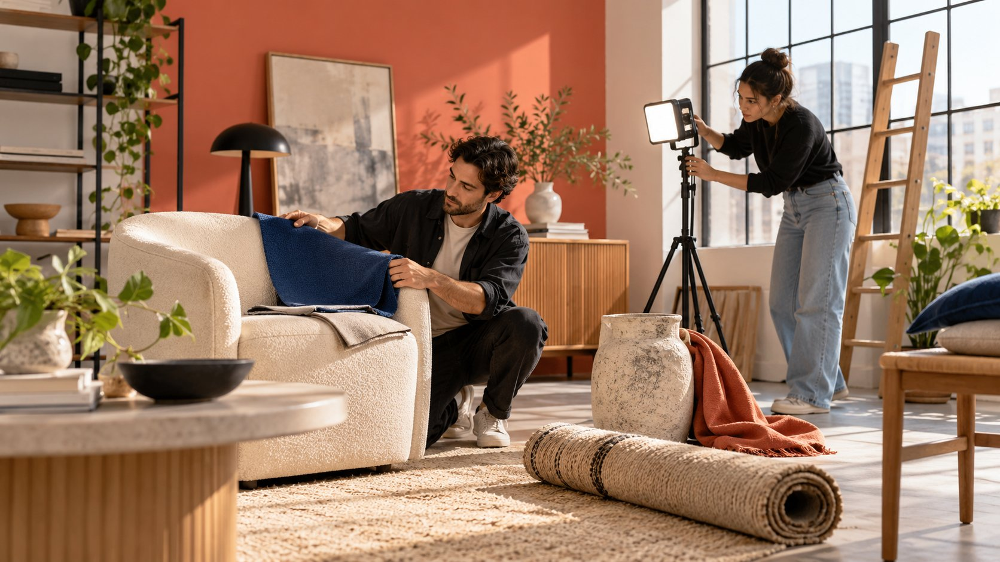

# Top Home Decor Influencers to Study for a Room-Reveal Timeline

Status: local review draft; confirm the publication date before release.

Study different home-content roles through Studio McGee, The Sorry Girls and Lone Fox, then plan installation, styling and reveal dependencies.

AI-generated editorial illustration, not an actual creator, client, product or event.

When researching top home decor influencers, match work to the design, making, styling and reveal stages of a room project, then verify availability, samples, installation and usage conditions. Studio McGee, The Sorry Girls and Lone Fox offer first-party entry points into different content approaches. They are not a live top-three follower ranking or confirmed partnership candidates.

## Translate home influence into project roles

A room reveal depends on design decisions, deliveries, installation, use, styling and filming. A creator skilled in complete-space storytelling may not fit a last-minute installation explainer. Someone who explains DIY steps may not be able to provide a finished room by the target date. Identify the missing role before selecting a person.

Separate the content job from construction responsibility. Showing installation does not establish that the creator has qualifications needed for the actual work. Confirm appropriate technical help, location consent and other conditions for the assignment. Supplying one product also does not give a brand control over the whole design or every other object in the room.

The [home decor project-fit guide](/blog/home-decor-influencers-project-fit/#answer) helps with initial selection. This article focuses on timing dependencies: what must be captured before installation, what needs actual use before it can be described accurately, and what happens if the reveal cannot occur on time. Research should identify relevant capability rather than place the largest accounts into one fixed list. The most useful candidate record links a work example to a particular stage the project needs, making the production reason visible to both the brand and the creator.

## Studio McGee: study spatial narrative and design context

The [Studio McGee official profile](https://www.studio-mcgee.com/about) provides context about the design studio and its related home brand. It is a useful starting point for studying how design storytelling places an individual product within a complete space. That commercial ecosystem does not establish openness to every competing brand, and self-description is not an independent audience-effectiveness audit.

Retain a public project relevant to the assignment and inspect how the product enters the rationale, material relationships and completed room. For furniture, lighting or surface-material brands, the important question may be which samples and facts are needed at the decision stage rather than only how the reveal photograph looks. Label your editorial observation and its evidence instead of describing an aesthetic as suitable for every premium brand.

If considering this kind of role, ask about design freedom, product fit, delivery and reveal dependencies. Highlighting one item may require other work to finish before the room is filmable. Put those conditions in the schedule rather than expecting the entire space to reorganize around a short promotional deadline after outreach. Public work research and accepted collaboration are separate states. The profile supplies an entry point, while the particular project still needs direct discussion through an appropriate public business route.

## The Sorry Girls: study the process as content

[The Sorry Girls official profile](https://www.thesorrygirls.com/about-us) describes a public direction spanning DIY, interior design and education. It provides a route for researching how making and transformation are explained, rather than treating creative as a complete partnership rationale. This article does not use historical scale statements on the site as current platform counts or infer that the team can perform construction in the reader’s city.

Retain a relevant making example and note which steps are visible, which materials must be prepared and where choices are explained. For tools, storage or materials, the process may answer an audience question better than a final placement. Genuine making still needs testing, a suitable location and time. A few minutes of finished footage are not the complete production workload.

Specify whether the brand wants a demonstration, transformation narrative, publication or asset use. Confirm responsibility separately for work requiring appropriate professional support. A DIY video appearing straightforward does not justify asking a creator to repeat it in unsuitable conditions. The process is valuable when understandable and accurate, not when every transformation is made to appear free of cost and limitations. Research the explanation quality and operational requirements together before deciding whether the role fits.

## Lone Fox: study details, styling and room transformation

The [Lone Fox official profile](https://lonefox.com/pages/about) introduces Drew Michael Scott and a public direction involving DIY room decor, makeovers and organization. It is an entry point into a creative approach, not proof of present availability, rates or audience geography. Verify those separately through an appropriate first-party route when required.

Choose a detail task related to the product, such as how a lamp enters a reading corner or how storage works within an existing space. Record explanations actually visible in the work. Do not infer unseen installation, long-term durability or commercial outcomes. An appealing arrangement does not establish that every size, material and room condition can reproduce it.

A similar role may require trial placement, alternatives, color decisions and adjustments before filming. Sample arrival is not the same as reveal readiness. Check dimensions, condition and the rest of the setting. Asking what happens when a product does not fit is more useful than requiring guaranteed inclusion in the final room. A brand can still commission a clear demonstration while acknowledging real design choices. Use that discussion to determine whether the content should concern one object, a styling decision or a more involved transformation with additional dependencies.

## Schedule installation, styling and reveal separately

For each product, record decision cutoff, sample confirmation, delivery, installation, use checks, styling and filming conditions. Some footage must be captured before installation; some conclusions require actual use. Ask the creator and operators to confirm the sequence instead of having the brand construct an apparently feasible schedule alone.

The [creator sample logistics guide](/blog/influencer-product-seeding-logistics/#answer) helps check delivery, receipt, condition and exceptions. Large objects may also require access, handling, storage and packaging arrangements. Confirm what applies rather than assuming the creator handles everything alone. If damage or a wrong item arrives, assess effects on accuracy and timing before choosing replacement, an alternative or delay.

Separate a fixed business moment from a movable reveal. If the room is unfinished, discuss an accurate process assignment without framing a partial view as a completed space. A changed format requires agreement on scope and costs. The timeline should allow facts to change the plan rather than silently transferring waiting and extra work to production. That distinction is especially useful when a product promotion has an immovable deadline but the space depends on several suppliers beyond the creator’s direct control.

## Keep conditions around product use and claims

Looking good in a room does not verify durability, energy savings, load capacity or another performance claim. Separate brand evidence, creator observation and aesthetic preference. If the assignment only shows styling, describe that scope accurately instead of using captions or imagery to imply tests that did not happen.

The [FTC disclosure guidance](https://www.ftc.gov/business-guidance/resources/disclosures-101-social-media-influencers) discusses material brand relationships in the US context, including support beyond cash. Check samples, discounts and other support against the actual relationship and applicable market. Consider platform labels, the video and its description. Lack of a production fee does not automatically make a supplied item irrelevant to disclosure.

Agree on the boundary between product fact review and creator judgment. Model, material and supply information should be accurate, but checking those facts does not purchase a mandatory positive verdict. Preserve conditions and experience time, particularly when a long transformation becomes a short advertisement. Clear claims and relationship explanations are part of making the material reusable by another team. Review the final derivative rather than assuming the original long-form context follows it into every placement, since a standalone reveal image may leave important information behind.

## Index reuse and changes after the reveal

Confirm whether the brand receives masters, stills, clean audio or other files, and where they may be used across accounts, markets and purposes. A published reveal does not establish unlimited reuse of every source clip and room photograph. Expiry, stock changes or a new model may also require updates to older sales material.

Index actual files, versions and usage locations. If the space contains other people’s works, music or third-party assets, check those conditions rather than only the creator’s appearance permission. Specify advertising, retail-partner and owned-site use separately so an internal forward does not become presumed permission for a new purpose.

If the brand later wants a use update, confirm timing, product condition and scope as another assignment rather than assuming permanent follow-up belongs to the original room project. Future content wishes can remain opportunities without becoming accepted deliverables. A clear index supports ongoing asset management and reduces repeated requests for the creator to reconstruct old terms. It also makes it possible to find affected placements if a factual detail changes after the room reveal, rather than leaving outdated product claims inside an attractive image that continues circulating.

## Make the shortlist decision from a room task

Suppose a lighting brand needs to explain a reading-corner choice. It can study full-space storytelling, process explanation and detail styling, then select the missing role. A shared home decor label does not justify sending all three the same request for a complete room transformation. This is a planning illustration, not an indication that any named creator is interested.

For candidates, retain relevant work, task rationale, conditions to verify and the next inquiry. If time and budget support only one-item explanation, narrow the scope. If the work must await room completion, preserve dependencies instead of promising an unsupported reveal date. A shortlist should display unknowns rather than fill every field with estimated followers, rates and availability.

Hand over a task record that can support production, not just attractive account links. Include role, sample, filming stage, facts, disclosure, permissions and stop conditions. Explain top through fit for the actual work. Public recognition provides a research lead without replacing verification of this assignment. The decision becomes more useful when another colleague can see exactly why a particular content approach was selected and which unresolved condition must be answered before outreach becomes a commitment.

## Research routes and project stages

| First-party entry | Content role to study | Verify separately |

| --- | --- | --- |

| Studio McGee | Whole-space and design narrative | Product fit, commercial conflicts and dependencies |

| The Sorry Girls | DIY process and making explanation | Testing, execution responsibility and location |

| Lone Fox | Decor details and room transformation | Sample condition, styling and filming readiness |

Selected for editorial research, not a live ranking, endorsement or partnership commitment.

## Room-reveal preparation

Confirm the role through project stages.

- [ ] Locate the task in design, making, styling or reveal.

- [ ] Retain specific work and selection reasons.

- [ ] Check samples, fit, installation and responsibility.

- [ ] Make dates follow actual dependencies.

- [ ] Separate performance evidence, experience and aesthetic opinion.

- [ ] Confirm disclosure, asset uses and stop conditions.

## Research date and limitations

Sources reviewed October 29, 2026. Methods and tables are editorial recommendations; hypothetical numbers are not industry benchmarks. Platform conditions can change. Named references are research entry points, not live rankings, endorsements or confirmed partnerships. This draft is in local preview; confirm its publication date before release.

## Sources

- [Studio McGee: About](https://www.studio-mcgee.com/about)

- [The Sorry Girls: About Us](https://www.thesorrygirls.com/about-us)

- [Lone Fox: Drew Michael Scott](https://lonefox.com/pages/about)

- [FTC: Disclosures 101 (US, 2019)](https://www.ftc.gov/business-guidance/resources/disclosures-101-social-media-influencers)
