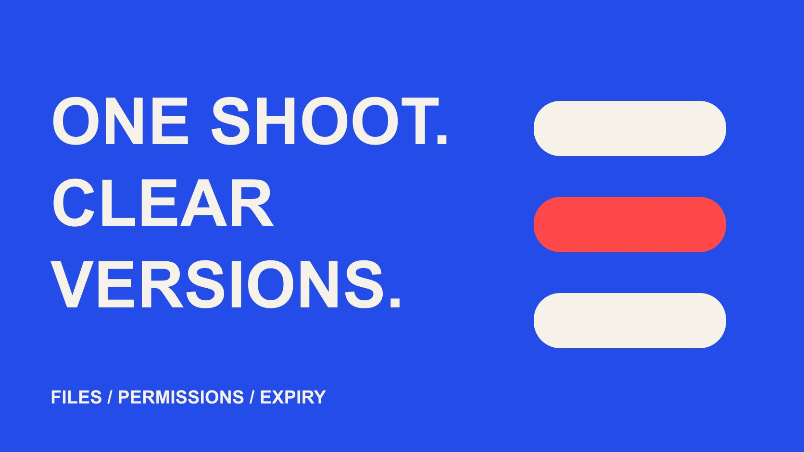

# UGC Creator 素材交接：剪辑版本、授权与到期管理

状态：本地审阅稿；正式发布日期待确认。

把 UGC 原片、剪辑版、使用许可和到期动作放进同一份版本索引，让后续复用保持清楚。

QuickKOL 编辑图形；不呈现真实账号指标或平台界面。

UGC creator 素材交接需要同时回答两类问题：这是什么文件，以及这个文件允许怎样使用。给原片和每个派生版本建立独立编号，记录批准状态、素材组成、使用渠道、地区、期限与到期负责人。文件已经下载、某版已经通过内容审阅，或平台已经授予数据访问，都不能替代对具体用途的许可确认。

## 从下一次复用倒推交接信息

拍摄验收完成后，素材往往继续流向剪辑、社交、媒体、地区团队和零售伙伴。最初知道条件的人可能已经离开项目。若文件夹只有“最终版”“最终版2”和一段散落的邮件，接手者很难判断哪一版能投放、是否包含过期音乐，或者能否改成另一种语言。

建立版本矩阵不是为了让每个小项目增加复杂系统，而是保留会改变使用决定的信息。先列出预计的后续用途，再决定必要字段。一个只做品牌自有账号发布的素材包，与需要多地区广告、字幕和零售分发的素材包，不需要同样数量的行，但都需要可辨认的文件和许可来源。

[内容付费使用排期指南](/zh/blog/influencer-content-licensing-paid-media-schedule/#answer)可以帮助整理用途与期限。让接收人用一个真实请求测试交接表：下个月能否把这个片段放进一条新广告？若必须翻遍聊天记录才能回答，就补上缺少的链接、负责人或条件。交接的目标是让决定可复核，而不是让所有字段永远显示绿色。

## 为原片和派生文件建立不同身份

原片、干净声音、带字幕成片、静帧和广告改版应分开标识。为每个文件保存项目、创作者、资产编号、版本、语言、画幅和导出日期。文件名可以简短，但索引必须能找到实际文件；不要只在文件名里堆满全部条款，也不要允许改名后失去原始对应关系。

派生版记录来自哪些素材。一次剪辑可能组合两个拍摄批次、品牌提供的动画和另一首音乐。不能因为某个原片允许使用，就假定整条组合视频拥有相同条件。保留组成关系，能在某段素材被更正、撤回或到期时找到受影响的版本，而无需重新手工查看全部视频。

素材交付不一定包含可编辑工程文件、原始拍摄、字体或全部音轨。把这些作为明确的交付范围协商，并检查项目文件能否在接收环境里打开。缺少素材时，记录可行的替代导出，不把“有工程文件”误当成“任何人都能完整重做”。一份可以定位并理解的简洁索引，通常比许多没有说明的压缩包更有价值。

## 把内容批准和许可批准分成两栏

内容批准说明一版作品的事实、表达和制作是否达到约定；许可批准说明它可以由谁、在什么地方、以什么方式、使用多久。这两项可能由不同人确认，也可能有不同条件。一个视频可以内容已批准、广告使用待确认，或者许可仍有效但产品事实已经过时。

[美国版权局版权说明](https://www.copyright.gov/what-is-copyright/)解释了原创表达受到版权保护的基础背景。实际的使用权限应看适用法律和项目约定，不能从“已经付费”或“收到文件”直接推出无限使用。这里的矩阵是运营记录，不是跨地区通用的合同，也不能替代对条款的适当审阅。

记录许可文件的位置、对应版本和批准人。若一个允许范围用自然语言写在邮件中，保留原始上下文，而不只复制一句可能失去条件的话。接收团队看到“待确认”时应有明确的询问路径和暂停动作。让未知保留为未知，比用一个笼统的“已授权”状态掩盖尚未谈妥的用途更可靠。

## 为音乐和其他组成素材保留独立条件

创作者出镜并不意味着视频里的全部内容都由其拥有。音乐、字体、品牌提供的图像、其他人的声音和背景作品可能有不同条件。接收前请对方指出哪些组成部分由谁提供，哪些只适用于特定平台或用途，以及是否存在需要替换的内容。

[TikTok 商业音乐库指南](https://ads.tiktok.com/resources/help/article/how-to-use-the-commercial-music-library?lang=en-GB)说明了商业音乐的地区和使用场景筛选。找到平台内可用音乐，不应被扩写成所有平台、所有地区和所有期限的无限许可。若品牌准备把视频转到其他渠道，另行确认当前允许的使用范围；不要因为导出文件里已经带着音乐，就把它视为一个无法拆分且已经全面清除权利问题的包。

必要时准备干净声音版和无音乐版，但也要确认它们在实际交付范围内。更换音乐可能影响节奏、字幕时点和内容含义，应形成新版本并重新核对。矩阵可以把待替换音乐标在组成层，再连接受影响成片。这样媒体团队不会在换一首歌后，继续使用已经失效的旧批准记录。

## 把平台访问与广告设置单独核对

平台上的品牌伙伴访问、数据共享和广告设置，不等于同一份许可。[YouTube 品牌伙伴访问说明](https://support.google.com/youtube/answer/15672082?hl=en)介绍视频级数据共享，并提醒双方另行讨论内容使用权。运营记录应把“能看报告”“平台设置已完成”和“具体广告用途已约定”分别显示，避免技术上可操作被误解成商业上已经允许。

给每种平台设置记录账号、授权对象、负责人、期限与撤销条件，不在矩阵里保存密码或访问令牌。一个授权可能只关联某条发布内容，而品牌后来制作的文件广告是另一个对象。核对实际投放方式和素材版本，不能只复制前一项目的绿色状态。

上线前让媒体负责人确认设置，让内容负责人确认版本，让商业负责人确认范围。若平台访问撤销，应检查报告和投放影响；若内容许可到期，也应检查允许保留哪些记录。两者有时同时变化，有时独立变化。清楚记录不同状态，能减少团队在平台按钮与合作承诺之间作错误推断。

## 为剪辑与翻译建立变更规则

提前约定哪些修改可直接进行，哪些需要再次确认。仅调整画幅，也可能裁掉使用条件、披露或演示中的重要细节；翻译可能改变技术词、语气和产品主张。不要用“只是小改”代替对实际影响的判断。把规则与用途关联，而不是单凭修改花了几分钟决定。

给新版本记录变更内容、修改人、日期和需要的批准。例如，产品型号变化需要事实核对，加入新的促销价格需要确认市场与时效，将自然体验改成广告文案则需要重新检查表达和使用范围。未经确认的声音合成、形象修改或其他明显改变创作者表达的处理，不应藏在一般剪辑字段里。

[UGC 创意测试指南](/zh/blog/creator-ugc-testing-plan/#answer)可以帮助安排有目的的版本变化。一次只改一个因素有时方便比较，但它不使未经许可的变化变得允许。为测试版明确假设、用途和退出条件，再把批准结果写回索引。这样实验不会留下许多不知道能否复用的散落成片。

## 在到期前找到所有实际使用位置

到期管理需要知道素材在哪里使用，而不仅是合同何时结束。记录品牌账号、广告、网站、销售资料、地区伙伴和其他实际分发位置。不要假设关停一条广告就等于所有使用已经结束；同一素材可能已经被另一个团队重新上传，或者出现在长期保留的页面中。

安排到期前的检查负责人和动作。根据约定，动作可能是申请续期、停止新增使用、替换页面素材或撤下相关版本；不要在没有依据时把所有项目套成相同撤除规则。保留决定、执行日期和受影响位置，让接手者知道哪些工作已完成，哪些仍在等待。

续期也应确认具体素材和范围。原片继续保留在内部档案，与继续对外发布可能是不同事项；新的地区、零售伙伴或广告用途也可能需要重新讨论。若某些位置无法立即完成处理，明确升级到有权的人，而不在表格里先标“已关闭”。一个真实的待解决事项，比过早结案更利于管理。

## 用一次真实请求测试版本矩阵

假设品牌收到一条已批准的竖版产品演示，原用途是品牌自有社交账号。两个月后，地区团队想剪成横版广告并增加当地价格。这是一个假设情景，不说明某种授权必定可得。接收人应先找原文件和许可，再核对画幅变化、价格事实、地区、广告方式与音乐条件。

若横版裁切会丢失关键演示，需要重新剪辑或另拍；若音乐不适合新的使用场景，准备替换；若许可没有覆盖该用途，先谈条件。完成后生成新编号，把修改、批准、许可和投放位置连回原片。原版本仍保留自己的状态，不直接被新版本覆盖。

最后让未参与原项目的同事回答：哪一版能用、由谁确认、何时再检查？能够回答才说明交接有效。矩阵不需要承诺永不出错，但应让不确定性暴露得更早。品牌获得的是可管理的内容资产，而创作者的表达和约定也不会在反复转发中失去边界。

## 文件、许可与使用位置矩阵

| 层级 | 必要字段 | 发生变化时 |

| --- | --- | --- |

| 原始素材 | 编号、组成、文件与交付范围 | 定位所有派生版 |

| 剪辑版本 | 修改、语言、画幅与批准 | 重新核对受影响内容 |

| 使用许可 | 主体、渠道、地区、期限与证据 | 暂停未确认用途并询问负责人 |

| 实际使用 | 位置、执行人、期限与处理动作 | 更新或停止相关位置 |

表格用于运营索引，具体权利与到期动作以适用约定为准。

## 素材交接检查

用下一次复用请求验证记录是否完整。

- [ ] 原片和每个派生版都有可定位编号。

- [ ] 内容批准与使用许可分别显示。

- [ ] 音乐与其他组成素材保留条件。

- [ ] 平台访问与广告设置已单独核对。

- [ ] 新剪辑与翻译有变更和批准记录。

- [ ] 到期前能找到实际使用位置与负责人。

## 研究日期与使用边界

资料核验于 2026 年 10 月 29 日。本文方法与表格为编辑建议，标明为假设的数字不是行业基准。平台条件可能变化，具名对象仅为公开研究入口，不代表实时排名、背书或已接受合作。稿件处于本地预览阶段，发布日期待正式发布前确认。

## 来源

- [美国版权局：What is Copyright?](https://www.copyright.gov/what-is-copyright/)

- [TikTok：How to Use the Commercial Music Library（2026年7月）](https://ads.tiktok.com/resources/help/article/how-to-use-the-commercial-music-library?lang=en-GB)

- [YouTube 品牌伙伴访问说明](https://support.google.com/youtube/answer/15672082?hl=en)
