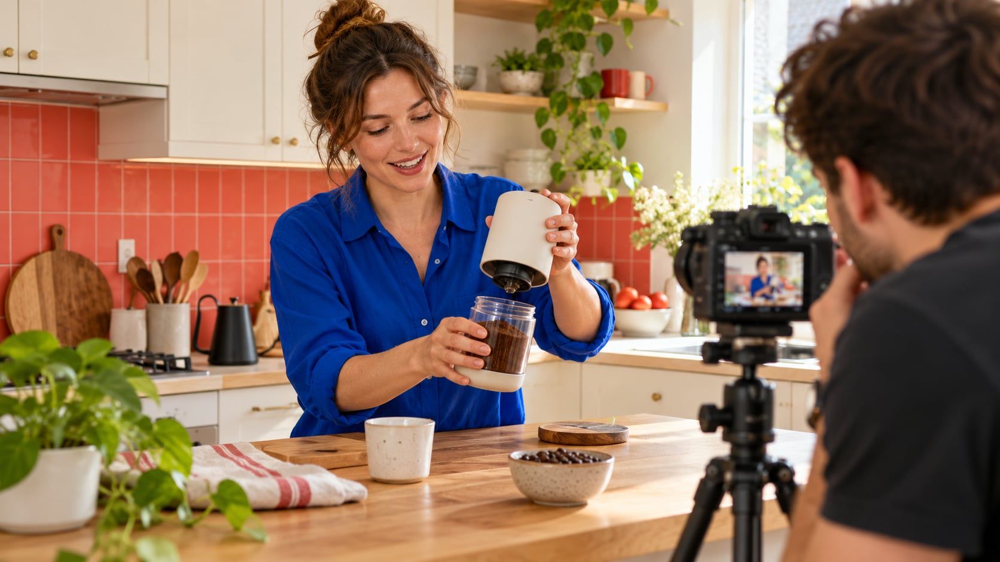

# 如何委托 UGC Creator 制作产品演示：从试用到验收

状态：本地审阅稿；正式发布日期待确认。

把 UGC Creator 委托拆成真实试用、镜头任务、使用许可与交付验收，让品牌买到可以实际使用的产品演示。

AI 生成的编辑示意图，不是真实达人、客户、产品或活动。

品牌委托 UGC Creator，通常是在购买创作者制作的产品内容；是否包含创作者账号发布、广告投放和后续剪辑，需要分别约定。先明确产品需要解释的一个使用问题，让创作者实际试用，再把事实、镜头、交付格式、许可范围和验收方式写进 Brief。自然的表达来自真实理解，而不是假装没有商业关系。

## 先分清你买的是素材还是传播

“UGC”在这里描述创作者参与制作、具有日常使用语气的内容，不代表这段内容一定是未经委托的顾客自发评价。品牌购买一个视频文件，与购买创作者在个人账号发布同一视频，承担的是不同任务。前者需要内容质量与许可，后者还涉及传播位置、发布时间和账号受众证据。不要因为两者都由同一个人完成，就把发布当作免费附带服务。

用一份[创作者工作说明清单](/zh/blog/creator-contract-scope-checklist/#answer)，把制作、发布、广告使用和原素材交付分别列项。没有创作者账号发布时，粉丝量可以不是核心筛选条件；示范是否清楚、表达是否可信、是否能按要求录到产品细节，往往更直接。反过来，若需要账号分发，就不能只看作品漂亮，还要检查该账号的受众与发布历史。

尤其要区分“像顾客说话”与“冒充没有利益关系的顾客”。[FTC 背书问答](https://www.ftc.gov/business-guidance/resources/ftcs-endorsement-guides-what-people-are-asking)在美国广告背景下解释了商业背书及品牌关系问题。本文的采购划分是编辑建议，并不把某种镜头风格当作豁免披露的理由。先确认内容会出现在哪里，再确定合作范围；这会同时改变选人、预算和审核方式。

## 把产品问题写成可拍摄的任务

不要只写“拍一条真实、有转化力的视频”。先说明观众要完成什么理解：这个杯盖如何拆洗、软件如何交接一个任务，还是背包放进储物柜是否方便？一个主问题通常比罗列十个卖点更容易形成连贯演示。对于技术或 B2B 产品，观众可能需要看懂步骤和适用条件，下一步也可能是申请演示，而不是立即下单。

Brief 至少写清目标观众、现有疑问、必须出现的产品动作、可以核验的事实、不能暗示的效果和一个下一步。把“展示可拆洗部件”与“宣传永不漏水”分开，后者需要品牌提供足够证据，不能让创作者靠自己的表达填补。需要完整结构时，可参考[可执行的达人 Brief 指南](/zh/blog/write-a-useful-campaign-brief/#answer)，再删掉与本次素材任务无关的发布要求。

同时写验收句子，例如“观众能看清开启、取出、重新安装三个动作，字幕不遮住连接位置”。它比“感觉更高级”更容易讨论。确认适用环境、照明和演示道具由谁提供；若需要另购手机、特殊接口或软件权限，先解决条件，再开始计算交付时限。

## 先试用，再决定能说什么

安排创作者拿到正确型号、说明书和可正常使用的样品，并确认收到与开始试用是两个状态。寄件成功不代表对方已经有足够体验。若产品需要安装、适配或持续使用，交期从条件具备后计算；无法完成的体验要改成开箱、功能演示或品牌提供的事实说明，不能保留一段虚构的长期评价。

[FTC 披露指南](https://www.ftc.gov/business-guidance/resources/disclosures-101-social-media-influencers)要求背书符合真实体验，并处理有价值的品牌关系，这是美国背景的规则参考。品牌自己的操作建议是：让创作者反馈困惑、缺件和不符合预期的地方，再决定拍摄主题。发现问题不等于合作失败；它可能暴露说明书、使用场景或产品本身需要修正的地方。

对容易被剪辑改变含义的语句特别谨慎。“我今天完成了安装”不能被重写成“任何人都能几分钟搞定”。保留适用条件，不让画面暗示未证实的医疗、财务或性能结果。体验存在分歧时，允许提出可拍的客观任务或结束项目，并按已经完成的工作和双方约定处理费用，而不是要求对方把负面体验读成肯定评价。

## 用作品样本核对制作能力

初筛可以看完整作品，而不只看作品集最强的三秒。检查镜头能否让观众看懂动作，收音是否清楚，字幕与产品细节是否冲突，讲解是否在关键处给出足够时间。把候选人放进同一个任务讨论，不用不同题材的公开视频播放量直接排名，更不要要求多位创作者免费提交完整可用广告。

可采用小型付费试拍，明确测试段落、费用、使用边界和是否允许投放。试拍的目标是解决一个制作不确定性，例如拍清反光材质上的接口，而不是用测试名义购买一整套营销方案。如果只提供拍摄描述和作品链接就能判断，也不必增加试拍负担。

把偏好和必要条件分开。某人习惯快速剪辑，未必适合需要慢速展示的组装步骤；口音、布景与服装则应与目标观众和品牌事实相关，而不是变成无关的个人筛选。问对方会如何解释困难步骤，以及需要哪些条件，通常比要求模仿另一位创作者的每个动作更有价值。保留两三项与任务相关的选择理由，方便后续复盘。

## 把许可写成可执行的使用范围

文件交付、版权归属和使用许可是不同问题。[美国版权局版权说明](https://www.copyright.gov/what-is-copyright/)介绍原创表达与权利人的授权；具体合同仍应按适用地区和项目处理。品牌不要把“付过钱”“给了原片”或“UGC”这几个字，当作永久、全球、任意修改与转授权的自动许可。创作者也需要知道内容是否会离开原定平台或被其他公司使用。

将使用方、渠道、地区、期限、剪辑方式、字幕翻译、广告投放和续期分别确认。是否允许把真人演示剪成另一种评价，是否包含原始素材和音乐，是否能交给零售伙伴，都应写具体。创作者账号下的广告授权还要核对平台条件，不能因为文件可以下载就默认已经具备账号投放权限。

保留一个可以交给媒体与剪辑团队的许可记录：素材标识、允许用途、开始结束日期、批准联系人、限制和证据位置。许可与技术规格都确认后再安排制作，减少拍完才发现素材不能用的情况。超出范围的需求应重新讨论，不让剪辑人员根据一句“客户需要”自行扩大合作。

## 让拍摄与修改有清楚的验收点

在拍摄前确认提纲、必须出现的动作和事实；在正式成片前确认关键镜头是否能看清；在最终交付时检查内容和技术文件。每一轮设置一位汇总意见的人，避免品牌、代理、产品与销售分别向创作者发送互相冲突的改动。不是每个项目都需要逐镜头审批，检查点应针对真正难以返工的内容。

把事实错误、漏拍、风格偏好和新增范围分开。产品型号读错、约定动作缺失属于不同于“我们现在想换一个场景”的问题。约定修改轮次、反馈格式、回复窗口和补拍条件。产品迟到、品牌改版或样机故障造成的延期，也应在记录里保留原因，而不是统一归为创作者迟交。

最终文件检查画幅、分辨率、字幕位置、声音、片尾动作和文件命名。需要无字幕版本、独立字幕文件或静音版时，事先列入交付，而非默认所有项目都包含。让一个不熟悉产品的人观看后复述步骤，能帮助发现说明跳跃；这是一项小型理解检查，不应被包装成用户研究或销售效果验证。

## 比较完整费用，而不只比较视频单价

下面是假设采购算例，不是创作者市场报价：方案 A 的制作费为 600 美元，限定使用许可 200 美元，寄样与制作附加成本 100 美元，共 900 美元；方案 B 报价 750 美元，已包含同样范围的许可，但还有 100 美元附加成本，共 850 美元。只有在工作内容、交付、期限和税费处理一致时，两个总数才适合比较。

如果 A 包含两条真正独立的视频而 B 只有一条，就不能只凭总价选便宜者。也不要把一次拍摄导出的六个尺寸都称为六个独立创意。将拍摄任务、创意数量、剪辑变体、发布与授权分别比较，列出明确未包含的费用，如加急、额外补拍或后续续期。

评估也要考虑使用条件是否已经解决。一条技术上合格、却需要重新谈音乐和广告范围的视频，可能增加排期成本。对长期采购，可以记录交付准时性、修改原因和可用素材比例，但不要用一次主观打分永久判断创作者。预算表用于支持选择与说明取舍，不应制造对未来观看或转化的保证。

## 交接完成，才算素材可投入使用

给最终素材分配稳定标识，关联已批准版本、许可记录、字幕和下一步使用人。不要只把文件丢进聊天群，然后让媒体团队猜哪个版本可以投放。公开使用前确认与当前产品版本一致，链接指向正确页面，必要披露没有在裁切或加字幕时被遮住。

安排明确的验收状态：待核对、接受、需修正、超出范围或暂停。接受表示满足本次约定，不意味着证明了商业回报。后续投放测试应有自己的目标、窗口和比较方法；一段素材在不同受众、出价和页面条件下的表现，不能全部归因于创作者。把测试反馈写成可操作的说明，例如哪一步观众仍然看不懂。

如果要继续合作，先问本次素材留下了哪个未解决的问题，再安排下一条内容。可能需要补充一个细节镜头，也可能需要另一种使用场景，而不必重拍整套流程。QuickKOL 可以帮助整理需求、研究相关创作者并准备个性化联系；实际产品体验、许可与交付仍由合作双方确认。一个清楚的结束状态，也为下一次委托保留了可信的起点。

## 素材委托的四类购买项

| 购买项 | 必须确认 | 不能默认 |

| --- | --- | --- |

| 内容制作 | 演示任务、成片、格式与验收 | 包含账号发布 |

| 账号发布 | 账号、位置、时间与披露 | 粉丝都看到 |

| 后续使用 | 渠道、期限、地区与修改 | 无限广告许可 |

| 原始素材 | 文件、音乐与可修改范围 | 文件等于版权转让 |

编辑采购框架，不是统一合同或行业报价。

## 发出委托前的确认清单

每项都应有双方能复核的记录。

- [ ] 把产品问题写成一个可拍的动作。

- [ ] 确认试用条件和真实体验。

- [ ] 分别确认制作、发布、许可和原片。

- [ ] 指定一位反馈汇总人并定义修改范围。

- [ ] 将获准素材与许可记录一起交接。

## 研究日期与使用边界

资料核验于 2026 年 10 月 29 日。本文方法与表格为编辑建议，标明为假设的数字不是行业基准。平台条件可能变化，具名对象仅为公开研究入口，不代表实时排名、背书或已接受合作。稿件处于本地预览阶段，发布日期待正式发布前确认。

## 来源

- [FTC：背书指南问答](https://www.ftc.gov/business-guidance/resources/ftcs-endorsement-guides-what-people-are-asking)

- [FTC：Disclosures 101（美国，2019）](https://www.ftc.gov/business-guidance/resources/disclosures-101-social-media-influencers)

- [美国版权局：What is Copyright?](https://www.copyright.gov/what-is-copyright/)
