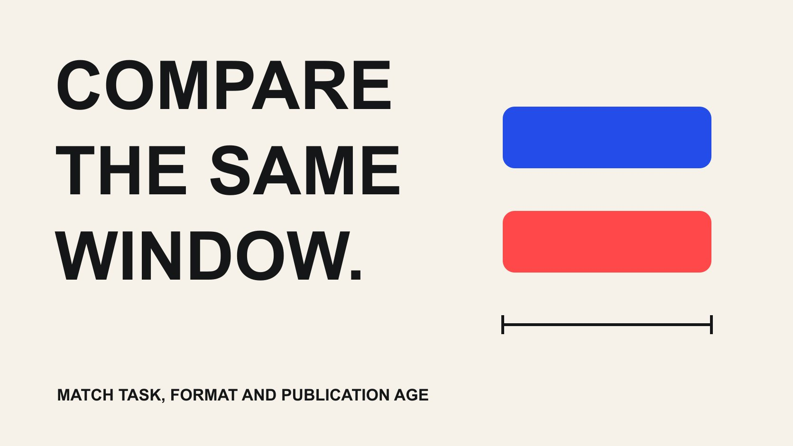

# YouTube Analytics 品牌报告：用可比内容组评估合作

状态：本地审阅稿；正式发布日期待确认。

用任务相近、格式一致和发布年龄可比的内容组阅读 YouTube 合作表现，保留筛选理由与缺失信息。

QuickKOL 编辑图形；不呈现真实账号指标或平台界面。

YouTube Analytics 合作比较组，是按事先说明的任务、格式和条件选择的一组视频，用来提供描述性背景。先统一比较窗口、发布年龄、指标和数据来源，再查看表现。可比内容并不等于随机对照；即使赞助视频高于某个组的中位数，也不能单独证明品牌合作造成了提升。

## 从报告决定选择比较对象

品牌可能想知道一次教程合作是否值得继续，也可能想判断解释结构是否需要调整。这两个决定不一定需要同一比较组。前者关注类似合作任务与投入，后者可能更需要同频道的相近教程。先写决定，再找视频，避免看到高低结果后才挑选有利的参照。

[YouTube Advanced Mode 指南](https://support.google.com/youtube/answer/9717005?hl=en)说明可以筛选、比较和导出报告，并组织内容组。功能提供分析入口，不会自动替团队定义公平比较。给每个入选视频写一句理由，也保留排除理由，例如直播、抽奖、产品发布新闻或明显不同长度。不要把所有未赞助视频都当成天然对照。

优先在同频道、相近任务和格式里寻找背景，再根据证据决定能否扩展。跨频道可能存在受众、分发和制作差异，不能只因为题目相似就合并。一个小而透明的内容组，通常比数量很多但选择逻辑不清楚的平均值更容易被负责人复核。

## 给内容组写清进入和排除规则

规则可以包括主题任务、内容形式、时长范围、语言、发布时间范围、是否赞助和已知付费支持。它们是本次分析的编辑选择，不是平台统一标准。先解释为什么这些条件会影响比较，再决定保留哪些；字段越多并不保证越公平，也可能把样本筛得只剩最有利的几条。

保留视频标识、标题、发布日期、格式、内容任务、已知活动背景和证据位置。赞助关系不明时写未知，不能仅凭口播风格推断。若使用历史合作报告，要核对来源与窗口，不让公开总观看与私有特定时期数据混在同一列。

固定初始组后，如果确需调整，保存新版本和理由。一个异常高值可能来自新闻事件、主题需求或其他条件，也可能无法解释；它不应仅因为影响结论就被删除。可以同时报告全组和有明确排除理由的敏感性版本，但让读者看到选择如何改变描述，而不是只留下最漂亮的结果。

## 区分日历窗口与发布年龄

同一自然月内，月初发布的视频可能拥有比月末视频更多积累时间。比较截至今天的累计观看，容易把发布年龄差异误读为内容优劣。先决定问题需要“某月贡献”还是“发布后同样长时间的表现”，不要用同一个表同时回答两件事。

若采用发布后窗口，写清起点、时区、持续时间与截止方式。可以在可用数据允许时整理相同发布年龄的观察，但不能承诺所有账号或报告都能恢复任意历史窗口。没有早期记录时，保留可用的范围，不根据当前总量倒推过去某天的数值。

[YouTube 留存与观看时间指南](/zh/blog/creator-retention-watch-time/#answer)可以帮助深入单条视频的解释。比较组层面还要记录曝光环境、发布时间和付费支持等差异。相同发布年龄减少了一种混淆，并不让所有视频获得同等推荐机会。报告里把时间一致性写成比较条件，而不是当作已经建立因果对照的证明。

## 按指标定义选择可比较的列

观看次数、观看时长、平均观看时长、订阅变化和受众估计不能相互替代。先记录字段的对象、单位、窗口和来源，再讨论哪项最接近内容任务。较长视频可能积累更多时长，较短内容也可能有不同观看方式，不能用单个数字替代全部质量判断。

[YouTube 受众说明](https://support.google.com/youtube/answer/9314416?hl=en)介绍的 monthly audience 使用过去 28 天的受众窗口。它不是某条视频的粉丝国家报告，也不是把同组视频人数直接相加得到的独立人数。跨视频的同一观众可能重复出现；若没有合适的去重口径，明确不报告“总共多少不同的人”。

给报告里的比率保留计算定义。如果采用自己计算的描述性比率，写明分子、分母和单位，不冒充平台默认指标。可用字段随权限和报告变化，先确认实际数据，再定报表。[合作衡量指南](/zh/blog/creator-campaign-measurement/#answer)可帮助把指标对应到业务问题，避免每次导出多少列就把多少列都塞进结案页。

## 用分布和样本数解释组内差异

平均值容易受到一条高观看视频影响，中位数也会隐藏组内差异。报告组内条数、最小和最大观察，以及采用的汇总方式。不要把中位数自动叫作基准线；这只是所选内容组在所选窗口下的描述，不一定代表该创作者长期表现。

假设三条可比视频的观看为 1,000、1,200 和 10,000，中位数为 1,200，平均值约为 4,067。这个假设说明汇总方式为什么改变读者印象，并不是频道数据或行业目标。任何一条赞助视频超过 1,200，都不能因此被称作由赞助产生的增量。

若样本很小，直接展示逐条记录可能比复杂分数更诚实。不要给几条作品算一个看似精确的预测成功率。检查极端值是否存在可核验背景，并保留未知。负责人需要知道结果是否由一个特殊内容主导，以及下一次应该保留哪种解释或补充哪项证据，而不是只收到一个方便放进演示文稿的大数字。

## 导出时保留报告条件与文件版本

导出文件应附带日期范围、过滤条件、内容组版本、字段定义和导出时间。[YouTube Advanced Mode 指南](https://support.google.com/youtube/answer/9717005?hl=en)说明当前报告导出有行数限制；当结果很多时，检查导出是否覆盖计划对象，不因为拿到文件就默认完整。平台界面也可能逐步更新，交接应以实际报告设置为准。

原始导出与清理后的表分开保存。对改名、换单位、合并行、删除重复和排除数据保留处理说明，让另一位同事能复核。不要手工补造被限制或缺失的指标，也不要把工具导出里的空白批量改成零。若组内部分视频只有公开数据，应在来源层明确区分。

核对视频数量、日期边界和字段后，再生成面向业务的简洁报告。共享范围应与获得数据的授权相符，避免把不必要的私有受众信息广泛转发。原文件位置与接收人清楚即可，不需要把账号密码、令牌或无关个人信息放进项目附件。

## 把数据限制当作结论的一部分

[YouTube 数据限制说明](https://support.google.com/youtube/answer/9101241?hl=en)指出，部分数据会因可用性与隐私条件受限，明细也可能不与总数相加一致。缺失不是零，未显示地区也不表示该地区无人观看。不要自行创造统一的隐私阈值，或用差额推断某个小人群的身份。

如果业务要求的字段无法取得，说明这是否改变当前决定。也许内容质量判断仍可进行，但地区适配需要补充证据；也许原计划依赖的比较无法成立，应退回单条描述。清楚说明哪个结论仍可支持，比在最后加一句“数据仅供参考”更有帮助。

平台数据访问也应与素材许可分开管理。有人可以查看一条视频的报告，不意味着品牌能下载、剪辑或推广内容。合作方撤销访问后，更新报告状态与后续核验安排，不能让旧共享状态一直显示有效。报告的可信度包括对自己拿不到的信息作准确说明。

## 把比较结果转成下一次制作决定

结论采用“观察—解释边界—下一动作”的顺序。比如所选教程组里，一条作品在相同发布年龄下观看较高，但它同时覆盖了更热门的问题；下一步可以继续研究这个问题，不能直接宣布某位创作者一定比另一位有效。区分内容选择、制作方式和分发背景。

让下一动作对应实际可改条件：重写开头、补充操作演示、换一个问题、修正接收页面，或在下一合作前准备更完整的报告权限。不要要求创作者保证复制历史最高值。若决定继续合作，商业范围、费用和许可仍需重新确认，分析结果不是已经接受的新合同。

交付组清单、选择规则、窗口、原始来源、处理记录和有限结论。未参与分析的人应能理解为什么这些视频被放在一起，以及哪些差异仍然存在。比较组的价值，是提供透明背景来改善下一次判断，而不是把不相同的作品包装成一个精确排名。

## 公平比较组的条件记录

| 条件 | 记录 | 不应推导 |

| --- | --- | --- |

| 任务与格式 | 进入、排除规则及理由 | 主题相似就是可互换 |

| 时间 | 日历或发布年龄、边界与时区 | 相同年龄等于相同分发 |

| 指标 | 对象、单位、窗口和定义 | 观看就是独立人数 |

| 来源与限制 | 授权、导出设置与缺失 | 空白就是零 |

| 结论 | 样本数、分布与下一动作 | 描述差异就是因果增量 |

本表是描述性比较方法；不构成随机对照或行业基准。

## 交付比较组之前

让选择和计算可以复核。

- [ ] 先确定业务决定，再选择视频。

- [ ] 保存进入、排除规则与组版本。

- [ ] 统一窗口并标记不完整观察。

- [ ] 检查字段对象、定义和导出完整性。

- [ ] 显示样本数、分布和缺失条件。

- [ ] 交付有限结论与可执行下一步。

## 研究日期与使用边界

资料核验于 2026 年 10 月 29 日。本文方法与表格为编辑建议，标明为假设的数字不是行业基准。平台条件可能变化，具名对象仅为公开研究入口，不代表实时排名、背书或已接受合作。稿件处于本地预览阶段，发布日期待正式发布前确认。

## 来源

- [YouTube：Advanced Mode 报告与导出](https://support.google.com/youtube/answer/9717005?hl=en)

- [YouTube：Understand your audience](https://support.google.com/youtube/answer/9314416?hl=en)

- [YouTube：Understand limited data](https://support.google.com/youtube/answer/9101241?hl=en)
