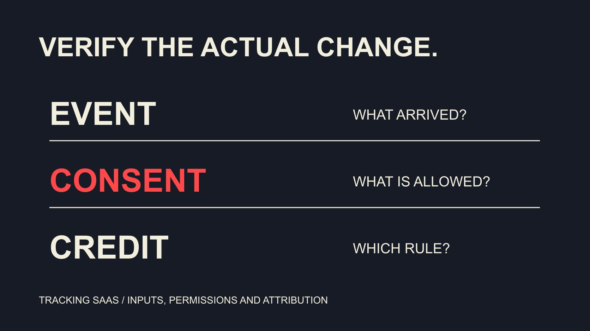

# Affiliate Tracking SaaS Trends: Verify the Actual Change

Status: local review draft; confirm the publication date before release.

Use first-party documentation reviewed November 2, 2026 to turn affiliate-tracking SaaS developments into testable procurement and migration requirements.

QuickKOL editorial graphic; not actual account metrics or a platform interface.

For current trends in affiliate tracking software SaaS, investigate implementable developments: server event delivery, explicit consent handling, explainable code attribution and transaction-lifecycle records. This is a review of official documentation as of November 2, 2026, not a survey of market adoption. A capability appearing in current documentation is not necessarily newly invented this year or available to every customer and plan. Translate each direction into inputs, rules, observable outputs and failure cases before deciding whether to migrate. The useful outcome is a tested requirement, rather than a list of fashionable labels or a promise to recover every missing conversion.

## Define what the trend evidence can establish

This review examines capabilities and requirements in specific product documentation. It does not establish coverage of all vendors or majority adoption among brands. A document’s update date establishes a current reference, but not necessarily the first release of a feature or market growth.

For a change record, name vendor, product, geography, plan, document date and review date. Compare before and after only when historical evidence is available. Otherwise say that current documentation describes the capability instead of inventing a migration history.

The [affiliate company-role guide](/blog/affiliate-marketing-companies-commercial-roles/#answer) helps identify buyer and implementer. If no technical owner exists, appoint one first. Replacing tracking with SaaS in a procurement brief does not make events reliable. Requirements should come from an observed gap. A trend review succeeds when it helps someone decide what to test, retain or replace, even if the existing system remains the appropriate choice.

This gives each capability a verifiable outcome and preserves specific questions for the supplier’s next response, instead of relying on a general assurance.

## Direction one: server delivery needs an event source

The [Awin server-tracking guide](https://help.awin.com/docs/server-to-server-tracking), published in March and updated in August 2026, explicitly scopes the page to Awin Classic and describes sending conversion information from servers. It provides a concrete implementation reference rather than universal configuration instructions for every system.

Ask which business event triggers delivery: order creation, payment or another state. Establish who supplies event identifier, currency, amount basis, timestamp and partner association. If several routes send the same event, arrival twice should not silently become two orders.

Server delivery can reduce reliance on some browser paths without eliminating missing data, errors or privacy responsibilities. Do not convert a vendor’s reliability language into your own claim of perfect accuracy. Verify inputs and results in permitted scenarios. The test should distinguish an event that never existed, an event not sent and an event received but rejected, because these require different repairs.

## Direction two: make consent state an explicit input

[Shopify pixel-privacy documentation](https://shopify.dev/docs/api/web-pixels-api/pixel-privacy) describes loading app pixels according to their declared visitor-permission requirements and provides interfaces for consent-state changes. This concerns a particular technical behavior, not a declaration of global legal compliance for a project.

Record required permissions, where state is read, when it updates and what should happen without the relevant permission. An absent event is not automatically a tracking defect. Do not bypass a visitor’s choice merely to fill a report.

The appropriate privacy owner reviews purposes, notices and data scope; engineers verify implementation and outputs. These roles can work together without treating a technical checkbox as the whole decision. Retain configuration versions after launch so a record difference following a change can be investigated. The procurement question is whether the system exposes the behavior your team needs to verify, rather than whether its marketing page uses a reassuring privacy label.

## Direction three: code attribution needs explainable rules

The [impact.com promo-code FAQ](https://help.impact.com/brand/what-would-you-like-to-learn-about/platform-features/promo-codes/promo-codes-faq) distinguishes coupon advertising from tracking codes with crediting logic, explaining that setup and other attribution rules affect results. Code use and a partner’s final commission are therefore different facts.

The [discount-code attribution guide](/blog/influencer-discount-codes-offer-attribution/#answer) separates the customer offer, partner credit and settlement. In a SaaS evaluation, ask to inspect the applied rule, its version and the review route rather than accept a column labeled attributed sales as a complete explanation.

More attributed records do not establish more incremental sales. A configuration change may alter allocation or improve observation. Procurement material should separate record completeness, contractual payment and marketing causality so one feature does not carry three incompatible promises. The team needs to know whether a change improves its evidence, changes its commercial policy or both. These are legitimate but different reasons to adopt a capability.

## Direction four: inspect the transaction lifecycle

The following is an editorial procurement recommendation, not a claim that all products offer the feature. Beyond the first conversion, request a demonstration of cancellations, refunds, corrections and disputes, including the relationship between the original event and later states.

The [EMV and ROI field guide](/blog/influencer-emv-roi-calculation-field-dictionary/#answer) explains why different quantities cannot be added indiscriminately. Amounts in a tracking system also need definitions: list price, discounted amount, tax-inclusive amount, commission base and recognized revenue may differ. One purchase field should not explain all business value.

If the system exports only the final state, establish whether that supports reconciliation. If it retains event history, explain how historical and current records avoid being counted together. More fields add value only when they help answer a question. An understandable export with documented state transitions can be more useful than a dashboard with many unexplained totals.

## Use a test matrix beyond the happy path

Prepare fictional cases for a normal order, duplicate event, delayed arrival, cancellation, partial refund, code-and-click conflict, absent relevant consent and missing field. The aim is not to impose one architecture on every project. It is to establish expected behavior for the applicable situations.

For each row, record input, rule, expected state, observable evidence and owner. Mark unsimulated cases unverified rather than announce complete success because one button worked. Authorized personnel should handle cases requiring account permission or actual transactions through the project’s normal process.

Retain the same case definitions across vendors while allowing them to explain limitations. A clear limitation can support a better decision than an unexplained promise to handle everything. For an unsupported essential case, decide explicitly whether to accept the gap, add a complementary process or stop the proposed migration.

## Explain differences between old and new records during migration

If migration is justified, retain rule and field mappings before planning an appropriate verification window. When systems show different totals, check period, currency, order status, duplication and attribution rules before declaring the new system inherently more truthful.

Parallel observation does not mean paying the same commission twice. Separate technical comparison from payment control and assign an owner. Partners need to know when to change links or codes and how earlier transactions will be treated.

In a hypothetical difference, the new system groups by payment time while the old groups by order-creation time. Aligning the window may explain the totals without changing a transaction. The example shows why migration learning should explain a difference before prescribing a repair. Keep unresolved differences visible, with the records needed to investigate them, instead of hiding them in an adjustment row nobody can reconstruct.

## Test three promises with one fictional order

The following is an editorial verification exercise, not an actual transaction or software-test result. Prepare a fictional order identifier, permitted event input, test currency, original amount and later refund. State in advance that the exercise must not trigger actual commission payment. Where a real environment is necessary, an authorized owner should arrange appropriate test conditions first.

First send the defined event once and inspect receipt time, identifier, state and reporting window. If it is absent, investigate whether it should have been sent, was delivered, was rejected or has not yet appeared in the selected report. A manually added row should not conceal a broken path.

Second, resend the same event under appropriate test conditions. Expected behavior depends on documentation and project design, but the team must explain whether the result is a duplicate, update or rejection. If it becomes another order, pause using the total for payment while the technical owner investigates.

Third, include a case where the click and code may point to different partners, and record the applied crediting rule. This tests whether configuration follows an agreed policy; it does not ask software to decide fairness for the brand. An unexpected result requires checking configuration and commercial terms before changing either.

Finally, add a refund or correction and inspect the relationship between initial state, later state and currently payable record. Retain expected behavior, evidence, result and unresolved questions at every step. One exercise does not cover every browser, geography or customer route. It does help the team understand how the SaaS turns events into records and commercial decisions. Revise procurement requirements using those findings instead of promising that every metric will improve after an upgrade.

## Decide whether replacement is actually necessary

Classify the gap as configuration, operation, data definition or product capability. If commission rules are unclear, replacement software may reproduce the same dispute. An essential unsupported event provides a more specific reason for technical procurement.

Retaining the system, repairing configuration, adding a service or replacing the product can all be reasonable. Record cost, work, limitations and ownership for each route. Choose the option that addresses the actual problem rather than make novelty the sole success criterion.

This review has no cross-vendor adoption dataset or universal effectiveness result, so it offers neither a popularity ranking nor a common uplift percentage. A future review should return to current documentation and observable behavior. The review date is evidence of when research occurred, not a permanent feature commitment or a reason to assume that an undocumented capability has appeared.

## Verification questions for tracking SaaS

| Direction | Evidence to inspect | Unsupported conclusion |

| --- | --- | --- |

| Server events | Source, identifier and state | Nothing is ever missing |

| Consent handling | Required permissions and state changes | Automatic global compliance |

| Code attribution | Crediting rule and version | Code proves incrementality |

| Lifecycle records | Refund and correction relationships | More fields necessarily mean greater accuracy |

Documentation review and editorial procurement framework as of November 2, 2026, not an adoption survey.

## Tracking migration readiness

Translate trend labels into verifiable requirements.

- [ ] Record product and documentation dates.

- [ ] Assign event and consent owners.

- [ ] Separate attribution and payment rules.

- [ ] Define expected exception behavior.

- [ ] Explain migration differences and control payment.

## Research date and limitations

Sources reviewed November 2, 2026. Methods, tables and decision rules are editorial recommendations. Hypothetical examples are not actual client results or industry benchmarks. Source geography and periods are specified where relevant. This draft is in independent local review; confirm its publication date before release.

## Sources

- [Awin server-tracking guide](https://help.awin.com/docs/server-to-server-tracking)

- [Shopify pixel-privacy documentation](https://shopify.dev/docs/api/web-pixels-api/pixel-privacy)

- [impact.com promo-code FAQ](https://help.impact.com/brand/what-would-you-like-to-learn-about/platform-features/promo-codes/promo-codes-faq)
