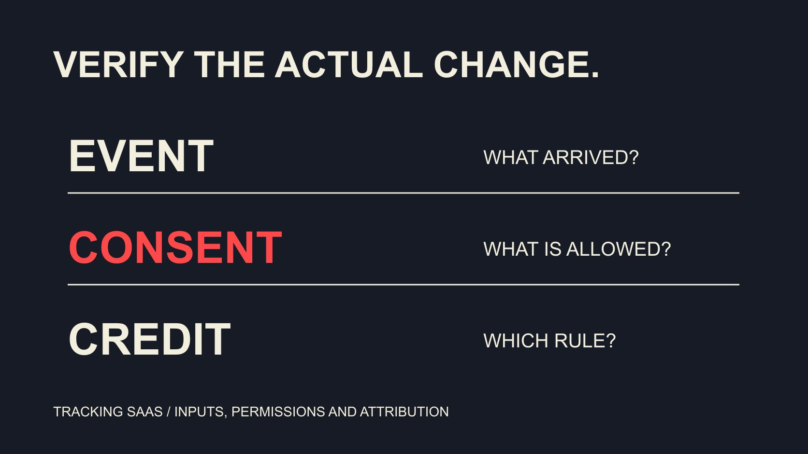

# 联盟追踪 SaaS 趋势：核对服务端、同意与代码规则

状态：本地审阅稿；正式发布日期待确认。

用截至2026年11月2日的一方文档研究联盟追踪SaaS方向，把变化转成可测试的采购与迁移要求。

QuickKOL 编辑图形；不呈现真实账号指标或平台界面。

研究current trends in affiliate tracking software SaaS时，优先核对可实施的变化：服务器事件传输、明确的同意处理、可解释的代码归因与交易生命周期记录。本篇截至2026年11月2日的官方文档观察，不是全市场采用率调查。某项能力出现在当前文档中，不代表今年才发明，也不代表所有计划或客户都支持。品牌应把每项方向写成输入、规则、可见输出和失败情境，再决定是否迁移。

## 先说明趋势证据能证明什么

本篇观察具体产品文档里的能力与要求，不声称它们覆盖所有供应商或已成为多数品牌标准。文档更新时间能说明当前资料，但不能独自证明某能力的首次推出时间或市场增长。

建立变化记录时，写明供应商、产品、地区、计划、文档日期与核验日期。有历史版本才比较前后；没有就写“当前文档说明”，不要补出并不存在的迁移历史。

[联盟公司角色指南](/zh/blog/affiliate-marketing-companies-commercial-roles/#answer)帮助确定谁采购与谁实施。没有技术负责人时，先补负责人；仅把采购关键词从tracking改成SaaS，不会让事件自动可靠。你的需求应来自实际缺口，而不是供应商名称更新。

这让每项能力都有可确认的结果，也为之后的供应商答复保留了具体问题。

## 方向一：服务端传输要说明事件来源

[Awin 服务器追踪说明](https://help.awin.com/docs/server-to-server-tracking)于2026年3月发布、8月更新，页面标明适用于Awin Classic，并描述从服务器传送转化资料。它提供具体实施入口，不是任意系统的通用配置说明。

品牌应问哪一个业务事件触发传输，是订单建立、付款还是另一状态。确认事件标识、币种、金额口径、时间与合作关联字段由谁提供。若不同路径重复发送，同一事件不能仅因到达两次就变成两个订单。

服务端减少某些浏览器路径的依赖，不等于没有缺失、错误或隐私责任。不要把供应商对可靠性的描述转成自己的百分百准确保证。需要用实际允许的场景验证输入和结果。

## 方向二：同意状态成为明确输入

[Shopify 像素隐私文档](https://shopify.dev/docs/api/web-pixels-api/pixel-privacy)说明应用像素按声明需要的访客许可加载，并提供同意状态变化的相关接口。这里讨论的是具体技术行为，不是替任何项目确认全球法律合规。

在采购表中分别记录需要哪些权限、状态在哪里读取、何时更新，以及没有相应许可时系统应怎样工作。不要把未收到事件自动写成追踪故障，也不要为了补齐报表而绕开用户选择。

请适当隐私负责人核对目的、告知和数据范围；工程人员核对实现与输出。两个角色可以协作，但不能用一个技术勾选框代替全部判断。上线后仍要保留版本，以便解释某次配置改变后的记录差异。

## 方向三：代码归因需要可解释的规则

[impact.com 优惠码说明](https://help.impact.com/brand/what-would-you-like-to-learn-about/platform-features/promo-codes/promo-codes-faq)区分优惠广告与带有分配逻辑的追踪代码，并说明设置与其他归因规则会影响结果。因此，代码被使用和某位合作方最终获得佣金不是同一个事实。

[优惠码归因指南](/zh/blog/influencer-discount-codes-offer-attribution/#answer)进一步拆分消费者优惠、合作方分配和结算。评估SaaS时，要求看到哪条规则被应用、规则版本是什么以及如何复查，而不是只看一列 attributed sales。

不要从更多被归因记录推导更多增量销售。新配置可能只是改变分配方式或补充记录。采购材料应该分别列出记录完整性问题、合同付款问题和营销因果问题，避免一个功能背负三种不相同的承诺。

## 方向四：从单次转化转向可复查的状态记录

以下是编辑采购建议，不是对所有产品功能的声明。除了订单首次出现，要求演示取消、退款、更正和争议怎样进入记录，是否保留原始事件与后续状态关系。

[EMV与ROI字段指南](/zh/blog/influencer-emv-roi-calculation-field-dictionary/#answer)强调不同字段不能混加。追踪系统里的金额也应有定义：原价、折后金额、含税金额、适用佣金基数和已确认收入可能不同。不要把一个purchase字段同时拿来解释全部业务价值。

如果系统只导出最终状态，应确认是否足够完成对账；如果保留事件历史，要说明如何避免把历史与当前状态重复汇总。更多字段只有在能支持问题解释时才增加价值。

## 用测试矩阵代替演示中的单一路径

以虚构记录准备测试：正常订单、重复事件、延迟到达、取消、部分退款、代码与点击冲突、无相应同意，以及缺失字段。不是要求每个项目都采用同一架构，而是确认适用情境有预期行为。

每行写输入、规则、预期状态、可见证据和负责人。对不能模拟的情境明确待验证，不能因为按钮点通就宣布所有条件通过。需要账号权限或真实交易时，由获授权的人员按项目流程处理。

比较供应商时保留同一测试定义，允许其解释产品限制。清楚的限制可能比没有说明的全能承诺更适合实际决策。暂时无法支持的必要场景，要形成接纳、补充或停止的决定。

## 迁移时先解释两套记录的差异

如果决定迁移，先保留规则和字段映射，再计划适当的验证窗口。两套系统看到不同总量时，逐项核对时间范围、币种、订单状态、重复处理与归因规则，不要先宣布新系统一定更真实。

并行观察也不意味着同一笔佣金应付两次。将技术记录比较与实际支付控制分开，由明确负责人管理。合作方需要知道何时换链接或代码，以及已经发生的交易怎样处理。

假设一次差异来自新系统按付款时间汇总，旧系统按订单建立时间汇总。先对齐窗口，可能无需改变交易。这个例子说明迁移学习应先解释差异，再决定是否需要修复。

## 一个虚构订单怎样检验三项承诺

以下为编辑设计的验证练习，不是真实交易或软件测试结果。准备一个虚构订单标识，记录允许的事件输入、测试币种、原始金额和后续退款，事先声明它不会触发实际佣金付款。需要真实环境时，先由获授权的负责人安排适当测试条件。

第一步只发送一次已定义事件，检查接收时间、事件标识、状态与报告窗口。若没有出现，先查是否应该发送、是否发送成功、是否被拒绝、是否还未进入当前报表。不要用手工补一行掩盖链路缺口。

第二步在适当测试条件下重发同一事件。预期行为取决于产品文档和项目设计，但团队必须能解释它是重复记录、更新还是被拒绝。若它被当作新的订单，先暂停把汇总结果用于付款，交由技术负责人查明原因。

第三步让案例包含点击与代码可能对应不同合作方的情境，记录实际应用的分配规则。测试的是配置是否符合已经同意的政策，不是让软件替品牌决定什么才公平。若规则结果出乎预期，核对配置与合同后再决定是否修改。

最后加入退款或更正，查看初始状态、后续状态与当前可支付记录的关系。保留每步的预期、证据、结果和未解决事项。一次练习不会覆盖所有浏览器、地区或客户路径，但能让团队看懂这套SaaS如何将事件变成记录与商业决定。用这些发现修订采购需求，比先承诺升级后所有指标都会改善更有用。

## 判断是否真的需要更换SaaS

把缺口分成配置、操作、数据定义与产品能力。若问题来自佣金规则没有写清，更换软件可能重复同样的争议。若必要事件无法得到支持，才有更明确的技术采购理由。

保留现状、修配置、增加服务或更换产品都可以是合理答案。分别写成本、工作、限制和负责人，选择能解决实际问题的方案，不把追新当作唯一成功标准。

本篇没有跨供应商采用率或统一效果数据，因此不发布热门排名或普遍提升百分比。未来再次研究时，继续回到当前文档和可观察行为，而不是将这次核验日当作永久有效的功能承诺。

## 追踪SaaS方向的验证问题

| 方向 | 要看的证据 | 不支持的结论 |

| --- | --- | --- |

| 服务端事件 | 来源、标识与状态 | 永不缺失 |

| 同意处理 | 许可要求与状态变化 | 自动全球合规 |

| 代码归因 | 分配规则与版本 | 代码证明增量 |

| 生命周期记录 | 退款与更正关系 | 更多字段等于更准确 |

截至2026年11月2日的文档研究与编辑采购框架，不是市场采用率调查。

## 追踪迁移准备清单

将趋势名称改成能验证的需求。

- [ ] 产品与文档日期已记。

- [ ] 事件与同意各有负责人。

- [ ] 归因与付款规则分开。

- [ ] 异常情境有预期结果。

- [ ] 迁移差异有解释与支付控制。

## 研究日期与使用边界

资料核验于 2026 年 11 月 2 日。文中方法、表格和决策规则为编辑建议，标为假设的示例不是实际客户结果或行业基准。外部资料的适用地区与时期按各段说明；本稿处于独立本地审阅阶段，正式发布日期待确认。

## 来源

- [Awin 服务器追踪说明](https://help.awin.com/docs/server-to-server-tracking)

- [Shopify 像素隐私文档](https://shopify.dev/docs/api/web-pixels-api/pixel-privacy)

- [impact.com 优惠码说明](https://help.impact.com/brand/what-would-you-like-to-learn-about/platform-features/promo-codes/promo-codes-faq)
