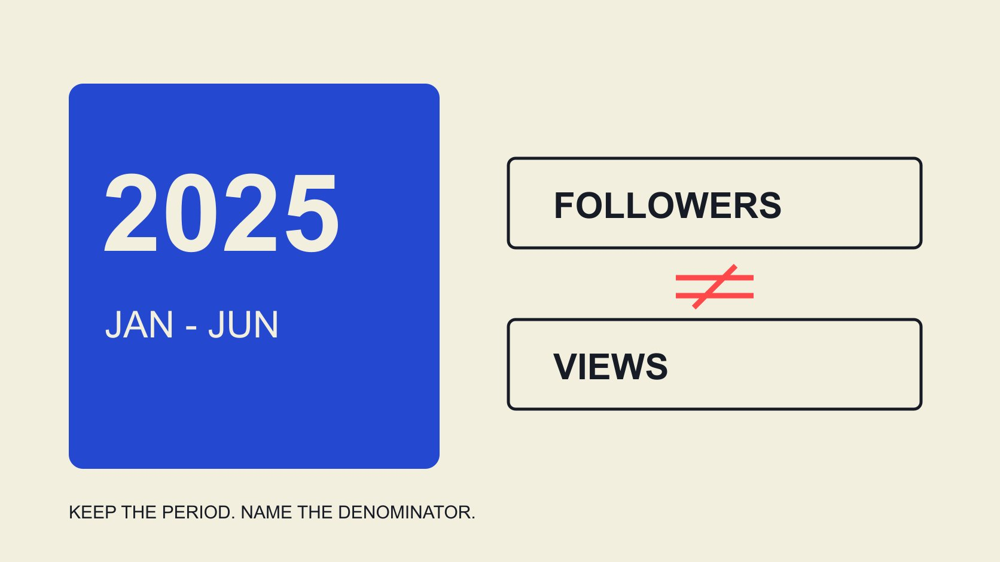

# Beauty Brand Instagram Engagement Rate 2025: Read the Scope

Status: local review draft; confirm the publication date before release.

Answer a 2025 beauty-brand Instagram engagement question through dated, denominator-specific evidence, without turning a global brand sample into a creator or local-market standard.

QuickKOL editorial graphic; not actual account metrics or a platform interface.

Beauty brand Instagram engagement rate 2025 needs a scoped answer. Dash Social’s Issue 2 2025 beauty report covers January 1 through June 30, 2025. Its industry table lists beauty at 0.2% engagement by followers and 3.0% by views, with the latter marked for customer-data coverage. These are different measures, not low and high versions of one metric. They are not full-year 2025, country-specific or individual-creator standards. Retain source, period, object and denominator whenever using the figures.

## Select the observation period for the historical question

A report published in 2025 does not necessarily observe 2025 activity. The H1 2025 edition of the [Dash Social 2025 beauty report](https://pages.dashsocial.com/hubfs/social-media-benchmark/2025/1H/beauty-industry.pdf) describes July through December 2024 data. Calling it 2025 performance would change the evidence’s meaning.

The Issue 2 file used here instead covers the first half of 2025. It supports a historical statement about that period, not an invented second-half or full-year average. A later website update to a 2026 report cannot replace the historical evidence’s dates.

Retain edition, observation start and end and review date separately. The [2025 platform-review guide](/blog/beauty-influencer-trends-facebook-instagram-2025-review/#answer) distinguishes announcements from observations; this article applies the same care to a historical rate. The year in the research question should determine which evidence is selected rather than whichever title looks newest. A presentation can be concise while still preserving first half of 2025, which is essential context rather than optional detail.

## Read the denominator before comparing percentages

The [Dash Social Issue 2 2025 beauty report](https://pages.dashsocial.com/hubfs/social-media-benchmark/2025/H2/beauty-industry.pdf) lists Instagram beauty at 0.2% by followers and 3.0% by views. Its follower formula uses likes plus comments divided by followers; the view-based field is different and carries a customer-data footnote in the industry table. Coverage includes organic, boosted and promoted content while excluding paid ads as defined by the report.

Dividing 3.0% by 0.2% cannot establish that content performs fifteen times better. Nor should the view-based value enter a follower-based benchmark column. Changing numerator and denominator changes the question. A reported average also does not mean every brand is close to it.

The [engagement-rate worksheet guide](/blog/calculate-engagement-rate-denominator-workbook/#answer) records your numerator, denominator, object and window. Align them before comparison. Where inputs are insufficient, retain not comparable rather than let a shared percent sign conceal the difference. The rate’s label belongs beside the number, not only in an appendix that disappears when the figure is copied.

## The sample concerns global brands, not every beauty creator

The methodology identifies an overall cross-industry Instagram sample of 2,967 global companies and criteria including handles with at least 1,000 followers. That 2,967 is not a confirmed beauty-only sample size here. The method page read does not supply a beauty-specific count for this statement, so do not derive one from the overall total.

Brand and creator accounts can differ in task, scale and publishing arrangements. An industry brand average should not become a creator admission threshold. Global coverage also does not automatically become a Philippine, Australian or city-specific standard.

Use the evidence first as bounded historical context, then seek observations closer to the task. If matching market, format and definition are unavailable, state the gap. Missing evidence is not a reason to turn a broader sample into a certain answer. The record remains useful when it tells the reader exactly which part of their question the available report does and does not resolve.

## Match tool definitions rather than similar names

The [Rival IQ engagement-rate method](https://help.rivaliq.com/en/articles/2043672-understanding-engagement-rates) also distinguishes public and authorized-data calculations. It reminds a brand that matching rate names across tools can conceal different sources and methods. No vendor’s approach is declared the universal platform standard here.

For a number in the team’s tool, examine included actions, follower snapshot, measurable-content coverage and averaging. An ER label does not make it comparable with a historical table column. Publicly visible likes and comments may not reproduce an authorized-data field.

Retain vendor method, team choice and raw observation separately. If the team selects a different comparable action set, rename the recalculation explicitly instead of retaining the report’s label and implying equivalence. This makes it possible for another analyst to understand why the team’s number differs without assuming an arithmetic mistake or treating the higher value as evidence of better performance.

## Align format and distribution coverage

The [Instagram format-decision guide](/blog/instagram-analytics-format-decision-matrix/#answer) distinguishes the jobs formats perform. Images, carousels and video can have different observation fields and use contexts. A mixed-format average is not a required result for one Reel, and an organic observation should not automatically be compared with boosted distribution.

Define the current assignment: showing texture, explaining operation, addressing a use situation or encouraging further learning. Then choose the content and appropriate observations. A format appearing higher in a report does not establish that copying the format reproduces the result.

Retain mixed distribution conditions instead of calling everything organic. Leave undisclosed details unknown rather than infer identical production, budget and audience arrangements from an aggregate chart. A smaller, format-matched comparison can be more informative for a specific brief than a broad industry average, provided its limitations and coverage remain clear.

## Use a gap to ask questions rather than promise results

Suppose the team calculates a different result using a matched method. Ask where the gap comes from: assignment, format, timing, coverage, data maturity or calculation. Before checking those conditions, below industry should not automatically become failed work.

A smaller brand may address a different question. A piece can answer an important concern without extensive visible interaction. Engagement rate describes a defined event relationship; it cannot alone establish education, trust or incremental sales.

Connect the next action to actual evidence. Unclear wording may need a better explanation; an unsuitable destination needs a path check; an incomparable sample needs a report correction. A universal demand to reach a percentage can encourage interaction unrelated to the assignment. A historical benchmark is most useful when it improves the question the team asks, rather than become an outcome somebody is expected to guarantee.

## Keep enough context when quoting a number

A reusable statement includes provider, edition, period, platform, object, denominator and limits. Beauty engagement is 3% invites readers to apply a number across years, markets and creators that the evidence does not cover.

Describe it as a particular report’s first-half 2025 global beauty-brand Instagram table measure, distinguishing views and followers. A customer-data footnote should survive transcription too. A correct number without its scope can still mislead.

If the reader needs a precise population distribution or local threshold that the report does not provide, state that limitation. Retain original file version and access date so a dynamic download page does not silently redirect an old citation to another dataset. A source link is necessary, but the nearby sentence must still contain enough context for someone quoting it responsibly in a proposal or training document.

## Worked example: build a comparable internal observation

This is an editorial hypothetical, not an actual beauty-brand result. A team retains two image-post observations at matching content ages, uses likes plus comments and documents a 50,000-follower snapshot for each. A has 80 likes and 20 comments. B has 10 likes and 40 comments. Neither record is assumed to cover views or private interactions that were not supplied.

Under that specification, A is 100 divided by 50,000 times 100, or 0.2%. B is 50 divided by 50,000 times 100, or 0.1%. Their simple mean is 0.15%. Without views, the team does not calculate a view-based rate or reverse-engineer a viewing total from an industry coefficient. The values describe this hypothetical set only.

If B’s assignment was to answer a particular use question, the team still needs the relevant questions and information before concluding the content was unhelpful. More comments do not automatically mean the question was resolved either; they may raise matters requiring clarification. The observations help decide what to examine without answering every communication question themselves.

If one item turns out to have a different distribution arrangement, retain that flag before deciding whether the group remains appropriate. Do not remove records simply until the best-looking result remains. Two posts also do not represent the market or establish a standard for all beauty brands and similar creators. Preserve their small scope even when sharing the example outside the original team.

The next action might be a corrected explanation, a defined follow-up observation or more consistent records for new content. There is no need to force 0.15% toward an industry target. If the original question concerns understanding, obtain evidence about understanding. That keeps the historical report in a supporting role while the internal record serves the current decision. A useful comparison should leave the team with a specific action and an honest account of what it still cannot know.

## Move from historical context to the current assignment

This evidence answers a historical question, not current realtime performance. For a new collaboration, update product, assignment, creator work and available data rather than permanently treating a 2025 average as today’s condition.

QuickKOL can help interpret the proposed work, research relevant content and prepare contact. A historical brand report can inform questions without confirming an individual creator’s current audience, price or result.

Use the benchmark as a scoped reference that identifies what the team still needs to learn. Keeping denominator, period and unknown coverage is more useful than presenting a seemingly universal beauty standard. It allows a planning team to use the historical evidence without asking it to answer a different question.

## Citation scope for the 2025 evidence

| Source or field | Supports | Does not establish |

| --- | --- | --- |

| Issue 2 2025 report | January–June 2025 observations | Full-year 2025 or current realtime values |

| Beauty Instagram 0.2% | The report’s follower-based measure | An individual creator threshold |

| Beauty Instagram 3.0% | View-based measure with the customer-data footnote | A direct better/worse comparison with 0.2% |

| Overall Instagram n=2,967 | Global cross-industry sample coverage | Beauty-only sample size or country representativeness |

Source: Dash Social Issue 2 2025 beauty report, methodology and Instagram industry table; reviewed November 2, 2026.

## Historical benchmark citation checks

Establish an accurate citation before deciding project actions.

- [ ] Separate edition year from observation year.

- [ ] Do not merge brand, creator and local samples.

- [ ] Check numerator, denominator and averaging.

- [ ] Keep customer-data footnotes with the figure.

- [ ] Keep format and distribution coverage comparable.

- [ ] Do not turn an industry average into a personal guarantee.

## Research date and limitations

Sources reviewed November 2, 2026. Methods, tables and decision rules are editorial recommendations. Hypothetical examples are not actual client results or industry benchmarks. Source geography and periods are specified where relevant. This draft is in independent local review; confirm its publication date before release.

## Sources

- [Dash Social: H1 2025 Beauty Industry Benchmark Report, pp. 2, 17](https://pages.dashsocial.com/hubfs/social-media-benchmark/2025/1H/beauty-industry.pdf)

- [Dash Social: Issue 2 2025 Beauty Industry Benchmark Report](https://pages.dashsocial.com/hubfs/social-media-benchmark/2025/H2/beauty-industry.pdf)

- [Rival IQ: Understanding Engagement Rates](https://help.rivaliq.com/en/articles/2043672-understanding-engagement-rates)
