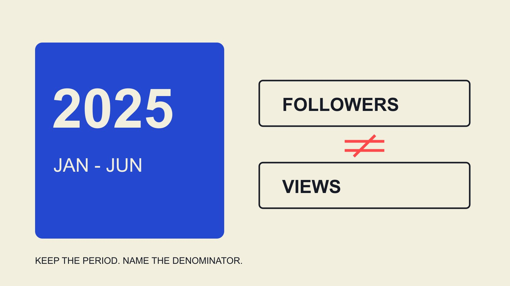

# 美妆品牌 Instagram 互动率 2025：按报告样本引用

状态：本地审阅稿；正式发布日期待确认。

用有统计期和分母的历史资料回答2025美妆品牌 Instagram 互动率问题，不把全球品牌样本变成达人或本地市场标准。

QuickKOL 编辑图形；不呈现真实账号指标或平台界面。

Beauty brand Instagram engagement rate 2025 需要带范围回答。Dash Social 第二期2025美妆报告的统计期为2025年1月1日至6月30日；其行业表列出美妆品牌按粉丝互动率0.2%、按观看互动率3.0%，后者带客户数据范围脚注。它们是不同口径，不是同一指标的高低版本，也不是2025全年、某国或创作者个人的统一标准。引用时必须带上来源、时期、对象和分母。

## 先给历史问题选对统计期

一份在2025年出版的报告，不一定统计2025年的活动。[Dash Social 2025 美妆报告](https://pages.dashsocial.com/hubfs/social-media-benchmark/2025/1H/beauty-industry.pdf)的H1 2025版本方法页说明，观察的是2024年7月至12月；如果把它直接叫作2025表现，会改变资料含义。

本篇采用的第二期文件则覆盖2025上半年。它可以支持明确写出这段时期的历史讨论，不能据此补出下半年或全年均值。网站后来更新成2026报告，也不能覆盖掉这份历史证据的日期。

研究记录应同时保留报告版本、观察起止和核验日期。[2025平台回看指南](/zh/blog/beauty-influencer-trends-facebook-instagram-2025-review/#answer)帮助将公告与实际观察分开；本篇再将历史互动率的范围写清。搜索者要找的年份，应该决定取哪份资料，而不是哪个标题看起来更新就用哪个。

## 读分母之前，不比较百分比

[Dash Social 2025 第二期美妆报告](https://pages.dashsocial.com/hubfs/social-media-benchmark/2025/H2/beauty-industry.pdf)在Instagram行业表中列出按粉丝0.2%与按观看3.0%。其按粉丝公式写为点赞加评论除以粉丝；按观看是另一个字段，行业表带客户数据脚注。报告范围包括有机、加热与推广内容，排除其定义的付费广告。

不能将3.0%除以0.2%后，宣称某种内容表现好15倍，也不能把按观看的值放进按粉丝的基准列。分子和分母变化，问题就已经不同。报告中的平均数，也不说明每个品牌都接近它。

[互动率工作表指南](/zh/blog/calculate-engagement-rate-denominator-workbook/#answer)帮助记录自己的分子、分母、对象与窗口。比较前先将这些字段对齐；没有足够输入时，保留“不具可比性”，不要用同样的百分号掩盖差异。

## 样本是全球品牌，不是每位美妆创作者

方法页说明其Instagram总体样本跨行业为2,967家全球公司，并设置账号至少1,000粉丝等范围。这个2,967不是本篇已确认的美妆子样本数；已读取的方法页未提供可直接用于本篇的美妆专属数量，不擅自从总样本推导。

品牌账号与创作者账号的任务、规模及发布安排可能不同。一个品牌行业均值，不应直接成为某位创作者的录取线；全球范围也不能自动变成菲律宾、澳大利亚或某个城市的本地标准。

研究可以先使用该资料理解一个有范围的历史背景，再寻找更接近实际任务的观察。若没有同市场、同形式和同定义的资料，就说明缺口。数据缺口不是必须用一个更宽样本填成确定答案的理由。

## 工具定义不能只靠相同名称匹配

[Rival IQ 互动率方法说明](https://help.rivaliq.com/en/articles/2043672-understanding-engagement-rates)也区分公开与有权限数据口径。这提醒品牌：同名互动率在不同工具里可能采用不同来源和算法。这里不将任何一家供应者的方法宣布为所有平台统一标准。

若团队工具显示一个数，先查看它包含哪些动作、粉丝取什么时点、是否仅有部分内容可测，以及如何计算平均。不要因为界面写ER，就直接与历史报告的一列比较。公开页面能看到的点赞与评论，也未必足以复算有权限的数据字段。

把供应者方法、团队选择和原始观察分别记录。若需要选择可比动作集合，就明确重新命名计算结果，不继续沿用原报告标签，让接收人误以为数据完全相同。

## 内容形式与分发范围也需要对齐

[Instagram 内容形式指南](/zh/blog/instagram-analytics-format-decision-matrix/#answer)帮助区分不同内容承担的任务。图片、轮播与视频可能有不同观察字段与使用情境。不要把混合形式均值当作某条Reel的必达结果，或把自然观察与加热后的数据直接比较。

先定义本次任务：展示产品质地、解释操作、回答适用情境，还是引导进一步了解。再决定需要哪类内容与相应指标。一个形式在报告里看起来较高，不代表复制形式就能复制结果。

若内容混合不同分发条件，报告应保留这些条件，而不是用“自然内容”概括所有。数据源未说明的部分保持未知，不从一个图表总量推断所有帖子都采用同一制作、预算和受众安排。

## 差额用于提问，不用于承诺结果

假设团队按匹配方法计算了一个不同结果，应先问差异来自哪里：任务、形式、时段、覆盖、数据成熟度还是计算方法。没有逐项核对前，不应立即判断团队“低于行业所以失败”。

一个较小品牌可能服务不同问题；一次内容也可能回答了重要疑问，却没有产生很多可见互动。互动率可以描述特定事件关系，但不能独自证明产品教育、品牌信任或新增销售。

选择下一步时，让动作对应实际证据。若素材文字不清楚，先修解释；若链接不合适，先核对下一步；若只是样本不可比，就修报告。不要用统一提高到某百分比的要求，让创作者追求与任务无关的互动。

## 引用数字时保留足够上下文

可引用表述应同时包含供应者、报告版本、统计期、平台、对象、分母与限制。不要只写“美妆行业互动率为3%”，让读者误以为它适用于所有年份、地区和创作者。

例如，可以说明这是特定报告的2025上半年全球美妆品牌Instagram表内指标，并区分按观看与按粉丝。脚注涉及客户数据时，也不应在转录过程中消失。数字准确但范围丢失，仍可能误导。

如果读者需要精确总体分布或本地阈值，而报告没有提供，就如实说明不能支持。保留原始文件版本和访问日期，避免动态下载页更新以后，旧引用被不小心指向另一份数据。

## 算例：建立自己的可比较观察

以下是编辑假设，不是真实美妆品牌结果。团队保留两条图片内容在相同内容期龄下的记录，采用点赞加评论作分子，并使用各自已说明的50,000粉丝快照。A有80次点赞、20条评论；B有10次点赞、40条评论。

A按该口径为100÷50,000×100＝0.2%，B为50÷50,000×100＝0.1%，两条单帖率的简单平均为0.15%。这里没有观看数据，就不计算按观看指标，也不按行业报告的系数猜一个观看量。数字只是这个假设集合的结果。

如果B的内容任务是回答一个具体使用问题，团队还需要阅读相关问题及已有资料，不能因其按粉丝比率较低，就认定内容没有帮助。评论较多也不自动表示问题已经解决；它可能提出更多需要澄清的事。数据可以告诉团队该问什么，不能直接替它回答所有问题。

若发现其中一条有不同分发安排，先保留标记，再决定是否适合放进同一组。不要将记录删掉到只剩最好看的结果。两条内容也不是市场代表样本，不能从它们推导所有美妆品牌或同类型创作者。

接下来，团队可以修正某个解释、明确后续观察，或为新内容准备更一致的记录。不必强行把0.15%改成某个行业目标；若原始问题涉及理解，就应为理解寻找适当依据。这使历史报告成为背景，而内部记录真正服务当下决定。

## 从历史背景走向当前项目

这份资料回答一段历史范围，不是今天的实时表现。品牌计划新合作时，应更新实际产品、任务、创作者作品与可用数据，不能让2025均值永久成为当前条件。

QuickKOL 可以帮助理解合作需求、研究相关内容与准备联系。历史品牌报告可以帮助形成问题，但不能替某位创作者确认当前受众、报价或结果。

将基准放在正确位置：它是一份有口径的参考，帮助团队判断还需要了解什么。保留分母、统计期和未知范围，比给出一个看似统一的“美妆标准”更有用。

## 2025历史资料的引用范围

| 资料或字段 | 能说明 | 不能扩展为 |

| --- | --- | --- |

| 第二期2025报告 | 2025年1月至6月观察 | 全年2025或当前实时值 |

| 美妆Instagram 0.2% | 报告按粉丝指标 | 某位创作者的合格线 |

| 美妆Instagram 3.0% | 按观看指标，保留客户数据脚注 | 与0.2%直接衡量好坏 |

| Instagram总体n=2,967 | 全球跨行业样本范围 | 美妆专属样本数或某国代表性 |

来源：Dash Social第二期2025美妆报告，方法页与Instagram行业表；核验于2026年11月2日。

## 历史基准引用清单

先保证引用准确，再讨论项目动作。

- [ ] 版本年份与统计年份分开。

- [ ] 品牌、创作者与本地样本不混用。

- [ ] 分子、分母与平均方式已核对。

- [ ] 客户数据脚注随数字保留。

- [ ] 形式与分发范围保持可比。

- [ ] 不把行业均值作为个人保证。

## 研究日期与使用边界

资料核验于 2026 年 11 月 2 日。文中方法、表格和决策规则为编辑建议，标为假设的示例不是实际客户结果或行业基准。外部资料的适用地区与时期按各段说明；本稿处于独立本地审阅阶段，正式发布日期待确认。

## 来源

- [Dash Social：H1 2025 Beauty Industry Benchmark Report，第2、17页](https://pages.dashsocial.com/hubfs/social-media-benchmark/2025/1H/beauty-industry.pdf)

- [Dash Social: Issue 2 2025 Beauty Industry Benchmark Report](https://pages.dashsocial.com/hubfs/social-media-benchmark/2025/H2/beauty-industry.pdf)

- [Rival IQ: Understanding Engagement Rates](https://help.rivaliq.com/en/articles/2043672-understanding-engagement-rates)
