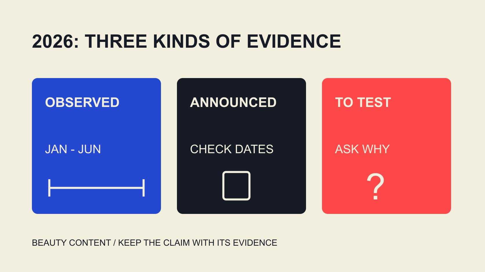

# Beauty Content Trends 2026: Put Engagement Rates in Context

Status: local review draft; confirm the publication date before release.

Separate 2026 beauty-content observations, platform announcements and proposed tests, using dated engagement evidence to form specific content hypotheses.

QuickKOL editorial graphic; not actual account metrics or a platform interface.

Beauty content trends in 2026 should separate observed data, platform announcements and ideas a brand proposes to test. As reviewed November 2, 2026, Dash Social’s Issue 2 beauty report observes January through June, with Instagram beauty-brand rates of 2.9% by views and 0.3% by followers. These are not full-year or universal creator standards. Use the context to investigate original use explanations, formats and production iteration, without treating an announcement or industry average as proof that a tutorial will increase interaction or sales.

## Separate three kinds of trend evidence

A report describes what a set of objects did in a period. An announcement describes what a platform released or plans. An editorial hypothesis proposes worthwhile next work. All can inform planning without substituting for one another, particularly when a future plan is presented as universal current practice.

This review ends November 2, 2026, before the year is complete. Continue from a 2026 title to the observation window; historical data may also have been published this year. A timely topic still needs its evidence’s own dates.

For each direction, record observation, possible explanation and next verification. An unavailable rate should not become a precise number invented to support a trend. A production implication can be a bounded question instead of a declaration that the entire market agrees. This helps a brand move quickly while keeping the difference between something documented and something merely worth trying.

## What the first-half 2026 report establishes

The [Dash Social Issue 2 2026 beauty report](https://pages.dashsocial.com/hubfs/social-media-benchmark/2026/H2/beauty-industry.pdf) describes global-company activity from January through June, with 3,313 Instagram accounts across industries and a minimum of 1,000 followers. Organic, boosted and promoted content are included, while paid ads are excluded under the report’s definitions. The total is not a beauty-only sample count.

Its Instagram beauty table gives 2.9% by views and 0.3% by followers. Different definitions prevent one becoming the target for the other. The [2025 beauty-benchmark scope guide](/blog/beauty-brand-instagram-engagement-2025-report-scope/#answer) develops the historical caution; two editions also require sample and method checks before a growth conclusion.

The evidence concerns brand observations, not every creator, country or collaboration. Use it to formulate questions and obtain appropriate evidence for the actual content task. A larger percentage alone should not decide whom to partner with or which format is necessarily effective. The rate remains useful as scoped context, even when the team cannot compare its own data directly with the report.

## Direction one: originality needs an actual contribution

The [Meta early-2026 recommendation update](https://about.fb.com/news/2026/01/2026-ai-drives-performance/), published in January, looks back at original-content recommendations on US Instagram during the fourth quarter of 2025. It offers platform-direction context, not a beauty-specific 2026 experiment or proof that every original video gets greater distribution.

For a brand, test the actual contribution: explaining a use question, showing a process or addressing a misunderstanding. Originality is more than being the first upload of one file. The material needs a contribution a reader can understand.

Do not turn originality into a request for experience the creator never had. Reliable product information and real experience remain inputs. If a treatment borrows a popular expression without answering the question, revise the task rather than continually adding effects or stronger emotion. A clear explanation can be evaluated as an explanation without assuming that an algorithm change guarantees its audience or commercial result.

## Direction two: make demonstrations understandable

Beauty content can explain texture, color, operation or use context, but selection depends on product and reader question. Every brand does not need the same routine. Define what the piece helps someone understand before selecting the format.

Retain demonstration conditions and actual product version. Light, editing, captions and sequence can change audience interpretation. Review meaning as well as appearance so a demonstration does not become an unsupported outcome promise.

For skin, efficacy or other claims needing appropriate expertise, the relevant owner checks product facts and applicable requirements. One personal experience should not become everyone’s result. Build a content hypothesis around something reliably demonstrable rather than assume stronger claims deserve more interaction. The team can also decide that a question belongs in written product information or professional review instead of forcing a creator to answer something outside their experience.

## Direction three: production tools support iteration, not judgment

The [Meta Edits anniversary update](https://about.fb.com/news/2026/04/one-year-of-edits-built-for-and-with-creators/amp/) in April 2026 reviews production tools and idea workflows while distinguishing existing work from plans. It shows platform investment in the creative process without establishing that every future feature was then, or is now, available to every account.

A brand can organize actual audience questions, invite a creator’s opening or explanation sequence and retain versions for bounded observation. Editing, organization or caption support does not automatically establish accuracy, audience fit or use conditions.

Iteration should concern more than surface changes. To compare explanations, record the actual change and preserve relevant conditions where feasible. A result difference can still have several causes. Easier production does not transform observation into a causal experiment. The practical advantage is making a clear revision easier to prepare and examine, rather than producing many files whose differences no longer correspond to the question being tested.

## Use engagement rates as bounded evidence for a content question

The [engagement-rate worksheet guide](/blog/calculate-engagement-rate-denominator-workbook/#answer) makes numerator, denominator, window and set explicit. More comments may contain questions or identify a topic worth explaining further; count alone does not establish greater trust or sales.

Retain format and distribution conditions. Native publication, boosting and other distribution can face different contexts. After finding high-interaction material, check what information is actually available before deciding whether another item is comparable.

Unknown data stays unknown and estimates remain estimates. Limited observations can improve a script, information or destination without becoming a verified industry-wide 2026 trend. Match the data to the question rather than allowing one percentage to answer the whole strategy. A review can include qualitative questions alongside rates without pretending the two are interchangeable or combining them into an unexplained score.

## Turn a trend direction into a hypothesis that can change

The [hypothesis-portfolio strategy guide](/blog/influencer-marketing-strategy-hypothesis-portfolio/#answer) connects audience obstacle, contribution, resources and next decision. Define the understanding problem before selecting creator, format and observation rather than begin with a popular template.

In an editorial hypothetical, a brand finds readers confused about a product step and prepares a demonstration and a short question-and-answer treatment. Both share reliable facts, but they are not a strictly randomized experiment. Observe relevant questions and appropriate data while retaining distribution differences.

If the main obstacle concerns product instructions, the next action can be an information revision. If data is incomparable, repair the record. A hypothesis gains learning value when it can change. More content is not the required conclusion of every review. Keeping alternatives visible makes a modest test useful even without a definitive engagement or commercial improvement.

## Three bounded beauty-content proposals

The following are editorial content hypotheses, not formats proven popular by the report. They turn explain it more clearly into an actual brief. Confirm reliable product information and the contribution a creator wishes to make before deciding whether one suits the current audience.

A shade explanation can show the specific product, shade and stated lighting conditions while recognizing that capture and displays affect perceived color. It should not promise identical results for every person or screen. The contribution is helping a reader understand available product-choice information, not choosing for everyone after one demonstration. Review the product, captions, conditions and visual together. Later questions can identify what remains unclear without turning informal feedback into a representative color-preference study. Keep the task within what can actually be shown.

A texture or operation explanation can demonstrate dispensing and actual steps, retaining product version and conditions. Appearance alone does not establish suitability for every skin type or long-lasting effects. A creator can describe the scope of experience while the brand checks other facts. If questions concern operation, improve that explanation rather than adding stronger efficacy wording. A short piece can connect to more detailed information instead of attempting every condition in one clip. That is a production choice to explore, not evidence that shorter or longer content always performs better.

A packaging-function explanation can answer opening, carrying or dispensing questions without editing away important steps. It may suit different beauty categories, but not every product needs the same demonstration. Confirm action and context before choosing framing and length. Observe new operational questions rather than treating a high interaction number as proof that the whole experience is understood. If the package changes, identify the version so an older demonstration does not silently become instruction for a different product.

These proposals share a visible contribution and a question that can be revised. They guarantee no 2026 popularity and describe no brand’s verified result. Select one with actual inputs, observations and next action rather than copy it as a fixed creative recipe.

## Deliver an as-of review without inventing a complete year

Label reports, announcements and editorial proposals with their own sources and periods. Recheck important current features and data before publication, preserving the intended publication and update record rather than turning old data into today’s realtime value for a fresh title.

QuickKOL can help interpret the brief, research relevant work and prepare contact. It guarantees no trend outcome and does not confirm current platform or brand data. Build the collaboration around the actual task and verifiable evidence.

A 2026 beauty-content plan can be exploratory while retaining a clear question, reliable facts and boundaries. Reports supply context and tools supply capabilities; the brand and creator still need to produce the actual work.

## From evidence to a content test

| Evidence type | Supports | Avoid |

| --- | --- | --- |

| First-half 2026 brand report | Scoped historical observation | Full-year or universal creator standards |

| Recommendation announcement | The platform’s stated direction and period | Guaranteed growth for a beauty post |

| Production-tool description | Specified capabilities and plans | Universal current feature availability |

| Brand test hypothesis | A content question and next decision | Promised interaction or causal sales |

Editorial research as of November 2, 2026; report and announcement periods are specified in the body.

## 2026 beauty-content research checks

Keep observations, announcements and proposed tests separate.

- [ ] Check edition and observation period.

- [ ] Separate brands, creators and geography.

- [ ] Name denominator and available fields.

- [ ] Use reliable facts and an actual contribution.

- [ ] Separate available and planned features.

- [ ] Allow the test to change the hypothesis.

## Research date and limitations

Sources reviewed November 2, 2026. Methods, tables and decision rules are editorial recommendations. Hypothetical examples are not actual client results or industry benchmarks. Source geography and periods are specified where relevant. This draft is in independent local review; confirm its publication date before release.

## Sources

- [Dash Social: Issue 2 2026 Beauty Industry Benchmark Report](https://pages.dashsocial.com/hubfs/social-media-benchmark/2026/H2/beauty-industry.pdf)

- [Meta: 2026 AI Drives Performance](https://about.fb.com/news/2026/01/2026-ai-drives-performance/)

- [Meta: One Year of Edits](https://about.fb.com/news/2026/04/one-year-of-edits-built-for-and-with-creators/amp/)
