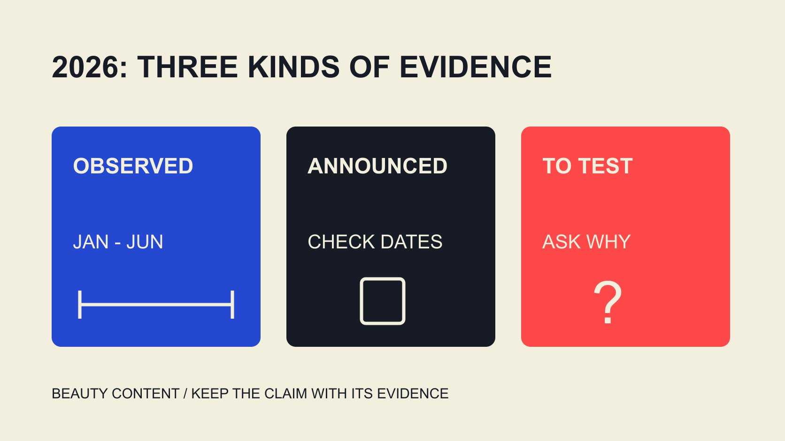

# 2026 美妆内容趋势与互动率：先解释观察窗口

状态：本地审阅稿；正式发布日期待确认。

把2026美妆内容观察、平台公告与下一轮测试分开，用有统计期的互动率资料形成具体内容假设。

QuickKOL 编辑图形；不呈现真实账号指标或平台界面。

2026美妆内容趋势应区分已经观察的数据、平台公布的变化和品牌准备测试的想法。截至2026年11月2日，Dash Social第二期2026美妆报告覆盖的是1月至6月，Instagram美妆品牌表列出按观看互动率2.9%、按粉丝0.3%。这不是全年或所有创作者的标准。可以据此研究原创使用解释、形式与制作迭代，但不能从平台公告或行业均值推导某条教程必然提升互动和销售。

## 把趋势证据分成三类

报告描述一组对象在某段时间发生什么，公告说明平台发布或计划什么，编辑假设则提出下一步值得测试的内容。三者可以一起帮助规划，但不能互相替代，尤其不能把未来计划写成已经普遍采用。

本篇的2026范围截至11月2日，全年尚未结束。看到标题写2026，要继续核对统计窗口；历史数据也可能在今年才发布。内容选题可以及时，证据仍需保留自己的日期。

品牌可以为每个方向写三列：观察是什么，解释有哪些，下一步怎么验证。没有可靠率值时，不用编造一个精确数字支撑趋势。对制作的启发可以是有边界的问题，而不必成为市场已经达成一致的结论。

## 2026上半年报告提供什么背景

[Dash Social 2026 第二期美妆报告](https://pages.dashsocial.com/hubfs/social-media-benchmark/2026/H2/beauty-industry.pdf)的方法页说明，样本覆盖全球公司1月至6月活动，Instagram跨行业样本为3,313，账号至少1,000粉丝；有机、加热与推广内容纳入，排除其定义的付费广告。这个总数不是美妆专属样本数量。

Instagram美妆行业表列出2.9%按观看和0.3%按粉丝。它们定义不同，不能将一个当作另一个的目标。[2025美妆基准范围指南](/zh/blog/beauty-brand-instagram-engagement-2025-report-scope/#answer)解释历史资料的相同注意点；两期样本和方法也不能未经核对就形成增长结论。

这些数据描述品牌观察，不直接说明每位创作者、每个国家或某项合作。用报告形成问题，再为实际内容任务寻找适当证据。不要从一个较大百分比就决定哪个人值得合作或哪种形式必然更有效。

## 方向一：原创表达需要实际内容贡献

[Meta 2026 年初推荐说明](https://about.fb.com/news/2026/01/2026-ai-drives-performance/)在1月发布时回顾美国Instagram于2025年第四季度的原创推荐变化。它提供平台方向背景，不是2026美妆内容的专属实验，也不能证明所有原创视频都获得更多分发。

对品牌，值得测试的是作品增加了什么：解释一个真实使用问题、展示实际步骤，或回应受众常见误解。原创不只意味着第一次上传同一文件；内容需要有能让读者理解的贡献。

不要将“原创趋势”变成强迫创作者作从未有过的体验。可靠产品资料和真实经历仍是输入。若素材只是借用流行表达，但没有回答问题，可以先修任务，而不是不断增加特效或要求更强情绪。

## 方向二：把产品演示做成可理解的内容

美妆内容可以解释质地、颜色、操作或使用情境，但选择取决于产品和读者问题，不是所有品牌都必须拍同一套日常流程。先明确这段内容准备让人理解什么，再选择合适形式。

保留展示条件与实际产品版本。不同光线、剪辑、字幕或画面顺序可能影响观众理解，因此审阅不只检查好不好看，也检查是否把演示变成未经支持的效果承诺。

对涉及皮肤、功效或其他需专业依据的说法，由适当负责人核对产品事实与适用要求。不能把一次个人体验写成所有人的结果。内容假设应围绕可以可靠展示的贡献，而不是越强的主张越容易获得互动。

## 方向三：制作工具支持迭代，不替代判断

[Meta Edits 周年说明](https://about.fb.com/news/2026/04/one-year-of-edits-built-for-and-with-creators/amp/)在2026年4月回顾制作工具与构思流程，也区分已提供内容和接下来计划。它说明平台在支持创作流程方面的方向，不等于所有未来功能当时或现在都已向每个账号开放。

品牌可以整理实际受众问题，让创作者提出开头、解释顺序或演示细节，再保留版本进行有范围观察。工具帮助组织、剪辑或字幕，不会自动保证内容准确、适合受众或具备使用条件。

迭代不应只更换表面元素。若要比较两种解释方式，记录真正改变的内容，尽可能保留其他相关条件。一次结果差异仍可能有多种原因；制作更方便，也不会把观察自动变成因果实验。

## 互动率要为内容问题提供有限证据

[互动率工作表指南](/zh/blog/calculate-engagement-rate-denominator-workbook/#answer)帮助明确分子、分母、窗口和集合。某条内容获得更多评论，可能是读者有疑问，也可能表示某个话题值得进一步解释；不能仅凭评论数量宣布信任或销售提高。

将形式和分发条件保留在记录中。原生发布、加热或其他分发可能面对不同情境。看到高互动内容后，应先确认哪些信息实际可得，再决定是否能与另一条比较。

未知数据保留未知，估计保留估计。团队可以据有限观察改善脚本、资料或下一步页面，但不要给小样本贴上“2026全行业趋势已验证”的标签。数据需要对应问题，不能因为有一个百分比就让它回答全部策略。

## 把趋势变成一个可改变的测试假设

[假设组合策略指南](/zh/blog/influencer-marketing-strategy-hypothesis-portfolio/#answer)帮助将受众障碍、内容贡献、资源与下一步决定放在一起。先问准备改变哪个理解问题，再决定需要的创作者、形式及观察，而不是先追一个热门模板。

以下为编辑假设：品牌发现读者不理解某个产品步骤，于是准备一份具体演示与一份简短问答。两者共享可靠事实，但并非严格随机实验。团队观察相关提问及适当数据，保留不同分发的影响。

如果结果显示主要障碍来自产品说明，下一步可以修说明；如果数据不可比，先修记录。原假设允许被改变，才有学习价值。继续拍更多内容不是每次复盘都必须得出的答案。

## 三个有边界的美妆内容提议

以下是编辑提出的内容假设，不是报告证明的热门形式。它们用于把“解释得更清楚”变成实际Brief。每项先确认可靠产品资料和创作者愿意承担的工作，再决定是否适合当前受众。

颜色说明：展示具体产品、色号与已说明的光线条件，解释拍摄和显示可能影响观众看到的颜色，不承诺所有人或所有屏幕都相同。内容贡献可以是让读者理解品牌提供的选择信息，而不是一次展示就替每个人决定。审阅时核对实际产品、字幕、条件与画面是否一致；后续观察可以围绕读者还在问什么。

质地或操作说明：演示实际取用和使用步骤，保留产品版本与演示条件。不要仅凭镜头效果推导适合所有肤质或持久效果。创作者可以说明自己实际体验的范围，品牌负责核对其他产品事实。若用户疑问集中在使用方式，先改善解释，不必追加更强的功效语言；简短内容与更详细说明也可以相互连接。

包装功能说明：让内容回答开合、携带或取用等实际问题，并避免让剪辑省略影响理解的重要步骤。这个方向可以适用于不同美妆品类，但不是所有产品都需要同一种演示。先确认真实动作与适用情境，再选择镜头和长度。记录受众是否提出新的操作问题，而不是将一个高互动数字当作全部体验已经清楚。

这些提议的共同点是可见贡献与可修正的问题。它们不保证2026年流行，也不代表任何品牌或创作者已经验证效果。团队选择其中一项时，应把自己的输入、观察和下一步写出来，而不是照搬为固定内容配方。

## 用截至日期交付，不把半年度写成全年

最终记录将报告、公告和编辑建议分别标注来源与时期。发布时再次核对重要的当前功能与数据，保留首发和更新安排，不为了标题新鲜就让旧数据变成今日实时值。

QuickKOL 可以帮助理解Brief、研究相关作品并准备联系。它不保证某个内容趋势成功，也不替平台或品牌确认当前数据。合作应围绕实际任务与可核验证据展开。

2026美妆内容规划可以积极尝试，但要让尝试有清楚问题、可用事实与范围。报告提供背景，工具提供能力，品牌与创作者仍需共同完成真实内容。

## 从证据到内容测试

| 证据类型 | 支持的理解 | 需要避免 |

| --- | --- | --- |

| 2026上半年品牌报告 | 有范围的历史观察 | 改写成全年或创作者标准 |

| 平台推荐公告 | 平台自述的方向与时期 | 某条美妆内容必然增长 |

| 制作工具说明 | 具体能力与计划 | 所有功能已普遍开放 |

| 品牌测试假设 | 具体内容问题与下一步 | 预先承诺互动或因果销售 |

截至2026年11月2日的编辑研究；报告统计期与公告时期按正文说明。

## 2026美妆内容研究清单

将观察、公告与拟议测试分别保留。

- [ ] 报告版本与统计期已核对。

- [ ] 品牌、创作者与地区不混用。

- [ ] 分母和可用字段明确。

- [ ] 内容有可靠事实与真实贡献。

- [ ] 工具已提供与计划功能分开。

- [ ] 测试允许修正原假设。

## 研究日期与使用边界

资料核验于 2026 年 11 月 2 日。文中方法、表格和决策规则为编辑建议，标为假设的示例不是实际客户结果或行业基准。外部资料的适用地区与时期按各段说明；本稿处于独立本地审阅阶段，正式发布日期待确认。

## 来源

- [Dash Social: Issue 2 2026 Beauty Industry Benchmark Report](https://pages.dashsocial.com/hubfs/social-media-benchmark/2026/H2/beauty-industry.pdf)

- [Meta: 2026 AI Drives Performance](https://about.fb.com/news/2026/01/2026-ai-drives-performance/)

- [Meta: One Year of Edits](https://about.fb.com/news/2026/04/one-year-of-edits-built-for-and-with-creators/amp/)
