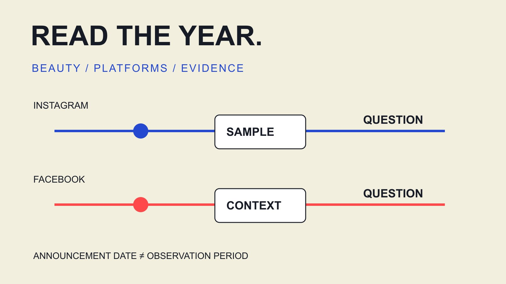

# Beauty Influencer Trends on Facebook and Instagram in 2025

Status: local review draft; confirm the publication date before release.

Review 2025 platform announcements and scoped industry evidence for beauty creator work, separating history, interpretation and the next test.

QuickKOL editorial graphic; not actual account metrics or a platform interface.

For beauty influencer marketing trends on Facebook and Instagram in 2025, separate platform developments, the subjects observed in reports and the content hypothesis a brand wants to test. This review focuses on Instagram creative experimentation, Facebook video-publishing consolidation and more careful content comparisons. Official evidence supports those developments, not a claim that every beauty creator gained engagement or sales. The historical scope is 2025; sources were reviewed November 2, 2026. Treat the article as a retrospective rather than a live platform manual or a forecast disguised as history.

## Use three evidence types instead of starting with a slogan

Separate platform announcements, samples with methods and the team’s observations. A feature creates an operating possibility without establishing adoption across beauty. A brand-account report does not automatically represent individual creators.

For each record retain publication date, observation period, platform, subject, market and the original claim. A current help interface read in 2026 does not independently establish the 2025 workflow. Preserve gradual-rollout language instead of making an announcement date the day every account changed.

Editorial interpretation can identify a question for beauty work: how a tutorial could test expression, or how changed video labels affect report comparisons. Mark that as a planning question. A reader should distinguish external facts from our suggested method rather than encounter an annual inevitability without a sample. The three evidence types can complement each other while retaining their different scopes. If one is missing, narrow the interpretation instead of treating another as a complete substitute.

## Instagram: distinguish creative testing from guaranteed results

The [Meta 2025 creativity announcement](https://about.fb.com/news/2025/06/inspiring-creativity-that-brings-people-together/) discusses Trial Reels shared with non-followers first, in a June announcement about reducing creative pressure and trying expressions. This cites the historical announcement, not a current eligibility promise or fixed interface for every creator.

The editorial implication for beauty is to specify the learning question: would showing the finished technique before its conditions help this audience, or would explaining suitability first work better? That is a test hypothesis, not a finding that one opening universally wins. Product experience and limitations still need accurate expression.

Retain test object, distribution and window. Content initially reaching non-followers and a regular publication may encounter different audiences, so a viewing difference alone does not describe changing creator ability. If a historical project did not retain test-distribution status, mark it missing rather than classifying every Reel as the same observation. The practical opportunity is a more explicit creative question, with a result that remains tied to its actual conditions.

## Facebook: a publishing label does not make every content job identical

The [Meta 2025 Facebook video announcement](https://about.fb.com/news/2025/06/making-it-easier-create-videos-facebook/amp/) describes a gradual unified publishing flow in which new videos are shared as Reels, while audience controls remain. Its coming-months language is not evidence of one completion date across every market.

Short techniques, longer product explanations and event records can still serve different beauty questions. A Reels label does not require identical short duration or automatically harmonize the definitions of older content. Retain actual duration, content purpose and the metric definitions used at the time.

Check versions and conditions for sharing or republication. The same format name on two channels does not establish identical music, captions, use or partnership arrangements. Preserve a record for each publication object so a 2025 review can distinguish nomenclature from actual content and distribution changes. Otherwise, a reporting label may appear to explain performance that was influenced by a completely different mix of work.

## Read the observation period and subjects before using a report

The [Dash Social 2025 beauty report](https://pages.dashsocial.com/hubfs/social-media-benchmark/2025/1H/beauty-industry.pdf) explains that its H1 2025 edition analyzes global company activity from July to December 2024; the Instagram beauty subset contains 257 brands. That defines context rather than a full-2025, country-specific or individual-creator population.

A report year may identify an edition rather than its observation period. Brand content is not a qualification threshold for an individual creator. If the brief needs observations actually published in 2025, obtain a matching sample or label this as historical background available when entering that year.

The [Instagram format decision guide](/blog/instagram-analytics-format-decision-matrix/#answer) supports connections between object and metric. Distinguish likes and comments relative to followers from actions relative to views or another denominator. A shared engagement-rate label does not make figures directly subtractable, poolable or a ranking of platform influence. Preserve the method beside the number instead of leaving a footnote that disappears when a chart is copied into another deck.

## Make the beauty question more specific than authenticity

The [beauty claims review guide](/blog/top-beauty-influencers-claims-review/#answer) distinguishes personal experience, technique teaching and product claims. Authenticity, education and community in a trend deck still cannot guide production without a concrete task. Specify the use condition or technique choice the viewer needs to understand.

A complexion demonstration might explain lighting, steps and visible limitations; a tool tutorial might show operation and cleaning conditions. These are editorial suggestions, not a 2025 industry performance ranking or a product-efficacy conclusion. Keep confirmed brand facts separate from the creator’s actual experience.

Do not treat women as one uniform audience or infer private circumstances from skin tone, apparent age or location labels. Use appropriate research and voluntarily discussed content context. A useful retrospective explains why a question deserves further work instead of turning fashionable vocabulary into a script for everyone. Specific questions also make limitations easier to retain when content moves from a full tutorial into a shorter authorized edit.

## Preserve historical distribution and collaboration conditions

Paid distribution, offers, seasonal moments and destination changes can influence observations. Without those conditions, differences between beauty publications are not automatically a format trend. Retain organic, paid, combined or unknown states rather than assigning unknown activity to organic.

Similar publications by one creator across platforms do not establish the same viewers. Adding followers or views is not deduplicated reach; an annual summary must explain each measure. Separate platform results when suitable deduplication evidence is unavailable.

A 2025 post inspected in 2026 includes subsequent accumulation. It can support a retrospective with a capture date without becoming a saved end-of-2025 snapshot. When history is incomplete, retain the limitation instead of using current numbers to manufacture a complete annual conclusion. This distinction matters even if the current number is accurate: accuracy at one date does not make it evidence for another.

## Turn the retrospective into a testable next hypothesis

The [social content-path guide](/blog/create-social-media-influencer-strategy-content-path/#answer) connects audience questions to contributions and destinations. Review 2025 material in the same way: observation, possible explanation, missing evidence and the specific change proposed next. A retrospective should not become a command to repeat something forever.

Suppose a brand’s earlier tutorial attracted questions about step order. Inspect whether a step was omitted before adding an explanation; comment volume alone does not establish a preferred format. If testing a new opening or subtitle structure, retain other simultaneous changes.

Match scale to the learning task. A suitable content trial need not replace every creator or platform because of an annual trend. Its observations may support continuing, redefining the question or ending an unsupported hypothesis. Each is useful learning. Reserve an owner for receiving questions and updating the destination, because a clearer publication can still leave the audience without a usable next answer if nobody maintains the supporting information.

## Example: two historical sources support different actions

Consider a hypothetical beauty lead reading the Instagram experimentation and Facebook video announcements and requesting one short-video format from every creator. A more useful response treats them separately: one prompts a creative-test discussion, while the other prompts checks on publishing objects and reporting labels.

The team retains tutorial purpose, actual version, distribution state and source before comparing suitable observations. A label change does not become a new creative execution. An actual tutorial restructuring retains its original question and the change. A brand report supplies context only for its applicable sample.

This process does not establish an industry-wide causal conclusion, but it reduces confusion between different changes. The next creator invitation can contain a specific question and open scope rather than a demand to copy an unsupported strongest trend of 2025. The example is editorial, not a real campaign or a claim that those steps were tested with the named platforms.

## Keep the scope when citing the retrospective

Retain original announcement dates, sample periods, review date and editorial interpretation together. They answer different questions and should not collapse into one updated timestamp. A 2025 retrospective remains useful without automatically changing dates to resemble a current feature guide.

QuickKOL supports brief interpretation, relevant-work research and contact preparation. Current features, permissions and terms still require verification; historical developments do not establish a workflow available to every account now.

A citable conclusion preserves its subjects and limits. With those conditions intact, history can inform the next planning decision.

A reusable internal conclusion can say that 2025 announcements created questions about creative testing and publishing records, that the team proposes a specific tutorial-expression test, and that no beauty-wide performance improvement was established. Link the relevant announcement and observation record so a recipient can find the basis. Do not shorten that into a statement that 2025 Reels guaranteed higher conversion: the sources did not establish it.

If a recipient sees only an annual comparison chart, its caption should retain brand versus individual subjects, observation period, denominator and paid-distribution state. A verbal explanation cannot be assumed to survive later handoffs. Research enters training, proposals and purchasing discussions; preserving a bounded conclusion keeps it accurate after it leaves the original author’s explanation. That is particularly useful when a historical report is reused by colleagues who were not involved in the campaign or the original analysis.

## Connect 2025 evidence to a beauty content task

| Evidence | Bounded conclusion | Does not establish |

| --- | --- | --- |

| Instagram creativity announcement | A basis for a creative-expression test question | Guaranteed results for beauty creators |

| Facebook video announcement | Check publishing labels and objects retrospectively | Identical content jobs for every video |

| Brand report with methods | Context for its period and sample | A market-wide 2025 creator benchmark |

Historical scope: 2025. Sources reviewed November 2, 2026. Suggested actions are editorial recommendations.

## Historical trend research checks

Connect each trend to evidence and a bounded question.

- [ ] Separate original date and observation period.

- [ ] Separate platform features, brand samples and creator observations.

- [ ] Trace historical distribution, versions and definitions.

- [ ] Scope beauty claims and actual experience.

- [ ] Specify the next change and its observation.

- [ ] Keep historical figures separate from live guarantees.

## Research date and limitations

Sources reviewed November 2, 2026. Methods, tables and decision rules are editorial recommendations. Hypothetical examples are not actual client results or industry benchmarks. Source geography and periods are specified where relevant. This draft is in independent local review; confirm its publication date before release.

## Sources

- [Meta: Inspiring Creativity That Brings People Together (June 12, 2025)](https://about.fb.com/news/2025/06/inspiring-creativity-that-brings-people-together/)

- [Meta: Making It Easier to Create Videos on Facebook (June 2025)](https://about.fb.com/news/2025/06/making-it-easier-create-videos-facebook/amp/)

- [Dash Social: H1 2025 Beauty Industry Benchmark Report, pp. 2, 17](https://pages.dashsocial.com/hubfs/social-media-benchmark/2025/1H/beauty-industry.pdf)
