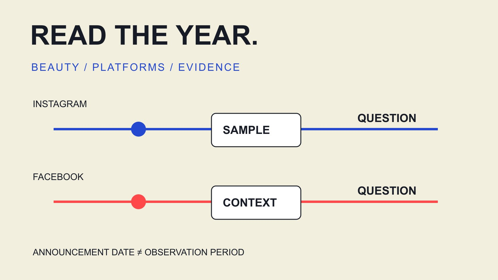

# 2025 美妆达人趋势：回看 Facebook 与 Instagram 的证据

状态：本地审阅稿；正式发布日期待确认。

用2025平台公告与有范围的行业资料回看美妆达人内容，将历史事实、编辑解读和下一轮测试分开。

QuickKOL 编辑图形；不呈现真实账号指标或平台界面。

回看2025年 Facebook 与 Instagram 的美妆达人营销，可靠做法是区分平台发生了什么、报告观察了谁，以及品牌据此想验证什么。本篇保留的方向是 Instagram 创意试验、Facebook 视频发布整合与更谨慎的跨内容比较；这些有官方资料支持，但不证明所有美妆达人都获得更高互动或销售。2025是回溯范围，本次资料核验日期为2026年11月2日。

## 用三种证据解释趋势，而不是先写口号

把研究记录分成平台公告、带方法的样本与本团队观察。平台推出一种功能，说明出现新的操作可能，不说明整个美妆行业已经普遍采用；一份品牌报告观察到的内容，也不自动代表个人创作者。

每条记录保存发布日、观察期、平台、对象、市场和原始说法。回溯时，2026年帮助页中的当前界面不能自动说明2025年如何操作。若原公告描述逐步推出，就保留推出状态，不把公告日写成所有账号同时完成更新的日期。

编辑解读可以指出对美妆任务的影响，例如教程怎样试验表达方式，或旧视频标签怎样影响报表比较。把这些作为待验证的工作问题。这样，读者引用时能识别哪些来自外部事实，哪些是我们建议的规划方法，而不是面对一个没有样本的年度“必然趋势”。

## Instagram：把创意试验与效果保证分开

[Meta 2025 创意说明](https://about.fb.com/news/2025/06/inspiring-creativity-that-brings-people-together/)在6月介绍先向非关注者分享的 Trial Reels，并将其放在降低创作压力与尝试表达的语境中。这里引用2025年的公告，不把它写成当前每位创作者的固定资格或界面操作承诺。

对美妆品牌的编辑启示是把要学的问题写清：同一技巧先展示结果，还是先解释适用条件，哪种更便于目标受众理解？这是假设测试，不是宣称某一种开头在行业中普遍胜出。内容仍需准确解释试用与限制。

试验对象、分发和窗口要保留。先面向非关注者的内容与常规发布可能面对不同人群，不能把观看差距单独解释为创作者能力变化。若历史项目没有记录是否使用试验分发，标注缺失，别在年度报告里把所有 Reels 当作同一种观察。

## Facebook：发布名称改变，不代表内容任务相同

[Meta 2025 Facebook 视频公告](https://about.fb.com/news/2025/06/making-it-easier-create-videos-facebook/amp/)说明将逐步整合视频发布流程，让新视频作为 Reels 分享，并保留受众设置。公告使用未来数月推出的表达，不能据此把所有市场的同一完成日补成已知事实。

对美妆合作，短技巧、较长产品解释与活动记录仍可能服务不同问题。名称变成 Reels，不说明必须剪成完全一样的短时长，也不意味着旧内容的口径已经自动统一。复盘需保留真实时长、内容任务与当时使用的指标定义。

转发或重新发布也要检查版本与条件。品牌不能仅因为两个渠道都使用 Reels 名称，就假设音乐、字幕、用途与合作安排完全一致。为每个发布对象保留对应记录，才能在回看2025年时理解哪项变化来自命名、哪项来自实际内容与分发。

## 行业报告先看观察期和对象

[Dash Social 2025 美妆报告](https://pages.dashsocial.com/hubfs/social-media-benchmark/2025/1H/beauty-industry.pdf)说明，H1 2025报告分析2024年7月至12月的全球公司活动，Instagram美妆子样本为257个品牌。这为理解报告提供边界，不能改写成2025全年、某一个国家或个人达人总体。

报告年份可能是发布版本，不是观测年份。其品牌内容也不能直接作为单个创作者的合格标准。若文章或方案需要2025真实发布观察，应另找匹配样本，或明确说明当前使用的是进入2025时可参考的历史背景。

[Instagram 格式决策指南](/zh/blog/instagram-analytics-format-decision-matrix/#answer)帮助保留对象与指标关系。比较时还应区分赞评论相对粉丝、动作相对观看或其他分母。表格里都写 engagement rate，不代表数值能直接相减、合并或排出哪个平台更有影响力。

## 把美妆问题写得比“真实感”更具体

[美妆主张审核指南](/zh/blog/top-beauty-influencers-claims-review/#answer)区分个人使用体验、技巧教学和产品主张。年度趋势材料里的“真实感”“教育内容”或“社区”，如果没有具体任务，仍然不能指导制作。品牌应说明观众需要理解哪项使用条件或技巧选择。

例如一份底妆演示可以交代光线、使用步骤与可见限制；一份工具教程可以展示操作动作与清洁条件。这里是编辑内容建议，不是2025全行业表现排名，也不提供产品疗效结论。品牌已确认的事实与创作者实际体验分别保存。

不把所有女性受众写成同一种需求，也不从肤色、年龄外观或地域标签猜私人情况。使用适当研究或本人愿意讨论的内容语境。更好的年度复盘能解释某类问题为什么值得继续，而不是将流行词当作对每位创作者都适用的脚本。

## 历史比较要保留当时的分发与合作条件

付费扩量、优惠、活动节点与页面变化可能影响观察。若这些条件没有记录，两个美妆发布的数字差异不能自动归为格式趋势。保留自然、付费、合并或未知状态，不把未知归到自然内容。

同一创作者在两个平台发布相似内容，也不意味着接触同一组人。跨平台粉丝或观看相加，不是唯一人数；品牌年度总结需要说明各数值描述什么。没有合适去重证据时，分别报告平台结果通常更清楚。

如果2026年才查看2025年帖子，当前累计值已经包含之后的增长。它可以作为注明抓取日期的回顾，却不能冒充2025年末保存的快照。历史窗口不足时保留限制，比用今天的数字补一个看似完整的年度结论更可靠。

## 用一份回溯记录形成下一轮假设

[社交内容路径指南](/zh/blog/create-social-media-influencer-strategy-content-path/#answer)将受众问题连接到具体内容与承接。回看2025资料时，可以按同样方式记录：观察到了什么、可能解释是什么、还缺什么、下一轮只改变什么。不要把回顾直接写成“以后都这样做”。

假设某品牌旧教程有很多关于步骤顺序的问题。可先核对原内容是否缺少一个动作，再考虑补充说明；不能仅凭评论数量断定该格式更受欢迎。如果试验新的开头或字幕结构，记录其他同时改变的条件。

下一轮规模应与学习任务相配。可以先做适当范围的内容试验，不需要为了年度趋势一次更换所有创作者或平台。观察结果可能支持继续、改写问题或停止一个没有依据的假设，这些都是可用的研究产物。

## 示例：两份历史资料可以支持不同动作

以下是编辑假设。一位美妆项目负责人看到 Instagram 创意试验公告与 Facebook 视频整合公告，想让全部创作者立刻发布同一种短视频。更谨慎的做法是分别处理它们：前者支持讨论创意试验，后者支持核对发布对象与报告标签。

她先让团队保留教程目的、实际版本、分发状态与来源，再比较适当观察。若一个内容只是改了发布标签，不将其算作全新创意；若真的改变教程结构，则说明原问题和改动。品牌报告只提供其适用样本背景。

这个过程没有得到美妆全行业因果结论，却减少了把不同变化混为一谈的风险。后续邀请创作者时，品牌能提出具体合作问题与待确认范围，而不是要求对方复制一个没有证据支持的“2025最强趋势”。

## 引用年度结论时保留范围

交付时同时保留原始公告日期、样本观察期、核验日期与编辑解释。它们回答不同问题，不应在一个“更新时间”里被合并。2025回溯文章可以持续有用，但不能靠自动改日期伪装成当前功能指南。

QuickKOL 可以支持 Brief 理解、相关作品研究与联系准备。品牌仍需核验当前功能、权限和合作条件，不能把历史趋势当成当下所有账号都能执行的流程。

可引用的结论应让读者知道观察对象与边界。保留这些条件，历史趋势才能成为下一步规划的依据。

一段可复用的内部结论可以说明：2025年平台公告为内容试验与发布记录提出了新问题；本团队准备测试具体教程表达，尚未建立美妆全行业效果提升的结论。引用时连接相应公告与观察记录，让读者能找到依据。不要把它简化为“2025 Reels 保证更高转化”，因为原资料没有完成这个证明。

若接收人只看到一张年度比较图，图注也应保留品牌或个人、观察期、分母与付费状态。不应指望口头说明在后续转交中一直存在。资料会进入培训、方案与采购讨论；保存有限结论，能让它在离开原作者解释后仍然准确。

## 2025资料与美妆任务之间的联系

| 证据 | 有限结论 | 不能推出 |

| --- | --- | --- |

| Instagram创意公告 | 可以围绕表达方式提出试验问题 | 所有美妆创作者效果保证 |

| Facebook视频公告 | 发布名称与对象需要在回溯中核对 | 所有视频内容任务已相同 |

| 有方法的品牌报告 | 指定时期与样本背景 | 2025个人达人全市场基准 |

历史范围为2025，资料核验于2026-11-02；表中动作是编辑建议。

## 历史趋势研究检查

每个趋势都连接到具体证据与有限问题。

- [ ] 原始日期与真实观察时期分别保留。

- [ ] 平台功能、品牌样本和达人观察没有混用。

- [ ] 当时的分发状态、版本和指标定义可追溯。

- [ ] 美妆主张与真实体验有明确范围。

- [ ] 下一轮假设说明具体改什么及如何观察。

- [ ] 没有将历史数字写成实时效果保证。

## 研究日期与使用边界

资料核验于 2026 年 11 月 2 日。文中方法、表格和决策规则为编辑建议，标为假设的示例不是实际客户结果或行业基准。外部资料的适用地区与时期按各段说明；本稿处于独立本地审阅阶段，正式发布日期待确认。

## 来源

- [Meta：Inspiring Creativity That Brings People Together（2025-06-12）](https://about.fb.com/news/2025/06/inspiring-creativity-that-brings-people-together/)

- [Meta：Making It Easier to Create Videos on Facebook（2025-06）](https://about.fb.com/news/2025/06/making-it-easier-create-videos-facebook/amp/)

- [Dash Social：H1 2025 Beauty Industry Benchmark Report，第2、17页](https://pages.dashsocial.com/hubfs/social-media-benchmark/2025/1H/beauty-industry.pdf)
