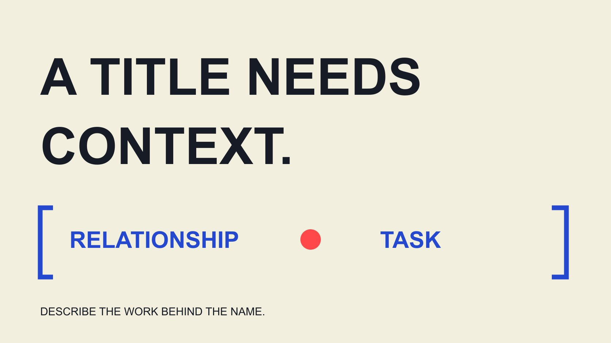

# Brand Ambassador Meaning：给跨部门团队的角色说明

状态：本地审阅稿；正式发布日期待确认。

用团队培训中的具体情境解释品牌大使，区分称号、实际关系、沟通任务与仍需确认的范围。

QuickKOL 编辑图形；不呈现真实账号指标或平台界面。

Brand ambassador 通常指通过被认可的关系，在特定场景中帮助介绍、体现或代表品牌的人。但称号本身不说明是否领取工资、有什么权限、是否要发布内容，或属于哪种法律关系。向团队解释时，可用“主体＋实际关系＋沟通任务＋范围”作工作说明。普通喜欢产品、注册某个社群或收到一份赠品，都不能自动改写成已经承担品牌大使工作。

## 先给同事一个可讨论的工作定义

[Shopify 大使概念说明](https://www.shopify.com/blog/how-to-become-a-brand-ambassador)将品牌大使描述为代表公司、帮助提升认知与销售的人，并指出可能有报酬或奖励，但并非总是如此。这里引用一种商业解释，不将其扩展为所有项目的统一资格、收入或期限标准。

给同事的工作说明应再加具体任务：谁，和品牌是什么关系，在什么情境下做什么。比如“在本次社区活动中，按已确认安排讲解产品使用的人”，比“一个很喜欢我们的达人”更清楚。

定义不是给所有人贴固定身份。一个人可以是员工、客户、创作者和活动伙伴，但当前需要理解的是哪种关系在发挥作用。团队可以在保留多个角色的同时，分别核对本次任务；不必为了表格整齐强迫每个人只属于一个类别。

## 称号、关系与任务是三个不同字段

称号是对外或内部使用的名称，关系说明双方如何连接，任务则描述实际贡献。团队培训时，将这三项分别填写，可以发现哪些信息只来自想象。一个称号听起来正式，不代表已经有内容排期或代表权限。

[代表范围指南](/zh/blog/what-is-a-brand-ambassador-representation-boundaries/#answer)处理更具体的可解释事项、需要转交的问题和不能自行承诺的条件。先理解关系，再进入权限和运营，可以避免新同事把所有“代表品牌”都理解为能替公司签字或承诺产品效果。

关系本身也可能变化。原来只是客户的人，可以后来接受一项内容任务；结束项目的人，也可能继续自然使用产品。记录应随着实际安排更新，不把过去的称号永久应用到后来的每一次表达。

## 情境一：普通客户的推荐

以下均为编辑培训情境。某客户自行购买产品并公开分享感受，品牌尚未与其讨论任务。可以记录公开作品与真实来源，但不能直接把对方加入“已确认大使”名单，更不能宣布它将按期制作下一条内容。

如果品牌希望进一步合作，先提出具体讨论，而不是将客户的积极评价视为免费工作的长期承诺。原内容的后续使用也需确认适用条件；喜欢产品，不等于允许品牌使用所有照片和身份呈现。

培训问题可以是：现在知道什么，还不知道什么，下一步应该问什么？答案是已经看到一次推荐，但商业关系、意愿、工作范围和使用条件仍需核对。这样解释，比简单断言“客户就是大使”或“客户绝不算大使”更符合真实变化。

## 情境二：员工分享与额外任务

一位员工可以在公开渠道分享工作相关信息，也可以另外承担活动或内容任务。团队不应只用大使称号判断工作安排、报酬或法律身份；这些问题要回到实际条件和适当负责人，本篇不作就业关系判定。

[FTC 背书问答](https://www.ftc.gov/business-guidance/resources/ftcs-endorsement-guides-what-people-are-asking)在美国语境下讨论员工等关系与推荐信息，强调相关连接可能影响受众理解。这里用于提醒团队核对实际关系，不提供适用于所有国家和所有表达的统一标注结论。

培训时，可以请同事区分个人观点、被安排的品牌沟通与已确认的产品事实。若任务需要额外准备或活动出席，明确安排，不以“自己人”推导无限责任。读者应该知道谁在表达，以及信息的真实来源是什么。

## 情境三：联盟参与与持续大使合作

一条推荐链接可能对应佣金安排，但不自动说明长期品牌代表、固定内容数量、排他或活动出席。反过来，大使项目也可能包含联盟贡献。培训的重点不是把两个标签完全分开，而是分别说明本次关系包含什么。

[双向讨论指南](/zh/blog/brand-ambassador-mutual-fit-conversation/#answer)帮助把愿意交流、接受具体任务和持续安排分开。若团队只有注册链接，就保留注册或申请状态；对方接受某项条件以后，再更新相应记录，不提前扩大到其他用途。

对内部同事，可以把称号换成完整句子测试理解。例如“通过指定链接开展推荐，其他任务未确认”，就比“我们的长期大使”准确。未来双方若增加制作或活动，也要让新增贡献可见，而不是隐藏在同一个关系名称里。

## 情境四：学习社区的项目成员

[Microsoft 学生大使说明](https://learn.microsoft.com/en-us/training/student-hub/become-a-student-ambassador)介绍技术学习、社区活动和分享等参与内容，并将注册、完成活动、邀请及入组列为不同阶段。它说明大使也可能用于学习社群语境，不等于本篇声称所有成员属于商业代言或获得相同报酬。

团队研究不同项目时，先看官方目的与实际工作。不要看到同一个英文词，就将技术社区、品牌推荐和活动执行套成同一种服务。也不要将注册状态提前写成已经取得项目称号。

培训可以让同事指出该例与商业内容项目有哪些共同点、哪些不同。共同点可能是清楚任务和支持；不同点需要按实际项目记录。这个练习帮助团队保持语境，而不是为所有行业建立一个不变的大使等级表。

## 用四个问题检查定义是否真正被理解

每个情境都问：主体是谁，实际关系是什么，拟议或已接受任务是什么，还有哪些未知？答题不以猜出一个称号为目标，而是看同事能否保留事实范围和下一步。

若回答中出现“肯定”“所有”“只要有粉丝”等词，进一步问依据。没有具体资料，就不要推断收入、权限或资格。团队可以采用清楚的编辑工作定义，同时承认外部项目可能使用不同名称。

练习后，把容易混淆的字段加入日常记录。例如某人是候选、申请者、受邀者还是已确认参与者；接受的是单次任务还是持续安排。这些状态帮助实际协作，不是对一个人的价值或能力评分。

## 练习：把一张模糊活动卡改写清楚

以下为编辑假设。某内部活动卡只写“品牌大使负责现场”，产品、客户支持和社交团队都收到这句话。产品同事以为对方能回答全部技术问题，支持团队以为对方能接受售后承诺，社交团队则预期当天会有账号发布。卡片实际上没有确认任何一项。

培训时，先把这些预期列成问题，不将它们立刻写成任务。再补入假设中确实已知的安排：这位参与者愿意在现场演示一个已说明的操作，品牌提供资料与问题接收人，其他工作待讨论。这仍不是完整合同，却比一个宽泛称号可理解。

让三位同事各写一句接收者能执行的说明。产品团队说明可用演示材料；支持团队说明未能解答的问题转交谁；社交团队将账号发布列为未确认，而不是提前进入发布排期。任务没有因为同事的愿望而扩大。

接着检查对外称呼是否让人误解权限或关系。称号可以保留，但它旁边需要准确任务说明；翻译成另一语言也不能增加“官方授权”“保证”等原安排没有的含义。

练习的合格输出是一张双方能读懂的任务卡，并列出未知与负责人，而不是得到最响亮的名称。团队可在下次真实项目复用这些字段，同时继续按实际来源确认。

## 从团队定义进入运营支持

[大使反馈闭环指南](/zh/blog/ambassador-program-feedback-renewal-loop/#answer)讨论如何接收真实体验、分派问题并回传结果。理解称号以后，团队还需要资料、支持和适当联系路径，不能只给一个名称就让参与者自己承担所有解释责任。

内部文件可以保留一段简短定义，附实际项目字段，而不声称它是行业统一标准。新同事接手时，应能读懂当前关系和未完成事项，不需要从聊天历史猜测称号意味着什么。

QuickKOL 可以帮助理解合作任务、研究相关作品并准备联系。工具不替团队定义法律身份，也不使候选自动成为伙伴。让称号回到真实关系和贡献，brand ambassador meaning 才能成为工作中可用的知识。

## 培训时先问关系与任务

| 情境 | 已知 | 不能推导 |

| --- | --- | --- |

| 普通客户推荐 | 一次公开分享 | 已接受长期工作 |

| 员工相关表达 | 存在工作关系，表达情境待核对 | 全部内容已由品牌批准 |

| 联盟推荐 | 按实际安排记录推荐关系 | 全部大使任务与权限 |

| 社群项目注册 | 注册或活动阶段 | 已取得所有成员资格与福利 |

编辑培训情境，不是就业、税务或具体法律身份判定。

## 团队理解检查

用具体问题回答，不只重复称号。

- [ ] 主体是谁？

- [ ] 实际关系是什么？

- [ ] 哪些任务已接受，哪些只是拟议？

- [ ] 称号是否适用于本次期间与场景？

- [ ] 需要向谁核对未知条件？

- [ ] 新同事能否读懂当前状态？

## 研究日期与使用边界

资料核验于 2026 年 11 月 2 日。文中方法、表格和决策规则为编辑建议，标为假设的示例不是实际客户结果或行业基准。外部资料的适用地区与时期按各段说明；本稿处于独立本地审阅阶段，正式发布日期待确认。

## 来源

- [Shopify: How to Become a Brand Ambassador](https://www.shopify.com/blog/how-to-become-a-brand-ambassador)

- [FTC：Endorsement Guides 问答（美国）](https://www.ftc.gov/business-guidance/resources/ftcs-endorsement-guides-what-people-are-asking)

- [Microsoft Learn: Become a Student Ambassador](https://learn.microsoft.com/en-us/training/student-hub/become-a-student-ambassador)
