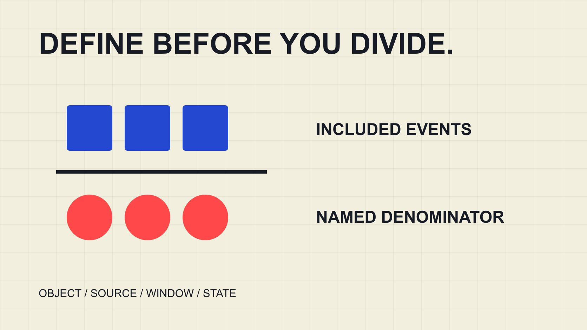

# How to Calculate Engagement Rate With the Right Denominator

Status: local review draft; confirm the publication date before release.

Build a reproducible engagement-rate record from source fields, handling denominators, missing values, zero, averages and pooling with the scope retained.

QuickKOL editorial graphic; not actual account metrics or a platform interface.

To calculate engagement rate, define included interactions and choose a denominator for the same object and window: percentage rate equals included interaction events divided by the selected denominator, multiplied by 100. Follower, reach, impression and view denominators produce different measures. Retain source, object, numerator, denominator type, value and observation state for every row. A zero or missing denominator does not produce a percentage; missing interactions are not zero. Then choose a post-level rate, an average or a pooled ratio that answers the intended question.

## Write the metric specification before copying numbers

A reproducible record first specifies platform, content object, format, reporting period, observation time and included actions. Replace engagement rate with a concrete label such as post-level, view-based, likes and comments. That is more reliable than reconstructing a percentage’s meaning after it reaches a presentation.

The [Rival IQ engagement-rate method](https://help.rivaliq.com/en/articles/2043672-understanding-engagement-rates) distinguishes public data from authorized private data and uses different denominators. It shows that one broad interface category can contain different calculations, not that every tool must use one universal formula.

The [engagement-denominator guide](/blog/engagement-rate-denominators/#answer) explains the questions different bases can answer. Here, put that choice into a row-level worksheet. Only matching specifications and appropriate source coverage should enter the later comparison. A neat table does not establish comparability. Include the configuration alongside any exported result so a colleague can reproduce the decision even when they do not have access to the interface that originally displayed the metric.

## Specify which interactions enter the numerator

The [Rival IQ interaction-field guide](https://help.rivaliq.com/en/articles/4792538-what-is-included-in-engagement-metrics) lists likes and comments for public Instagram data and likes, comments and shares for TikTok, among its channel-specific definitions. These are the vendor’s own coverage rules, not proof that every native report or another tool supplies identical data.

Authorized records may include additional actions. If another source lacks them, do not turn the missing fields into zero and call the totals equivalent. Select a genuinely comparable included set or report the different measures separately.

One person can perform several actions, so interaction events are not unique interacting people. If a platform supplies a unique-account measure, preserve its name and definition instead of adding it to event counts. A numerator change can change the conclusion and should travel with the result. That small piece of metadata is essential when a table is reused later, because a column called engagements cannot explain which actions were actually counted.

## Match the denominator to the question and object

A follower-based ratio places events relative to a follower count; it does not show how many followers actually saw the content. Reach, views and impressions answer different questions and cannot all become the share of people participating. Return to the source for the denominator’s definition.

For a hypothetical post with 100 included interactions and a 5,000-follower snapshot, the follower-based rate is 2%. If its matched view count is 2,000, the view-based rate is 5%. Both are reproducible from their own inputs. The difference is neither an arithmetic error nor a finding about audience authenticity.

Retain the follower snapshot time. Publication-period interaction, followers one month later and views from another window do not become a matched row merely because all fields are filled. Mark limitations or decline calculation when alignment is unavailable. More decimal places cannot remove a scope mismatch. The result’s label should make this visible before anyone compares it with a benchmark or another assignment.

## Separate zero, missing and not applicable

If included interactions are genuinely observed as zero and the denominator is 500, the defined rate is 0%. A missing numerator instead leaves the result missing. A zero or missing denominator should not produce division, 0% or infinity merely to fill a table.

Negative counts, text mixed with numbers and unclear abbreviated thousands need source review. Do not automatically convert every dash, blank or less-than value into an exact observation. Retain the original value and cleaning note, particularly where an estimate might otherwise appear observed after cleanup.

The downloadable worked examples keep these states separate. They are static CSV files, not a spreadsheet that automatically recalculates edited inputs. The [formula-and-calculator guide](/blog/engagement-rate-calculator-formulas/#interactive-tool) provides an actual interactive next step. Before using any calculator, match your fields to its definitions rather than relying on an input labeled engagement. A calculator can apply correct arithmetic to an inappropriate value, so the person preparing the data still owns the interpretation.

## An average of post rates differs from a pooled ratio

In a hypothetical example, post A has 100 interactions and 1,000 matched views, producing 10%. Post B has 90 interactions and 9,000 views, producing 1%. The simple mean of the two rates is 5.5%. Pooling events and views instead gives 190 divided by 10,000 times 100, or 1.9%.

The simple mean gives each post equal weight; the pooled ratio weights according to denominator size. Neither is inherently better. Ask whether the report describes an average post or the relationship between these pooled events and denominators. Average engagement rate without the method is incomplete.

The [campaign-aggregation guide](/blog/engagement-rate-instagram-campaign-aggregation/#answer) develops the aggregation question further. Here the pooled denominator contains example view events, not unique viewers. Likewise, adding post reach can repeat people and should not automatically become campaign-wide unique audience. Keep the population label attached to the total even if the arithmetic looks straightforward. The sample illustrates a weighting difference, not expected performance for any industry or account.

## Keep the calculation set consistent

If A has interactions but no denominator, adding its interactions alone to the pooled numerator breaks the match. Mark calculable rows first, use the same eligible set for numerator and denominator totals and identify excluded content.

Valid does not mean unbiased. Missing content may differ from observed content. Covering six of ten posts should be labeled as six-post coverage rather than the complete campaign. Do not replace unobserved values with a mean and call the result actual performance.

When comparing periods, preserve comparable inclusion rules and formats. Adding coverage can change the number without establishing better or worse content. Retain dataset version and set changes so the recipient can distinguish a recalculation from a performance change. If a later export fills a previously missing denominator, identify the row and reason for inclusion rather than silently updating the aggregate as though the original report had complete information. This makes both versions intelligible.

## Retain observation time so updates are not mistaken for anomalies

The [YouTube metric-counting guide](https://support.google.com/youtube/answer/2991785?hl=en) notes that verification can alter counts and realtime estimates can differ from the watch page. Retain state and observation time instead of immediately treating displays from different stages as errors or manipulation.

Choose an observation window appropriate to the project, such as an agreed period after publication, and apply it consistently to comparable content. This is the team’s methodological choice, not a universal platform requirement. Do not rank a newer item against much older accumulated results without addressing the difference in age.

Preserve earlier records when observing again and append a snapshot. Corrections and updated calculations are legitimate, but explain why they occurred. Publication time, interaction window, export time and research review date are different concepts. One generic date column cannot represent them all. Clear timing also helps a recipient reproduce a finding without expecting today’s public total to equal a historical snapshot that the source has since updated.

## Identify duplicate rows and replacement snapshots

A content item can appear in two exports or have both an older screenshot and a newer record. Identify platform, content reference, reporting window and snapshot time before choosing which row belongs in the calculation. Two folders do not make the same observation two independent items.

Suppose an earlier snapshot of post P contains 30 interactions and a later matched snapshot contains 40. For a latest-available report, retain the old value as history and include the new value in the current set. Adding them to 70 double counts the snapshots. For a change analysis, instead describe the difference between times and the update conditions, without calling them separate posts.

Deduplication also needs to avoid incorrect merging. Identical titles on different platforms do not establish one publication object, and identical filenames may refer to different versions. Use verifiable stable references, preserve the change basis and avoid using title text as the only key. A row removed as a duplicate should remain explainable if someone later questions coverage.

After cleaning, report included rows, covered publication objects and exclusions. Unknown states should not disappear in the process. This step lets an exported sheet explain where a result came from instead of leaving only a clean-looking total whose contents cannot be reconstructed.

## Recalculate, label and then interpret

Before handoff, recalculate one result manually and check multiplication by 100, percent symbols and precision. Do not treat 0.02 as an already converted 2 and multiply again. Round for display at the end while preserving original inputs.

A higher rate does not establish better brand fit, more authentic audiences or additional sales. It describes events relative to the defined denominator. For an industry comparison, check sample, period, format, numerator, denominator and aggregation. Without those conditions, the difference cannot responsibly become an improvement target.

QuickKOL can support research into relevant content and partnership questions, while source data and calculations still need appropriate verification. A reusable result is not merely a percentage. It is a record another person can understand, reproduce and bound correctly. That record can remain useful even when the conclusion is that two attractive-looking numbers should not be compared.

## Hypothetical examples: check calculation state

| Case | Input | Output |

| --- | --- | --- |

| Observed | 100 ÷ 5,000 × 100 | 2% under that denominator |

| Observed zero interactions | 0 ÷ 500 × 100 | 0% |

| Missing interactions | Missing, denominator 500 | Missing, not 0% |

| Zero denominator | Interactions 0, denominator 0 | Not calculated |

| Mean versus pooling | A 10%; B 1%, unequal denominators | Simple mean 5.5%; pooled 1.9% |

All values are educational examples, not benchmarks. Static CSV does not recalculate edited inputs.

## Reproducible engagement-rate checks

Downloaded examples retain calculated and unavailable states; verify actual data separately.

- [ ] Define included actions and denominator.

- [ ] Match object, window and observation date.

- [ ] Retain missing and zero separately.

- [ ] Pool numerator and denominator over the same set.

- [ ] Label simple mean and pooled ratio separately.

- [ ] A percentage alone establishes neither authenticity nor sales.

[Download English static worked examples CSV](/downloads/engagement-rate-worked-examples.en.csv)

[Download Chinese static worked examples CSV](/downloads/engagement-rate-worked-examples.zh.csv)

## Research date and limitations

Sources reviewed November 2, 2026. Methods, tables and decision rules are editorial recommendations. Hypothetical examples are not actual client results or industry benchmarks. Source geography and periods are specified where relevant. This draft is in independent local review; confirm its publication date before release.

## Sources

- [Rival IQ: Understanding Engagement Rates](https://help.rivaliq.com/en/articles/2043672-understanding-engagement-rates)

- [Rival IQ: What is included in engagement metrics?](https://help.rivaliq.com/en/articles/4792538-what-is-included-in-engagement-metrics)

- [YouTube: How engagement metrics are counted](https://support.google.com/youtube/answer/2991785?hl=en)
