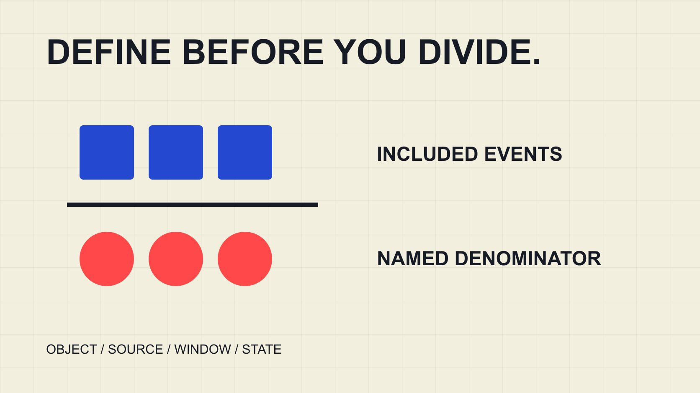

# 互动率计算：分母与汇总口径

状态：本地审阅稿；正式发布日期待确认。

从原始字段建立可复算的互动率记录，处理分母、缺失、零、平均与汇总，并保留每个结果的适用范围。

QuickKOL 编辑图形；不呈现真实账号指标或平台界面。

计算互动率先定义互动事件，再选择同一对象与窗口下的分母：互动率百分比＝纳入的互动事件数÷选定分母×100。按粉丝、触达、展示或观看计算的是不同指标，不能只写“ER”。每条记录应保留来源、对象、分子、分母类型、数值与观察状态。分母为零或缺失时不输出百分比；缺失互动不是零。最后按问题选择单帖、单帖平均或匹配记录的汇总比率。

## 先写指标配置，再复制数字

一份可复算记录，先写清平台、内容对象、形式、期间、观察时间与纳入动作。把“互动率”改成具体标签，例如“单帖、按观看、纳入点赞和评论”，比事后猜每个百分比更可靠。

[Rival IQ 互动率方法说明](https://help.rivaliq.com/en/articles/2043672-understanding-engagement-rates)将其公开数据与有权限数据的计算分开，使用不同分母。这说明工具界面中的同一大类名称可能包含不同算法，不是所有工具都必须使用同一公式的证明。

[互动率分母指南](/zh/blog/engagement-rate-denominators/#answer)解释各类分母能回答的问题。本篇进一步把选择写进逐行工作表。只有配置相同且来源适用的记录，才进入后续比较；看起来格式整齐，不代表它们已经可比。

## 分子要说明纳入哪些互动

[Rival IQ 互动字段说明](https://help.rivaliq.com/en/articles/4792538-what-is-included-in-engagement-metrics)对公开 Instagram 数据列出点赞与评论，对 TikTok 列出点赞、评论与分享等范围。引用的是供应者自己的字段方法，不等于所有原生报告或其他工具都提供同样数据。

有权限的记录可能包含更多动作；如果另一来源缺少这些字段，不能把缺少项默认为零，再称为相同的“总互动”。可以选择双方真正覆盖的可比集合，或保留不同指标分别报告。

同一人可能产生多个动作，因此互动事件总数不是独立互动人数。若使用平台提供的独立账号指标，应保留其原名和定义，不把它与事件数相加。分子变化足以改变结论，应和结果一起显示。

## 让分母对应问题与同一对象

按粉丝的比率描述互动事件相对于一个粉丝规模，不说明有多少粉丝实际看到内容。按触达、观看或展示的比率又有不同含义，不能把它们互换成“多少人参与”。分母本身的定义仍应回到数据源。

假设一条内容有100次纳入互动、5,000个粉丝，按该粉丝快照计算为2%；若同窗口可用观看为2,000，按观看计算为5%。两者都能按各自输入复算，差异不是谁算错，更不是受众真实性结论。

保留粉丝快照的时间。不能拿发布时互动、一个月后的粉丝和另一段时间的观看凑一条记录，再宣称已经控制窗口。若现有数据无法匹配，就注明限制或不计算，不能靠一个更精确的小数消除范围问题。

## 零、缺失与不适用要分开

若纳入互动确实观察为0，分母为500，则该定义下比率为0%。若分子缺失，结果应缺失。若分母为0或缺失，不做除法，也不输出0%或无穷大来填表。

负数计数、混入文本的数字和不清楚的千位缩写需要回到来源核对。不要自动把每个横线、空白和“少于某值”转换成精确数字。数据清理应保留原值和处理说明，尤其不能让估计在清理后看起来已观察。

下载算例将这些状态单列。它是静态 CSV，不会在用户修改输入后自动重算；[公式与计算器指南](/zh/blog/engagement-rate-calculator-formulas/#interactive-tool)提供实际交互入口。使用任何计算器前，也应先确认自己输入的字段对应其定义，而不是只看输入框叫“互动”。

## 单帖平均与汇总比率回答不同问题

假设内容A有100次互动和1,000次同口径观看，比率10%；内容B有90次互动和9,000次观看，比率1%。两条单帖率的简单平均为5.5%；合并事件数除以合并观看数，则为190÷10,000×100＝1.9%。

简单平均给予每条内容相同权重；汇总比率按分母大小赋予不同权重。它们没有谁必然更好，问题是报告想描述平均一条内容，还是这些匹配事件相对这些分母的总体比例。不要在不知道算法时只写“平均互动率”。

[活动汇总指南](/zh/blog/engagement-rate-instagram-campaign-aggregation/#answer)继续讨论不同聚合方式。这里合并的是示例中的观看事件，不是独立观众。同样，逐帖触达相加可能包含重复人，不能把汇总分母自动叫活动唯一人数。

## 完整行进入同一个计算集合

若A的互动可用而分母缺失，只把它的互动加进汇总分子，会破坏匹配。先标记哪些行可以计算，汇总时对分子和分母使用同一个有效集合，并报告哪些内容未被纳入。

有效不等于无偏：缺少数据的内容可能与已观察内容不同。若只覆盖十条中的六条，结果应说明六条覆盖，而不是把它命名为全部活动表现。不要用平均值替未观察内容补数后称作实际结果。

比较两个时期时，保持纳入规则与形式范围可比。一次加入更多数据，可能使数字变化，而不代表内容变好或变坏。把数据版本和集合变动留下来，接收人才能解释重算与真实表现变化的区别。

## 记录观察时间，避免把更新当异常

[YouTube 指标计数说明](https://support.google.com/youtube/answer/2991785?hl=en)提醒，核验可能改变计数，实时估计也可能与观看页不同。计算时保留数据状态与时间，不把两次不同阶段的显示差异直接当作数据错误或造假。

按项目需要确定观察窗口，例如发布后某个已约定期间，并对所有可比内容一致执行。这个期间是团队的编辑选择，不是平台统一规定。若内容尚未达到相同期龄，就不要把它与已积累较久的结果直接排名。

重新观察时保留旧记录，追加新快照。可以纠正错误，也可以用更新数据重算，但要解释为什么。发布、最后互动统计、导出和研究核验日期是不同时间概念，不能只保留一个“日期”列。

## 先识别重复行和更新快照

一条内容可能在两次导出中出现，也可能既有旧截图又有新记录。先识别平台、内容编号、窗口和快照时间，再决定保留哪条用于这次计算。不能因为文件来自两个文件夹，就把相同观察算两次。

假设内容P的一份旧快照有30次互动，后来的同范围快照有40次。若目的是报告最新可用观察，应保留旧值作历史，并让新值进入当前集合；不能把两者加成70。若要研究变化，应记录两个时点的差值与更新条件，而不是称为两条不同内容。

去重规则也要防止错误合并。不同平台出现相同标题，并不证明是同一发布对象；相同文件名也未必对应相同版本。使用能核对的稳定编号，保留修改依据，不要以标题文字作为唯一键。

完成后报告纳入多少行、覆盖多少发布对象、排除了什么。未知状态不应在清理过程中消失。这个步骤让下载后的表格仍能解释结果来自哪里，而不是只剩一个看似干净的总数。

## 复算、标注，再讨论含义

交接前选一条结果手算，核对乘100、百分号和小数精度。不要把0.02再当作2输入重复乘100。舍入放在最后显示，保留原始输入供复核。

高互动率不自动说明内容更适合品牌、受众更真实或带来更多销售。它只描述定义内的事件与分母关系。比较行业报告时，核对样本、时期、形式、分子分母和聚合方式；缺少这些条件，就不能把差额当作改进目标。

QuickKOL 可以帮助研究相关内容与合作问题；原始数据和计算仍需在适当来源核对。真正可复用的结果不只是一个百分比，而是一条别人能看懂、复算并正确限定的记录。

## 假设算例：先看计算状态

| 情况 | 输入 | 输出 |

| --- | --- | --- |

| 正常观察 | 100 ÷ 5,000 × 100 | 2%（按该分母） |

| 实际零互动 | 0 ÷ 500 × 100 | 0% |

| 互动缺失 | 缺失，分母500 | 缺失，不写0% |

| 分母为零 | 互动0，分母0 | 不计算 |

| 平均与汇总 | A 10%；B 1%，分母不同 | 简单平均5.5%；汇总1.9% |

全部为教育算例，不是市场基准。静态CSV不随输入自动重算。

## 可复算互动率清单

下载示例保留计算与不可计算状态，实际数据另行核验。

- [ ] 分子动作与分母名称明确。

- [ ] 对象、窗口和观察日期匹配。

- [ ] 缺失与零分别保存。

- [ ] 分子分母汇总用同一集合。

- [ ] 简单平均与汇总分别标注。

- [ ] 百分比不能独自证明真实性或销售。

[下载英文静态算例 CSV](/downloads/engagement-rate-worked-examples.en.csv)

[下载中文静态算例 CSV](/downloads/engagement-rate-worked-examples.zh.csv)

## 研究日期与使用边界

资料核验于 2026 年 11 月 2 日。文中方法、表格和决策规则为编辑建议，标为假设的示例不是实际客户结果或行业基准。外部资料的适用地区与时期按各段说明；本稿处于独立本地审阅阶段，正式发布日期待确认。

## 来源

- [Rival IQ: Understanding Engagement Rates](https://help.rivaliq.com/en/articles/2043672-understanding-engagement-rates)

- [Rival IQ: What is included in engagement metrics?](https://help.rivaliq.com/en/articles/4792538-what-is-included-in-engagement-metrics)

- [YouTube: How engagement metrics are counted](https://support.google.com/youtube/answer/2991785?hl=en)
