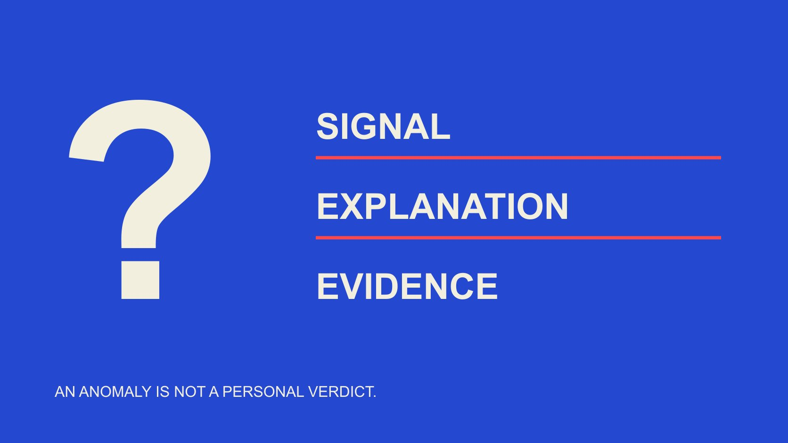

# Fake Followers: Understand Anomalies Before Drawing Conclusions

Status: local review draft; confirm the publication date before release.

A brand data-literacy guide to anomalous growth and engagement, cross-checking records and separating warning signals, explanations and established facts.

QuickKOL editorial graphic; not actual account metrics or a platform interface.

Fake followers commonly refers to accounts or activity used to create a misleading impression of an audience or engagement. An unusual increase, low interaction or repeated comments does not by itself establish that someone bought followers. For brand data literacy, identify the metric, object, window and source before examining alternative explanations. Keep what was observed, what might explain it and what evidence establishes in separate statements. This educational guide provides no personal verdicts and promises no method that identifies every inauthentic account.

## Separate accounts, engagement and responsibility

The phrase fake followers can compress several questions: whether an account misrepresents an identity, whether an interaction is valid, whether a dataset is reliable and who caused an anomaly. Each needs different evidence. Establishing one metric discrepancy does not simultaneously establish identity and intent.

The [TikTok authenticity policy](https://www.tiktok.com/community-guidelines/en/integrity-authenticity) prohibits engagement manipulation and trading related services while distinguishing nondeceptive multiple-account uses. A prohibition does not make every suspicious chart proof that someone committed the prohibited conduct. Reading a rule helps define the issue; it is not a shortcut to a personal verdict.

A team can learn through its own authorized brand aggregates, campaign records or public metrics. It should not acquire irrelevant private information to substantiate a guess or treat anonymity, infrequent posting or an unfamiliar language as proof of inauthenticity. The educational task is to improve the interpretation of observations. Keep that task separate from assigning responsibility for an event that the available records may not explain.

## Preserve an observation before labeling an anomaly

Record platform, object, metric name, unit, source, observation time and reporting period. Growth also needs comparable before-and-after values. A current total without an earlier equivalent record cannot reliably establish period growth or reconstruct when it happened.

Preserve interface context and date with a screenshot, and field definitions and filters with an export. Keep account totals, individual-post observations and website activity in separate records; changes across those objects should not be merged into a single unexplained series. A relayed percentage is not raw evidence. Copying a screenshot into another spreadsheet does not create an independent source. If the source labels a value estimated, retain that label in the research note.

For brand-owned data, check schedules, advertising, coverage, events and changes to data connections. Listing these contexts does not claim they occurred. Seek the corresponding records rather than replacing an unverified allegation with an equally unverified reassuring story. A neutral observation might read that two recorded totals differ over a stated period, with the reason unresolved. That wording leaves room for later evidence without prejudging either a person or a platform.

## An unusual increase is a question, not its cause

A sudden step in a line establishes a change under that source and definition. Next ask whether the change is real, comparable and consistent with a documented timeline. Coverage, paid distribution, changes in content distribution or delayed data can be explanations to check, not automatic excuses.

Avoid a universal rule that growth above a particular daily amount means purchased followers. Scale, channel, activity and recording interval change the shape. A slope cannot identify an actor or establish that anyone commissioned a service. An unusual observation can be worth investigating while its cause remains unknown.

For a hypothetical increase on the brand’s own account during an event, compare the event date, referral placements and platform records, then state what the evidence covers. If the cause remains unresolved, growth source unconfirmed is a valid conclusion. A report does not become more rigorous by forcing a choice between fraud and completely normal when neither is established. The decision can remain limited to how confidently the observed series may be interpreted.

## Read interaction rates with their denominators and formats

The [engagement-denominator guide](/blog/engagement-rate-denominators/#answer) explains why follower-based, reach-based and view-based percentages are different measures. A discrepancy may reflect definitions rather than audience authenticity. Identify included interactions, the denominator’s object and whether the windows match before comparing results.

Low interaction can prompt a question about content, distribution or measurement. It cannot alone establish fake followers. Views, followers and interactions are not the same set of unique people; a person watching without publicly commenting is not thereby inauthentic.

Repeated comments also require context. Brief praise, emoji, event prompts or copied interface text may look similar. They can motivate a closer look, but a convenient visible sample does not establish the proportion of an entire audience. State how many items were reviewed, how they were selected and what remains unseen. Do not attach an invented confidence percentage to an informal observation. The goal is a fair description of the pattern and its limits, not a dramatic classification that the sample cannot support.

## Check counting, updates and missing data first

The [YouTube metric-counting guide](https://support.google.com/youtube/answer/2991785?hl=en) explains that counts may slow, freeze or change during verification, and realtime estimates can differ from the watch page. This is an official example of why status and timing matter, not proof that every discrepancy on every platform has the same cause.

The [GA4 threshold guidance](https://support.google.com/analytics/answer/9383630?hl=en) explains that some report data may be withheld to prevent identification from small or sensitive groups. This website-analytics example shows why not displayed cannot automatically mean zero. GA4 is not a follower-authenticity tool, and missing website data cannot establish the identity of a social account.

Retain data-quality notices and check object, window and metric alignment. The [YouTube cohort-analysis guide](/blog/youtube-analytics-sponsored-content-cohorts/#answer) offers a next step for keeping content observations in scope. When a definition changes, repair comparability before applying an old formula to an apparently unusual trend. A cleanly drawn chart can still connect measurements that should not be joined, so presentation quality is not a substitute for checking the underlying labels.

## Cross-check independent source chains

Two websites displaying the same number are not necessarily two independent observations. They may read one platform interface, copy one public page or cite each other. Map the path from original record through transformation to display. Independence depends on the evidence chain, not the number of URLs.

Within authorized access, compare native records, exports and the existing activity timeline, stating what each covers. A screenshot may establish what appeared at one moment; an export may cover a longer window; an advertising record may establish that activity occurred. None automatically proves the complete cause.

If a tool supplies an authenticity score or estimated proportion, retain its definition, model coverage and limitations. Do not rewrite an estimate as a confirmed account count. Two decimal places do not create equivalent factual precision. Where a method cannot be checked, mark the explanation unverified rather than borrowing the authority of a numerical display. Agreement between tools using the same input may be consistency, while adding little independent support for the underlying claim.

## Worked example: what a follower-count difference establishes

Consider an editorial hypothetical. Two comparable records show a change from 10,000 to 12,000 over a week: net growth of 2,000, or 20% relative to the starting value. That establishes recorded net growth. It does not establish 2,000 newly acquired unique humans or 2,000 fake accounts.

If the same period contained 2,400 follows and 400 unfollows, the net would also be 2,000. The two endpoint totals alone cannot recover those flows. If an authorized export actually contains them, record them separately under its definitions rather than assuming they are known.

Suppose another page still displays 10,000. Check update time, caching, object and source first. Until resolved, say the displays disagree at the observation time. Do not call the difference identified fake followers or infer that a person bought attention because a platform may revise counts. Arithmetic can be correct while the narrative attached to it is unsupported. This example is useful for teaching that difference without making a claim about an actual account.

## Write conclusions that can be corrected and updated

Separate observation, hypothesis, verification result and unresolved questions. Observations retain original scope. Hypotheses identify possible causes and needed evidence. Verification states only what the evidence supports. A platform notice about removed inauthentic interactions does not necessarily establish who purchased what.

Use neutral descriptions such as a step change occurred in this series and its cause is unconfirmed. Do not label a person a fraud or interpret nonresponse as admission. Where a judgment could affect a relationship or reputation, the appropriate owner should see the original basis and limitations.

When new evidence arrives, update the conclusion and preserve why it changed. If an earlier report overstated the result, send a correction to recipients of that conclusion. Correction is part of an accountable record, making the current state intelligible rather than allowing an outdated inference to circulate as fact. A careful team can change its interpretation without erasing the observation that first prompted the question.

## The next step is better metric literacy

The [campaign-measurement guide](/blog/creator-campaign-measurement/#answer) helps keep objectives, observations, metrics and limitations together. A training exercise can use hypothetical data without named people: one colleague describes the observation, another proposes alternatives and a third checks whether the evidence supports the conclusion.

This guide supplies no methods for purchasing, manipulating or evading platform rules. A useful educational outcome is a team better able to recognize definition differences, explain uncertainty and correct overinterpretation, rather than assigning everyone an authenticity score.

Where verification is unavailable, retain the unknown, narrow the report or seek appropriate original information. Metrics should support accurate understanding. No single indicator can decide a person’s intent on the team’s behalf.

## Three levels of evidence wording

| Level | Can state | Cannot jump to |

| --- | --- | --- |

| Observation | A source shows net growth over a stated window | All growth came from fake accounts |

| Hypothesis | Check activity, update and counting changes | A person must have purchased followers |

| Verified finding | The object and event established by specific evidence | Unsupported identity, intent or proportions |

Editorial teaching framework, not a platform certification, detection accuracy claim or verdict about a real person.

## Anomaly-literacy checks

Practice with anonymous or authorized brand data without personal verdicts.

- [ ] Retain object, source, time and unit.

- [ ] Align numerator, denominator and window.

- [ ] Check distinct source chains, not URL counts.

- [ ] Separate estimates, missing values and zero.

- [ ] Do not rewrite a hypothesis as fact.

- [ ] Make corrections reach recipients of the earlier conclusion.

## Research date and limitations

Sources reviewed November 2, 2026. Methods, tables and decision rules are editorial recommendations. Hypothetical examples are not actual client results or industry benchmarks. Source geography and periods are specified where relevant. This draft is in independent local review; confirm its publication date before release.

## Sources

- [TikTok: Integrity and Authenticity (effective September 13, 2025)](https://www.tiktok.com/community-guidelines/en/integrity-authenticity)

- [YouTube: How engagement metrics are counted](https://support.google.com/youtube/answer/2991785?hl=en)

- [Google Analytics: About data thresholds](https://support.google.com/analytics/answer/9383630?hl=en)
