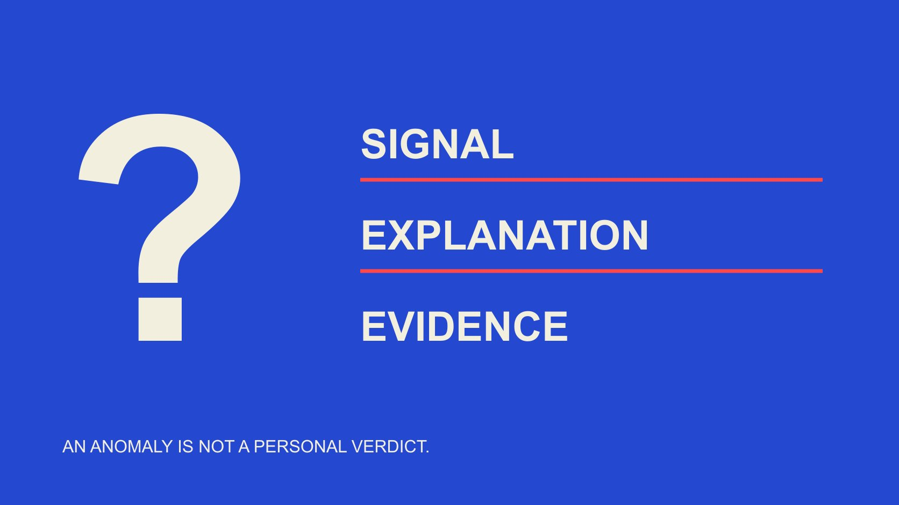

# Fake Followers：品牌如何解读异常数据

状态：本地审阅稿；正式发布日期待确认。

面向品牌的数据素养指南：解释异常增长与互动，交叉核验记录，并把可疑信号、待验证解释和已证实事实分开。

QuickKOL 编辑图形；不呈现真实账号指标或平台界面。

Fake followers 通常指用来制造虚假受众或互动印象的账号或相关行为，但增长异常、低互动或重复留言本身不能证明某人购买粉丝。品牌学习这类数据时，应先确认指标定义、对象、统计窗口与来源，再检查其他可验证解释。把“观察到什么”“可能因为什么”和“证据已经确认什么”分别写清。本篇是数据教育指南，不提供个人判定名单，也不承诺百分百识别。

## 先区分账号、互动与责任归属

“假粉”容易把多个问题压成一句话：某个账号是否虚构身份、某次互动是否有效、某组数据是否可靠，以及谁造成了异常。这些问题需要不同证据。确认一条指标不一致，并不同时确认身份和动机。

[TikTok 真实性政策](https://www.tiktok.com/community-guidelines/en/integrity-authenticity)禁止操纵互动及买卖相关服务，也区分不带欺骗目的的多账号等情况。平台禁止某种行为，不代表任意可疑图形都能证明有人实施了该行为。阅读规则是理解边界，不是获得对个人定性的捷径。

团队可以先围绕自己有权查看的品牌汇总数据、活动记录或公开指标学习。不要为证明一个猜测去获取无关私人资料、推断私人身份，或将匿名、少发帖和不熟悉的语言视为不真实的证据。

## 描述异常前，先保存可复核的观察

写下平台、对象、指标名称、单位、来源、观察时间和统计期间。增长还需要可比较的前后值。只有一个当前总数，没有此前同口径记录，就不能计算可靠的期间变化，更不能恢复何时发生了增长。

截图保留界面和日期，导出保留字段说明与过滤条件。对账号总数、单帖表现和网站访问分别建记录，不能将三个对象的变化合成同一条时间线。经过转述的百分比不是原始数据；把截图抄进另一张表，也不增加一份独立证据。若来源只给估计，研究记录也应保留“估计”。

对品牌自有数据，可先核对排期、投放、媒体报道、活动和数据连接变化。列举这些可能情境，不代表断言它们实际发生。要从对应记录确认，避免用一个未经验证的解释，替换另一个同样未经验证的指控。

## 异常增长是问题，不是原因的答案

折线突然抬升，说明在该数据源与口径下出现了变化。接下来要问这个变化是否真实、是否可比，以及可能与什么时间线一致。传播事件、付费分发、内容分发变化或数据补回，都属于需要核对的解释，不是自动免责理由。

不要使用“每天超过多少就是买粉”的统一阈值。不同规模、渠道、活动和记录间隔会产生不同图形；仅凭斜率不能识别行为者，更无法知道是否有人主动购买了服务。

假设品牌自己的账号在活动日增长，团队可以核对活动日期、引流位置与平台记录，再说明证据覆盖范围。若仍无法解释，结论可以是“增长原因未确认”。没有必要为了让报告看起来完整，就在欺诈与完全正常之间强选一边。

## 互动率必须和分母及形式一起读

[互动率分母指南](/zh/blog/engagement-rate-denominators/#answer)解释，按粉丝、触达或观看计算的百分比不是同一指标。即使显示值不同，差异也可能来自口径，而不是受众真实性。先确认分子包括什么，分母对应谁，观察窗口是否一致。

低互动可能提示内容、分发或测量问题，但不能单独证明粉丝虚假。观看、粉丝与互动也不是同一组独立人数；有人观看但不公开留言，并不因此不是真实的人。

重复留言同样需要语境。简短赞美、表情、活动提示或复制的界面文本，可能看起来相似。它们可以构成要核对的模式，但一个方便观察的小样本不能扩展为全部受众的比例。报告应说明观察了多少条、如何选取及看不到什么。

## 先检查计数、更新和数据缺失

[YouTube 指标计数说明](https://support.google.com/youtube/answer/2991785?hl=en)指出，系统核验互动时可能暂缓、冻结或调整计数，实时估计也可能与观看页数字不同。这给出了为什么要核对状态和时间的官方例子；它不意味着任何平台的任何差异都必然由同一种原因造成。

[GA4 数据阈值说明](https://support.google.com/analytics/answer/9383630?hl=en)则解释，为避免从细分数据推断个人信息，部分报告数据可能被隐藏。这个网站分析例子说明“未显示”不能自动等于零。GA4 也不是粉丝真实性工具，不能拿网站报告的缺失情况反推社交账号身份。

保留来源提供的数据质量提示，并核对是否同一对象、同一窗口和同一指标。[YouTube 数据分组指南](/zh/blog/youtube-analytics-sponsored-content-cohorts/#answer)帮助进一步区分内容观察范围。发现口径变化后，应先修正可比性，而不是沿用旧公式继续解释看似异常的趋势。

## 交叉核验要寻找不同来源链

两个网站给出相同数字，未必是两份独立观察。它们可能读取同一个平台接口、复制同一公开页面，或者引用彼此。先画出数据路径：原始记录、转移或处理方式、展示位置。独立性取决于证据链，不取决于网址数量。

对同一问题，可在有权访问的范围内比较原生记录、导出与已有活动时间线，但要说明它们各自覆盖什么。截图可确认某个时刻显示了一个数字；导出可包含更长窗口；投放记录可确认活动存在。任何一项都不自动证明完整原因。

若工具提供真实性评分或估计比例，保留它自己的定义、模型范围与限制，不将估计改写为已确认账号数量。不能因为模型给出两位小数，就宣称拥有同等精度的事实。无法核对的方法，应被标为不可验证的解释。

## 算例：粉丝数差异只证明了什么

以下是编辑假设。两份同口径记录在一周内从10,000变为12,000，净变化2,000，按期初值计算增长20%。这组数字说明记录中的净增长，不说明有2,000个新增独立真人，也不说明有2,000个假账号。

若同期新关注2,400、取消关注400，两者的净值也是2,000；但仅凭前后总数，不能恢复这两个流量。若导出恰好包含它们，可按来源定义另行记录，不能先假定自己知道。

假设另一个网页仍显示10,000，应先核对更新时间、缓存、对象与来源。没有解释之前，写“两个展示在该时点不一致”。不能将差额称为已识别假粉，也不能由平台可能调整计数推定某个人购买了关注。

## 把结论写成能纠正和更新的句子

建议将记录分成观察、假设、核验结果与未解决项。观察写原始范围；假设写可能原因及需要的证据；核验结果只写证据确实支持的部分。某项平台通知若只说明移除了异常互动，就不能扩写成已经证明谁购买了什么。

尽量使用中性描述，例如“该系列出现一次增长跃迁，原因待确认”。不要给个人贴上“骗子”标签，也不把未回复解释成承认。对可能影响合作或声誉的判断，让适当负责人查看原始依据和范围。

新证据出现后，更新结论并保留修改原因。若先前报告夸大，把更正同步给收到旧结论的人。修正不是隐藏错误：它让后续讨论知道事实状态为何改变，而不是继续引用已经失效的推断。

## 下一步是提高指标素养

[活动衡量指南](/zh/blog/creator-campaign-measurement/#answer)可帮助把目标、观察、指标与限制放在同一记录里。团队培训可以用无人物的假设数据练习：一人描述观察，一人提出不同解释，再由另一人检查证据是否真的支持结论。

本篇不提供购买、操纵或规避平台规则的方法。教育成果可以是团队更能识别口径差异、说明未知并纠正过度推断，而不是给每个人打真实性分数。

对无法核验的情况，可以保留未知、缩小报告主张或寻找适当的原始资料。任何指标都应服务于准确理解；它不能独自替团队判断个人动机。

## 三层事实表达练习

| 层级 | 可以写 | 不能跳到 |

| --- | --- | --- |

| 观察 | 某来源在某窗口显示净增长 | 增长全部来自虚假账号 |

| 待验证解释 | 需核对活动、更新或计数变化 | 某人必然购买了粉丝 |

| 核验结果 | 具体证据确认的对象与事件 | 扩大到未经证明的身份、动机或比例 |

编辑教育框架，不是平台认证、检测准确率或对实际人物的结论。

## 异常数据学习清单

用匿名或自有授权数据练习，不输出个人判定。

- [ ] 对象、来源、时间、单位齐全。

- [ ] 分子、分母、窗口可比较。

- [ ] 找不同来源链，不只数网址。

- [ ] 估计、缺失和零分开。

- [ ] 假设不改写成事实。

- [ ] 更正能同步给旧结论接收人。

## 研究日期与使用边界

资料核验于 2026 年 11 月 2 日。文中方法、表格和决策规则为编辑建议，标为假设的示例不是实际客户结果或行业基准。外部资料的适用地区与时期按各段说明；本稿处于独立本地审阅阶段，正式发布日期待确认。

## 来源

- [TikTok：Integrity and Authenticity（2025-09-13生效版本）](https://www.tiktok.com/community-guidelines/en/integrity-authenticity)

- [YouTube: How engagement metrics are counted](https://support.google.com/youtube/answer/2991785?hl=en)

- [Google Analytics: About data thresholds](https://support.google.com/analytics/answer/9383630?hl=en)
