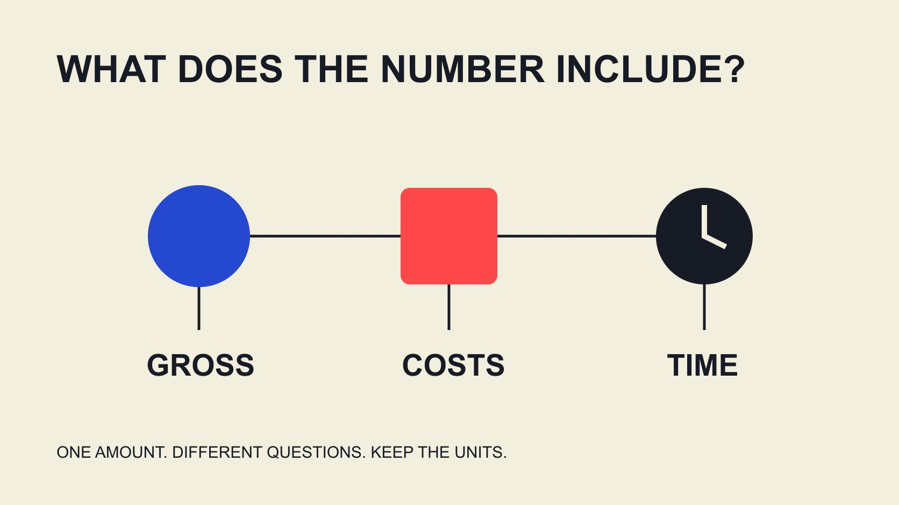

# How Much Do Influencers Make? Gross, Net and Workload

Status: local review draft; confirm the publication date before release.

Read creator-income research in context and separate scope, revenue streams, actual costs and payment status when discussing an individual quote.

QuickKOL editorial graphic; not actual account metrics or a platform interface.

How much do influencers make has no single answer that applies to everyone. Specify whether the question concerns annual creator income, a brand-campaign fee, platform revenue or money remaining after work costs. Then identify currency, period, sample and scope. A public survey describes its respondents; it does not price a particular person. Brands should discuss payment around actual production, publication, use and resources rather than inferring private annual income from followers or treating an average as the amount someone should accept.

## An income question needs a unit before it needs a number

What does this creator make can refer to an entire year of business, one partnership or income from one platform. Identical numbers would have very different budget implications. Begin research with entity, currency, reporting period, included revenue and data status.

A brand purchases defined work rather than a person’s whole financial life. Deciding whether a demonstration video suits a project does not require guessing every private revenue stream. Ask for the proposed assignment’s quote and feasible arrangements while explaining what resources the brand can supply.

Retain agreed amount, invoiced amount, receivable and payment received as separate states. A large publicly discussed deal does not establish that all money arrived or how much went to a team and production. Accurate labels make the subsequent comparison meaningful. A quote is also time-specific: a person may propose different work, rights or scheduling conditions for another assignment without either quote becoming evidence of a fixed personal salary.

## Different surveys are not one universal salary table

The [CreatorIQ 2026 creator survey](https://www.creatoriq.com/whitepaper/state-of-creators) states that Influencers.club surveyed 5,095 respondents from May 29 to June 29, 2026, across 100 countries. It reports that 67% earned under USD10,000 in creator income over the preceding year. This describes self-reported income in that sample, not every creator’s earnings.

The [CreatorIQ 2025 income study](https://www.creatoriq.com/hubfs/%5BSCC26%5D%20State%20of%20Creator%20Compensation%20Report/CreatorIQ_StateofCreatorCompensation_Report-compressed.pdf) instead used a Sapio Research survey of 300 creators, reporting average annual 2025 income of USD44,293. Different samples and observation contexts mean the average from one cannot be combined with the proportion from the other to manufacture an income standard for a follower tier.

A brand can use the findings to understand that earnings vary substantially. It cannot conclude that an individual partner should earn either number. The research explains why scope and income definitions matter; it does not replace a quote. An accurate citation should preserve the survey and year even when a short presentation would be easier to write without them.

## Brand fees and platform earnings are different streams

A creator may receive production fees, publication fees, licenses, referral commission or platform earnings. Not everyone has every stream, and views do not automatically establish monetized income. A brand’s budget should identify the contribution it buys rather than using unrelated revenue to discount the work’s value.

The [YouTube earnings overview](https://support.google.com/youtube/answer/72902?hl=en) distinguishes mechanisms such as the applicable Watch Page share of net advertising revenue and the share allocated through the Shorts creator pool. It also states that earnings are not guaranteed. Different calculation bases prevent those percentages from becoming directly comparable pay rates, much less a fixed payment per view.

Even an authorized platform record answers only the question within its scope, not total business income. Preserve source and coverage. Public views, subscribers and someone else’s CPM assumption cannot reconstruct finalized personal earnings. A report can responsibly say that a stream exists while leaving its amount unknown. That is preferable to converting visible attention into a financial claim that the person never disclosed.

## Make a quote correspond to a defined assignment

The [scope-normalization guide](/blog/evaluate-creator-rate-cards/#answer) separates deliverables, publication, revisions and use. One amount may include script research, filming, editing, captions, publication and use for a period. Another may cover only part of that work. Without scope, two quotes are not meaningfully comparable.

Specify quantities, formats, length requirements, research, supplied information, review rounds, timing and additional uses. Separate required work from optional additions rather than placing an expanding request under a vague all-inclusive label.

A creator may suggest fewer pieces, a different format or another date. Discuss those real choices instead of using an income survey as bargaining authority. If the budget cannot support the original assignment, change the assignment or production approach rather than assuming outside income makes free work reasonable. Clarifying scope also protects the brand’s planning: a cheaper proposal may omit the publication or editing contribution that the project needs most, while an apparently expensive proposal may include resources the team would otherwise buy separately.

## Hypothetical example: gross receipts, project remainder and time

Consider an editorial hypothetical, not a market quote. A defined project has USD1,600 received and USD600 in editing, location and other direct project costs. The difference is USD1,000. Dividing that remainder by 25 actual project hours gives USD40 per project hour.

USD40 is not take-home hourly pay. The calculation has not allocated all annual administration, equipment, acquisition, idle time or applicable taxes. Treating those 25 hours as the whole business workload, or calling the project remainder a net wage, overstates what the example establishes.

If USD200 remains receivable, distinguish cash observed from agreed revenue as well. The example does not set a creator minimum price. It explains why costs and work cannot disappear inside a headline deal amount. Actual accounting and individual circumstances require appropriate judgment. State which costs are included before comparing this figure with another project: a team that counts editing in hours but also deducts an editor’s invoice needs to explain whose labor each figure represents, so the same work is not interpreted twice.

## Content use changes the assignment’s value

The [content usage-rights guide](/blog/creator-rates-usage-rights/#answer) distinguishes file delivery, brand-owned publication, paid distribution, editing and longer reuse. Existing footage does not make every additional use valueless, and a publication fee does not automatically include indefinite advertising.

Exclusivity also changes the arrangement someone can accept. Identify products, market and period so the recipient can consider effects on other work. This article supplies no universal license price or exclusivity multiplier. A precise-looking multiplier without actual scope cannot support a specific quote.

List potential additional uses as options. The brand can purchase its current need and discuss another use later, while the creator can identify what was provided and when. Defined scope is closer to the decision than deriving license fees from an earnings ranking. It also avoids a later dispute in which one party remembers a production conversation and the other assumes it bought an unrestricted asset library for the same amount.

## Continuing work needs payment clarity and feasible scheduling

The [negotiation-options guide](/blog/how-to-negotiate-with-influencers-offer-options/#answer) supports discussion of quantity, format, duration and payment arrangements. Continuing work may reduce repeated research and coordination, but continuity is not an automatic discount or a guarantee of identical monthly volume.

Explain expected assignments, confirmed commitments, change handling and payment states. Avoid asking someone to reserve a long period for work that remains only a possibility. The brand also needs to distinguish agreed spending from forecasts.

Observe delivery, whether revisions follow a changed request and whether work exceeds the original scope. Revisit arrangements when workload changes rather than explaining everything with an old income assumption. Sustainable collaboration comes from real resources and clear expectations, not imagining the partner belongs to a rich or poor category. A narrower confirmed assignment can be easier for both parties to plan than a large hypothetical annual number with no allocation, scheduling or payment detail.

## Why an average is not an individual income target

Consider a purely mathematical hypothetical, not a research sample. Three annual amounts are USD3,000, USD3,000 and USD30,000. Their mean is USD12,000 and their median is USD3,000. A few larger observations can pull the mean above the amount received by most members of a small sample. The statistics answer different questions; neither reveals the amount a particular person earns.

Knowing a mean and median would still leave working conditions unresolved. Ask what revenue streams are included, whether participation was full time, what team costs exist and which places and respondents the research covers. Differences between a public statistic and a proposed fee do not establish poor effort, unreasonable pricing or a particular lifestyle. A creator may quote for a demanding specialist production while maintaining a small public following, and the scope still needs to be evaluated on its own terms.

Brand training can explain these distinctions without reproducing a follower-tier salary chart. Budget discussions should return to the deliverable the brand can purchase and the conditions the recipient actually offers. A sample can improve the questions the team asks; it cannot answer for an individual. This also makes room for a valid unknown: the team can make a purchasing decision without learning, estimating or publishing the partner’s private annual income.

## Use income information for the decision it can support

A final research record identifies where each number came from, whom it describes, its period and the question it answers. Public surveys can support training, authorized quotes can support purchasing comparisons and actual payments belong in their corresponding records. They should not be combined into a person’s supposed true value.

QuickKOL can help interpret a brief, discover relevant creators and research work and contact routes. Content fit does not establish a quote or income; commercial conditions and outcomes still need verification at the appropriate source.

The brand’s practical questions are whether the work is defined, resources are sufficient, the recipient wants the arrangement and observations can inform another assignment. Those specific questions are usually more useful than an income average without a scope.

## Identify the number before comparing it

| Figure | Required scope | Does not replace |

| --- | --- | --- |

| Survey annual income | Respondents, year and income definition | Individual quote |

| Assignment fee | Deliverables, publication, use and period | Annual disposable income |

| Platform earnings | Mechanism, estimated/finalized state and window | Total business income |

| Project remainder | Included receipts and costs | After-tax wage or universal hourly rate |

Body arithmetic is hypothetical, not individual tax or financial advice or a market quote.

## Income and quote reading checks

Complete the scope before interpreting the amount.

- [ ] Record currency, period, entity and status.

- [ ] Do not generalize a survey sample to all creators.

- [ ] Discuss production, publication, use and exclusivity separately.

- [ ] Specify costs included and excluded from a remainder.

- [ ] Do not infer private income from public followers.

- [ ] Change the actual assignment when resources are insufficient.

## Research date and limitations

Sources reviewed November 2, 2026. Methods, tables and decision rules are editorial recommendations. Hypothetical examples are not actual client results or industry benchmarks. Source geography and periods are specified where relevant. This draft is in independent local review; confirm its publication date before release.

## Sources

- [CreatorIQ: The State of Creators](https://www.creatoriq.com/whitepaper/state-of-creators)

- [CreatorIQ: The State of Creator Compensation](https://www.creatoriq.com/hubfs/%5BSCC26%5D%20State%20of%20Creator%20Compensation%20Report/CreatorIQ_StateofCreatorCompensation_Report-compressed.pdf)

- [YouTube: Partner earnings overview](https://support.google.com/youtube/answer/72902?hl=en)
