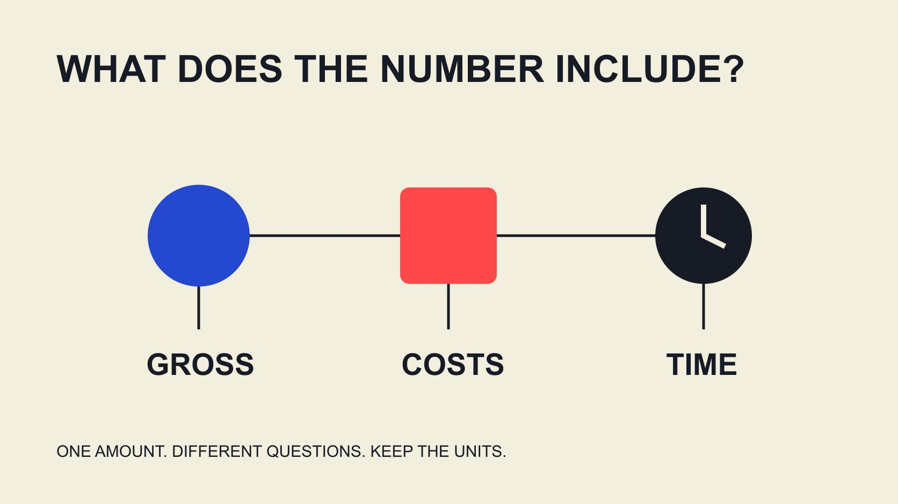

# 达人能赚多少？区分收入、成本与工作范围

状态：本地审阅稿；正式发布日期待确认。

读懂达人收入调查的样本和期间，把个人报价拆成工作范围、收入来源、实际成本与付款状态。

QuickKOL 编辑图形；不呈现真实账号指标或平台界面。

How much do influencers make 没有一个适用于所有人的数字。先问是过去一年的创作者收入、单次品牌合作费、平台分成，还是扣除工作成本后的金额；再核对币种、期间、样本与工作范围。公开调查能描述特定受访者，不能给某个人定价。品牌应围绕实际交付、发布、使用和资源讨论报酬，不从粉丝数推断私人年收入，也不以行业平均数作为应付价格。

## 收入问题要先带单位

“这个达人赚多少”可能混合了一年的全部业务、一项品牌合作，或者一个平台的收入。即使数字相同，它们对预算的意义也完全不同。开始研究时就写下主体、币种、统计期间、收入范围及数据状态。

品牌购买的是一项有范围的工作，不是某个人的一整年生活。为了决定一段演示视频是否合适，不需要猜测对方所有私人收入。可以直接询问拟议任务的报价与可行安排，同时说明自己能提供哪些资源。

把合同约定金额、开票、待收、已到账分别记录。一个很高的公开合作金额，不证明钱已全部收到，也不说明扣除了多少团队或制作成本。标签准确，后面的比较才有意义。

## 两份调查的结果不能拼成统一薪资表

[CreatorIQ 2026 创作者调查](https://www.creatoriq.com/whitepaper/state-of-creators)披露，Influencers.club 于2026年5月29日至6月29日调查5,095名创作者，页面说明覆盖100个国家；67%的受访者表示过去一年创作者收入低于10,000美元。它反映该样本的自报收入分布，不是所有达人的总体收入结论。

[CreatorIQ 2025 收入研究](https://www.creatoriq.com/hubfs/%5BSCC26%5D%20State%20of%20Creator%20Compensation%20Report/CreatorIQ_StateofCreatorCompensation_Report-compressed.pdf)则基于与 Sapio Research 合作的300名创作者调查，报告2025年度收入平均为44,293美元。两个研究的样本及观察背景不同，不能把一份的均值与另一份的比例拼接后，假装得到某个粉丝层级的收入标准。

品牌可由此认识到收入差异很大，但不能声称某个合作对象就应该接近其中一个数。研究结果适合解释为什么要问清工作与收入定义，不能替代真实报价。

## 品牌费用与平台收益是不同收入流

达人可能获得内容制作费、自己账号的发布费、许可费、推荐佣金或平台收益。并非每个人都具备所有来源，也不能假设某个平台有观看就必然有对应收入。品牌在预算中应记录自己购买的部分，避免把不相关的收入流拿来抵扣工作价值。

[YouTube 收益说明](https://support.google.com/youtube/answer/72902?hl=en)区分不同分成机制，例如适用 Watch Page 广告条款下的净广告收益分成，以及 Shorts 分配池对应的份额；说明也明确没有收入保证。两种百分比的计算基础不同，不能直接相互比较，更不能当作每次观看固定支付额。

即使创作者授权分享某平台记录，它也只回答该记录覆盖的问题，不代表所有业务收入。报告应保留来源和范围。公开观看数、订阅数与别人的 CPM 估计，不能复原个人最终收入。

## 先让报价对应清楚的工作

[报价归一指南](/zh/blog/evaluate-creator-rate-cards/#answer)建议把交付、发布、修改与使用范围拆开。一个数字可能包括脚本研究、拍摄、剪辑、字幕、发布以及一定期间的使用，也可能只包含其中一部分。没有范围就无法判断两个报价是否真的可比。

写出内容数量、形式、长度要求、研究任务、提供资料、审核轮次、发布时间与额外用途。区分必须交付和可选追加，不用一个模糊的“全包”覆盖不断增长的请求。

创作者也许可以建议减少数量、改变形式或移动日期。品牌应讨论这些真实取舍，而不是把收入调查当作压价依据。若预算不足以支付原任务，调整任务或寻找不同制作方案，比假设对方有其他收入所以可以免费更合理。

## 假设算例：毛收入、项目余额与时间

以下是编辑假设，不是市场报价。一次明确范围的项目已收1,600美元；为该项目支出的剪辑、场地与其他直接成本合计600美元。两者相减剩1,000美元。若实际投入25小时，这个项目余额除以工时为每小时40美元。

40美元不是个人到手时薪：还没有覆盖所有年度管理、设备、获客、闲置时间及可能适用税费。若把同样25小时误当为全部业务时间，或将项目余额叫作净工资，就会高估可支配收入。

若有200美元仍待收，现金观察与约定收入也需要分开。算例的目的不是给达人制定最低价，而是让品牌看懂成本与工作为何不能从一个合作总额中消失。实际资源和核算应采用相应专业判断。

## 内容的使用范围也占用价值

[内容使用权指南](/zh/blog/creator-rates-usage-rights/#answer)说明，文件交付、品牌自有渠道使用、付费投放、修改与长期复用需要分别讨论。内容已经拍好，并不代表所有新用途没有价值，也不代表一次发布费涵盖无限投放。

排他要求也会改变可接受的安排。品牌应说明涉及哪些产品、市场与期间，让对方判断是否影响其他工作。本文不提供通用许可价格或排他倍数；没有实际范围的倍数看似准确，却不能支撑一份具体报价。

把可能追加的用途列为选项。品牌可以只购买当前需要的范围，日后再谈新用途；创作者也能知道自己在何时提供了什么。清楚范围，比从收入排名倒推许可费更接近真实决策。

## 长期合作需要考虑现金与可安排性

[谈判选项指南](/zh/blog/how-to-negotiate-with-influencers-offer-options/#answer)可用于比较数量、形式、期限与付款安排。长期合作可以减少反复研究和协调，但持续关系不是自动降价理由，也不保证每个月都会有相同工作量。

说明预计任务、可确认的部分、变化处理与付款状态。不要要求创作者保留很长档期，却仅承诺未来可能发生的工作。品牌内部也需要知道哪些费用已约定、哪些仍只是预测。

实际观察可以包括是否按期交付、修改是否来自需求变化、成本是否超出原范围。若工作量变化，重新讨论安排比用旧收入假设解释一切更可靠。合作可持续性来自真实资源与清楚预期，不来自把某位创作者想象成高收入或低收入人群。

## 平均数为何不能变成个人的收入目标

以下为纯数学假设，不描述任何研究样本。三个年度金额分别是3,000、3,000和30,000美元，平均数为12,000美元，中位数为3,000美元。少数较大值就能使均值明显高于样本中多数人的金额；两种统计量回答的问题不同。

即使知道均值和中位数，也还不知道某个具体人的工作条件。需要继续看收入包括哪些来源、是否为全年投入、团队成本、地区与调查覆盖。不能用数字比较就判断一个人工作不努力、报价不合理或一定拥有某种生活水平。

品牌培训可以解释这种差别，但不必复制一张按粉丝划档的薪资表。若讨论预算，回到自己能够购买的交付和对方明确提出的条件。样本可以促使团队提出更好的问题，不能代替当事人的回答。

## 把收入资料用在正确的决定上

最终研究记录应说明每个数字来自哪里、描述谁、覆盖多久，以及能回答什么。公开调查可以进入团队培训，授权报价可以进入采购比较，实际付款进入对应记录。它们不应该被合成某人的“真实身价”。

QuickKOL 可以帮助理解 Brief、发现相关创作者并研究作品与联系路径。内容适配不等于已确认报价或收入；商业条件与结果仍需向适当来源核验。

品牌真正需要回答的是：这项工作是否清楚、资源是否够、对方是否愿意接受，以及观察结果如何支持下一次安排。把问题问得具体，通常比寻找一个没有范围的收入平均数更有用。

## 比较数字前先确认它是什么

| 数字 | 需要范围 | 不能替代 |

| --- | --- | --- |

| 调查年收入 | 受访者、年份、收入定义 | 个人报价 |

| 合作费 | 交付、发布、使用与期限 | 全年可支配收入 |

| 平台收益 | 机制、估计/结算、窗口 | 全部业务收入 |

| 项目余额 | 纳入收入与成本 | 税后工资或统一时薪 |

正文金额算例是假设；不构成个人税务、财务建议或市场报价。

## 收入与报价阅读清单

先补齐范围，再讨论金额。

- [ ] 记录币种、期间、主体及状态。

- [ ] 调查样本不写成所有创作者。

- [ ] 制作、发布、使用与排他分别讨论。

- [ ] 余额说明纳入和未纳入成本。

- [ ] 不从公开粉丝数推断私人收入。

- [ ] 预算不足时调整实际任务。

## 研究日期与使用边界

资料核验于 2026 年 11 月 2 日。文中方法、表格和决策规则为编辑建议，标为假设的示例不是实际客户结果或行业基准。外部资料的适用地区与时期按各段说明；本稿处于独立本地审阅阶段，正式发布日期待确认。

## 来源

- [CreatorIQ: The State of Creators](https://www.creatoriq.com/whitepaper/state-of-creators)

- [CreatorIQ: The State of Creator Compensation](https://www.creatoriq.com/hubfs/%5BSCC26%5D%20State%20of%20Creator%20Compensation%20Report/CreatorIQ_StateofCreatorCompensation_Report-compressed.pdf)

- [YouTube: Partner earnings overview](https://support.google.com/youtube/answer/72902?hl=en)
