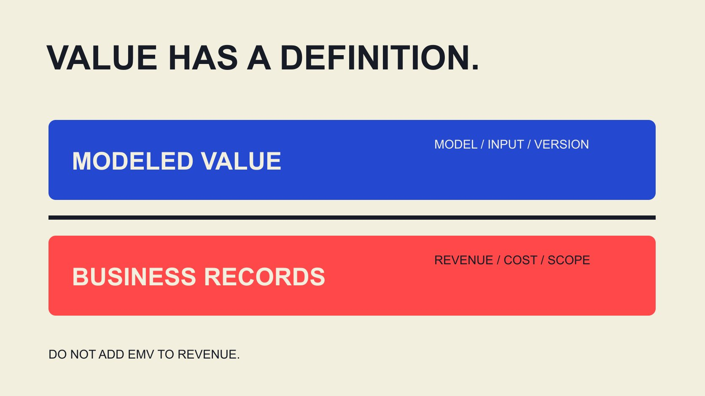

# Influencer EMV and ROI: Define the Calculation Fields

Status: local review draft; confirm the publication date before release.

Build an influencer-reporting field dictionary for EMV, revenue, costs and ROI, keeping estimates, attribution and profit calculations in their proper scope.

QuickKOL editorial graphic; not actual account metrics or a platform interface.

For influencer marketing earned media value metrics and ROI calculation fields, start with a data dictionary rather than adding every number carrying a currency symbol. EMV is a model-dependent media valuation; recorded or attributed revenue describes transactions; ROI requires defined profit, costs and causal scope. Retain unit, source, window, observed-or-estimated state and formula dependencies for each field. EMV is not revenue, attributed revenue is not automatically incremental revenue, and a dashboard label called ROI does not replace the business’s actual cost definition.

## Assign a role to every field

Classify inputs as observations, modeled estimates, attribution outputs, commercial costs or derived calculations. A currency unit does not make a field cash revenue, and a dashboard number does not establish completed settlement. Roles prevent values entering inappropriate formulas.

The [AMEC integrated evaluation framework](https://amecorg.com/amecframework/) distinguishes outputs, audience responses, outcomes and organizational impact while requiring relevant actual information. That distinction helps explain why media valuation cannot replace business results; the framework does not supply complete attribution or financial records.

The [campaign-measurement guide](/blog/creator-campaign-measurement/#answer) helps define the question first. A visibility question does not need invented profit, while a profit question cannot be answered with exposure alone. Put the question and field roles at the top of the dictionary so the recipient knows which decision the file can support. This also prevents a report owner from choosing an attractive metric after the work and presenting it as the answer to a different question.

## EMV needs its model and input version

The [Modash EMV method description](https://help.modash.io/en/articles/13717084-understanding-campaign-analytics) calls it an estimated monetary value of organic exposure using platform- and engagement-specific multipliers, configurable at campaign or workspace level. This is a public-document review, not a logged-in test or independent effectiveness validation.

Retain provider, model version or configuration date, covered content, input metrics, multipliers, currency and calculation time. If a method detail is undisclosed, record that rather than inventing an internal rule to make the model seem reproducible.

Changing configuration can change the valuation even when underlying observations remain unchanged. Check method and coverage before comparing campaigns. Higher EMV does not automatically mean more purchases, more unique viewers or a more valuable person. Valuation has a purpose and a boundary. A report should make it possible to tell whether a movement came from new activity, a revised input or a new valuation coefficient, rather than treating every increase as equivalent progress.

For a simplified editorial model, suppose 2,000 defined action events are multiplied by an assumed USD2.50 valuation coefficient, giving USD5,000. Changing only that coefficient to USD5 gives USD10,000, with no new action observed. This is not the Modash formula or an industry price. It demonstrates why coefficient and configuration fields belong beside the estimate. The second value is larger because an assumption changed, not because audience response doubled. If a reporting team cannot retrieve the earlier settings, it should describe the resulting comparison as methodologically incomplete rather than announce a performance improvement. Retaining the original configuration also prevents a later revaluation from being mistaken for newly received money.

## Separate transaction revenue from its adjustments

Revenue records need transaction or event scope, amount definition, currency, window and state. Use the business’s actual treatment of tax, shipping, cancellations, returns and refunds, and state it. Sales alone does not establish identical definitions across reports.

Retain attribution source, rule and window. Links, codes or platform models may associate activity with transactions, but cover different sets, and one order may appear in several systems. Without consistent objects and a deduplication basis, do not add every source’s revenue.

Separate unobserved, unauthorized, pending adjustment and genuine zero. If the job concerns professional-service inquiries rather than online orders, record appropriate actions and later states instead of assigning every lead an unverified cash value. Fields should follow the actual business rather than require a shopping cart in every project. A dictionary can identify a needed later input without pretending it already exists, which is preferable to a monetary estimate whose origin disappears once the sheet is shared.

## Make included and excluded costs visible

Record relevant production, publication, licensing, agency, paid distribution, product and logistics costs as appropriate, and explain internal labor treatment. Keep contracted, invoiced, paid and forecast states distinct rather than making an estimate look like actual expenditure.

Product costs and marketing costs are different fields. If contribution subtracts product costs and marketing cost is deducted afterward, do not include that same marketing cost in the earlier deduction too. Dependencies should be understandable to the recipient.

With incomplete costs, report the known amount and gap rather than a complete ROI. Zero marketing spend does not establish resource-free work, and an unavailable denominator should not become zero followed by division. Retain exchange-rate source and date for multimarket work instead of adding different currencies directly. An allocation across several projects also needs its basis recorded, so a team cannot improve one project’s apparent economics merely by moving a shared expense to another unexplained category.

## Define profit and the investment denominator for ROI

The [Google ROI guide](https://support.google.com/google-ads/answer/1722066?hl=en) relates ROI to net profit and costs, notes that the exact method depends on objectives and illustrates product and advertising costs. This does not establish causality for every attributed transaction; the user still needs appropriate cost and result scope.

For a clearly labeled editorial convention here, project return percentage equals contribution before campaign cost minus campaign cost, divided by campaign cost, times 100. Define which product or variable costs contribution already excludes, and require positive campaign cost. This is not a universal accounting formula for every organization.

If contribution comes from attributed transactions, name the result accordingly. A claim about incremental profit needs suitable incremental evidence. Software may label revenue less a defined cost as ROI, but the team must still inspect those fields rather than infer that the label covers every profit component. The calculation’s name should reveal its basis instead of borrowing a stronger business interpretation than the available inputs support.

## Do not add attribution, incrementality and EMV together

Attribution associates outcomes with touchpoints under a rule; incrementality asks what would have happened without the activity. They need different evidence. Recorded attributed revenue can be useful without proving every transaction was independently created by the campaign.

EMV should not be added to revenue and then reduced by campaign costs to create profit. That combines modeled media value with business amounts. Correct arithmetic cannot make the resulting label valid. Keep separate columns and explain their purposes.

The [engagement-rate worksheet guide](/blog/calculate-engagement-rate-denominator-workbook/#answer) likewise distinguishes interactions and denominators. The principle also applies to commercial measures: matching units do not guarantee matching meanings. A field may help explain communication scale while remaining inappropriate for a financial formula. Require a reason for every dependency. This helps a recipient understand that a blank ROI alongside reported EMV can be an accurate limitation, rather than an incomplete report that should be repaired by inserting the estimate.

## Hypothetical example: higher EMV does not guarantee positive return

All values here are hypothetical, not tool defaults or industry benchmarks. A model produces USD5,000 EMV, attributed revenue is USD2,000, contribution before campaign cost is USD800 under declared product and variable costs, and campaign cost is USD1,000.

Under this article’s convention, 800 minus 1,000 divided by 1,000 times 100 equals negative 20%. It is a project return on the hypothetical attribution basis, not proven incremental return. EMV remains USD5,000 separately and cannot be added to make the negative result positive. Dividing 2,000 by 1,000 gives a different revenue-to-cost ratio of 2, not net profit.

If incremental contribution is unknown, incremental ROI remains not calculable. Retain a new version and reason when costs, attribution or refund status changes. The example establishes relationships among fields and formulas, not whether any real campaign deserves more investment. A useful report can present several valid measures while refusing to blend them into one misleading success figure.

## Validate units, coverage and formula dependencies

Before handoff, check currency, windows, duplicated costs, model version and denominator availability. Save a formula description for every derived field rather than only the result. Keep limitations and state when moving a number into a presentation.

The [platform record-handoff guide](/blog/influencer-platforms-record-interoperability/#answer) connects content, publication, observation and use. The dictionary also needs stable campaign and dataset references so an aggregate can be traced to its included scope. Identically named fields across files should not merge without checking their definitions.

The download supplies field descriptions without actual customer information or a preset budget. It is static CSV, not a platform connection or automatic recalculation service. The team supplies real sources, ownership and availability before deciding which calculations are supported. A field can remain in the dictionary as required but unavailable, making the missing dependency visible rather than disappearing from a report that then appears complete.

## Use the dictionary to support the actual decision

Present communication observations, model estimates, attributed results and business calculations separately, identifying what is directly observed and what depends on assumptions. A brand can improve content or process using limited evidence without announcing proven ROI every time.

QuickKOL can help interpret the task, research relevant content and potential partners and prepare contact. Business outcomes, platform metrics and costs still need their corresponding sources; a relevant roster does not establish them.

A field dictionary lets teams recognize what one another mean by the same term. A clearly defined unknown can support subsequent work better than a precise percentage mixing revenue, EMV and incomplete costs.

## Four amounts with different meanings

| Field | Meaning | Required scope |

| --- | --- | --- |

| EMV | Modeled media valuation | Model, inputs, settings and coverage |

| Attributed revenue | Transaction value associated under a rule | Rule, window, adjustments and deduplication |

| Contribution before campaign cost | Amount after declared cost deductions | Inclusions, exclusions and attributed/incremental basis |

| Campaign cost | Investment within defined scope | Currency, state, allocation and period |

The ROI convention is a labeled editorial example, not a universal accounting standard. EMV is not added to revenue or profit.

## EMV and ROI field checks

Download a field dictionary; the team supplies actual sources and values.

- [ ] Give each field a role, unit and source.

- [ ] Retain the EMV model and settings.

- [ ] Do not rewrite attribution as incrementality.

- [ ] Check cost scope and duplicate deductions.

- [ ] Define profit and investment denominator in the formula.

- [ ] Do not replace unavailable dependencies with zero.

[Download English metric-field dictionary CSV](/downloads/influencer-emv-roi-field-dictionary.en.csv)

[Download Chinese metric-field dictionary CSV](/downloads/influencer-emv-roi-field-dictionary.zh.csv)

## Research date and limitations

Sources reviewed November 2, 2026. Methods, tables and decision rules are editorial recommendations. Hypothetical examples are not actual client results or industry benchmarks. Source geography and periods are specified where relevant. This draft is in independent local review; confirm its publication date before release.

## Sources

- [AMEC: Integrated Evaluation Framework](https://amecorg.com/amecframework/)

- [Modash: Understanding campaign analytics](https://help.modash.io/en/articles/13717084-understanding-campaign-analytics)

- [Google Ads: About return on investment](https://support.google.com/google-ads/answer/1722066?hl=en)
