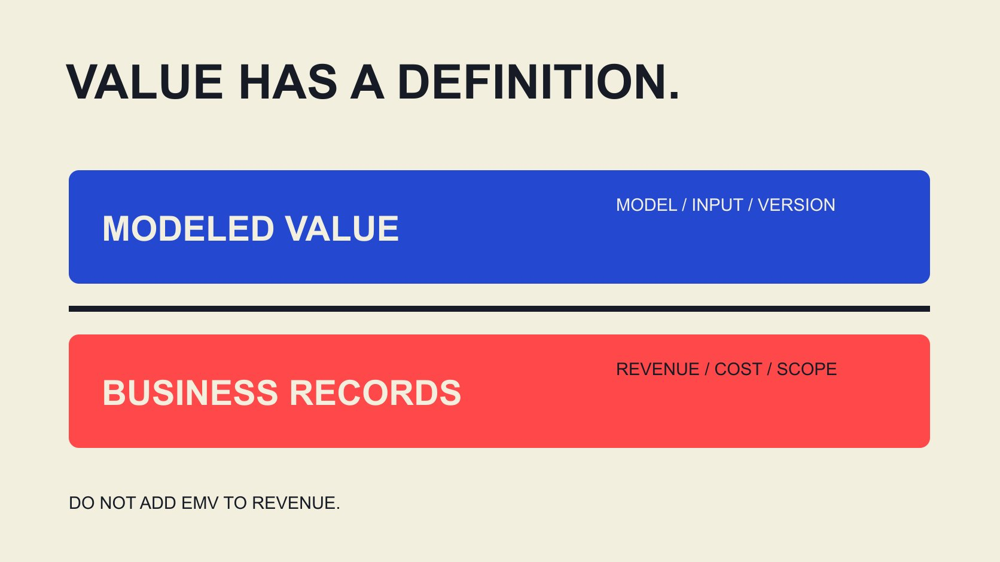

# 达人 EMV 与 ROI：分别记录模型估值和实际回报

状态：本地审阅稿；正式发布日期待确认。

为达人营销报告建立 EMV、收入、成本与 ROI 字段字典，让估计、归因与利润计算各有清楚范围。

QuickKOL 编辑图形；不呈现真实账号指标或平台界面。

研究 influencer marketing earned media value metrics ROI calculation fields 时，先建立字段字典，而不是把所有带货币符号的数相加。EMV 是依特定模型估计的媒体价值；记录或归因收入描述交易；ROI 则需要明确利润、成本及因果范围。每项保留单位、来源、窗口、观察或估计状态，以及公式依赖。EMV 不等于收入，归因收入不自动等于新增收入，软件里的 ROI 名称也不能代替企业实际成本定义。

## 先给每个字段一个角色

把输入分为观察、模型估计、归因结果、商业成本和派生计算。一个字段可以带货币单位，却不属于现金收入；一个数字来自后台，也不代表已完成结算。角色能防止数值进入不适合的公式。

[AMEC 整合评估框架](https://amecorg.com/amecframework/)区分产出、受众反应、结果与组织影响，并要求团队获取实际相关资料。这个层级思路有助于理解为什么媒体估值不能直接替代经营结果，但框架本身不会提供完整归因或财务数据。

[活动衡量指南](/zh/blog/creator-campaign-measurement/#answer)帮助先定义要回答的问题。若目的是内容可见性，不必伪造利润；若要解释利润，就不能只交曝光。将问题和字段角色写在字典顶部，让报告接收者知道这份文件准备支持哪一种决定。

## EMV 要保留模型和输入版本

[Modash 的 EMV 方法说明](https://help.modash.io/en/articles/13717084-understanding-campaign-analytics)将其描述为自然曝光的估计货币价值，采用平台与互动类型相关乘数，并允许在项目或工作区层级调整。这里核验的是公开文档，不是登录测试，也不是对效果的独立验证。

因此，EMV字段至少保留供应者、模型版本或配置日期、覆盖内容、输入指标、乘数、币种及计算时间。若供应者未公开某项方法，就记录未披露；不能为了复算而杜撰其内部规则。

模型配置变化后，估值可能变化，即使底层内容观察没有变化。比较两个活动前，先核对同一方法和覆盖范围。不要把一个更高EMV自动解释为更多购买、更多独立观众或更有价值的某位个人。估值有自己的用途，也有自己的边界。

用一个简化的编辑模型说明：假设2,000个已定义动作，乘每次2.50美元的估值系数，得到5,000美元。只将系数改为5美元，就得到10,000美元，却没有新增动作。这不是Modash公式或行业价格，而是说明为何要保留配置。不能把假设改变写成受众反应翻倍；找不到旧设置时，应说明比较方法不完整，也不能把重估金额当作新收到的钱。

## 收入字段从交易到调整分别记录

收入记录需要订单或事件范围、金额定义、币种、窗口和状态。含税、运费、取消、退货与退款如何处理，应采用企业实际口径并写清。不要从“销售额”三个字推断所有报表相同。

保留归因来源、规则和窗口。链接、优惠码或平台模型可以记录关联，但不同方式可能覆盖不同交易，且同一订单可能在多个系统出现。没有一致对象与去重依据，就不应把所有来源的收入直接相加。

未观察到、未授权访问、尚待调整与实际为零分别标记。若目标是专业服务咨询，而非在线订单，就记录适当动作和后续状态，不给每条线索套未经核验的统一货币价值。字段定义应服从真实业务，而不是强求每个项目都有购物车。

## 成本字段要能看出纳入和排除

将创作者制作、发布、许可、代理、付费分发、产品及物流等相关成本按项目需要记录，并说明内部工作如何处理。合同金额、已开票、已支付和预测分别保存，避免把一个预计值当作实际支出。

商品成本与营销成本不是同一字段。若计算收入减去商品成本后的贡献，之后再扣营销成本，就不能在前一步已经扣除同一笔营销成本。每个字段的依赖关系应让接收者看得懂。

成本不完整时，可以报告已知成本及缺口，暂不输出完整ROI。零营销支出也不代表资源完全免费；没有输入的分母不能用0填满后继续除法。对多市场项目，币种换算来源与日期也应保留，而不是直接合并不同货币金额。

## 给 ROI 写明利润和分母定义

[Google 的 ROI 说明](https://support.google.com/google-ads/answer/1722066?hl=en)将ROI与净利润和成本联系起来，也说明具体计算方式取决于活动目标，并以纳入商品和广告成本的例子说明。这不是声称任何归因收入都具备因果证明；使用者仍需确认自己的成本与结果范围。

本文给出一个明确标记的编辑计算口径：项目回报率＝（项目贡献在扣除活动成本前的金额－活动成本）÷活动成本×100。贡献需先说明已扣除哪些商品或变动成本，活动成本必须大于0。它不是所有企业通用的会计公式。

如果贡献来自归因交易，只能按归因口径命名结果；如果声称新增利润，则还需要适当增量依据。软件可能将收入减某种成本的比率标为ROI，团队仍需回看字段定义，不能从名称推导它已经覆盖全部利润项目。

## 归因、增量与 EMV 不进入同一个加法

归因规则把某些结果关联到接触点；增量问题则问没有这项活动会怎样。两者需要不同依据。来源中记录的收入有价值，但不能因为有一个来源标签，就声称全部是活动独立创造。

EMV也不能加进收入，再减去活动成本称为利润。这样把模型估计的媒体价值与真实经营金额混在一起，结果即使计算正确，名称也不成立。保留单独栏目，说明各自用途。

[互动率工作表指南](/zh/blog/calculate-engagement-rate-denominator-workbook/#answer)还提醒，互动与分母不能随意混用。相同原则适用于商业指标：单位相同不代表含义相同。某个字段可用于解释传播规模，却不一定能进入财务结果公式。让每一条公式依赖都能说明理由。

## 假设算例：高 EMV 不保证正回报

以下全部是假设，不是工具默认值或行业基准。某模型给出的EMV为5,000美元，归因收入2,000美元，按已声明商品与变动成本计算的活动前贡献为800美元，活动成本为1,000美元。

按本文口径计算，（800－1,000）÷1,000×100＝－20%。它是该假设归因口径下的项目回报，不是已证明新增回报。EMV仍单独保留5,000美元，不能加进去让负值变正。2,000÷1,000＝2描述另一种收入与成本比，也不是净利润。

如果增量贡献未知，就将增量ROI标为不可计算。若成本、归因或退款状态更新，保留新版本及变化原因。这个算例证明的是字段和公式关系，不证明任何真实活动是否应该继续投资。

## 验证单位、范围和公式依赖

交接前检查币种是否一致、窗口是否匹配、成本是否重复、估计是否有模型版本，以及分母是否可用。对每个派生字段保存公式文本，不只保存结果。复制到演示文稿时，仍带上限制与状态。

[平台记录交接指南](/zh/blog/influencer-platforms-record-interoperability/#answer)帮助连接内容、发布、观察与使用对象。字典还需要稳定的活动和数据集编号，使一个汇总能追到纳入范围。不同表格里的同名字段，不应未经核对就合并。

下载表提供字段说明，不含真实客户数据或预填预算。它是静态CSV，不能自动读取平台或重算项目。使用团队要补齐实际来源、负责人和可用状态，再决定哪些计算可以成立。

## 用字段字典支持真实的决定

最终汇报分别展示传播观察、模型估计、归因结果与商业计算，说明哪些可直接观察、哪些依赖假设。品牌可以根据有限证据改进内容或处理流程，不必每次都宣称证明了ROI。

QuickKOL 可以帮助理解任务、研究相关内容与合作对象，并准备联系。商业结果、平台指标和成本应继续在相应来源核验，不能由一份相关名单推导。

字段字典的价值，是让不同团队使用同一词时知道彼此指什么。一个定义清楚的未知，比一个混合了收入、EMV与不完整成本的精确百分比更能支持后续工作。

## 四种金额不能混为一谈

| 字段 | 说明 | 必要范围 |

| --- | --- | --- |

| EMV | 模型估计媒体价值 | 模型、输入、配置、覆盖 |

| 归因收入 | 按规则关联的交易金额 | 规则、窗口、调整与去重 |

| 活动前贡献 | 按已声明成本扣除后的金额 | 包含、排除及归因/增量基础 |

| 活动成本 | 所定义范围的投入 | 币种、状态、分配与期间 |

本文ROI口径为明确标注的编辑算例，不是通用会计标准。EMV不加入收入或利润。

## EMV 与 ROI 字段检查

下载的是字段字典，实际来源与数值由团队补齐。

- [ ] 每个字段有角色、单位与来源。

- [ ] EMV保留模型与配置。

- [ ] 归因不自动改写成增量。

- [ ] 成本纳入范围与重复扣除已检查。

- [ ] 公式写清利润与分母口径。

- [ ] 未知依赖不补成零。

[下载英文指标字段字典 CSV](/downloads/influencer-emv-roi-field-dictionary.en.csv)

[下载中文指标字段字典 CSV](/downloads/influencer-emv-roi-field-dictionary.zh.csv)

## 研究日期与使用边界

资料核验于 2026 年 11 月 2 日。文中方法、表格和决策规则为编辑建议，标为假设的示例不是实际客户结果或行业基准。外部资料的适用地区与时期按各段说明；本稿处于独立本地审阅阶段，正式发布日期待确认。

## 来源

- [AMEC: Integrated Evaluation Framework](https://amecorg.com/amecframework/)

- [Modash: Understanding campaign analytics](https://help.modash.io/en/articles/13717084-understanding-campaign-analytics)

- [Google Ads: About return on investment](https://support.google.com/google-ads/answer/1722066?hl=en)
