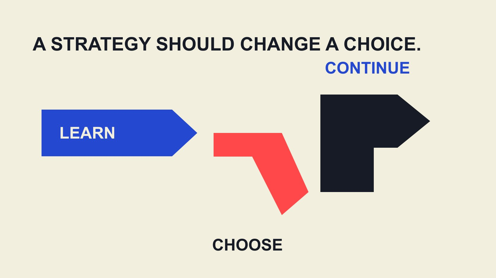

# Influencer Marketing Strategy: Build a Portfolio of Tests

Status: local review draft; confirm the publication date before release.

Plan creator work around business hypotheses that evidence can change, with explicit learning value, resource trade-offs and next decisions.

QuickKOL editorial graphic; not actual account metrics or a platform interface.

An influencer marketing strategy should identify the business change sought, why creator collaboration might help and what evidence would change the next decision. Allocate resources to complementary hypotheses rather than dividing a budget mechanically across follower tiers. Each hypothesis needs an audience problem, content contribution, observable signal, resource boundary and continue-or-stop condition. A small pilot can support learning without proving that every recorded outcome was caused by a creator. The strategy is the rationale for choices, including the work the brand decides not to commission.

## Begin with a business obstacle that needs to change

We need influencer marketing is not a complete strategy. Describe the obstacle an audience faces: misunderstanding a new use, lacking a credible account of an experience or not knowing how to request more information. Different obstacles need different contributions rather than one universal request for exposure.

The [AMA influencer marketing overview](https://www.ama.org/topics/influencer-marketing/) describes relationships between influential people and brand communication without prescribing identical roles or sales objectives for every organization. A technology demonstration, consumer-product explanation and professional-service lesson can address different audience problems.

Write the obstacle as a statement that evidence could contradict. A brand might suspect people do not understand installation rather than find the price too high. That remains a hypothesis requiring support from existing questions, content observations or suitable research. A clear hypothesis explains why someone should demonstrate the process and which finding would change direction. Without this step, the team may commission excellent work that answers a question its intended audience was not asking.

## Translate a hypothesis into a content contribution

A hypothesis can say that if a particular audience sees an explanation in a defined context, it may understand something better and become more willing to take a relevant next step. Every link can fail. Identify evidence for each rather than presenting the whole sequence as an established result.

The [useful-brief guide](/blog/write-a-useful-campaign-brief/#answer) turns that into a task: question, reliable facts, suitable format and destination. Specify the creator’s contribution, such as demonstrating a real process, raising audience questions or explaining a misunderstanding. More influence is not a production instruction.

Do not require an unexperienced conclusion. The brand supplies reliable product information, while the creator can suggest another treatment and identify what does not suit the audience. A strategy needs room for correction rather than staging confirmation of a preferred answer. This makes a proposal more informative even before production: the creator’s response may reveal a misunderstanding in the brief or a practical condition the brand has overlooked.

## Choose complementary hypotheses instead of duplicating work

A hypothesis portfolio does not mean recruiting as many people as possible. It means answering distinct important questions within limited resources. A project might examine clarity of explanation, relevance of a use context and ease of taking the next step. Each assignment needs a job rather than a different person repeating the same slogan.

If every piece changes audience, format, product message and destination simultaneously, different results leave the team unsure what it learned. Where feasible, hold some conditions stable and record the deliberate changes. Nonrandom collaborations still contain selection differences; that does not make them controlled experiments.

The [creator-selection guide](/blog/creator-selection-beyond-followers/#answer) supports looking at work, explanatory ability and context. Complementarity can come from experience and expression without putting people into appearance-based or imagined personality categories. Ask which contribution is missing before adding a participant. A smaller set of clearly different tasks may teach more than a large roster whose assignments cannot be distinguished once the report is assembled.

## Budget for the work and preserve the next choice

List production, publication, use, coordination, products or locations, actual distribution and measurement resources. Which commitments are necessary now, and which can wait for evidence? Spending everything in the first round leaves little room for a genuinely evidence-led next decision.

In an editorial hypothetical, a team has 60 internal work hours to allocate among preparation, two content tasks, observation and later revision. This is not a standard allocation ratio; project complexity differs. The useful information is whether total commitments reconcile and what another request displaces.

Costs extend beyond creator quotes. Internal review, asset revision and information checks take time. When comparing proposals, identify whether the same work has merely moved between teams rather than treating internal labor as free. Retaining a modest decision reserve can also prevent a promising observation from triggering an immediate expansion that the team lacks the capacity to operate or evaluate responsibly.

## Define observation before selecting success signals

The [AMEC integrated evaluation framework](https://amecorg.com/amecframework/) connects organizational and communication objectives with inputs, activity, outputs, audience responses, outcomes and impact, while requiring relevant actual data. It helps distinguish levels; it does not automatically provide observations or establish a collaboration’s causal effect.

Choose a small set of useful observations for each hypothesis. These might concern completion of the explanation, relevant audience questions and an authorized source recording a predefined action. A visible comment sample differs from an aggregate report. An easy-to-obtain number should not replace the question the project needs answered.

The [campaign-measurement guide](/blog/creator-campaign-measurement/#answer) supports recording definitions, numerators, denominators and periods. Keep unknowns unknown. If the intended action cannot be observed, revise the question or obtain the appropriate conditions rather than selecting the best-looking metric at the end and calling it the original definition of success. A modest learning objective with usable evidence is more actionable than an ambitious outcome claim with no measurement path.

## Distinguish an operational pilot from a causal experiment

Different results from two creators do not establish that one characteristic caused the difference. Audience, timing, prior relationships, content and distribution can all vary. An operational pilot can explain process and response without establishing incremental sales from a before-and-after change.

The [Google Conversion Lift guide](https://support.google.com/google-ads/answer/12003020?hl=en) describes controlled exposed and control groups and notes that the capability is not available to all accounts. It illustrates why causal questions need an appropriate design, not that any creator project can simply run the same study.

Where resources are limited, report process and bounded observations while leaving causality unresolved. A small pilot is not a proven business model, and simple grouping does not remove every difference. If an incremental conclusion is necessary, work with people who can design a feasible study. The team can still learn enough to improve a brief or fix a destination while explicitly stopping short of the stronger claim.

## Write continue, change and stop conditions in advance

Decision rules need not all be numeric thresholds. Unconfirmed essential product facts can pause production. A clear explanation paired with a broken destination can prompt a destination repair. A task unrelated to the audience problem can require a revised hypothesis or an ended direction. These are editorial examples, not industry-wide standards.

Conditions should map to an action the team can take. Poor performance means optimize says little if nobody knows what changes. Moving the target repeatedly after results appear makes every collaboration seem successful without learning anything. Retain the initial rule and reasons for revisions. An observation supporting a modest change does not justify expansion across every market. Keep the next decision within the context covered by the evidence. For example, clearer questions about one installation workflow may justify a revised explanation, while leaving purchase intent, another language and another product unresolved. Name those boundaries in the decision record so another team does not mistake a narrow learning result for broad permission to scale.

Stopping a hypothesis is not a verdict on a person. Product, context, resources or observation conditions may be unsuitable. Leave a specific explanation rather than creator did not work, which can circulate later while concealing the assignment design that needs attention. A useful record supports a better future task without claiming that one outcome defines someone’s general capability.

## Use an example to test whether the strategy changes choices

Consider an editorial hypothetical. A software brand suspects new users do not understand importing. Instead of general recommendations, it commissions explanations of common import questions and an actual workflow demonstration, observing authorized education records and relevant questions. Any sales conclusion remains bounded by available evidence.

If feedback concerns an unsupported file format, the next action may be clearer documentation or a product-team handoff rather than more creators. If the content cannot accurately demonstrate the existing product, repair the facts and material instead of treating views as proof that the problem is solved.

The example shows strategy changing purchased work, required roles and the next decision. It is not a client case or performance promise. Applying the method to a consumer experience requires the corresponding question and evidence rather than copying every software-project signal. A strategy becomes practical when an observation can lead to a different action from the one the team originally expected.

## Make the next decision inherit evidence as well as budget

For each hypothesis, retain question, basis, contribution, resources, observation, limitations and decision. Handoffs should identify continuing work, changed assumptions and unresolved conditions instead of passing only total exposure and remaining budget.

QuickKOL can help turn a defined task into relevant creator and work research and prepare targeted contact. It does not prove causal outcomes or make a fluent brief automatically the right strategy.

The downloadable sheet is an editorial planning starting point without market benchmarks or default success thresholds. Define a worthwhile learning question before increasing collaborations. Attach a basis or unresolved condition to each decision so a recipient can assess whether continuing is justified. When evidence can change what receives resources, strategy becomes part of the actual work rather than a description written after the decisions have already been made.

## Four decisions in a hypothesis portfolio

| Decision | Record | Next step |

| --- | --- | --- |

| Why | Audience problem and business obstacle | Choose a supported hypothesis |

| What work | Contribution, delivery, publication and use | Match the required role |

| What to learn | Observation, definition and limitation | Obtain appropriate evidence |

| What next | Continue, change or stop conditions | Retain decision and reason |

QuickKOL editorial planning method, not an empirically validated optimal budget ratio.

## Hypothesis-portfolio planning checks

Complete fields for the actual project; do not treat examples as benchmarks.

- [ ] Make the obstacle specific and open to evidence.

- [ ] Give distinct tasks complementary questions.

- [ ] Expose total resources and the trade-off from additions.

- [ ] Define observation and causal limits in advance.

- [ ] Connect continue, change and stop to actions.

- [ ] Retain unknowns and decision basis in the handoff.

[Download the English hypothesis planning CSV](/downloads/creator-strategy-hypothesis-portfolio.en.csv)

[Download the Chinese hypothesis planning CSV](/downloads/creator-strategy-hypothesis-portfolio.zh.csv)

## Research date and limitations

Sources reviewed November 2, 2026. Methods, tables and decision rules are editorial recommendations. Hypothetical examples are not actual client results or industry benchmarks. Source geography and periods are specified where relevant. This draft is in independent local review; confirm its publication date before release.

## Sources

- [American Marketing Association: Influencer Marketing](https://www.ama.org/topics/influencer-marketing/)

- [AMEC: Integrated Evaluation Framework](https://amecorg.com/amecframework/)

- [Google Ads: About Conversion Lift](https://support.google.com/google-ads/answer/12003020?hl=en)
