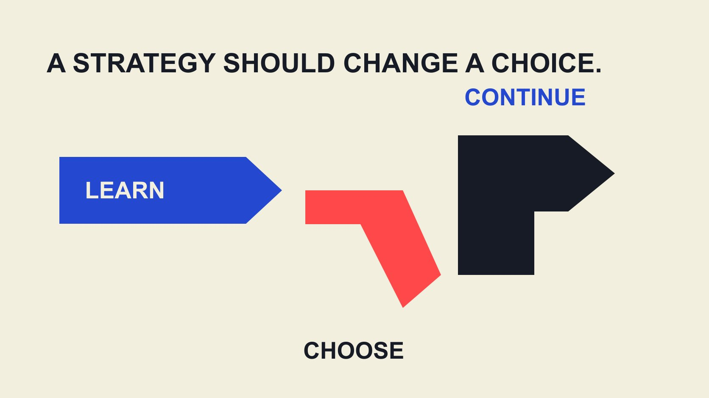

# 达人营销策略：把合作当作可验证的假设组合

状态：本地审阅稿；正式发布日期待确认。

用可被证据改变的业务假设规划达人营销，明确每项合作的学习价值、资源取舍和下一步决定。

QuickKOL 编辑图形；不呈现真实账号指标或平台界面。

有效的 influencer marketing strategy，应先说明品牌想改变什么、为什么创作者合作可能有帮助，以及什么证据会改变下一步决定。把预算分配给互补假设，而不是按粉丝层级平均分人头。每个假设都要有明确受众问题、内容贡献、可观察信号、资源上限与继续或停止条件。小型试点可以帮助学习，但没有适当比较设计时，不能把记录到的结果都归因于创作者。

## 从一个需要改变的业务障碍开始

“我们需要做达人营销”不是完整策略。先描述受众正在遇到什么障碍：不理解新产品用途、对某项体验缺少可信解释，或者不知道如何继续咨询。不同障碍需要不同合作任务，不能统一变成更多曝光。

[AMA 达人营销说明](https://www.ama.org/topics/influencer-marketing/)围绕有影响力的人与品牌传播关系展开，但没有规定每项业务都必须采用相同角色或销售目标。科技演示、消费品使用解释和专业服务教育，可以有各自的受众问题。

把障碍写成可被反驳的句子。例如，品牌怀疑读者没理解安装步骤，而不是产品价格太高。这还是假设，需通过已有问题、内容观察或适当研究支持。假设越清楚，团队越能知道为何找人讲解，以及什么发现会让它改变方向。

## 将业务假设转成可执行的内容贡献

一个假设可以写为：若某类受众在某种情境下看到某项解释，他们可能更理解某件事，进而更愿意完成一个相关动作。每一环都可能失败，应分别说明需要什么证据，而不是将整条链当作已经发生。

[实用 Brief 指南](/zh/blog/write-a-useful-campaign-brief/#answer)帮助把它变成任务：要回答的问题、可用事实、适合形式和下一步位置。创作者的贡献也要具体，例如演示真实流程、提出读者问题或解释常见误解，而不是泛泛要求“更有影响力”。

不要规定对方必须说出未经体验的结论。品牌负责可靠产品资料，创作者可以提出不同表达方式，并说明哪些内容不适合其受众。策略要留出修正空间，不能把合作变成验证品牌预设答案的表演。

## 安排互补假设，不复制相同工作

假设组合不是尽可能多地找人，而是在有限资源内回答不同的关键问题。一个项目可以比较使用解释是否清楚、应用情境是否相关、下一步是否容易完成。每项工作需要各自任务，不能只换一个人重拍同一口号。

若每份内容同时改变受众、形式、产品说法和落地页，结果再不同也难以知道该学什么。可以在条件允许时保持一些因素相同，并清楚记录有意改变的部分。非随机合作仍有选择差异，不因此成为严格实验。

[达人选择指南](/zh/blog/creator-selection-beyond-followers/#answer)支持按任务看作品、解释能力与语境。互补性可以来自经验和表达，而不是将创作者按外貌或想象中的人格装进固定格子。先问组合缺了什么贡献，再决定是否需要增加参与者。

## 预算既买交付，也为下一步保留选择

列出制作、发布、使用、协调、产品或场地、实际投放及衡量资源。哪些是当前必须投入，哪些可以等到证据出现再决定？不能把全部预算在第一轮用完，却声称后续会根据结果优化。

以下是编辑假设：团队有60个内部工作小时，可以为准备、两种内容任务、观察与后续修改分别预留。这里不提供标准分配比例，因为项目复杂度不同。真正需要的是总投入可核对，以及某项追加会挤掉什么工作。

成本不只包括创作者报价。品牌内部审核、素材修订和资料核对也占时间。比较两个方案时，记录它们是否把同一工作转移给了不同团队，而不是把品牌内部承担的成本当作完全免费。

## 先定义能观察什么，再选择成功信号

[AMEC 整合评估框架](https://amecorg.com/amecframework/)从组织与传播目标连接投入、活动、产出、受众反应、结果与影响，并指出团队仍需取得实际相关数据。它可以帮助理解层级，不会自动提供数据或证明某次合作带来因果效果。

团队应为每个假设选少量真正有用的观察。例如说明内容是否完成、受众是否提出相关问题，以及有权限的数据是否记录了预先定义的动作。评论样本与后台汇总不同，不应让一个方便获得的数字替代真正要回答的问题。

[活动衡量指南](/zh/blog/creator-campaign-measurement/#answer)进一步记录口径、分子分母和期间。未知值保持未知；若目标动作无法观察，先修正研究问题或取得适当条件，不要等结案时才选一个表现最好的数字称作原定成功。

## 区分运营试点与因果实验

两位创作者产生不同结果，不代表差异由他们某一项特征造成。受众、发布时间、历史关系、内容和分发都可能不同。运营试点可以帮助了解流程和反应，但不能仅凭前后变化认定新增销售。

[Google 增量研究说明](https://support.google.com/google-ads/answer/12003020?hl=en)介绍对照与受影响群体的受控研究，也说明该能力并非所有广告账户可用。它用于说明因果问题为什么需要适当设计，不是声称任意达人项目都能直接运行同一种研究。

资源不足时，可清楚报告过程与有范围的观察，保留因果未知。不要把小样本试点称为已证明的商业模式，也不要承诺通过简单分组就消除所有差异。需要增量结论时，应与具备相关能力的人一起设计可行研究。

## 提前写下继续、修改与停止条件

决定规则不一定都是数字阈值。若关键产品事实无法确认，内容暂缓；若解释清楚但下一步页面失效，先修页面；若任务与受众问题明显不符，修改假设或结束该方向。这些是编辑示例，不是统一行业标准。

条件应对应团队能采取的动作。不能仅写“表现不好就优化”，却不知道改什么；也不能在看到结果后不断移动目标，使每项合作都被宣布成功。保留原先规则与调整理由。某项观察能支持一个小范围修改，不代表要一次扩大所有市场；下一步仍应对应证据覆盖的场景。

停止某项假设不等于否定创作者本人。可能只是当前产品、场景、预算或观察条件不合适。给后续团队留下具体原因，避免一句“这个人不行”被重复引用，掩盖真正需要修正的任务设计。

## 用一个例子检查策略是否真的改变选择

以下为编辑假设。某软件品牌怀疑新用户不懂导入流程。它原计划做一组泛泛推荐，后来将任务改为解释常见导入问题、演示实际步骤，并观察有权限的产品教育记录及相关提问。销售结果仍按可用证据限定。

若反馈主要指向缺少一种文件格式，下一步可能是更新说明或转交产品团队，而不是立刻增加达人数量。若内容无法准确演示现有产品，就应先修正素材和事实，不把观看数当作问题已经解决。

这个例子说明策略的作用：它改变采购的工作、需要的角色及后续决定。它不是实际客户案例或效果承诺；用同样方法研究消费品体验时，也要回到相应问题和资料，不能复制软件项目的全部信号。

## 让下一次决策继承证据，而不只继承预算

每项假设记录问题、依据、拟议贡献、资源、观察、限制与决定。交接时说明哪些工作可继续、哪些已改变、哪些仍未确认。不要只把总曝光与剩余预算交给下一位同事。

QuickKOL 可以帮助将明确任务转成相关创作者与作品研究，并准备有针对性的联系。它不替团队证明因果结果，也不会使一份流畅 Brief 自动成为正确策略。

下载表可作为编辑规划起点，不含市场基准或默认成功阈值。先定义一项值得学习的问题，再决定是否需要增加合作。每次决定都附一个依据或未知项，接收人才能判断是否值得继续。让预算跟着有依据的选择变化，策略才会成为实际工作的一部分。

## 假设组合的四个判断

| 判断 | 记录什么 | 下一步 |

| --- | --- | --- |

| 为什么做 | 受众问题与业务障碍 | 选择有依据的假设 |

| 买什么工作 | 贡献、交付、发布与使用 | 匹配适合角色 |

| 能学到什么 | 观察、口径、限制 | 获取适当证据 |

| 之后怎么做 | 继续、修改或停止条件 | 保留决定与理由 |

QuickKOL 编辑规划方法，不是经实证验证的最优预算比例。

## 假设组合规划清单

表格空白字段由真实项目补齐，不把示例当作行业基准。

- [ ] 业务障碍具体，可被证据改变。

- [ ] 不同任务回答互补问题。

- [ ] 资源总投入与追加取舍可见。

- [ ] 观察定义与因果限制提前说明。

- [ ] 继续、修改和停止各有动作。

- [ ] 交接保留未知与决定依据。

[下载英文假设规划表 CSV](/downloads/creator-strategy-hypothesis-portfolio.en.csv)

[下载中文假设规划表 CSV](/downloads/creator-strategy-hypothesis-portfolio.zh.csv)

## 研究日期与使用边界

资料核验于 2026 年 11 月 2 日。文中方法、表格和决策规则为编辑建议，标为假设的示例不是实际客户结果或行业基准。外部资料的适用地区与时期按各段说明；本稿处于独立本地审阅阶段，正式发布日期待确认。

## 来源

- [American Marketing Association：Influencer Marketing](https://www.ama.org/topics/influencer-marketing/)

- [AMEC: Integrated Evaluation Framework](https://amecorg.com/amecframework/)

- [Google Ads: About Conversion Lift](https://support.google.com/google-ads/answer/12003020?hl=en)
