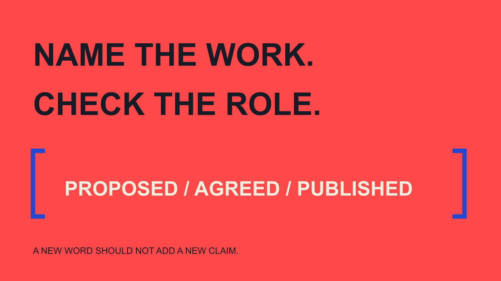

# Influencer Synonyms: Choose Accurate Partnership Language

Status: local review draft; confirm the publication date before release.

Choose alternatives to influencer in invitations, reports and public introductions without accidentally claiming endorsement, credentials or an agreed relationship.

QuickKOL editorial graphic; not actual account metrics or a platform interface.

The right influencer synonym depends on what you intend to describe. Creator emphasizes making content; ambassador commonly concerns a particular representative relationship; endorser describes an endorsement; KOL carries an industry context. The words overlap without being freely interchangeable. In an invitation, describe proposed work. In a report, describe observed facts. In a public introduction, confirm the agreed role. When precision matters, video-production contributor or proposed demonstrator can be clearer than a more impressive label. Choosing a word is a factual editing decision, not merely a way to avoid repeating influencer or increase keyword variety.

## Decide what the sentence is doing

One person may need different descriptions in an invitation, budget sheet, report and website introduction. The email discusses work that has not happened. The report summarizes conduct. A public introduction can be read as an official identity. Determine the document’s purpose before choosing the word.

The [influence-context guide](/blog/what-does-influencer-mean-trust-context/#answer) explains influence as a relationship involving topic and audience. Synonym editing should not erase that context. A person may produce content without agreeing to publish a brand recommendation. Sentence variety should not turn a proposed relationship into a confirmed one.

Add an editing status such as proposed, agreed, produced, published or ended. This is not necessarily a public classification; it is a tool to prevent wording from outrunning facts. Only after the sentence matches the current state can the role word be evaluated. The status also helps another reviewer understand which evidence to request rather than debate terminology in isolation.

For example, an internal note saying invited, not confirmed can support an email proposing a discussion, but not a website introduction saying our partner. A positive response without an agreed assignment need not immediately become official ambassador status. Similarly, “The creator explained three selection conditions” describes work, while “The expert endorses our entire range” adds credentials and endorsement scope. Three is a hypothetical content count here. The reviewer should correct those added facts before considering fluency. Checking only whether synonyms repeat would miss the actual problem, because a smoother sentence can still communicate an unsupported relationship or claim.

## Creator describes work, not automatically endorsement

Creator, content creator or a specific craft such as photographer or video producer can emphasize production. If the brand is buying material, describe the deliverable without assuming audience influence, promised distribution or public approval of the product.

The [AMA influencer marketing overview](https://www.ama.org/topics/influencer-marketing/) covers multiple possible participants without making every production task the same relationship. Wording need not collapse filming, publishing and recommending into one role. One person may perform all three, or they may belong to separate arrangements.

For example, replace “We hired a brand advocate to film assets” with “We commissioned a creator to produce a product-operation video,” if that is what happened. The latter is specific without adding unconfirmed approval. If publication follows, verify the publication assignment, facts and use conditions separately. This is an editorial rewrite, not a claim that creator is always the correct legal or contractual category for every production arrangement.

## Ambassador must match the actual relationship

Ambassador often suggests representation of a brand or program. The [ambassador-meaning training guide](/blog/brand-ambassador-meaning-team-training/#answer) explains why a name cannot replace an assignment. Without a confirmed relationship, prospective collaborator or invited participant may better describe the current stage.

An invitation can say that the brand wants to discuss possible participation in a program instead of calling the recipient our new ambassador before acceptance. A planned budget entry does not automatically become a roster that may be published on the website.

When the role is confirmed, check program name, period and scope. A community representative for one event should not become a global spokesperson through editing. If the program ends, retain the historical role and period without implying a continuing relationship. This protects the factual meaning of the introduction and gives a future editor enough context to update it without guessing what the original arrangement covered.

## Do not rotate endorser, advocate and reviewer for style

These terms create different expectations about a person’s message and position. Return to the actual work: explaining operation, evaluating experience, offering an opinion or explicitly recommending? A more persuasive word should not add a supportive position the person has not expressed.

The [FTC disclosure primer](https://www.ftc.gov/business-guidance/resources/disclosures-101-social-media-influencers) emphasizes understandable relationships and truthful expression in a US context. It is not a synonym dictionary, but it reminds a brand that softer terminology should not obscure a commercial relationship. Review applicable requirements for the actual market.

Independent reviewer especially needs a basis. Do not use it to package material whose conclusion the brand controls. Actual arrangements should explain allowed revisions, factual review and genuine opinions. This article cannot classify a particular relationship from a title alone. The editorial task is to inspect what the wording leads a reader to believe and verify that the supporting conduct and arrangements justify that interpretation.

## Keep the scope of KOL and expert clear

The [IAB UK glossary entry](https://www.iabuk.com/jargon-buster/key-opinion-leader-kol) gives KOL an industry usage rather than a worldwide professional license. The [KOL brief-terminology guide](/blog/kol-meaning-brief-terminology/#answer) helps a team specify the work intended for the role instead of letting an acronym imply authority over everything.

Before using expert, ask about the subject and the basis. Familiarity visible in work, practical experience and formal qualification need separate examination. Do not transfer professional status between domains or infer industry certification from audience size.

For example, “a video creator who explains home-network setup” may be more accurate than “a global technology authority.” The first still needs supporting work; the second makes a broad, stronger claim that may be impossible to establish. Precision does not diminish partnership value. It locates value in a contribution the team can explain and prevents publicity language from silently creating an endorsement of expertise that nobody actually reviewed.

## Use task language in invitations

For a hypothetical installation-video invitation, write: “We reviewed your relevant how-to work and would like to discuss an explanation for beginners. Would you be interested in learning about the assignment and conditions?” This states a specific intention without announcing a partnership.

If the work has not been reviewed, do not claim longstanding familiarity. When using QuickKOL to research work and prepare personalized outreach, retain the actual basis. A candidate label should not automatically become praise or a relationship fact in the message.

Keep subject line, body and attachments aligned. If the subject says ambassador invitation while the body describes a one-off asset commission, name the actual assignment or explain the proposed program role. The recipient needs to understand the discussion before assessing interest, workload and willingness to continue. Clear words make an invitation easier to answer without requiring either side to accept a title prematurely.

## Use observed facts in reports

“A collaborator published an item” and “brand advocates changed consumer behavior” require different evidence. The former needs a publication record; the latter adds position and impact. Do not strengthen a conclusion simply because the report is expected to sound impressive.

Replace “We activated ten opinion leaders” with the accurate count and work state. Ten is hypothetical here, not a benchmark. If ten people only accepted invitations, report acceptance rather than delivery or demonstrated effect.

Separate commitment, delivery, publication and observed results. If someone completed production without publication, accurate status is more useful than rotating creator, ambassador and influencer. It tells the reader where the project stands and which information the next decision needs. A report can remain concise while naming a narrower fact, and that fact will usually be easier for another colleague to verify than an expansive role label.

## Review what a public introduction invites readers to infer

Before publishing a biography, verify name, title, period, relevant work and applicable permission. Attendance at one event should not automatically place someone in an official endorsement section. Internal records and public pages face different readers and need appropriate review.

Consider a hypothetical introduction: “Our expert ambassador guarantees the product suits every household.” It combines role, qualification and universal outcome claims. Replacing ambassador with creator does not fix the sentence. Return to the actual relationship and work, remove unsupported claims and route the remaining wording to the appropriate reviewer.

Translation needs the same inference check. A Chinese phrase for collaborating creator should not become official spokesperson merely for fluent English. Community participant should not become a contracted brand endorser in Chinese. Both languages need the same factual boundaries, even when their natural phrasing differs. Read the public version as an unfamiliar audience member would, then ask whether that interpretation is supported.

## Keep a small editorial wording record

For common terms, record context, supporting basis, relationship status and unsuitable uses rather than create an automatic replacement table. A new project can review the changed details while colleagues know which words require additional facts.

Creator may fit a production description; ambassador needs the confirmed program relationship; expert needs a topic and basis; partner still needs the type of collaboration. No word automatically satisfies every condition, and a sentence does not need several labels to be useful.

Finally, read the draft aloud: is it clear who proposes to do what, what has happened and what remains unknown? If so, the words have done their job. SEO does not require constant role-name substitution. Vocabulary variation should never change the factual assessment of a person, relationship or result. Keep the record short enough for people to consult during editing rather than burying useful distinctions inside a document nobody opens.

## Choose wording by the communication task

| Describe | Possible wording | Verify additionally |

| --- | --- | --- |

| Production contribution | Creator / video producer | Actual work and deliverable |

| Program representation | Ambassador | Confirmed role, period and scope |

| Recommendation | Endorser | Actual message and relationship explanation |

| Subject experience | Specific capability description | Work, experience or relevant credentials |

| Unaccepted invitation | Prospective collaborator | No implication of an agreed relationship |

An editorial wording guide, not a legal classification or universal synonym replacement table.

## Five partnership-copy checks

Recheck facts after changing the word.

- [ ] Clarify purpose and relationship stage.

- [ ] Avoid adding unverified position or credentials.

- [ ] Keep proposed and completed work distinct.

- [ ] Align factual meaning across languages.

- [ ] Obtain appropriate confirmation for public introductions.

## Research date and limitations

Sources reviewed November 2, 2026. Methods, tables and decision rules are editorial recommendations. Hypothetical examples are not actual client results or industry benchmarks. Source geography and periods are specified where relevant. This draft is in independent local review; confirm its publication date before release.

## Sources

- [American Marketing Association: Influencer Marketing](https://www.ama.org/topics/influencer-marketing/)

- [FTC: Disclosures 101 for Social Media Influencers](https://www.ftc.gov/business-guidance/resources/disclosures-101-social-media-influencers)

- [IAB UK: Key Opinion Leader (KOL)](https://www.iabuk.com/jargon-buster/key-opinion-leader-kol)
