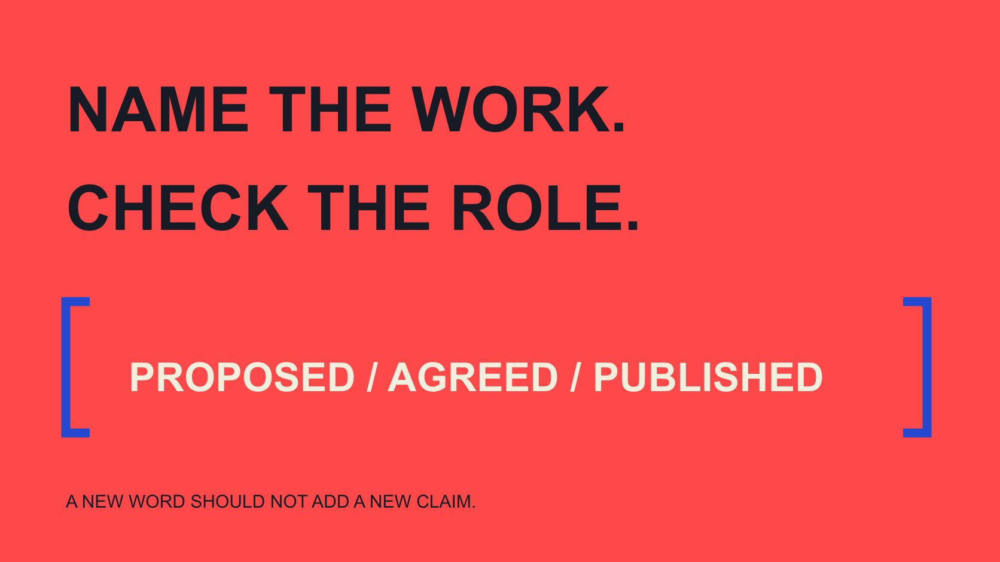

# Influencer 的近义词：合作文案怎样准确选词

状态：本地审阅稿；正式发布日期待确认。

为品牌邀请、报告和公开介绍选择influencer的近义表达，避免换词时意外声称背书、资格或已经达成合作。

QuickKOL 编辑图形；不呈现真实账号指标或平台界面。

适合的influencer synonym取决于你准备描述什么。Creator强调创作工作；ambassador通常涉及具体代表关系；endorser描述背书表达；KOL带有行业使用语境。它们有重叠，但不是可随意轮换的同一个词。写邀请时描述拟议工作，写报告时描述已观察事实，写公开介绍时确认双方同意的角色。需要准确时，直接写“视频制作合作方”或“拟邀请的讲解者”，比换一个更有气势的标签更清楚。

## 先确定句子在做什么工作

同一个人在邀请邮件、预算表、报告与官网介绍中可能需要不同描述。邮件讨论还未发生的工作，报告总结已发生的行为，公开介绍则容易被读者理解成正式身份。先决定文稿用途，再选词。

[影响力语境指南](/zh/blog/what-does-influencer-mean-trust-context/#answer)解释影响是有主题和受众的关系。近义词编辑不能省略这些语境：某人可能是内容制作者，却还没有同意为品牌发布推荐。不要因为句子需要变化，就把拟议关系写成已确认关系。

给草稿加一个状态提示：拟议、已同意、已制作、已发布或已结束。这不是必须公开展示的分类，而是编辑时防止越过事实的工具。只有文字对应当前状态，后面的词才有可判断的基础。

例如内部备注“已邀请，尚未确认”可以支持邮件写“想讨论合作”，不能支持官网写“我们的合作伙伴”。收到积极回复后，若还未确定任务，状态也不必立即改成正式大使。再如“该创作者解释了三项选择条件”描述作品，而“该专家认可我们的全部产品”增加资格与背书范围。这里三项是假设内容数量。审核者应先修正这些新增事实，再考虑句子是否流畅；只检查近义词是否重复，会遗漏真正的问题。

## Creator描述工作，不自动描述背书

Creator、content creator或具体的摄影师、视频制作者，适合强调制作贡献。若品牌采购的是素材，可以写清交付而不推断对方已经影响受众、承诺分发或公开认可产品。

[AMA 达人营销说明](https://www.ama.org/topics/influencer-marketing/)涉及多种可能参与者，但不是每种制作任务都构成同样的营销关系。用词时不需要把拍摄、发布和推荐强行写成一个角色；它们可能由同一人完成，也可能属于不同安排。

例如将“我们聘请了一位品牌倡导者拍摄素材”改为“我们委托一位创作者制作产品操作视频”，前提是确实如此。后一句更具体，也没有增加未确认的认同。之后若要公开发布，另行核对发布任务、事实与使用条件。

## Ambassador必须对得上实际关系

Ambassador往往使人联想到代表某个品牌或项目。[大使含义培训指南](/zh/blog/brand-ambassador-meaning-team-training/#answer)说明名称不能替代任务。没有明确关系时，用“潜在合作方”或“受邀参与者”更适合描述当前阶段。

邀请中可以写“希望讨论加入某项目的可能性”，而不是在尚未接受前称对方为“我们的新大使”。预算表里的预定合作也不能自动成为官网可以发布的名单。

当双方确实确认该角色，仍需核对项目名、期间与适用范围。某次活动的社区代表不必被扩写为品牌全球代言人。若项目已经结束，资料可以保留历史身份和时期，不宜让读者以为关系仍然持续。

## Endorser、advocate和reviewer不能只为文风轮换

这些表达会让读者对表达内容与立场产生不同期待。编辑应回到实际作品：对方是在说明操作、评价体验、提出观点，还是明确推荐？不能因为词更有感染力就替对方增加支持立场。

[FTC 披露入门指南](https://www.ftc.gov/business-guidance/resources/disclosures-101-social-media-influencers)在美国背景下强调关系说明与真实表达。它不是近义词字典，但提醒品牌不能靠柔和的称呼让商业关系变得难以理解。具体市场仍需按适用要求审阅。

“独立评价者”尤其需要依据，不能用来包装由品牌控制结论的内容。对方是否允许修改、品牌核对什么、是否保留真实意见，都应由实际安排说明。文章不能仅凭一个标签替任何具体关系下结论。

## KOL与expert需要保留使用范围

[IAB UK 术语说明](https://www.iabuk.com/jargon-buster/key-opinion-leader-kol)给KOL一个行业使用描述；它不是全球通用的专业执照。[KOL任务术语指南](/zh/blog/kol-meaning-brief-terminology/#answer)帮助团队写清本次希望这个角色完成的工作，而不是靠缩写暗示全部权威。

若要使用expert，问关于什么主题以及依据在哪里。作品中的熟悉程度、实际经验与正式资格分别核对。不要把某领域的专业身份迁移到另一领域，也不要从粉丝量推断已经得到行业认证。

例如“擅长解释家庭网络设置的视频创作者”可能比“全球科技权威”更准确。前者仍需作品支持，后者则包含很强且未必可证明的广泛主张。精确措辞不是降低合作价值，而是把价值放在能够解释的地方。

## 邀请邮件用任务语言替代身份预设

假设邀请一位创作者制作安装说明，可以写：“我们看过你关于相关操作的作品，想讨论制作一份适合新手的说明。请问你是否有兴趣了解任务和条件？”这表达具体意图，没有宣布已经合作。

若还没读过相关作品，就不能声称“长期关注你的内容”。用QuickKOL研究作品与准备个性化联系时，保留真实依据，避免把候选标签自动变成对对方的赞美或关系事实。

邮件主题、正文与附件也要一致。如果主题写“大使邀请”，正文却只有一次素材采购，应改成实际任务或解释为什么讨论项目角色。对方需要知道你希望讨论什么，才可能判断兴趣、工作量与是否愿意继续。

## 报告用观察事实替代关系修饰词

报告中写“合作方发布了某项内容”与“品牌倡导者改变了消费者行为”包含不同证据要求。前者需要发布记录，后者还涉及立场和影响。不要只因报告希望更有力度就扩大结论。

可以把“我们激活了十位意见领袖”改为准确数量与工作状态；这里十仅是假设数量，不是行业基准。若只有十位接受邀请，应写接受邀请，而不是已经交付或产生效果。

报告还应区分承诺、交付、发布和观察结果。有人完成制作但尚未发布时，正确的状态比不断轮换creator、ambassador、influencer更有价值。读者据此知道项目进行到哪里，以及下一个决定需要什么资料。

## 公开介绍检查读者会推断什么

发布简介前，确认姓名、称谓、合作期间、相关作品和适用授权。不要因为对方曾参加一次活动，就自动在页面上放进“官方代言”区域。内部记录和公开页面面对不同读者，需要相应审阅。

假设一句简介写“我们的专家大使保证产品适合所有家庭”。这同时包含角色、专业资格和普遍效果主张，不能只换成creator就解决。应回到实际关系与作品，删除没有依据的部分，再请适当负责人核对剩余表述。

翻译同样要检查推断。中文“合作创作者”不应为了英文顺畅变成official spokesperson；英文community participant也不应被翻成已签约品牌代言人。两种语言需要承担同样的事实边界。

## 建立一张小型编辑用词记录

为常用表达写适用情境、依据、关系状态与不适用情况，而不是建立一张机械替换表。每次新项目只需核对变化部分，让同事知道哪些词需要额外事实支持。

例如creator可能适合制作说明，ambassador需要已确认项目关系，expert需要主题和依据，partner则仍要说明是哪类合作。没有一个词自动覆盖所有条件，也不需要每句都加入多个标签。

最后朗读一遍文稿：是否清楚谁准备做什么、已经发生什么、还有什么未知？如果可以，用词已经完成工作。无需为了SEO不断替换角色名，更不应让词汇变化改变对一个人、关系或效果的事实判断。

## 按表达任务选择用词

| 要描述 | 可能适合 | 额外核对 |

| --- | --- | --- |

| 制作贡献 | Creator / video producer | 实际工作与交付 |

| 项目代表关系 | Ambassador | 已确认角色、期间与范围 |

| 推荐表达 | Endorser | 实际表达与关系说明 |

| 主题经验 | 具体能力描述 | 作品、经验或相应资格 |

| 未接受的邀请 | Prospective collaborator | 不暗示已经合作 |

编辑用词指南，不是法律身份分类或所有场景的同义词替换表。

## 合作文案五项核对

改词后重新检查事实。

- [ ] 句子用途与关系阶段清楚。

- [ ] 称谓没有增加未知立场或资格。

- [ ] 拟议工作没有写成已完成。

- [ ] 中英文引导相同事实理解。

- [ ] 公开介绍有适当确认。

## 研究日期与使用边界

资料核验于 2026 年 11 月 2 日。文中方法、表格和决策规则为编辑建议，标为假设的示例不是实际客户结果或行业基准。外部资料的适用地区与时期按各段说明；本稿处于独立本地审阅阶段，正式发布日期待确认。

## 来源

- [American Marketing Association：Influencer Marketing](https://www.ama.org/topics/influencer-marketing/)

- [FTC: Disclosures 101 for Social Media Influencers](https://www.ftc.gov/business-guidance/resources/disclosures-101-social-media-influencers)

- [IAB UK：Key opinion leader (KOL)](https://www.iabuk.com/jargon-buster/key-opinion-leader-kol)
