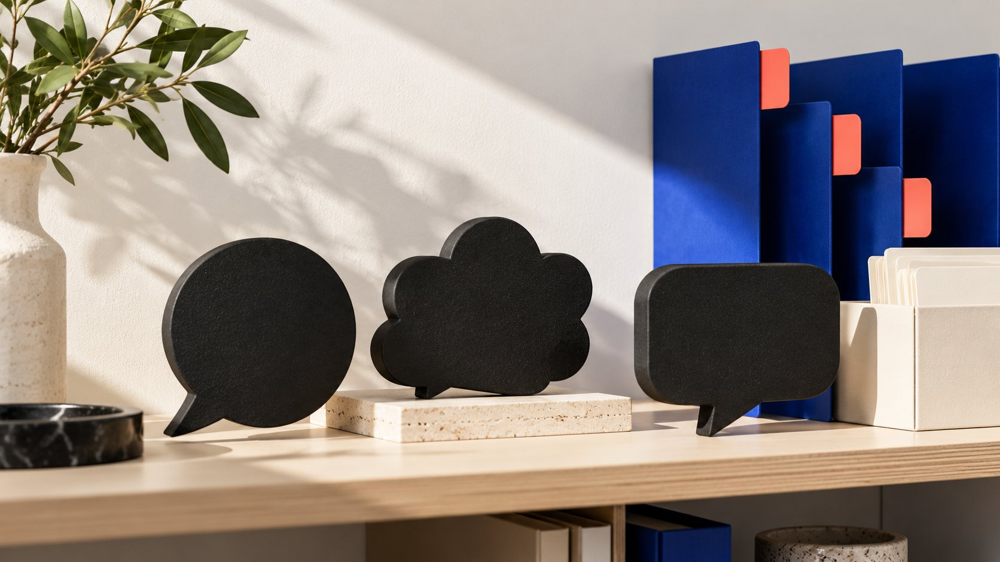

# KOL Meaning: Turn the Acronym Into a Clear Brief

Status: local review draft; confirm the publication date before release.

Understand what KOL means, then turn a vague request for KOLs into a clear assignment covering audience, contribution, publication and evidence.

AI-generated editorial illustration, not an actual creator, client, product or event.

KOL stands for Key Opinion Leader. In marketing conversations it can refer to a person with influence in a relevant field, while some industry terminology uses it for a paid branded-content creator. State what the term means in this brief, then specify contribution, audience, publication and evidence. The acronym alone establishes neither credentials, willingness to collaborate nor results. For a brand team, the useful question is what work this person is being considered for and why the available evidence supports that role.

## State the meaning used in this project

The [IAB UK glossary entry](https://www.iabuk.com/jargon-buster/key-opinion-leader-kol) describes a KOL as a creator usually in a higher-following tier who makes branded content for a fee. This is one marketing use, not a universal follower threshold or evidence that everyone called a KOL is a subject specialist.

Ask what the colleague using the term actually needs. Communications may want a publisher with a relevant audience; product colleagues may want an explanation of technical limitations; production may need a credible demonstrator. Listing these expectations can reveal different assignments hidden behind the same label.

Use a project definition such as an independent creator being considered to explain a specified use question to a relevant professional audience. This is an editorial recommendation, not a credential. Keep publication pending if it has not been discussed. A familiar acronym should make conversation easier rather than replace it. Retain the definition beside the brief so a new colleague can understand the intended role without having attended the original meeting.

## Record the title separately from the contribution

The [expert-contribution review guide](/blog/key-opinion-leader-expert-contribution-review/#answer) concerns the question and scope in which someone can offer supported explanation. This article addresses an earlier input: does the brand need expertise, demonstration, hosting or distribution? Those roles call for different work evidence.

For a software workflow, retain a relevant published example and explain which capability it supports. If a qualification matters, verify it through the appropriate credential source separately. A clear demonstration can show expression without authorizing conclusions about every technical or professional question.

Replace because they are a KOL with a reason someone can check: this example explains the operating condition we need to discuss. Record unknowns too, such as unverified audience geography or no observed experience with the current product. This retains a candidate without quietly promoting inference into fact. A brief that can name its evidence is also easier to revise: if the proposed contribution changes, the team knows which work samples need another look instead of relying on the title indefinitely.

## Replace a headcount request with six inputs

The [campaign brief guide](/blog/write-a-useful-campaign-brief/#answer) can organize six inputs: audience and market, question to answer, intended contribution, publication and destination, confirmed product facts, and owner with timing. These six are an editorial structure, not a mandatory industry-standard form.

Describe when someone needs the answer before recording the selection reason. Consumer products may involve installation or care; B2B software may involve a workflow; an industry organization may need a clear account of published research. Do not turn every assignment into a sales demonstration to fit a familiar creator template.

Separate publication from destination. Creator-account publication, file delivery for brand publication and an offline hosting role are different arrangements. Leave unconfirmed platform, language, availability, permission and data requirements as questions for the appropriate owner. Headcount should follow coverage and resources rather than a round number that the team then fills. These inputs give discovery a useful direction while allowing a smaller or different collaboration to emerge from actual research.

## Understand influence in the marketing relationship

The [AMA influencer marketing overview](https://www.ama.org/topics/influencer-marketing/) explains the field through people with influence over potential buyers and brand communication around them, involving more than one possible role. It puts terminology back into the marketing task without proving that a particular account changes behavior for this brand.

When researching work and audience evidence, explain the connection to the question. Public following describes account scale without independently establishing relevant viewers, explanation quality or purchasing authority. Adding followers across platforms does not produce unique reach.

For an educational project, define a useful explanation and a suitable observation. Sales-oriented work additionally depends on product, destination, pricing and fulfillment conditions. A title cannot replace the evidence between a proposed partnership and its intended result. Keep a working hypothesis separate from an observed outcome. This helps colleagues understand why relevant influence is a question to investigate rather than a property the brand can purchase in a fixed amount from a label.

## Do not let the label replace scope and conditions

The [collaboration scope checklist](/blog/creator-contract-scope-checklist/#answer) helps specify quantity, versions, publication objects, timing, revisions and use. One KOL collaboration is not a comparable pricing unit: the phrase could describe hosting, a file or a project with several publications and advertising uses.

Offer a discussable scope before asking for conditions. Acceptance of an introductory conversation does not establish exclusivity, continuing posts or indefinite reuse. Price cannot be inferred solely from a title or follower count; production, publication, licensing and work arrangements affect the discussion.

Separate essential and optional items in a request. A brand needing one operational explanation need not demand every channel and use in advance. Specific scope lets the recipient respond and reveals whether price differences concern different work rather than automatically making the higher quotation unreasonable. If the team changes a requirement, preserve the change and let the relevant parties confirm its effect before treating the earlier response as a final commitment.

## Keep relationships and truthful expression explicit

The [FTC endorsement FAQ](https://www.ftc.gov/business-guidance/resources/ftcs-endorsement-guides-what-people-are-asking) emphasizes truthful, nonmisleading endorsements and suitable disclosure of unexpected material relationships in its United States context. Expert or KOL terminology does not remove those questions, and substituting a gift for cash does not establish that there is no relevant relationship.

Record the actual relationship and intended market, then have the appropriate owner confirm the expression. This article makes no universal legal determination or requirement to use one label mechanically. Platform features, language and publication format may affect the practical treatment and should be checked for the situation.

The brand supplies confirmed facts and limitations; the creator describes actual experience. Without a trial, do not invent experience to fit a recommendation narrative. A claim needing support does not become substantiated through a title. Build these questions into the content discussion rather than relying on a generic disclosure reminder at the end. The brief should let reviewers identify the relevant relationship without assuming that every audience member already knows it.

## Example: turn the request into a discussable invitation

Consider an editorial hypothetical: a desk-equipment brand requests ten KOLs, preferably able to drive sales. Further input reveals a more immediate problem: people in small spaces need installation conditions, and the current destination omits unsuitable cases.

The revised assignment starts with work demonstrating installation and limitations, then asks suitable people whether they want to discuss a paid demonstration. The proposal identifies language, product readiness, file or publication requirements and unresolved uses. Headcount still follows the work and available resources; ten has not become a validated need.

This is not an actual client case or proof of higher sales. It gives the brand a reason to contact, the recipient an understandable discussion and the destination owner a missing input to address. A clear invitation produces a task-relevant response more readily usable than a request for a KOL collaboration price. The example also shows why discovery may uncover a brand-side problem that should be repaired before a larger collaboration is commissioned.

## Separate role coverage from the number of people

One person may explain, demonstrate and host, or may be suitable for only one role. Three role types do not automatically require three KOLs. Conversely, convenient availability does not make an influential person responsible for every task. List contributions before checking work, conditions and realistic capacity.

Suppose a software launch needs an operating explanation, an interview about user questions and event hosting. The demonstration can be recorded in advance; the interview needs relevant questioning; hosting involves live pacing and language. Whether one person handles several roles depends on capability, preparation and agreed scope rather than empty spaces in a shortlist.

Separate repeated distribution from contributions needing distinct perspectives. Publishing an introduction on several channels may provide distribution coverage; questions from different working contexts may add understanding. Explain why several contributions are needed instead of duplicating a script to meet a quantity target. This is an editorial planning example, not a validated optimal headcount or combination.

Then discuss resources, retaining inputs, owners and open conditions for each contribution. A colleague can understand whether a changed headcount reflects narrower scope, changed conditions or a better division of work instead of guessing why the original target moved. Define what happens if a role becomes unavailable: reschedule, narrow the assignment or confirm a replacement. Do not assume another creator inherits the same duties or conditions simply because the team still needs someone to fill the role.

## Keep the definition where the team can use it

Retain project meaning, assignment, evidence, unknowns and ownership in the brief rather than scattered conversations understood only by the original participants. Another colleague should explain why the role is needed, what is being discussed and what remains unconfirmed.

QuickKOL supports brief interpretation, relevant creator discovery, work research and personalized contact preparation. Clear inputs help those tasks, but a returned list does not confirm credentials, audience or commercial terms. Continue checking the relevant sources.

KOL terminology should clarify collaboration. Familiar shorthand is useful when connected to work and conditions; when it starts concealing disagreement, write out the complete assignment.

## Translate the acronym into brief inputs

| Input | Specify | Evidence still needed |

| --- | --- | --- |

| Relevance | Which audience needs an answer in what context | Actual audience and work connection |

| Contribution | Explanation, demonstration, hosting or publication | Relevant ability and scope |

| Arrangement | Object, language, timing and use | Willingness, conditions and confirmation |

QuickKOL editorial input framework, not certification or a universal pricing standard.

## KOL brief clarity checks

Connect the acronym to an understandable assignment.

- [ ] State the meaning used in this project.

- [ ] Ground the audience and question.

- [ ] Connect work samples to the role and retain unknowns.

- [ ] Discuss production, publication, price and use separately.

- [ ] Let owners check the relationship and actual experience.

- [ ] Make the handoff usable by another colleague.

## Research date and limitations

Sources reviewed November 2, 2026. Methods, tables and decision rules are editorial recommendations. Hypothetical examples are not actual client results or industry benchmarks. Source geography and periods are specified where relevant. This draft is in independent local review; confirm its publication date before release.

## Sources

- [IAB UK: Key Opinion Leader (KOL)](https://www.iabuk.com/jargon-buster/key-opinion-leader-kol)

- [American Marketing Association: Influencer Marketing](https://www.ama.org/topics/influencer-marketing/)

- [FTC: Endorsement Guides FAQ (United States)](https://www.ftc.gov/business-guidance/resources/ftcs-endorsement-guides-what-people-are-asking)
