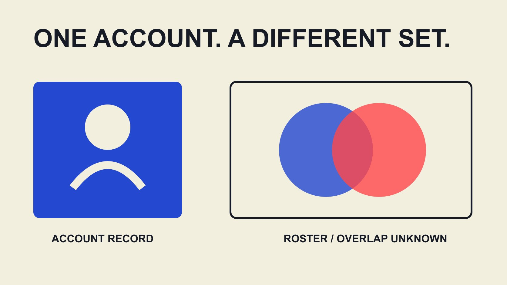

# A KOL’s Audience: Separate Individual and Roster Evidence

Status: local review draft; confirm the publication date before release.

Make the data object in “a KOL’s audience” explicit, separating people, accounts, platforms and roster totals instead of adding follower relationships as unique people.

QuickKOL editorial graphic; not actual account metrics or a platform interface.

“A KOL’s audience” refers to one KOL’s audience, but analysis still needs the account, platform, metric and period. One person can operate several accounts, and follower relationships, views and unique audience members are different objects. Adding account follower totals across a roster does not automatically produce unique people or expected reach. This article turns the search term kol’s into a practical brand data task: make each field’s ownership, construction and permitted interpretation explicit. The aim is an explainable roster, not a grammar lesson extended into a universal audience score or a promise of identity matching across platforms.

## Define person, account and audience record

Assign separate project identifiers to the contributor, account and observation record without collecting followers’ private identities. The contributor record describes the collaboration counterpart, the account identifies publication location and the observation records what was obtained, where and when.

Two platforms belonging to one creator should not have follower totals merged because the name matches. An account that changed its display name should not appear twice for that reason. Public account addresses and necessary historical notes help colleagues recognize these differences.

This identification is an organizational method, not an identity-verification tool. Similar names or photos do not prove common ownership. Keep uncertain associations unconfirmed. The model should preserve unknowns rather than force a relationship merely to complete a roster. Later verification should retain the reason for each change. A useful dataset can explain why two rows remain separate as well as why another pair was joined.

For example, one colleague saves an account under its display name and another under its address, with follower values from different dates. First reconcile account identifiers, then put both values into an observation table. Do not join by name and sum the columns. If addresses differ and contributor ownership is unconfirmed, retain separate account records. Explain that this revision concerns data organization rather than newly discovered audience change. State which observation was selected and why the other was not used, so a later report does not accidentally reintroduce the duplicate while attempting to reproduce the total.

## Attach scope to every number

Each value needs metric name, object, source, observation date and window. A follower stock usually refers to a snapshot, while period views refer to an interval. They should not become the same generic audience field.

The [YouTube metric-counting guide](https://support.google.com/youtube/answer/2991785?hl=en) explains that platform verification can delay or adjust metrics and that estimated displays may differ. This does not establish a problem with a particular account. It supports retaining where and when a number was obtained.

Keep estimated or rounded status when applicable. A more precise decimal format does not make an approximate input exact. Before comparison, establish whether objects and definitions align. A change can be computed only with an interpretation appropriate to those inputs. If one snapshot is from a public rounded display and another from an authorized exact export, preserve the source difference instead of presenting every digit as equally comparable.

## Deduplicate roster accounts before guessing audience identity

First review duplicates inside the roster: repeated imports of one public address, the same account saved by different colleagues, or old and new display names. Retain source and merge reason rather than deleting rows and losing observation history.

Two dated follower observations for one account are not two separate audiences, nor are they necessarily useless duplicates. They are two observations belonging to one account. Select a snapshot for aggregation while retaining history, instead of adding both stocks.

Then examine whether distinct accounts are confirmed as belonging to one contributor. That helps contact and collaboration planning without revealing audience overlap. Contributor-ownership deduplication and audience deduplication are different tasks. Completing one does not complete the other. A roster review should explicitly say which kind was performed so a cleaner contact list is not presented later as a verified unique-reach dataset.

## Use an overlap example to explain the limits of a sum

This is a hypothetical set exercise, not actual account data. Suppose two completely defined audience sets on one platform have 1,000 members for A and 800 for B, with 300 belonging to both. Their union is 1,000 plus 800 minus 300, or 1,500 set members.

The 1,800 sum counts memberships across both sets rather than deduplicated membership. Without an appropriately established overlap input of 300, the union cannot be claimed as 1,500. Only under these complete-set assumptions does unknown overlap leave a union between 1,000 and 1,800. That interval is still not a real campaign-reach forecast.

Actual follower displays may be rounded and do not establish unique human identities. Cross-platform account totals cannot show whether accounts belong to the same person. Do not turn the teaching formula into an automatic estimate of real cross-platform people. Its purpose is to identify required inputs and explain why an unavailable input prevents a definite conclusion. A correct formula remains insufficient when its assumed sets are not available or do not match the business question.

## Own-property identifiers do not automatically match social followers

The [Google Analytics User-ID guide](https://support.google.com/analytics/answer/9213390?hl=en) concerns identifiers a business assigns in its own Analytics implementation and states relevant limitations. It is not a tool for automatically matching arbitrary social followers into people, nor does it establish permission to collect or share private identity information.

Customer behavior on a brand property and audiences on creator platforms occupy different data contexts. Reports labeled users should not be joined merely because the field names match. Do not add names, email addresses or other private information indiscriminately to pursue apparently complete deduplication.

Where duplicate exposure genuinely matters, the appropriate data and privacy owners should establish purpose, available material, permission and method first. If a reliable permitted method is unavailable, report the undeduplicated total with limitations rather than invent an attractive unique count nobody can reproduce. The quality of the analysis depends on an appropriate question and lawful, suitable inputs, not on collecting the largest possible identity table.

## Keep geography, proportions and missing data in their own states

Audience geography percentages need platform, object, period and denominator. If creators supply different windows, or one measure concerns views while another concerns followers, do not simply weight them by follower totals into a roster geography.

[GA4 threshold guidance](https://support.google.com/analytics/answer/9383630?hl=en) illustrates how privacy thresholds can withhold information in some reports. It is an own-property analytics example, not evidence that social platforms use identical rules. It supports the recording principle that not displayed is different from observed zero.

Keep states such as unknown, unavailable, unverified and observed zero. The [educational anomaly-evidence guide](/blog/fake-followers-anomaly-evidence-literacy/#answer) explains why missing information or unusual changes should not become personal accusations. For incomplete data, state which decision it limits rather than enter a default merely to complete a table. This makes later verification possible without requiring colleagues to guess whether a zero was measured, assumed or inserted because a cell could not be left empty.

## Engagement rates also need the correct object

The [engagement-rate worksheet guide](/blog/calculate-engagement-rate-denominator-workbook/#answer) defines numerator, denominator, window and set. A roster percentage should not be formed by adding individual rates, nor does a shared engagement-rate label establish the same platform or source definition.

If aggregation is needed, state the question: a typical account, a content set or a combined event proportion? Different questions may require different methods. The worksheet already provides examples of averages and pooled definitions; this article does not add another unexplained score.

A report can retain separate account observations without demanding one roster number. Preserving differences can better support later task-specific research and prevent a high-follower account from automatically dominating strategy through an inappropriate aggregation. The analyst should be able to explain why the selected method answers the stated question, rather than use the method solely because every row happens to contain a percentage.

## Make the roster report a reviewable handoff

Provide roster version, account identifiers, selected snapshots, sources, field definitions, missing states and merge log. Internal identifiers need not be public, and irrelevant private information should not be exposed. A colleague should be able to reconstruct an aggregate rather than rely on a screenshot.

Suppose someone asks why total followers fell. First inspect merged duplicate accounts, changed snapshots or corrected fields before investigating actual audience change. A cleaning-rule difference should not be reported as creators losing followers.

Keep definitions beside the report and retain a short limitation statement. If the material is research only, say so rather than publish unconfirmed contacts or prospects as an official partnership roster. A reviewable handoff explains numbers and permitted uses together. This also helps the next analyst distinguish a revised dataset from an observed market event when comparing versions months later.

## Use the roster to support choices rather than manufacture certainty

The [hypothesis-portfolio strategy guide](/blog/influencer-marketing-strategy-hypothesis-portfolio/#answer) connects roster research to audience obstacles and content contributions. Useful work may justify learning more about an account even when audience data is incomplete, but it does not convert unknown fields into verified evidence.

QuickKOL can help interpret a brief, discover relevant creators and research work and contact routes. Audience evidence, cross-account relationships and commercial terms still need verification. Discovery does not promise completed deduplication or identity judgments.

In reports, retain the correct object: what an account displayed on a date, how a set was aggregated and what overlap remains unknown. This makes an account of a KOL’s audience easier to cite and discuss because readers know whom it concerns and which conclusions it does not establish. The resulting roster supports a next decision while remaining open to better evidence.

## Individual and roster data fields

| Field | Retain | Avoid |

| --- | --- | --- |

| Contributor record | Project identifier and confirmed account relationship | Automatic name-based merging |

| Account observation | Metric, source, date, window | Adding stocks from different snapshots |

| Roster aggregate | Set and aggregation method | Calling follower sums unique humans |

| Overlap evidence | Appropriate method, scope and unknown state | Guessing private identities from public counts |

Hypothetical sets of 1,000 and 800 with 300 overlapping have a union of 1,500; set arithmetic, not an actual people or reach estimate.

## Roster-audience handoff checks

Review before an aggregate enters a proposal.

- [ ] Separate contributor, account and observation records.

- [ ] Give every value a definition and date.

- [ ] Separate roster duplicates and audience overlap.

- [ ] Do not replace unknown with zero.

- [ ] Do not present sums as unique people.

- [ ] Retain method, sources and merge log.

## Research date and limitations

Sources reviewed November 2, 2026. Methods, tables and decision rules are editorial recommendations. Hypothetical examples are not actual client results or industry benchmarks. Source geography and periods are specified where relevant. This draft is in independent local review; confirm its publication date before release.

## Sources

- [YouTube: How engagement metrics are counted](https://support.google.com/youtube/answer/2991785?hl=en)

- [Google Analytics User-ID guide](https://support.google.com/analytics/answer/9213390?hl=en)

- [Google Analytics: About data thresholds](https://support.google.com/analytics/answer/9383630?hl=en)
