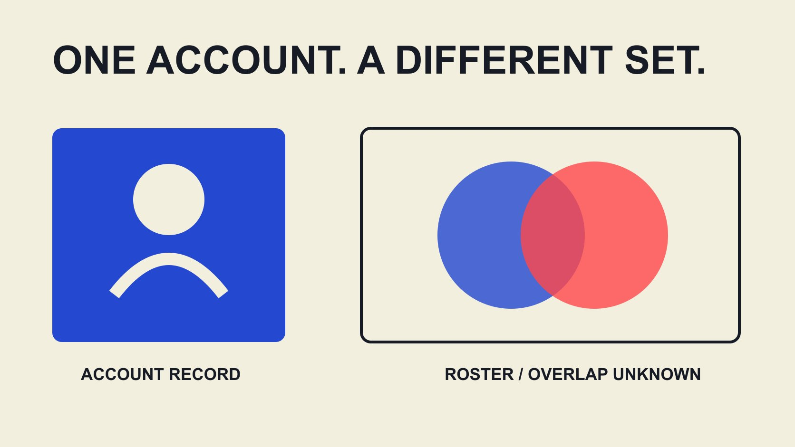

# KOL’s Audience：区分单个达人与名单受众数据

状态：本地审阅稿；正式发布日期待确认。

从“A KOL’s audience”明确数据归属，区分个人、账号、平台与名单汇总，避免把粉丝关系相加当作独立受众。

QuickKOL 编辑图形；不呈现真实账号指标或平台界面。

“A KOL’s audience”表示某位KOL的受众，但用于数据分析时必须继续说明是哪一个账号、平台、指标与时期。一个人可以有多个账号，粉丝关系、观看和独立受众也不是同一个对象。名单中多个账号的粉丝总和最多是已定义的关系数合计，不能自动称为唯一人数或预计触达。本篇将kol’s这个搜索词落到品牌的数据任务：让每个字段知道自己属于谁、如何形成、能够回答什么。

## 先定义个人、账号与受众记录

为创作者个人、账号和观察记录分别设置本项目内部标识，不必收集粉丝的私人身份。个人记录说明合作对象，账号记录说明发布位置，观察记录说明何时从哪里读到什么指标。

同一位创作者的两个平台不能因姓名相同就合并粉丝数；同一账号换过显示名称，也不应因此在名单出现两次。记录公开账号地址及必要历史说明，能帮助同事识别这些差别。

这里的标识是整理工作，不是身份核验工具。姓名或照片相似不能证明两个账号属于同一人；不确定时保留待确认。数据模型应帮助保存未知，而不是为了凑齐名单强行建立关系。后续核对时，应保留每次变更的理由。

例如甲同事按显示名保存账号，乙同事按地址保存，而两个文件使用不同日期的粉丝数。先统一账号标识，再将两项数值放进观察表；不能直接以姓名连接后把两列求和。若地址不同但个人归属尚未确认，继续保留独立账号记录。对同事解释这次修订是数据整理，不是新发现的受众变化。交接中写出选用了哪次观察，以及为什么没有使用另一项，能避免后续报表重新引入重复。

## 为每个数值附上范围

每个数值至少需要指标名、对象、来源、观察日和窗口。粉丝存量通常与某次观察有关，期间观看则对应一个时间范围；不能将它们写成相同类型的“受众”。

[YouTube 指标计数说明](https://support.google.com/youtube/answer/2991785?hl=en)指出平台会核验互动指标，部分数据可能暂缓、调整或在不同位置显示不同估计。这个来源不说明某个账号有问题，而是提醒团队保留数值来自哪里与何时。

如果记录是估计或经过取整，要保留该状态。更精确的小数格式不会让近似输入变成真实精确值。需要比较时，先问对象和定义是否一致，再决定是否计算变化。

## 名单去重先处理账号，不猜粉丝身份

先检查名单自身的重复：同一公开地址被多次导入、不同同事保存同一账号、或旧名称与新名称并存。为重复行保留来源和合并理由，别直接删除后丢失观察历史。

同一账号在两个日期的粉丝观察不是两个独立受众，也不是必须删除的无用重复。它们属于一个账号的两次观察。选择某个快照用于汇总，同时保留历史，避免把两次存量加起来。

再检查不同账号是否属于已确认的同一创作者。这有助于联系与合作安排，但仍不告诉你其受众是否重叠。个人归属去重与受众去重是两件工作，不能用一项完成另一项。

## 一个重叠算例说明合计的边界

以下为假设集合练习，不是真实账号数据。假设同一平台有两个可完整定义的账号受众集合，甲有1,000个成员、乙有800个，其中300个属于两者。并集为1,000加800减300，等于1,500个集合成员。

1,800是两个集合的成员关系合计，不是去重结果。若没有300这个经过适当确认的重叠输入，就不能声称已知并集为1,500。仅在这些完整集合假设下，未知重叠时并集可在1,000至1,800之间，仍不是现实营销触达预测。

真实粉丝显示数可能经过取整，也不等于独立人类身份。跨平台账号无法仅凭公开合计判断是否属于同一人。因此不要把这个教学公式变成自动推算真实跨平台人数的工具。它的用途是解释需要什么输入，以及缺少时为什么不能给确定结论。

## 自有分析标识不能自动匹配社交粉丝

[Google Analytics User-ID 说明](https://support.google.com/analytics/answer/9213390?hl=en)针对企业在自身分析实施中分配的标识，也列出相关限制。它不是把任何社交账号粉丝自动匹配成同一人的工具，更不证明已获得收集或共享私人身份的权限。

品牌网站上的客户行为与创作者平台上的受众属于不同数据情境。不要因为两份报告都写users就直接连接，也不要把姓名、邮箱或其他私人信息随意加入名单以追求看似完整的去重。

如果确实需要研究重复触达，由适当数据与隐私负责人先确定目的、可用资料、权限和方法。没有可靠合法的方法时，可以报告未去重合计与限制，而不是创造一个漂亮但无法复核的唯一人数。

## 地域、比例与缺失保持各自状态

受众地域比例必须说明平台、对象、期间与分母。如果两位创作者的资料窗口不同，或一个按观看、另一个按粉丝统计，不能直接按粉丝数加权成名单受众地域。

[GA4 数据阈值说明](https://support.google.com/analytics/answer/9383630?hl=en)展示某些报告可能因隐私阈值隐藏资料。这只是自有分析中的一个例子，不说明社交平台采用相同规则；它支持一般记录原则：未显示不等于已观察为零。

为名单保留“未知、不可用、未核验、已观察为零”等状态。[教育向异常证据指南](/zh/blog/fake-followers-anomaly-evidence-literacy/#answer)进一步说明不能从缺失或不寻常变化直接指控个人。对暂时不完整的数据，先说明影响哪个判断，不要填上默认数值让表格显得完整。

## 互动率也必须先找准数据对象

[互动率工作表指南](/zh/blog/calculate-engagement-rate-denominator-workbook/#answer)说明分子、分母、窗口和集合。名单级百分比不能只把每位创作者的比率相加，也不能因为字段都叫engagement rate就认定平台和来源口径一致。

如果确实需要汇总，先说明问题：想描述典型账号、内容集合还是某个合并事件比例？不同问题可能需要不同方法。已发表的工作表有均值与汇总口径算例，本篇不再给一个不明意义的总分。

报告可以同时保留每个账号的独立观察，而不强求一个名单数字。保留差异更适合之后按任务研究合作，也能避免高粉丝账号在错误汇总中自动成为全部策略的中心。

## 把名单报告变成可复查的交接

交接时提供名单版本、账号标识、选用快照、来源、字段定义、缺失状态与合并日志。内部标识不需要公开展示，也不应暴露无关私人信息。让接手同事能重建一项合计而不是依赖截图。

假设同事问“为什么总粉丝数少了？”先查重复账号是否被合并、快照是否改变或字段是否修正，再研究实际变化。整理规则导致的差异不能被写成创作者受众流失。

将字段定义与报告放在一起，并保留一个简短限制说明。若内容只用于本地研究，状态也要明确，不能把未确认的联系或合作名单发布成官方关系。可复查的交接应同时解释数字和它们能被怎样使用。

## 名单的用途是支持选择，不是制造确定性

[假设组合策略指南](/zh/blog/influencer-marketing-strategy-hypothesis-portfolio/#answer)帮助将名单研究放回受众障碍和内容贡献。某个账号的有用作品可以支持进一步了解，即使暂时没有完整受众数据；但不能因此把未知资料改成已验证。

QuickKOL可以帮助理解Brief、发现相关创作者并研究作品与联系路径。受众证据、跨账号关系和合作条件仍需核验，不能承诺一个发现结果已经完成所有去重或身份判断。

写报告时，保留准确对象：某账号在某日显示什么，某集合怎样汇总，什么重叠未知。这样的“A KOL’s audience”描述更容易被引用和讨论，因为读者知道它属于谁，也知道它没有替什么下结论。

## 个人与名单数据字段

| 字段 | 应保留 | 避免 |

| --- | --- | --- |

| 创作者记录 | 内部标识与已确认账号关系 | 相似姓名自动合并 |

| 账号观察 | 指标、来源、日期、窗口 | 不同快照存量相加 |

| 名单合计 | 集合与聚合方法 | 粉丝合计称独立人类 |

| 重叠资料 | 适当方法、范围与未知状态 | 用公开数猜私人身份 |

假设集合1,000与800重叠300时并集1,500；这是集合教学，不是真实人数或营销触达估计。

## 名单受众交接检查

在任何合计进入方案前核对。

- [ ] 个人、账号、观察记录分开。

- [ ] 每项数字有定义与时间。

- [ ] 名单重复与受众重叠分开。

- [ ] 未知不填零。

- [ ] 汇总没有冒充独立人数。

- [ ] 保留方法、来源与合并日志。

## 研究日期与使用边界

资料核验于 2026 年 11 月 2 日。文中方法、表格和决策规则为编辑建议，标为假设的示例不是实际客户结果或行业基准。外部资料的适用地区与时期按各段说明；本稿处于独立本地审阅阶段，正式发布日期待确认。

## 来源

- [YouTube: How engagement metrics are counted](https://support.google.com/youtube/answer/2991785?hl=en)

- [Google Analytics User-ID 说明](https://support.google.com/analytics/answer/9213390?hl=en)

- [Google Analytics: About data thresholds](https://support.google.com/analytics/answer/9383630?hl=en)
