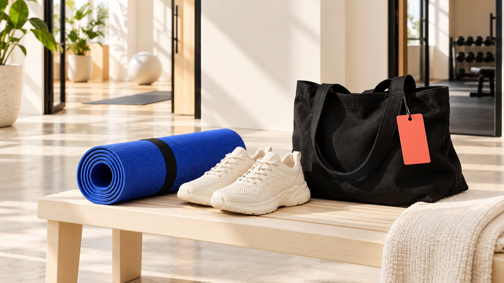

# Lululemon Affiliate Program: Find the Official Route

Status: local review draft; confirm the publication date before release.

Find the official regional lululemon affiliate route, distinguish commissions from personal discounts and community ambassadorship, and identify terms still to confirm.

AI-generated editorial illustration, not an actual creator, client, product or event.

To research the lululemon affiliate program, start with the brand’s official regional page and verify the application destination and applicable terms. The US-selected page reviewed November 2, 2026 describes unique links and purchase commissions and sends applicants to Awin. That route differs from Sweat Collective personal shopping benefits and community ambassador relationships. An available application is not acceptance, a confirmed commission rate or permission to use every brand asset. Record missing terms explicitly before building a forecast or recommending participation.

## Identify the relationship you are looking for

A search for the program can mean earning referral commission, accessing a professional community benefit or studying a long-term ambassador model. Those questions require different routes. Write down applicant, channel, intended audience and target market before choosing a page.

A brand or agency may simply be researching partnership design. Public information can establish the structure without submitting an application under a misleading identity. This guide did not log in, apply, test tracking or verify anyone’s actual earnings.

The [affiliate relationship guide](/blog/affiliate-and-marketing-customer-journey/#answer) separates recommendation, click, recorded transaction and settlement. Start by identifying the proposed contribution: content distribution, connection to a professional community or continuing community involvement. A shared partner label does not make those contributions interchangeable. An internal research note can remain useful even when the conclusion is that the available public information does not answer the team’s commercial question.

## Trace the application from the brand’s own page

The [lululemon affiliate page](https://shop.lululemon.com/story/affiliates-creators), with the United States selected during this review, describes unique links and commission from resulting purchases. Its application button points to Awin. That is a dated public observation, not a promise that every country, channel or future applicant uses the same provider.

Record starting URL, selected region, review date, program name and destination. Check the domain and context before continuing. A third-party registration link is not official merely because the surrounding article includes the brand name.

Reaching an application page is not approval, and an invitation to apply does not establish that every applicant is accepted. If a later step requires an account or additional information, review its actual terms. Permission to submit, a program decision and eventual commission settlement remain separate stages. Keep that distinction in any handoff so a colleague does not describe an unsubmitted opportunity as an active partnership.

## Separate a shopping benefit from referral commission

The [Sweat Collective FAQ](https://shop.lululemon.com/about/sweat-collective-faq?icid=SWC_US_EN_Lander_FAQLink) describes a North American benefit of 25% off eligible regular-priced personal purchases, with exclusions and restrictions on gifting, resale and sharing. That percentage is a shopping benefit, not an affiliate commission rate. It should not enter a referral-income forecast.

The page also points separately to affiliate and ambassador programs. Related community offerings may sit beside each other without membership in one granting status in another. A brand studying the design should record eligibility basis, exchange of value and restrictions for each relationship.

For an editorial hypothetical, a fitness instructor meeting a professional verification requirement still cannot assume affiliate acceptance or permission to promote a personal discount to followers. Conversely, a channel owner cannot infer professional-community eligibility from audience size. Return to the criteria for the specific program. This separation prevents a striking public percentage from becoming an unsupported earnings claim in a deck, outreach message or proposal.

## Understand what the community ambassador description establishes

The [lululemon community overview](https://corporate.lululemon.com/our-business/innovation/community-engagement) describes ongoing ambassador relationships with community role models, including local influencers and professional athletes. It supports an understanding of the relationship’s positioning. It does not establish that a particular person has been invited, places are available or a specific payment is offered.

The [ambassador role guide](/blog/what-is-a-brand-ambassador-representation-boundaries/#answer) distinguishes continuing representation, individual content production and affiliate distribution. Ask which community, activities and sustained contribution shape the relationship. Brand prominence alone cannot establish identical contracts for participants.

A team designing its own program can use the editorial principle of defining the relationship before choosing its title. It still needs its own work, resources and ending arrangements. Public values should not be translated into unpublished selection rules, compensation or operating procedures. A useful comparison records what is disclosed and which questions require direct clarification, rather than trying to reconstruct a private program from promotional language.

## Turn unpublished terms into specific questions

The public affiliate body read for this review did not establish a complete numeric commission rate or attribution window applicable to every applicant. Do not fill that gap with an old third-party article. Prepare questions about market, accepted channel, qualifying purchase, commission basis, attribution conditions, returns and reversals, settlement timing and exit arrangements.

These are editorial research fields, not claims that the program applies a particular settlement rule. Enter answers only when the relevant terms are actually available, retaining their version. An ambiguous answer should remain ambiguous rather than becoming a number invented by the researcher.

The [collaboration scope checklist](/blog/creator-contract-scope-checklist/#answer) helps separate program membership from additional services. If the parties also discuss a standalone video, event attendance or paid content use, confirm that portion separately. Affiliate application should not silently cover production fees, advertising rights or exclusivity. Clear questions can support a useful conversation even when the team is not ready to submit an application or forecast a return.

## Assess fit through content and audience tasks

For content fit, start with actual work: what the channel explains, why its readers trust it and whether a recommendation belongs in the use context. Follower count is only one descriptive field. Fitness-related work should not be presumed to require one gender, body type or lifestyle expression.

Separate examples from interpretation. A statement that a channel publishes training-equipment care tutorials can have a work reference. A prediction that its audience will buy a particular brand still needs evidence; topical similarity does not establish purchase intent.

A smaller channel can clearly explain whom it serves and how it edits its work, without that becoming an acceptance guarantee. Where existing work has little natural connection to the proposed product, a valid outcome is not applying yet or developing an authentic editorial direction first. Inventing experience to satisfy an imagined program preference weakens the research rather than demonstrating fit.

## Keep the relationship and product experience understandable

The [FTC disclosure primer](https://www.ftc.gov/business-guidance/resources/disclosures-101-social-media-influencers), in a US context, explains that money and valuable noncash relationships can require clear disclosure. Referral commission, gifts or relevant benefits should not be hidden in a profile or hard-to-find text. Check wording against the applicable rules, format and actual relationship.

Membership is not proof of product performance. Statements of personal experience should reflect real experience, and a brand should supply reliable product information without asking a creator to invent an encounter with the product.

For cross-border work, identify the intended audience and route applicable requirements to the appropriate owner. This reference is not a worldwide legal conclusion or a complete review of every post format. Leave a disclosure owner and intended placement in the research record so the concern reaches publication rather than remaining an abstract sentence in a planning document.

## Model the economics only after the terms are known

An earnings forecast first separates eligibility for commission, qualification of an order and completed settlement. A public description of a mechanism does not supply the team with all its numeric inputs. Prepare the model fields without calculating an unsupported result.

For example, a planning sheet might retain valid referrals, qualifying transactions, commissionable value, confirmed rate and adjustments. Values must come from applicable confirmed terms or explicitly labeled assumptions. If the rate is unknown, mark the income result not calculable rather than inserting a figure from an unrelated article. Sales value is not the creator’s take-home income. A blank field can be a better decision aid than a precise-looking forecast built on an unverified rule.

Production, equipment, assistance and management time remain separate resources. Evaluate whether the proposed work justifies that commitment and which costs arise even when no qualifying purchase occurs. A publisher with existing relevant work faces a different incremental workload from a channel planning an entirely new production around the opportunity. Do not assume the same sales outcome or cost structure for both.

This is not individual tax or financial advice. It is a way to prevent incomplete commercial information from becoming an earnings promise. When terms arrive, preserve the version, update the assumptions and explain why the model changed. That makes a later decision review possible without pretending the earlier uncertainty never existed.

## Example: hand over a research record another colleague can continue

Consider an editorial hypothetical: an agency researches a route for a sports-content channel. Its note could say: US official affiliate page reviewed; application points to Awin; no application submitted; commission and attribution window unconfirmed; Sweat Collective personal benefit recorded separately; no ambassador relationship established. That is more actionable than brand available, attractive commission. Where an agency represents several channels, identify applicant, channel authorization and intended payee separately, rather than extending one channel’s research to every client.

The recipient can read applicable terms, assemble genuine work and decide whether to apply without reconstructing the research stage. If region or route changes, add the new observation and date rather than replacing the historical record as though it had always said the same thing.

QuickKOL can help interpret a partnership brief, research relevant work and prepare contact. It does not secure acceptance or confirm unpublished commercial terms. Base the decision on the correct program, authentic content and current conditions. The practical deliverable is a reliable path to a decision, including a reason to defer when the available evidence is insufficient.

## Three labels, different decisions

| Route | Public description supports | Does not establish |

| --- | --- | --- |

| Affiliate | A link and purchase-commission mechanism | A fixed rate, acceptance or guaranteed income |

| Sweat Collective | An eligible personal-shopping benefit | Shareable discount or referral-commission rate |

| Community ambassador | Positioning of a continuing community relationship | Available places or uniform compensation |

Reviewed November 2, 2026; US/North American scope as specified. Actual terms and regional pages govern.

## Official-route research checks

Retain the basis before applying; leave unknown terms unfilled.

- [ ] Record region, official starting point, date and destination.

- [ ] Label affiliate, personal benefit and ambassador separately.

- [ ] Keep unconfirmed rates, attribution and settlement explicit.

- [ ] Use genuine work to support content and audience fit.

- [ ] Specify additional production, advertising and disclosure.

- [ ] Distinguish research, application, acceptance and settlement.

## Research date and limitations

Sources reviewed November 2, 2026. Methods, tables and decision rules are editorial recommendations. Hypothetical examples are not actual client results or industry benchmarks. Source geography and periods are specified where relevant. This draft is in independent local review; confirm its publication date before release.

## Sources

- [lululemon: Affiliates and Creators](https://shop.lululemon.com/story/affiliates-creators)

- [lululemon: Sweat Collective FAQ](https://shop.lululemon.com/about/sweat-collective-faq?icid=SWC_US_EN_Lander_FAQLink)

- [lululemon: Community Engagement](https://corporate.lululemon.com/our-business/innovation/community-engagement)

- [FTC: Disclosures 101 for Social Media Influencers](https://www.ftc.gov/business-guidance/resources/disclosures-101-social-media-influencers)
