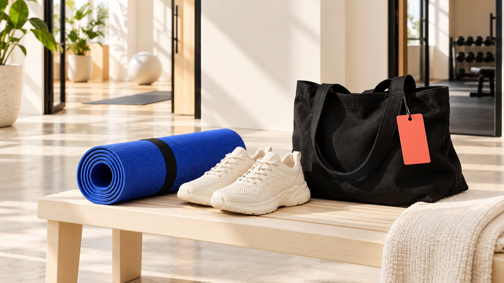

# lululemon 联盟计划：核对官方申请与项目区别

状态：本地审阅稿；正式发布日期待确认。

沿官方地区页面找到 lululemon 联盟申请入口，分清佣金合作、个人折扣与社区大使，并保留尚未确认的条款。

AI 生成的编辑示意图，不是真实达人、客户、产品或活动。

研究 lululemon affiliate program，应从品牌官方地区页面进入，再核对申请平台及适用条款。2026年11月2日核验的美国地区联盟页面介绍专属链接与购买佣金，申请按钮通往 Awin。它不等于 Sweat Collective 个人购物优惠，也不等于社区大使合作。公开入口未给出完整费率、归因窗口或个人准入结果时，保留未知状态，不用旧榜单替代当前条件。

## 先判断自己在寻找哪一种合作

搜索品牌联盟计划的人可能想赚取推荐佣金、获得职业社群优惠，或研究长期大使模式。这些任务需要不同入口。先写清申请主体、内容渠道、服务受众与目标地区，再判断要阅读哪个项目。

品牌或机构也可能只是做竞品合作研究。此时公开页面适合确认项目结构，不应冒充申请者提交资料来补齐信息。本指南没有登录、申请、测试追踪或验证任何人的实际收入。

[联盟与营销关系指南](/zh/blog/affiliate-and-marketing-customer-journey/#answer)可帮助拆开推荐、点击、记录与结算。判断一个合作机会时，先知道对方希望提供什么价值：内容分发、专业社群连接，还是持续的社区参与。不要用同一个“合作伙伴”标签替代具体任务。

## 从品牌页面追到申请目的地

[lululemon 联盟入口](https://shop.lululemon.com/story/affiliates-creators)在本次核验的美国地区页面中说明，参与者使用专属链接讲述产品与品牌相关内容，并通过点击后购买获得佣金；申请按钮链接至 Awin。这个跳转关系是当日公开观察，不是所有国家、渠道和未来申请都使用同一服务的保证。

研究记录应保存起始网址、地区、核验日期、项目名称与申请目的地。打开平台前核对域名和页面语境；第三方文章出现的注册链接，不应仅因带着品牌名称就被视为官方入口。

不要把到达申请页写成已经获批，也不要把“可以申请”写成“任何人都会接受”。若后续页面要求账户或额外资料，先阅读该页面条款。申请权限、录取决定与日后佣金结算，是不同阶段。

## 把购物优惠与推荐佣金分开

[Sweat Collective 常见问题](https://shop.lululemon.com/about/sweat-collective-faq?icid=SWC_US_EN_Lander_FAQLink)在北美语境下列出符合条件成员购买自用正价产品的25%优惠，同时说明排除项及不得赠送、转售或分享优惠等条件。这里的25%是购物优惠，不是联盟佣金率，也不能写进推荐收入模型。

该页面还分别指向联盟与大使相关项目。可见同一品牌的社区项目可能相邻展示，但参加其中一项不自动取得另一项身份。品牌读者研究项目设计时，应分别记录参与依据、价值交换及使用限制。

假设一位健身教练符合某项职业验证要求，仍不能据此推断其联盟申请一定通过，或允许将个人优惠向受众宣传。相反，有内容渠道的申请者，也不能仅凭频道规模推断自己具备职业社群资格。判断标准应回到对应项目。

## 社区大使说明回答的是另一类问题

[lululemon 社区合作说明](https://corporate.lululemon.com/our-business/innovation/community-engagement)将大使项目描述为与社区榜样持续合作，例子包括当地影响者和专业运动员。它能支持对社区关系定位的理解，不能证明某位个人已被邀请、当前有名额或可获得某种报酬。

[大使角色说明](/zh/blog/what-is-a-brand-ambassador-representation-boundaries/#answer)进一步区分持续代表、单次内容制作与联盟分发。研究团队应问：项目围绕什么人群、活动和长期贡献建立关系？不要只从品牌知名度倒推所有参与者都获得相同合同。

如要在自己的品牌设计类似项目，可借鉴“关系目标先于称号”的编辑方法，但需要自行定义工作、资源与结束安排。不能将品牌公开价值观直接翻译为它没有公开的选拔标准、薪酬或操作步骤。

## 把未公开条款变成具体问题

在本次读取的联盟公开页面正文中，没有找到可用于所有申请者的完整数值佣金率或归因窗口。不要用第三方旧文章填空。团队可以先写出待确认字段：适用市场、渠道、合格购买定义、佣金基础、归因条件、退款与撤销处理、结算时间及退出安排。

这些是编辑建议的提问字段，并非声称该项目一定采用某种结算规则。只有实际获得相应条款后，才记录具体答案与版本。含糊回答也应保留，不能由研究者自行补成确定数字。

[合作范围清单](/zh/blog/creator-contract-scope-checklist/#answer)可用于区分计划成员资格与额外服务。如果双方还讨论独立视频、活动出席或付费使用内容，分别确认该部分条件；不要默认联盟申请覆盖制作费、广告权利或排他要求。

## 从内容与受众任务判断适配

对内容合作的研究，可以从真实作品开始：该渠道通常解释什么、读者为什么信任它、推荐是否与使用情境相符。不要只检查粉丝数，也不预设健身相关内容只能采用一种性别、体型或生活方式表达。

品牌或机构整理观察时，把作品例子与自己的判断区分。比如“频道发布训练装备维护教学”可以附作品依据；“受众一定会购买某品牌”则仍需要证据，不能由内容相似推定。

小型渠道也可以清楚说明特定服务对象与编辑方式，但这不是录取保证。若主要作品与拟推广产品缺少自然关系，研究结果可以是暂不申请，或先完善真实内容方向。为了符合想象中的项目偏好而制造经历，会降低资料可靠性。

## 合作披露与真实体验不能省略

[FTC 披露入门指南](https://www.ftc.gov/business-guidance/resources/disclosures-101-social-media-influencers)在美国语境下指出，金钱及有价值的非现金关系都可能需要清楚披露。推荐佣金、赠品或相关优惠不应只藏在个人简介或不易看见的文字里。具体表达应结合适用规则、内容形式及实际关系核对。

不要将品牌计划成员身份写成产品效果证明。内容里说到个人使用体验时，应基于真实经历；品牌侧则应提供可靠产品资料，不要求创作者制造不存在的使用感受。

对跨地区内容，把目标受众和适用要求交给相应负责人确认。本篇引用美国指导，不是全球法律结论，也不是对每种帖子形式的完整审核。研究文档应留下披露负责人和需要核对的内容位置，让信息能落实到真实发布中。

## 只有条款齐备后才建立经济假设

收入预测先区分是否有资格获得佣金、订单是否符合要求，以及结算是否完成。公开页面描述了某种机制，不等于团队已取得输入数字。可以先准备模型字段，暂时不计算结果。

例如，假设表格保留有效推荐量、合格成交量、可计佣金额、实际费率及调整项。所有数值必须来自获确认条款或明确标注的假设；若费率未知，就将收入输出标为不可计算，而不是擅自输入网络文章中的数值。也不要把销售额写成创作者到手收入。

内容制作、设备、协助人员和管理时间仍是独立资源。比较机会时，问这项工作是否值得投入相应时间，以及哪些成本在没有成交时仍然发生。本文不提供个人税务或财务建议；真正有用的是避免把不完整的商业资料包装成精确收益承诺。

## 示例：给下一位同事一份可继续的研究记录

以下为编辑假设：一家机构为运动内容频道研究合作入口。记录可写：“美国地区官方联盟页已核验，申请跳转 Awin；未提交申请；费率与归因窗口待确认；Sweat Collective 自购优惠单独记录；不代表大使合作。”这比“品牌可合作，佣金很好”更能支持下一步。若机构代表多个频道，还应把申请主体、渠道授权与收款主体分别记录，避免把某个渠道的研究结论扩展到所有客户。

接收人可以据此阅读适用条款、整理真实作品和决定是否申请，而无需重新猜测研究进度。若地区或入口变化，追加新核验日期和来源，不覆盖旧记录中的历史观察。

QuickKOL 可以帮助理解合作 Brief、研究相关内容并准备联系。它不会使申请自动获批，也不替品牌确认未公开的佣金条件。最终决定应建立在正确项目、真实内容与当前条款上。

## 三个项目标签，三种不同判断

| 入口 | 公开说明支持 | 不能推导 |

| --- | --- | --- |

| 联盟 | 链接与推荐购买佣金的合作机制 | 固定费率、准入或收入保证 |

| Sweat Collective | 符合条件的个人购物优惠 | 可分享折扣或推荐佣金率 |

| 社区大使 | 持续社区关系的定位 | 公开申请名额或统一报酬 |

核验于2026年11月2日；美国/北美范围按正文说明。实际条款与地区页面优先。

## 官方入口研究清单

申请前保留依据，不预填未知商业条件。

- [ ] 记录地区、官方起点、日期及跳转。

- [ ] 把联盟、个人优惠与大使分别标记。

- [ ] 费率、归因与结算未确认时明确留空。

- [ ] 真实作品支持内容与受众适配判断。

- [ ] 把额外制作、投放与披露另行说明。

- [ ] 区分研究、申请、获批与结算阶段。

## 研究日期与使用边界

资料核验于 2026 年 11 月 2 日。文中方法、表格和决策规则为编辑建议，标为假设的示例不是实际客户结果或行业基准。外部资料的适用地区与时期按各段说明；本稿处于独立本地审阅阶段，正式发布日期待确认。

## 来源

- [lululemon: Affiliates and Creators](https://shop.lululemon.com/story/affiliates-creators)

- [lululemon: Sweat Collective FAQ](https://shop.lululemon.com/about/sweat-collective-faq?icid=SWC_US_EN_Lander_FAQLink)

- [lululemon：Community Engagement](https://corporate.lululemon.com/our-business/innovation/community-engagement)

- [FTC: Disclosures 101 for Social Media Influencers](https://www.ftc.gov/business-guidance/resources/disclosures-101-social-media-influencers)
