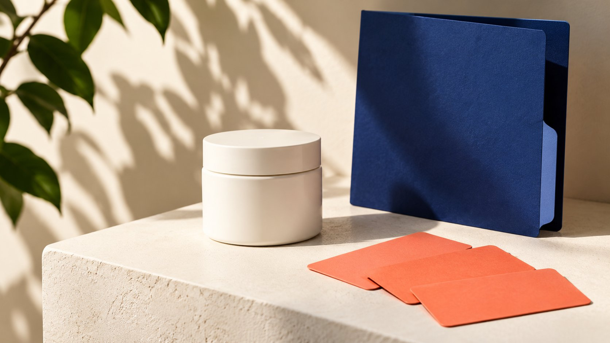

# Pure Encapsulations Partnership Program: Verify Official Paths

Status: local review draft; confirm the publication date before release.

Distinguish Pure Ambassador, professional-account and organizational partnership routes, with qualification and commercial questions rather than assumed affiliate terms.

AI-generated editorial illustration, not an actual creator, client, product or event.

The Pure Encapsulations partnership program search does not establish one open affiliate scheme with a universal commission rate. As reviewed November 2, 2026, the official Pure Ambassadors page describes free products in exchange for authentic social sharing and offers a qualification form. Pure Partnerships describes professional and organizational relationships, while professional accounts have separate terms. A brand or agency should confirm program name, geography, role and scope before asking about applications or compensation. This guide does not recommend supplements, evaluate health effects or replace professional or legal judgment. Its purpose is to help a partnership team navigate the correct official route without manufacturing commercial promises.

## Turn the search into a specific partnership question

Searchers may be content creators, agencies, practitioners or marketing colleagues studying a brand program. The same query does not give them the same qualifications or intended work. Write who you are, what you propose to contribute and which relationship you want to understand.

Asking whether a location is eligible for content collaboration differs from asking how to establish a professional sales account. Route each question to the appropriate official entry instead of assuming both identities already apply inside one form.

The [ambassador-meaning training guide](/blog/brand-ambassador-meaning-team-training/#answer) separates a program title from an actual assignment. Do the same in internal records: page found, inquiry submitted, brand response received and membership confirmed are different states. A program name in search results should not become an approved partnership in a planning sheet. This simple separation prevents research from being presented to colleagues as a commercial arrangement that nobody has offered.

If a form cannot be opened, record technical unavailability rather than announce program closure. An appropriate contact route on the official site can clarify the current path without repeated submissions of the same information. With no response, retain unconfirmed status and choose a client plan that does not depend on admission. If a reply refers the inquiry to another program, record the reason and recheck role and territory instead of carrying the original page’s benefits into the new route. The research deliverable can be an accurate route and question record without pretending an application or negotiation has been completed.

## What the Pure Ambassadors page actually establishes

The [Pure Ambassadors official page](https://www.pureencapsulationspro.com/ambassadors) describes free products for fans in exchange for sharing authentic experiences on social media and directs visitors to a qualification form. That supports a bounded conclusion: the page describes a product-exchange sharing route.

A visible page does not establish that every application is currently processed or that a particular country, audience size or content category qualifies. This research did not submit a form, obtain a private agreement or receive an admission decision.

Keep eligibility, current application acceptance, sharing requirements, specified products and permitted uses unconfirmed until the appropriate official response. Free products should not become assumed cash commission, and authentic sharing should not become a requirement to deliver a positive evaluation. Preserve the public page’s actual scope in research notes. If a team needs a paid content assignment, describe that need separately rather than budget for it as an included benefit of the route.

## An organizational partnership page is not an open recruitment list

The [Pure Partnerships official page](https://www.pureencapsulationspro.com/partnerships) lists professional-sector relationships, including Fullscript, and educational or diagnostic partnership categories. It establishes different relationship types without showing that the named organizations are recruiting creators.

Do not treat a partner’s name as an admission route available to everyone or infer authority to represent either company from the existence of their relationship. An organizational proposal needs its organization, audience, proposed work and problem clearly described.

This article studies partnership structure without repeating the page’s health-effect promotional claims or presenting a company relationship as proof of product efficacy. Marketing teams should route feasibility questions and material requiring professional review to their respective owners. The public list can identify a type of collaboration worth understanding; it cannot supply the private business case, obligations or permission that a new organization would need for its own proposal.

## Verify professional accounts separately from content collaboration

The [Pure professional-account terms](https://www.pureencapsulationspro.com/practitioner-account) contain US professional-customer qualification and sales arrangements, with relevant terms on the page dated 2023. They concern a professional channel and do not establish that a content creator has sales or recommendation authorization.

Do not describe yourself as a practitioner merely to enter a program. Where genuine credentials are relevant, provide them through the appropriate official process rather than circulate private documents to marketing contacts who do not need them.

Someone who has both professional qualifications and content skills still needs to establish the program, role, permitted work and applicable commercial arrangement. One identity does not automatically extend across territories or channels. Specific legal interpretation belongs with appropriate professional review. For the partnership team, the immediate task is accurately identifying the route and recording what remains to be confirmed, rather than trying to convert a creator inquiry into a different professional relationship.

## Specify product exchange and content responsibilities

The [FTC disclosure primer](https://www.ftc.gov/business-guidance/resources/disclosures-101-social-media-influencers) explains, in a US context, why valuable connections such as free products can require clear disclosure; cash is not the only relevant benefit. Review applicable requirements for the actual market rather than extend US guidance into a worldwide legal conclusion.

In an inquiry, separate exchange from work: deliverables, timing, publication requirement, review scope, any additional permission and what happens if a person cannot genuinely evaluate the product. Receiving a product does not establish agreement to all those conditions.

The [brand-partnership fit conversation guide](/blog/brand-ambassador-mutual-fit-conversation/#answer) helps discuss each side’s contribution and support. In a health-related category, do not ask a creator to invent experience, diagnosis or outcomes to complete a marketing assignment. Unsupported language can be removed or routed to the appropriate reviewer. A feasible partnership begins with work someone can actually undertake, not a stronger testimonial written in advance of that experience.

## What a focused inquiry should contain

The following is an editorial suggestion, not an official form requirement. Briefly state organization or public work, location and target market, proposed contribution and the program you want to clarify. Begin with route and qualification questions instead of sending extensive private information or many attachments.

A hypothetical inquiry could say: “We represent a content-production agency and want to confirm whether there is a suitable route for authentic use explanations in our market. We offer production services and have not assumed ambassador status, sales authorization or cash commission. Which program and current requirements should we review?”

This is a writing example, not a brand response. The person or authorized owner should verify facts and channel before sending. If an official form asks for different information, follow the actual process while seeking clarification on unclear fields. Do not guess answers to make the application appear complete or imply a professional status that has not been established.

## Keep unknown commercial terms unknown

The reviewed public routes do not establish a universal commission, tracking window, income guarantee, capacity or acceptance rate. Where evidence is unavailable, say unconfirmed instead of filling the gap with another brand’s terms or an unofficial list.

The [affiliate company-role guide](/blog/affiliate-marketing-companies-commercial-roles/#answer) separates product exchange, performance commission, professional sales and organizational services. If a later proposal provides a specific price, attach it to program, territory, date and role. Do not generalize it into the brand’s standard across every relationship.

A budget can retain an awaiting-quote row. Describe the scope and resources for production work, then wait for an appropriate response. Do not record the assumed retail value of an unconfirmed product as cash income or promise a client that anticipated program earnings will repay production costs. Clear unknowns are more useful to planning than unsupported precision that later needs to be withdrawn.

## How three different searchers can choose a next step

These three scenarios are hypothetical. A content creator reading the Pure Ambassadors page can check current qualification, territory and exchange requirements before deciding whether to apply. That is not selection or authorization to make recommendations.

A person with relevant professional qualifications should review the current professional route and inquire under their actual identity. If content work is also intended, state that separately. An organizational team researching education collaboration should propose its organization-level task and audience rather than treat a fan qualification form as a complete institutional proposal.

All three begin by identifying role and task, then confirming the official route. Their eventual conditions can differ completely. Sharing that route decision with a colleague is more useful than sending a link containing partnership without context. It explains why a page was chosen, what it establishes and what response is still needed before anyone allocates time, products or budget.

## Keep review dates and brand-response boundaries

Save page name, full official address, review date and the limited facts supported. Recheck when pages change rather than present a November 2, 2026 observation as a promise of permanent availability.

A later genuine response should retain sender, program, applicable scope and version. General guidance from a contact should not become a signed agreement. Without a clear response, status remains unconfirmed. An ended or unsuitable route can be closed instead of extended through increasingly unsupported explanations.

QuickKOL can help a brand clarify a content brief, research relevant work and prepare outreach. It cannot approve Pure Encapsulations eligibility, grant professional status or guarantee compensation. Establish the relationship first, then design authentic work a participant can undertake with appropriate support. This order lets marketing planning proceed without converting navigation research into a health endorsement or a commercial promise.

## Scope of Pure partnership-route verification

| Public route | Supported understanding | Still to confirm |

| --- | --- | --- |

| Pure Ambassadors | Page describes product exchange for authentic sharing | Territory, eligibility, current processing and terms |

| Pure Partnerships | Professional and organizational relationships | Route and scope for a new proposal |

| Professional account | Separate qualification and channel terms | Applicable qualification and authorization |

Reviewed November 2, 2026; no application submitted or admission verified; no medical or legal advice.

## Partnership-route inquiry checks

Confirm the program before work and compensation.

- [ ] State actual role and proposed contribution.

- [ ] Name official program and territory.

- [ ] Do not relabel product exchange as cash commission.

- [ ] Separate eligibility, permissions and content work.

- [ ] Route health-related statements to appropriate review.

- [ ] Retain unknown terms and review date.

## Research date and limitations

Sources reviewed November 2, 2026. Methods, tables and decision rules are editorial recommendations. Hypothetical examples are not actual client results or industry benchmarks. Source geography and periods are specified where relevant. This draft is in independent local review; confirm its publication date before release.

## Sources

- [Pure Ambassadors official page](https://www.pureencapsulationspro.com/ambassadors)

- [Pure Partnerships official page](https://www.pureencapsulationspro.com/partnerships)

- [Pure Encapsulations: US professional-account terms](https://www.pureencapsulationspro.com/practitioner-account)

- [FTC: Disclosures 101 for Social Media Influencers](https://www.ftc.gov/business-guidance/resources/disclosures-101-social-media-influencers)
