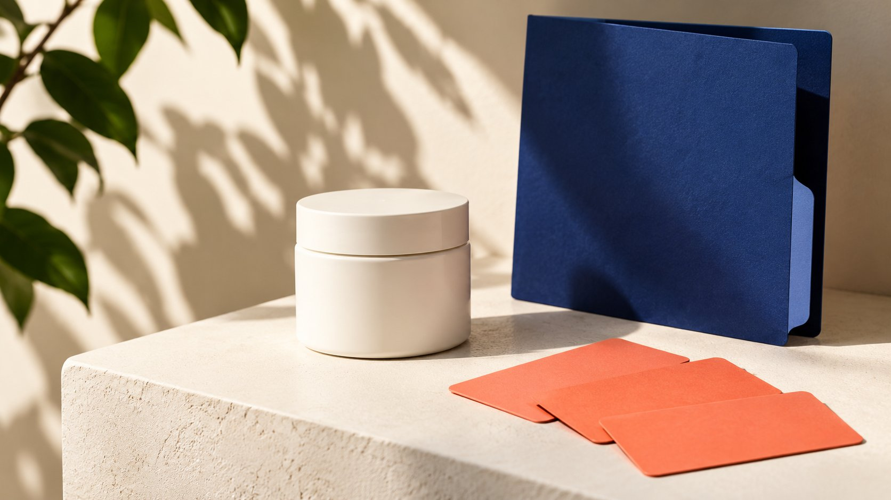

# Pure Encapsulations 合作计划：核对官方项目与资格

状态：本地审阅稿；正式发布日期待确认。

区分Pure Ambassador、专业账户与机构合作页面，整理资格、地区、交换内容和待确认条款，不推断统一联盟佣金。

AI 生成的编辑示意图，不是真实达人、客户、产品或活动。

Pure Encapsulations partnership program不是一个已核实具有统一费率的开放联盟计划。截至2026年11月2日，官方Pure Ambassadors页面描述免费产品交换真实社交体验分享，并提供资格表单；Pure Partnerships则展示专业与机构合作。专业账户又有不同条款。品牌或机构应先确认项目名称、地区、身份和合作范围，再问是否接受申请及具体回报。本篇不推荐补充剂、不评价疗效，也不代替专业或法律判断。

## 先将搜索词改成具体合作问题

搜索者可能是内容创作者、代理机构、专业人员或想研究品牌项目的营销同事。相同搜索词不说明他们具有相同资格或准备完成相同工作。先写自己是谁，想提供什么，以及希望了解哪类关系。

例如询问“是否接受某地区的内容合作”与“怎样建立专业销售账户”是不同问题。应把它们发送到适当官方入口，而不是在一个表单里假设两种身份都已经成立。

[大使含义培训指南](/zh/blog/brand-ambassador-meaning-team-training/#answer)帮助团队区分项目名称与实际任务。内部记录也要如此：页面已找到、问题已提交、品牌已回应和正式加入分别记录。一个项目名出现在搜索结果中，不能直接进入已确认合作名单。

如果表单暂时打不开，记录技术不可用而不是宣称项目关闭。可以通过官网适当联系入口询问当前路线，不需要重复提交大量相同信息。若没有回复，就保留待确认，并为客户计划选择不依赖该录取的方案。若回复要求查看另一项目，记录转交原因并重新核对身份与地区，不把最初页面的回报条件自动带过去。品牌研究的交付可以是一份准确路线与问题记录，而不必假装已经完成申请或谈判。

## Pure Ambassadors页面实际说明了什么

[Pure Ambassadors 官方页面](https://www.pureencapsulationspro.com/ambassadors)描述向品牌粉丝提供免费产品，以交换在社交媒体分享真实体验，并引导填写资格表单。这支持“页面描述产品置换分享路线”的有限结论。

页面可见不等于当前每个申请都被处理，也不证明任何特定地区、粉丝规模或内容类别一定符合条件。本次研究没有提交表单，也没有获得私人项目协议或录取结果。

因此把资格、当前是否接受申请、分享要求、具体产品与使用范围列为待确认。不要从free products推导现金佣金，也不要把真实分享改写成必须给出正面评价。研究记录应保持页面原本支持的范围。

## 机构合作页面不是公开招募名单

[Pure Partnerships 官方页面](https://www.pureencapsulationspro.com/partnerships)列出专业领域的机构合作，包括Fullscript等伙伴，以及教育或诊断相关合作类别。它说明品牌存在不同类型关系，不代表列出的机构正在招募创作者。

不要把伙伴名称当作自动适用于所有人的加入入口，也不要从两家公司合作推导你能够代表其中任何一方。若准备提出机构项目，需要说明组织、受众、拟议工作及希望解决的问题。

本篇只研究合作结构，不复述该页面关于健康效果的宣传，也不将机构合作写成产品疗效证明。营销团队应将项目可行性问题与需要专业审阅的内容问题分别交给适当负责人。

## 专业账户与内容合作分别核对

[Pure 专业账户条款](https://www.pureencapsulationspro.com/practitioner-account)包含面向美国专业客户的资格与销售安排，页面展示的相关条款日期为2023年。它们属于专业渠道，不能作为创作者已经获得销售或推荐资格的证明。

不要为了进入某个合作项目而把自己的身份填写成专业人员。真实资格如确实相关，应通过官方要求的适当渠道提供，而不是向没有必要接收的营销联系人传播私人文件。

如果你同时具有专业身份和内容工作能力，也需要分别确认参加哪个项目、代表什么角色、哪些内容可制作及哪些商业安排适用。一个身份不自动扩展到所有地区或渠道。对于具体条款的法律解释，交由适当专业人员审阅。

## 产品回报与内容责任应写清

[FTC 披露入门指南](https://www.ftc.gov/business-guidance/resources/disclosures-101-social-media-influencers)在美国背景下说明，免费产品等有价值关系也可能需要清楚披露；并非只有现金报酬才重要。具体市场仍需按适用要求审阅，不把美国资料扩写为全球结论。

准备询问时，将回报与工作分别列明：具体交付、时间、是否需要发布、审阅范围、是否另有许可，以及无法真实评价时怎样处理。免费收到产品本身不说明双方已经同意所有这些内容。

[品牌合作适配对话指南](/zh/blog/brand-ambassador-mutual-fit-conversation/#answer)帮助讨论双方能提供的贡献与支持。在健康相关类别，尤其不要为了完成营销任务要求创作者捏造体验、诊断或结果。无法可靠支持的表达可以删减或交由适当负责人处理。

## 一封询问信应提供哪些信息

以下是编辑建议，不是官方表单要求。用简短说明交代组织或公开作品、所在及目标地区、拟议贡献和要确认的项目。先提出资格与路线问题，不必一开始发送完整私人资料或大量附件。

例如可以问：“我们代表一家内容制作机构，希望确认某地区是否存在适合真实使用说明的合作入口。我们提供制作服务；尚未假定大使资格、销售授权或现金佣金。请问应查看哪个项目及当前要求？”

这只是询问模板，不能冒充品牌回复。发送前由本人或获授权负责人确认事实和渠道。若官方表单要求不同信息，以实际流程为准，同时保留对不清楚字段的询问，不猜测填写。

## 将未知商业条件留为未知

本次已读取的公开路线不足以建立统一佣金、追踪窗口、收入保证、名额或通过率。没有这些资料时，内容应直接说尚未确认，不借其他品牌或非官方列表补空白。

[联盟公司角色指南](/zh/blog/affiliate-marketing-companies-commercial-roles/#answer)帮助区分产品置换、按结果佣金、专业销售与机构服务。若后续收到某项具体报价，将报价对应到项目、地区、日期与角色，不能回填成品牌全部项目的标准。

预算可以先保留待报价行。对于制作工作，描述所需范围和资源，再等待适当回应。不要把未确认的产品价值按现金收入记录，也不要向客户承诺预计通过项目赚回制作成本。

## 三个搜索者怎样选择下一步

以下三个情境均为假设。内容创作者看到Pure Ambassadors页面，可以核对当前资格、地区与交换要求，然后决定是否愿意申请；这不等于已被选中或获得任何推荐资格。

具有适当专业身份的人研究专业账户，应阅读该渠道的当前要求并按真实身份询问。内容项目若也是目标，仍需单独说明。机构团队研究教育合作，则应提出组织层面的任务和受众，而不是把一个粉丝表单当作完整机构方案。

三个路径的共同动作是先确定身份与任务，再确认官方路线；之后的条件可能完全不同。把这份路径判断交给同事，比只发一个写着partnership的链接更有助于避免误申请与错误预算。

## 保留核验日期与品牌回复的边界

保存页面名称、完整官方地址、核验日和支持的有限事实。页面后来变化时，重新确认，不把2026年11月2日观察写成永久开放的保证。

后续真实回复应保留发送方、项目、适用范围与版本；不要把一个联系人的一般说明改写成已签合同。若没有明确回应，状态仍是待确认。对已结束或不适用的路线，可以停止，而不是继续扩展未经支持的解释。

QuickKOL可帮助品牌明确内容Brief、研究相关作品并准备联系；不会替Pure Encapsulations批准资格、授予专业身份或保证回报。先确认关系，再设计真实、可承担且有适当依据的内容任务。

## Pure合作路线的核验范围

| 公开路线 | 已支持的理解 | 仍需确认 |

| --- | --- | --- |

| Pure Ambassadors | 页面描述产品交换真实分享 | 地区、资格、当前处理与具体条件 |

| Pure Partnerships | 专业与机构合作类别 | 新提案路线与范围 |

| 专业账户 | 有独立资格与渠道条款 | 本人适用资格及授权 |

核验于2026年11月2日；未提交申请，未验证录取，不提供医疗或法律建议。

## 合作路线询问清单

先确认项目，再确认工作与回报。

- [ ] 身份与拟议贡献真实。

- [ ] 官方项目名与地区明确。

- [ ] 产品置换不写成现金佣金。

- [ ] 资格、许可与内容任务分开。

- [ ] 健康相关说法由适当负责人审阅。

- [ ] 记录待确认条件和核验日期。

## 研究日期与使用边界

资料核验于 2026 年 11 月 2 日。文中方法、表格和决策规则为编辑建议，标为假设的示例不是实际客户结果或行业基准。外部资料的适用地区与时期按各段说明；本稿处于独立本地审阅阶段，正式发布日期待确认。

## 来源

- [Pure Ambassadors 官方页面](https://www.pureencapsulationspro.com/ambassadors)

- [Pure Partnerships 官方页面](https://www.pureencapsulationspro.com/partnerships)

- [Pure Encapsulations：美国专业账户条款](https://www.pureencapsulationspro.com/practitioner-account)

- [FTC: Disclosures 101 for Social Media Influencers](https://www.ftc.gov/business-guidance/resources/disclosures-101-social-media-influencers)
