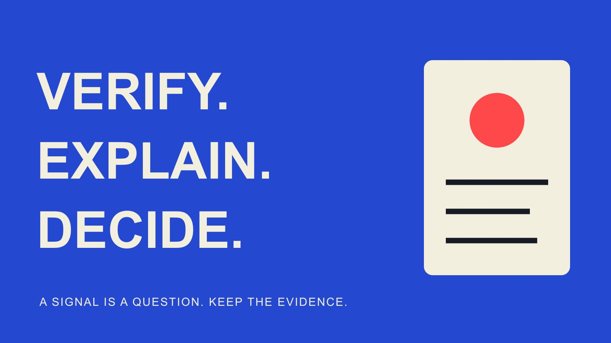

# How to Spot Fake Influencers Without False Accusations

Status: local review draft; confirm the publication date before release.

Verify identity, work and metrics separately, distinguishing investigation leads, alternative explanations and confirmed facts without mislabeling creators.

QuickKOL editorial graphic; not actual account metrics or a platform interface.

To spot fake influencers, turn a suspicion into a verifiable question: does the contact represent the correct account, what contribution did the person make to the work, and do the metrics describe the same object and window? A follower change, short comments or a low engagement rate is a lead, not standalone proof of purchased followers or fraud. Save the source and time, examine reasonable alternatives and request proportionate evidence through an appropriate business route. An unresolved question can justify pausing a specific partnership without labeling the person deceptive.

## Replace the broad label with a specific issue

Write the observation before the conclusion. The publication link differs from the account in the media kit is investigable. This person is fake neither identifies the issue nor separates identity, data and a commercial disagreement. Record the object, claim, source and time involved.

Impersonation, undisclosed borrowed work, misstated metrics and poor brand fit are different problems. A real creator may have an unsuitable audience or communicate through an agency; neither automatically means deception. Establish whether the check concerns the contact route, work capability or interpretation of a number.

Prioritize questions that change the current decision. Before sending a sample, establish the relevant relationship; before advertising, establish asset conditions. One resolvable discrepancy is not a reason to investigate someone’s private life without limit. A question-based record also tells the next reviewer what evidence would close the check. It creates a bounded task rather than an accumulating collection of negative impressions that cannot be resolved.

## Verify the account and contact through an independent route

The [account-identity guide](/blog/influencer-finder-tool-account-identity/#answer) supports stable identifiers, public work and relationship routes. Compare exact URLs and accounts rather than display name, avatar or similar spelling alone. Inspect links controlled by the creator across public sites or accounts and date the observation. A reused name does not establish continuity.

The [FTC impersonation guidance](https://consumer.ftc.gov/consumer-alerts/2025/04/help-ftc-fight-impersonation-scams) recommends verifying uncertain messages through contact information independently located and known to be genuine. Apply that principle to business contact: if an unfamiliar message claims agency representation, confirm the relationship from an established route rather than trusting another proof link supplied by that message.

A different agency or company name is not automatically a problem; the issue is confirmation of its current role and authority. Do not request passwords, one-time codes or unrelated identity documents as proof. Confirmation might come through a known business route, creator confirmation of representation or appropriate partnership records. Record what was actually confirmed, because control of a contact channel does not independently establish every performance claim in the same conversation.

## Check the contribution behind a work sample

The [media-kit review guide](/blog/what-is-a-media-kit-brand-review/#answer) treats a portfolio as a research entry rather than final proof. Trace an important sample to its original publication, author, date, context and claimed role. Joint production, brand publication and publication on the creator’s account can involve different contributions.

Repeated footage may reflect collaboration, licensed distribution, editing variants or unauthorized copying. Finding repetition alone does not distinguish them. Ask whether the person appeared, filmed, edited or made another contribution, with suitable production or partnership evidence where necessary. Do not demand confidential client material; an appropriately checkable alternative may answer the question.

If the assignment depends on original demonstration ability, examine work relevant to that skill. A collection containing strong videos does not establish that the contact produced them. Retain an unresolved contribution, narrow the assignment or investigate further rather than turning similarity search into an automatic plagiarism verdict. A focused work discussion can establish more than a large portfolio whose role descriptions remain ambiguous.

## Align the metric object and window first

The [engagement data guide](/blog/read-creator-engagement-data/#answer) supports numerators, denominators and timing. Lifetime views in a media kit, a current public value and a date-filtered private report may describe different windows. Confirm account, content, date, unit and paid distribution before deciding whether the figures conflict.

The [YouTube fake-engagement policy](https://support.google.com/youtube/answer/3399767?hl=en) prohibits artificial metric inflation and explains that public and Analytics subscriber counts can differ during verification; spam-account removal can also affect counts. A discrepancy therefore needs explanation, not an automatic finding that the researched person violated policy. Platform rules and evidence about an individual remain separate.

A screenshot should show enough context to identify the object and period without exposing unrelated private information. If a total combines content or channels, request a breakdown or a clear limitation. Subtracting mismatched windows does not produce a valid percentage of fake traffic. Preserve both original observations rather than overwriting one with the number that best fits an initial suspicion.

## Keep reasonable alternative explanations visible

A follower increase could relate to broad distribution, media attention, a collaboration or another factor. Low engagement could relate to format, inactivity, audience change or measurement. These are alternatives to investigate, not automatic exoneration or proof that one explanation occurred.

Comment content can inform relevance, but short replies, emojis, another language or repeated questions do not establish bots. Examine product questions, publication context and sample selection together. Names, countries and language should not become shortcuts for labeling people inauthentic.

The [TikTok authenticity policy](https://www.tiktok.com/community-guidelines/en/integrity-authenticity) distinguishes deceptive impersonation from nondeceptive multiple accounts, fan content or creative expression while prohibiting traded or artificially inflated engagement. Use the rule as context rather than calling every pseudonymous character, virtual persona or multi-account creator a violation. Investigate behavior and disclosure instead of treating appearance as evidence. Where a possible alternative remains unconfirmed, preserve it as such; replacing one unsupported accusation with an unsupported reassuring story does not improve the review.

## Request the minimum evidence that answers the question

Make the request specific: do these reports use the same seven-day window, or what part of this work did you produce? Explain the purpose and acceptable alternatives. Asking for an entire account, client list and financial history rarely answers a narrow metric question.

A suitable editorial example is: To evaluate this demonstration assignment, we need to confirm which content and observation window the media-kit figure describes. Please share a relevant record showing the object, period and metric definition, or explain whether it combines versions. Unrelated information can be hidden; we do not need login access. We will use the response to check this figure and explain any remaining decision impact. Adapt this wording to the actual task rather than sending it automatically.

Appropriate authorized report viewing or export can retain object, window and source without taking over the creator’s account. If a field cannot be supplied, record unavailability and its effect on the decision. Refusal to share private information is not automatically evidence of fraud.

Use clear states such as explained, awaiting evidence, contradictory or insufficient for this assignment. Connect each to an observation and next action rather than a single suspicious flag. Pause the relevant decision if needed while treating independently confirmed matters according to their own evidence. The request should have a useful stopping point: once the stated uncertainty is answered, do not keep escalating collection merely because additional private information might exist.

## Keep detection outputs in a supporting role

A third-party quality score, anomaly flag or model explanation can prioritize research if its object, data date, coverage and limitations are retained. A score is not a forensic conclusion, and missing methodological detail should not disappear when the output enters a decision.

Several tools repeating one upstream dataset are not independent confirmations. If supporting evidence cannot be shown, inspect the actual work and suitable sources rather than turning a model’s resemblance judgment into a public allegation. QuickKOL’s discovery and research positioning does not guarantee detection of every artificial interaction.

A useful output identifies a question rather than creating a permanent blacklist. Retain the human review and correct resolved discrepancies so they do not propagate into the next shortlist. An uncovered account remains unknown, not automatically trustworthy or problematic. The same caution applies to a clean score: it can describe what the tool assessed without guaranteeing every identity, rights or commercial claim in the partnership.

## Distinguish a resolved mismatch from an open issue

Consider a hypothetical media kit reporting 80,000 views while a public page shows 50,000. The team initially suspects exaggeration, then finds the kit combined two versions while the page describes one. Record unclear scope and request separate objects rather than treating the 30,000 difference as purchased traffic.

If the same object and window still produce an unexplained conflict, retain it and the request, and pause a decision that depends on the figure. That is not complete proof of intentional deception. The team can decline a particular partnership for insufficient evidence without distributing the unconfirmed cause as fact.

If an independent channel also cannot confirm the contact’s representation, identity remains a separate open issue. Explaining metrics should not conceal that gap, and genuine identity should not validate every number. Layered checking lets each piece of evidence support the appropriate conclusion.

## Write a limited, revisable partnership decision

The final record identifies subject, time, evidence, explanation, unknowns, owner and decision. Continue, narrow scope, request evidence or decline according to conditions needed for this assignment, without permanently labeling someone.

For clear evidence of impersonation or a platform violation, use the appropriate formal route and retain specific facts without unnecessary dissemination. Keep observation and interpretation separate. The team needs an actionable record, not an unproven industry rumor.

The purpose is an evidence-based partnership decision that also avoids false accusations. Resolving an anomaly and confirming a risk are both useful outcomes. Share the review with appropriate owners rather than publishing an unresolved allegation.

## From suspicion to a verifiable question

| Observation | Check | Appropriate state |

| --- | --- | --- |

| Different contact name | Confirm representation independently | Confirmed or identity unresolved |

| Repeated footage | Original publication, contribution and use | Role clarified or contribution unresolved |

| Numbers differ | Object, window, unit and distribution | Definition explained or conflict unresolved |

| Anomaly score | Source, coverage and evidence | Research lead, not a fraud finding |

QuickKOL editorial verification method, not forensic detection or an allegation against a named creator.

## Verification and false-positive checks

Make each issue answerable and match conclusions to evidence.

- [ ] Record a specific observation before labeling a person.

- [ ] Confirm account and role through an independent business route.

- [ ] Check work contribution and metric scope separately.

- [ ] Separate alternatives, missingness and conflict.

- [ ] Do not request passwords, codes or unrelated private data.

- [ ] An unresolved issue can pause a partnership without proving fraud.

## Research date and limitations

Sources reviewed November 2, 2026. Methods, tables and decision rules are editorial recommendations. Hypothetical examples are not actual client results or industry benchmarks. Source geography and periods are specified where relevant. This draft is in independent local review; confirm its publication date before release.

## Sources

- [FTC: Help the FTC Fight Impersonation Scams (April 2025)](https://consumer.ftc.gov/consumer-alerts/2025/04/help-ftc-fight-impersonation-scams)

- [YouTube: Fake Engagement Policy](https://support.google.com/youtube/answer/3399767?hl=en)

- [TikTok: Integrity and Authenticity (effective September 13, 2025)](https://www.tiktok.com/community-guidelines/en/integrity-authenticity)
