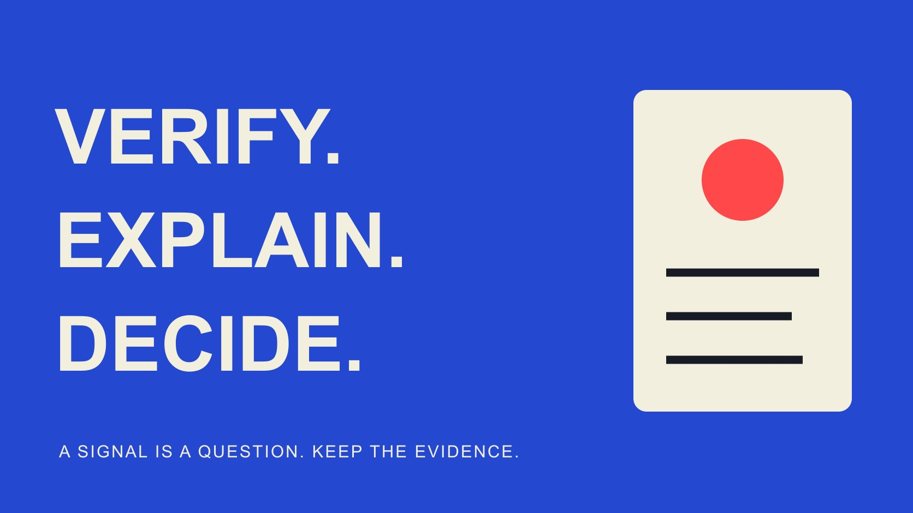

# 识别虚假达人：核验信号与事实

状态：本地审阅稿；正式发布日期待确认。

按身份、作品和指标逐项核验异常，区分需要调查的线索、合理解释与已确认事实，避免误判创作者。

QuickKOL 编辑图形；不呈现真实账号指标或平台界面。

识别所谓“虚假达人”，应把疑点拆成可核验的问题：联系者是否代表正确账号、作品是否属于其贡献、指标是否按相同对象和窗口描述。异常粉丝变化、短评论或低互动率只是线索，不能单独证明买粉或欺诈。先保留来源与时间，检查合理解释，再通过适当商务渠道请求最少必要证据；无法确认时可暂缓具体合作，不需要给人贴上未经证明的标签。

## 把一个笼统标签拆成具体疑点

先写观察，而不是写结论。“对方提供的发布链接与资料包账号不同”可以继续核验；“此人是假达人”既没有指出问题，也混淆身份、数据与商业分歧。记录涉及哪个对象、哪一项说法、哪个来源与时间。

身份冒充、未经说明的作品借用、误报指标与不适合品牌是不同问题。一个真实创作者可能受众不匹配，也可能由代理机构联系；这些都不自动属于欺骗。团队需要知道调查是为确认联系路径、评估作品能力，还是解释某项数字。

优先处理会改变当前决定的疑点。例如发样前需要确认收件合作关系，确定广告用途前需要确认素材条件。不要因为一个可解决的小差异，就无限扩大对个人生活的调查。将记录写成问题，也让接手同事知道什么证据足以结束核验。

## 从独立入口确认账号与联系者

[账号身份指南](/zh/blog/influencer-finder-tool-account-identity/#answer)支持保存稳定标识、公开作品和关联路径。比较准确的网址与账号，而不只看显示名、头像或相近拼写。查看作者控制的公开网站或账户之间的联系，保留观察日期；同一名字不说明是同一个人。

[FTC 冒充识别建议](https://consumer.ftc.gov/consumer-alerts/2025/04/help-ftc-fight-impersonation-scams)强调，对不确定消息通过自己独立找到且确认真实的联系方式核验。这里将这个原则用于商务联系：若一封陌生邮件自称代理，从已确认入口核对代表关系，而不是只相信该邮件附带的另一个证明链接。

代理与公司名称不同不必然有问题，关键是能否确认其角色与当前授权。不要索取密码、一次性验证码或无关身份证件来“证明真实性”。适当确认可以是从已知商务入口回复、由创作者确认代理，或核对正式合作资料中的主体。

## 核对作品贡献，不只搜索相似画面

[Media Kit 核对指南](/zh/blog/what-is-a-media-kit-brand-review/#answer)将资料包视为研究入口而不是最终证明。对关键作品回到原始发布，确认作者、时间、完整语境与对方声称的角色。联合制作、品牌发布与创作者本人发布可能不同，需要具体解释。

相同画面可能来自合作、获授权分发、剪辑版本或未经授权复制。仅发现重复，不足以决定是哪一种。请对方说明在该项目中负责出镜、拍摄、剪辑还是其他贡献，并在必要时提供适当的制作或合作依据。不要要求泄露客户保密材料；可以采用可公开核对的替代证据。

如果本次任务依赖原创演示能力，就选相应作品研究。一个集合页收录很多好视频，不自动证明联系者制作了它们。保留未确认贡献，缩小拟议任务或进一步核验，而不是用搜索结果里的相似度自动宣布盗用。

## 先统一数据对象与窗口

[互动数据阅读指南](/zh/blog/read-creator-engagement-data/#answer)帮助核对分子、分母与时间。资料包的累计观看、公开页面当前值与后台特定日期报表，可能描述不同窗口。先确认账号、内容、日期、单位和是否包含付费分发，再检查数字是否真正冲突。

[YouTube 虚假互动政策](https://support.google.com/youtube/answer/3399767?hl=en)禁止人为增加指标，也说明公开订阅数与后台可能因验证处理而不同，垃圾账号移除也会影响数量。这说明数据差异需要解释，不证明某个被研究者违规。政策规定与针对个人的证据必须分开。

截图应有足够上下文让接收人知道看的是哪个对象和期间，但无需暴露无关私人资料。若一个总数由多种内容或渠道组成，要求拆分或说明无法拆分；不能将不同窗口硬算出差额后，称其就是虚假流量比例。

## 为异常保留合理的替代解释

粉丝突然增加可能与广泛传播、媒体提及、合作活动或其他因素有关；低互动也可能与内容类型、近期停更、受众变化或口径有关。这些是需要核对的可能解释，不是替任何账号自动开脱，也不证明其中一种已经发生。

评论内容可以辅助研究相关性，但短句、表情、语言不同或重复问法不等于机器人。围绕产品的问题、发布语境与样本选择应一起看；不能根据观众姓名、地区或语言，把某类人直接判为虚假受众。

[TikTok 真实性政策](https://www.tiktok.com/community-guidelines/en/integrity-authenticity)区分欺骗性冒充与非欺骗的多账号、粉丝或创意表达，也禁止买卖和人为增加互动。团队可以把规则作为检查背景，不能将所有非实名角色、虚拟形象或多个账号都称为违反政策。看具体行为与清楚说明，避免用形式代替证据。

## 提出能回答疑点的最少证据请求

将请求写成具体问题，例如“这两个报告是否使用相同的七天窗口？”或“请确认你在该作品负责的部分”。说明用途与可接受替代方式。一次要求全部后台、客户名单和财务资料，通常不能帮助回答一个很小的指标问题。

示例请求可以写：“为评估这次演示合作，我们需要确认资料包数字对应哪条内容与哪个观察窗口。请提供能显示对象、期间和指标定义的相关记录，或说明是否合计多个版本。可遮挡无关资料，我们不需要账号登录权限。我们会用回复核对该项数字，仍缺信息时再说明影响。”这是编辑示例，应按真实任务调整，不能自动发送。

可以在适当授权下查看相关报表或导出，保留对象、窗口与来源，不需要接管创作者账号。对方无法提供某字段时，记录数据不可用以及对决定的影响；不能把拒绝分享私人信息自动作为欺诈证据。

提出明确的后续状态：已解释、待补充、相互矛盾或不满足本任务的证据要求。每个状态都应连接观察与下一动作，而不是只有一个“可疑”按钮。必要时暂停范围相关的决定，其他已经独立确认的事项仍可按各自证据处理。

## 将检测工具输出留在辅助层

第三方质量评分、异常标记或模型解释，可以帮助决定先研究哪里，但应记录它描述什么、数据日期、覆盖范围和已知限制。分数不是法证结论，缺少算法细节也不能被忽略后当成独立事实。

同一数据源被多个工具转述，不构成多份相互独立的确认。若工具无法显示相关依据，进一步查看实际作品与适当来源；不能把“模型认为像”变成公开指控。QuickKOL 的达人发现与研究也不能保证识别所有虚假互动。

更有用的输出是具体待核问题，而不是永久黑名单。保存人工核对的结果并及时修正，让已经解释的差异不继续在下一轮候选名单中被复制。对工具没有覆盖的账号，保留未知，而不是自动认为完全可靠或存在问题。

## 用一个核验情景区分误差与未解决问题

以下是假设。资料包写某段视频有80,000观看，公开页为50,000，团队首先以为多报。核对后发现资料包合计两个版本，而公开页只对应其中一个。应该记录原说法范围不够清楚，并要求使用分开的对象，不直接把30,000差值当作买量。

若在相同对象与窗口下仍无法解释差异，就保存冲突与请求记录，暂缓依赖该数字的决定。它仍不是证明个人主观欺骗的完整证据。团队可以因为证据不足不继续当前合作，同时避免把未经确认原因传播为事实。

如果独立渠道也无法确认联系者代表该账号，则身份问题单独未解决。不要让指标解释成功掩盖身份缺口，也不要因为身份真实就默认所有数字真实。分层核验使不同证据各自支持合适结论。

## 把结果写成有限、可更新的合作决定

最终记录说明核验对象、时间、证据、解释、未知、负责人和决定。可选择继续、缩小范围、补充证据或不合作。措辞以本次任务所需条件为准，不给人永久贴标签。

出现明确平台违规或冒充证据时，按适当正式渠道处理，保存具体事实并避免扩大传播。事实与解释仍应分开；团队内部需要知道如何行动，不需要一个未经证明的行业流言。

识别问题的目的，是选择有依据的合作并保护双方免受误判。能够解释一个异常与能够确认一个风险，同样都是有用结果。核验记录只向相关负责人交接，不把尚未解决的疑点当成已确认的公开指控。

## 从疑点到可核验问题

| 观察 | 核对 | 合适状态 |

| --- | --- | --- |

| 联系者名称不同 | 独立入口确认代表关系 | 已确认或身份待确认 |

| 作品画面重复 | 原发布、角色与使用解释 | 角色明确或贡献待核 |

| 数字不一致 | 对象、窗口、单位与分发 | 口径已解释或冲突待核 |

| 异常评分 | 来源、覆盖与可复核依据 | 研究线索，不是欺诈结论 |

QuickKOL 编辑核验方法；不是法证检测或对任何具名创作者的指控。

## 核验与误判检查

每项疑点都要能回答，结论与证据范围一致。

- [ ] 记录具体观察，而不是先给人贴标签。

- [ ] 从独立商务入口确认账号与角色。

- [ ] 作品贡献与指标口径分别核对。

- [ ] 合理解释、缺失与冲突分别保留。

- [ ] 不索取密码、验证码或无关私人资料。

- [ ] 未确认可以暂停合作，不等于已证明欺诈。

## 研究日期与使用边界

资料核验于 2026 年 11 月 2 日。文中方法、表格和决策规则为编辑建议，标为假设的示例不是实际客户结果或行业基准。外部资料的适用地区与时期按各段说明；本稿处于独立本地审阅阶段，正式发布日期待确认。

## 来源

- [FTC：Help the FTC fight impersonation scams（2025-04）](https://consumer.ftc.gov/consumer-alerts/2025/04/help-ftc-fight-impersonation-scams)

- [YouTube：Fake engagement policy](https://support.google.com/youtube/answer/3399767?hl=en)

- [TikTok：Integrity and Authenticity（2025-09-13生效版本）](https://www.tiktok.com/community-guidelines/en/integrity-authenticity)
