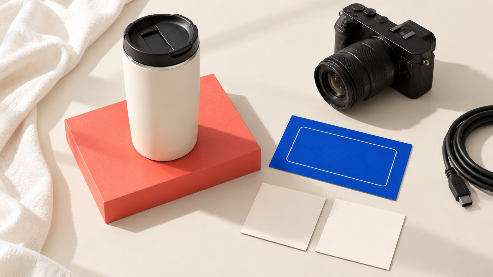

# UGC Creator Meaning：品牌到底采购了什么

状态：本地审阅稿；正式发布日期待确认。

把 UGC Creator 这个商业称呼转成可采购的服务说明，定义原始成片、变体、输入资料和完成条件。

AI 生成的编辑示意图，不是真实达人、客户、产品或活动。

在采购沟通中，UGC creator 通常是提供具有个人表达或使用情境风格内容的制作服务者称呼，但这个词本身不是服务清单。品牌应把它翻译成具体购买单位：要解决什么内容问题、交付哪份成片及哪些变体、需要提供什么资料、如何确认完成，以及是否包含发布或使用安排。不能因为报价写着“一条 UGC”，就假设所有人对工作范围理解相同。

## 词义可以解释风格，不能定义采购范围

[IAB UK 的 UGC 定义](https://www.iabuk.com/jargon-buster/user-generated-content-ugc)将用户产生的在线内容与媒体拥有者或出版者制作的内容区分，例子包括评论、博客与视频。商业沟通里的 UGC Creator 服务称呼不应被当作这一定义自动附带的统一采购规格。

[付费制作与自发分享指南](/zh/blog/what-is-ugc-creator-paid-organic-distinction/#answer)进一步解释这种区别。品牌这次真正要采购的可能是一份演示素材，而不是客户自发评价；如果是付费委托，就应据实说明合作，而非把风格自然写成来源自发。

采购人员可以保留关键词便于搜索供应者，但询价时必须说明任务。称呼帮助找到对话起点，不能代替双方对输出的理解。缺少定义的低价报价，也不能与工作清楚的完整方案直接比较。

## 先定义一份主成片，而不是一个模糊件数

主成片可以用内容任务、产品、形式、语言、技术要求和拟议用途识别。不要只写“竖屏视频一条”，却把开头、字幕、语言、结尾和画幅都留到拍完以后再决定。

[制作角色指南](/zh/blog/ugc-content-creator-on-camera-production-role/#answer)可帮助理解谁完成各项制作，但本篇关注交付单位。一个可核对的单位应让采购、制作和接收素材的人都知道，哪份文件是本次要完成的主版本，以及它需要回答什么问题。

不要把数字当作越多越好。若一段内容需要同时解释过多功能，可能更适合拆成不同任务。拆分会影响工作和报价，不能一边增加独立内容，一边坚持“还是同一条视频”。先确认内容边界，再决定数量。

## 变体需要说明改动，不能只增加文件数

同一主成片可以有字幕版、不同开头、不同画幅或另一语言版本，但它们需要的工作并不相同。将所有版本统称为“剪几个变体”，会让接收人无法判断是否要重新录音、翻译、补拍或只调整输出。

编辑建议是保留主成片编号、变体编号与变化说明。若不同版本只调整结尾文案，就写清结尾来源与其他部分保持条件；若内容实质改变，则按实际新增任务讨论。不要用名称掩盖新的创作。

核对文件数量时，避免把同一视频的预览链接、压缩文件和最终交付都算成独立内容。文件可以有多个存储副本，但内容数量应按双方确认的单位。否则采购报告看似获得更多素材，实际可用贡献并未增加。

改一段开头文字，与换一个人、场景重新演绎开头，可能需要很不一样的工作。称为变体前，先问现有素材是什么、新增工作是什么，再由供应者说明使用已有镜头、重新剪辑还是另行制作。不要只按最终视频长度判断；保留变化说明，接收人才能理解为何相似大小的文件需要不同准备。

## 品牌输入决定服务能否开始

采购范围还应说明品牌提供什么：适用产品、可靠资料、可演示功能、必要场景信息、联系负责人及反馈时间。产品尚未可用或资料互相矛盾，会影响实际安排，不能把所有等待都归为供应者拖延。

对需要真实体验的内容，留出与任务相称的使用条件，不要求创作者照读未经发生的感受。若主要目标只是展示一个操作，则说明演示内容与个人评价的区别，避免镜头让受众误以为对方作了更广的体验保证。

把缺少输入的状态保留在工作记录里，并说明它影响哪个交付。不是所有缺失都要让全部工作停止，但不能让制作人员猜重要产品事实。接收方需要知道什么时候能继续，以及重新排期应由谁协调。

## 完成条件应该能被接收人检查

完成可以核对内容任务是否回答、文件是否符合约定规格、声音与文字是否可辨认、版本与产品事实是否正确，以及约定附件是否齐全。不要只写“足够真实”或“品牌觉得满意”，却不给任何可理解条件。

品牌仍可以有创意判断，但应在前期提供方向，并由指定人员合并反馈。审阅时区分错误修正与新偏好：文字拼写错误，与临时换一个产品主题，不是相同的修改。

完成制作也不等于确认投放效果。若采购的是素材，接收人不应因为广告结果尚未产生，就宣称文件未交付。相反，文件可打开，也不意味着已经回答原任务。技术与内容两方面都应按已约定范围检查。

## 发布、许可与文件交付仍需分别说明

[内容使用权指南](/zh/blog/creator-rates-usage-rights/#answer)帮助说明文件交付后准备在哪里、由谁、以何种用途使用。[美国版权局许可说明](https://www.copyright.gov/circs/m10.pdf)提示关注具体作品、用途与适当权利人；这里是美国背景的方法参考，不是对所有委托作品所有权的通用判断。

不要用“UGC Creator”称呼推导必然包含账号发布，也不从收到原始素材推导全部修改、广告和长期用途已经适用。采购行项目可以分别标记文件、发布与拟议使用，实际条件由相应约定确认。

第三方材料、其他出镜者和新增语言版本也可能需要相关核对。服务范围不是越宽越好：品牌可以先购买确实需要的用途，之后再讨论变化。关键是交接给下一位素材使用者时，范围仍能被理解。

## 自然风格不意味着广告识别可以省略

[ASA 品牌社媒广告说明](https://www.asa.org.uk/advice-online/recognising-ads-brand-owned-and-paid-social-media.html)在英国 CAP 语境下讨论付费及部分品牌自有渠道内容，并强调广告应可识别。它没有为“看起来像用户拍摄”的内容提供一般豁免。本篇不是对任何具体广告的法律审核。

品牌可以采购轻制作感、生活化表达或具体使用演示，但不能因此暗示内容来自无商业关系的独立客户。内容如何呈现来源、体验和商业关系，需要与实际情况一致。

交付清单可保留披露或来源说明由谁准备、在哪个版本核对。品牌自有渠道、创作者账号和广告位置可能有不同语境，不能把某个版本的识别方式机械复制到所有位置。让适当负责人在实际用途下检查，而不是在制作完成后才发现宣传方式与素材表达冲突。

## 算清一份订单里的内容与文件

以下为编辑假设。一份订单约定一个产品演示主成片、两个只改变开头的变体，以及每份的字幕和无字幕版本。它可以形成三种剪辑、六个最终文件；不是六次独立拍摄，也不代表三种不同产品主题。

如果团队后来要求另一语言版本，应先确认是否包含翻译、录音与重新审阅；不能仅因原计划有六个文件，就认定任何新增第七个文件都几乎没有工作。实际差异决定任务，而不是文件序号。

订单记录将主成片、变化、输出文件与接受状态连接起来。接收人能知道哪一份有字幕、哪一份适合当前用途，以及还有什么未完成。这个假设没有报价或效果基准，只解释怎样让数量可复核。

## 采购说明是清楚合作的起点

下载表保留任务、主成片、变体、输入、完成条件和拟议用途字段，供真实项目补齐，不是完整合同。询价时说明哪些是必须、哪些是可选以及哪些仍待确认。

QuickKOL 可以帮助理解需求、研究相关作品与准备联系，但一份相关的合适作品不等于当前可用、已接受任务或价格确认。商业安排与内容事实仍需向相应来源核对。

UGC creator meaning 在采购中的实用答案，是让团队从一个风格称呼走到可理解的服务。只有知道自己买什么，后面的报价比较、制作、接收和使用才有共同依据。

## 一项服务的采购字段

| 字段 | 需要写清 | 避免推导 |

| --- | --- | --- |

| 内容单位 | 主成片任务与参考编号 | 每个文件都是独立拍摄 |

| 变体 | 具体改变与保留部分 | 所有修改工作相同 |

| 输入与接受 | 品牌资料、规格与内容条件 | 打开文件就完成内容任务 |

| 使用与发布 | 拟议用途、渠道、期间与依据 | 风格名称包含全部权利 |

编辑采购字段，不是合同或通用法律意见。正文文件数量为假设算例。

## UGC 制作服务询价清单

用真实要求填写，不要求供应者猜范围。

- [ ] 内容问题与主成片可识别。

- [ ] 变体说明具体变化。

- [ ] 品牌输入、等待和负责人明确。

- [ ] 接受条件区分错误与新请求。

- [ ] 发布和使用不从标签自动推定。

- [ ] 最终文件与适用版本能对应。

[下载英文服务采购字段 CSV](/downloads/ugc-service-purchase-fields.en.csv)

[下载中文服务采购字段 CSV](/downloads/ugc-service-purchase-fields.zh.csv)

## 研究日期与使用边界

资料核验于 2026 年 11 月 2 日。文中方法、表格和决策规则为编辑建议，标为假设的示例不是实际客户结果或行业基准。外部资料的适用地区与时期按各段说明；本稿处于独立本地审阅阶段，正式发布日期待确认。

## 来源

- [IAB UK: User-generated content](https://www.iabuk.com/jargon-buster/user-generated-content-ugc)

- [U.S. Copyright Office：How to Obtain Permission（M-10）](https://www.copyright.gov/circs/m10.pdf)

- [ASA/CAP: Recognising ads: Brand-owned and paid social media](https://www.asa.org.uk/advice-online/recognising-ads-brand-owned-and-paid-social-media.html)
