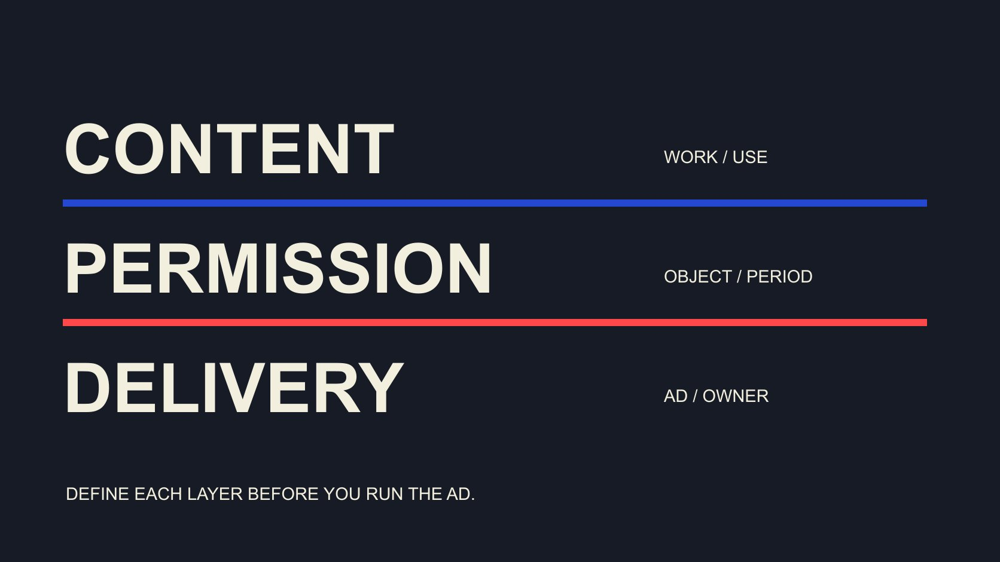

# What Is Whitelisting in Creator Advertising?

Status: local review draft; confirm the publication date before release.

Separate content use, platform permission and ad execution when discussing creator whitelisting, with clear objects, periods and ending procedures.

QuickKOL editorial graphic; not actual account metrics or a platform interface.

In creator advertising, whitelisting commonly refers to an authorized arrangement allowing a brand to advertise with a creator-related identity or content through a platform’s supported mechanisms. Name the actual mechanism, such as Meta partnership ads or TikTok Spark Ads. It does not mean collecting the creator’s password or automatically receiving ownership, unrestricted account management or indefinite use. Confirm content use, technical permission and advertising scope separately. Those layers can overlap operationally while still requiring different evidence and owners.

## Name the platform and the actual action

Can we have whitelisting does not specify the request. Identify platform, advertiser, proposed content or identity, intended use and period, then ask whether the creator wants to discuss it. A production invitation should not silently expand into advertising authorization.

The [Meta partnership-ad overview](https://about.fb.com/news/2024/02/creator-marketplace-for-brands-and-creators-to-collaborate-on-instagram/) describes brands and creators reaching an agreement before using partnership ads for collaboration. It is a historical official introduction, not proof of current eligibility for every market, account or asset. Use the mechanism name rather than presenting a 2024 interface path as today’s promise.

Separate creator publication, file publication through a brand’s own account and advertising through partnership permissions. Similar footage can appear in all three with different objects and arrangements. The recipient should understand what permission is requested instead of being asked to accept an undefined industry shorthand. This first clarification also helps the media team identify which part of the proposal it must confirm before preparing an ad.

## Confirm content use, platform permission and delivery separately

The [usage-rights guide](/blog/creator-rates-usage-rights/#answer) supports discussion of asset use and duration. Separate three layers here: content and relevant use conditions, the capability actually granted by the platform, and the advertisement the brand runs. Passing one does not complete the other two.

Receiving a file does not authorize advertising with a creator’s identity. A usable platform state does not establish every music, contributor or editing condition. The actual advertisement still needs correct product facts, a destination and appropriate review. Distinct layers route a problem to the owner able to resolve it.

The [US Copyright Office permission guide](https://www.copyright.gov/circs/m10.pdf) emphasizes the specific work, use and appropriate rights holder, noting that a work can contain material belonging to others. This references a US permission method without determining a case or worldwide law. Confirm the conditions relevant to the proposed use rather than interpreting authorized as unlimited. The aim is an intelligible arrangement for the work, not collecting broad permissions merely because they may be convenient later.

## TikTok: distinguish a post code from other authorization routes

The [TikTok Spark Ads creation guide](https://ads.tiktok.com/resources/help/article/spark-ads-creation-guide?lang=en) describes sourcing creatives through authorized identities or post codes, with an authorization period to review. This makes the technical object explicit without requesting a password. Campaign type and account configuration can affect the interface, so an old screenshot is not a current universal workflow.

The guide also describes caption-editing restrictions after ad authorization and public visibility when a private video is used in a campaign, with privacy changes restricted during promotion. Discuss the relevant content and expected state before requesting permission rather than explaining the change after delivery.

Retain post reference, code relationship, advertiser account, period and confirmation basis. A code is part of the technical flow, not complete confirmation of commercial terms or product claims. Entering it in the right place does not establish that every planned ad, use and duration is covered. Treat the source as a bounded platform instruction, while leaving agreement and publication decisions with the appropriate parties.

## Include timing and ending procedures in the request

The [collaboration scope checklist](/blog/creator-contract-scope-checklist/#answer) can retain start, end, use, version and owner. Check platform permission periods alongside actual ad schedules. Code availability does not settle every commercial use, and an agreed date does not automatically update platform settings.

The [TikTok authorization error guide](https://ads.us.tiktok.com/resources/help/article/about-spark-ads-code-error-notifications-in-tiktok-ads-manager) distinguishes expiry, missing permission and an ad end exceeding authorization. Record the actual error and condition rather than treating every failure as creator refusal or permanent product incompatibility.

Specify who stops the relevant activity, how active ads are handled and what appropriate records remain. TikTok’s creation guidance links code deletion to deletion of the ads using it. Do not promise an unconditional single-button end to every use at any moment. Follow the actual mechanism, arrangement and platform support. A useful ending plan identifies responsibility before launch, so neither side must infer later whether an expired discussion, expired permission or stopped ad means the same operational thing.

When an error appears, identify the object, period and account it concerns. Expired authorization, missing advertiser access and a temporary system failure require different responses. Retain the message and time, then route it to the party able to resolve that condition. Repeatedly asking for broader access or another code can conceal a misunderstood error rather than repair it. A request for changed timing remains a request the creator can discuss, not an automatic extension created because the media team needs more time.

## Identify the recipient and responsibility for the request

Confirm which advertiser requests access, which team uses it, who approves content and who changes timing. When an agency participates, identify brand, agency and creator roles. One participant in a conversation does not automatically accept expanded scope for everyone.

Use supported platform mechanisms or an established business route without requesting passwords, one-time codes or unnecessary private information. The aim is to align consequential access with actual ownership, not add an invented approval gate to every routine task.

For a new use requiring broader capability, explain the change and obtain the appropriate confirmation. The recipient can accept narrower scope, propose conditions or decline. Retain the result with the relevant object so a media colleague does not mistake replied for permission active. The response needs to be interpreted according to what was requested, not according to the maximum capability a platform might allow.

## Review the actual ad as well as permission

Usable permission does not complete the advertisement. Check visual version, captions, product facts, disclosure, destination and intended audience. Market, use or format changes may require the appropriate owner’s review rather than automatic inheritance from an earlier approval.

A creator identity can make wording read as personal experience. Do not add new product promises later and assume earlier permission covers every statement attributed to the creator. Retain who changed what and which final version was confirmed.

For editing, translation or music changes, explain the proposal and conditions. The team may keep the original, prepare a new version or narrow use. The operating ad should match the content discussed, rather than merely acquire a final filename. A recipient outside the original conversation needs enough information to recognize that match and route any mismatch before publication.

## Observe original publication and paid advertising separately

Paid advertising may distribute the same content to different audiences with a different destination. Retain original publication, ad object, period, spend and definition. Paid results should not become organic performance or an independent effect caused solely by the creator.

The [platform record-handoff guide](/blog/influencer-platforms-record-interoperability/#answer) connects assets, versions, publications and observations. Transfer permission periods with actual use records so a recipient can identify the content and use behind a result. Missing values remain missing, and views across platforms do not add into unique people.

Evaluate the current job: whether the arrangement operated as agreed, which audience questions were addressed, what behavior was reliably observed and whether another assignment is justified. Permission itself guarantees no reach, conversion or return, and does not establish suitability for every audience. An accurate record can support a smaller follow-up even when the team cannot establish an incremental business effect.

One asset may be connected to several ad objects, so an ending procedure needs the actual use list. Update relationships when another ad is created instead of maintaining only the first entry. If brand and agency operate separate activity, identify who holds each record and how changes reach them. One party stopping its work should not leave another assuming the arrangement continues unchanged. That record is also useful when interpreting a result: the brand can distinguish which version and distribution were active during the observation, without making unsupported claims about individual viewers.

## Example: one permission should not silently become a new use

Consider an editorial hypothetical: a brand and creator discuss a desk-equipment demonstration for an ad in a specified market and period. The media team later wants another product, translated captions and a longer run. A record saying whitelisting confirmed may cause a new colleague to assume every change was accepted.

A useful handoff identifies the original asset, use, period and uncovered changes. Confirm the new version and conditions before handling technical permission through the actual platform. A still-usable interface is not a substitute for the new discussion, and an extended commercial arrangement does not automatically extend a technical period.

If confirmation cannot be completed, continue only the applicable scope or defer the new use. This is not a real client case or platform test result. It explains why permission and use records should be maintained together, with changes visible to both the person requesting the capability and the colleague operating the advertisement.

## Connect the request, confirmation and actual use

Retain requester, platform mechanism, object, version, use, period, confirmation basis, actual ads and ending owner. A short code or approving emoji alone leaves the next colleague guessing about scope.

QuickKOL can support understanding the proposed work, researching relevant content and preparing contact. Actual permissions and use conditions still require the appropriate source and parties. A fluent request is not a granted capability.

Whitelisting is useful through a clear collaboration arrangement. Describe each layer so the creator and brand understand what is being allowed and operated.

## Three layers of advertising use

| Layer | Confirm | Does not replace |

| --- | --- | --- |

| Content and use | Work, version, use, period and appropriate basis | Actual platform capability |

| Platform permission | Identity/post object, advertiser and technical period | All terms or content review |

| Actual delivery | Correct ad, destination, observation and ending | Causal effect or indefinite reuse |

Editorial workflow, not universal legal advice or a promise about every current account interface.

## Creator ad-permission request checks

Define proposed use alongside permission.

- [ ] Identify platform, requester and object.

- [ ] Check content conditions and technical permission separately.

- [ ] Keep version, period and ending owner discoverable.

- [ ] Do not request passwords or one-time codes.

- [ ] Match actual advertising to confirmed content.

- [ ] Handle expiry, errors and changed use through actual mechanisms.

## Research date and limitations

Sources reviewed November 2, 2026. Methods, tables and decision rules are editorial recommendations. Hypothetical examples are not actual client results or industry benchmarks. Source geography and periods are specified where relevant. This draft is in independent local review; confirm its publication date before release.

## Sources

- [Meta: Brands and Creators Collaborate on Instagram (February 21, 2024)](https://about.fb.com/news/2024/02/creator-marketplace-for-brands-and-creators-to-collaborate-on-instagram/)

- [U.S. Copyright Office: How to Obtain Permission (M-10)](https://www.copyright.gov/circs/m10.pdf)

- [TikTok: Create Spark Ads (June 2026)](https://ads.tiktok.com/resources/help/article/spark-ads-creation-guide?lang=en)

- [TikTok: Spark Ads Code Error Notifications (July 2025)](https://ads.us.tiktok.com/resources/help/article/about-spark-ads-code-error-notifications-in-tiktok-ads-manager)
