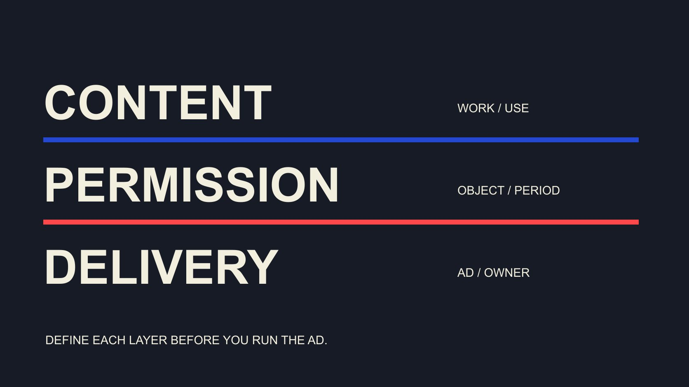

# 什么是达人 Whitelisting？看清广告权限范围

状态：本地审阅稿；正式发布日期待确认。

把达人广告里的 whitelisting 拆成内容使用、平台权限和投放执行，明确对象、期限及结束安排。

QuickKOL 编辑图形；不呈现真实账号指标或平台界面。

在达人广告语境中，whitelisting 通常指品牌通过平台允许的合作授权方式，使用创作者相关身份或内容投放广告。具体机制应按平台名称说明，例如 Meta 合作广告或 TikTok Spark Ads。它不是要求创作者交出密码，也不自动把素材所有权、所有账号管理权或无限期使用交给品牌。先分别确认内容用途、技术权限与实际投放范围，再安排执行。

## 先说明平台与具体动作

“能否给我们 whitelisting”仍然没有说清需要什么。品牌应说明平台、广告主体、要用的内容或身份、预期用途与期间，并询问对方是否愿意讨论。不能将一次制作邀约自动扩展为广告授权。

[Meta 合作广告说明](https://about.fb.com/news/2024/02/creator-marketplace-for-brands-and-creators-to-collaborate-on-instagram/)介绍品牌与创作者达成约定后，利用合作广告开展内容合作。这是官方历史介绍，不是当前所有地区、账号或素材都满足条件的证明。本篇使用机制名称，不照抄2024界面路径作为当前操作承诺。

先区分创作者本人发布、品牌自有账号发文件，以及借助合作权限运行广告。三者可能包含相似画面，但对象和安排不同。接收邀请的人应该能理解自己被请求允许什么，而不是被要求接受一个没有范围的行业简称。

## 内容许可、平台权限与投放执行分别确认

[使用权指南](/zh/blog/creator-rates-usage-rights/#answer)帮助讨论素材用途与期限。本文再将流程分为三层：内容及相关使用条件、平台实际授予的能力、品牌最终运行的广告。某一层通过，不代表另外两层都已完成。

拿到文件不证明能用创作者身份投放；平台里有一个可用状态，也不说明音乐、其他出镜者或新的剪辑用途全部适用。实际广告还需要正确产品事实、落地页与适当审核。清楚分层可以让问题交给对应负责人处理。

[美国版权局许可说明](https://www.copyright.gov/circs/m10.pdf)指出，核对许可要关注具体作品、用途与适当权利人，作品中也可能包含其他人的材料。这里引用美国背景的许可方法，不对个案或全球法律作结论。团队应确认与本次用途有关的条件，而不是从“已授权”一词推导无限范围。

## TikTok：区分帖子代码与其他授权路径

[TikTok Spark Ads 创建说明](https://ads.tiktok.com/resources/help/article/spark-ads-creation-guide?lang=en)描述通过获授权身份或帖子代码等方式选择素材，并提示查看授权期间。它支持把技术对象写清，而不是要求账号密码。不同活动类型与账户配置可能采用不同界面，不能只凭一份旧截图判断当前流程。

该说明还指出，已作为广告授权的帖子字幕有编辑限制，私密视频用于活动后会公开，推广期间其隐私状态也受限制。品牌应在发起请求前与创作者核对对应内容和预期状态，不把这些变化留到投放后才说明。

保存帖子对象、代码对应关系、广告账户、授权期间与确认依据。代码本身只是技术流程的一部分，不是商业条款或产品主张的完整确认。复制一个代码进入正确字段，也不证明计划中的全部广告、用途与期限都已适用。

## 把期限和结束安排写在请求里

[合作范围清单](/zh/blog/creator-contract-scope-checklist/#answer)可以保留开始、结束、用途、版本与负责人。平台授权期间和品牌实际投放排期需要同时核对，不要把一个代码可用的期间理解为所有商业用途都已经谈妥，也不要假设合同期限会自动改变平台设置。

[TikTok 授权错误说明](https://ads.us.tiktok.com/resources/help/article/about-spark-ads-code-error-notifications-in-tiktok-ads-manager)区分授权过期、缺少权限、结束时间超出授权等问题。它提醒团队记录具体错误与对应条件，不能将每次失败都解释为创作者拒绝或系统永远不支持。

结束时应说明由谁停止相关活动、如何处理仍在用的广告以及怎样保存适当记录。TikTok 创建说明指出，删除视频代码与相关广告删除之间有条件关系；不要向创作者承诺任何时候都能无条件用同一个按钮立即结束所有使用。按实际机制、约定与平台支持处理。

发现错误时，先核对它针对哪个对象、什么期间与账户。授权过期、广告账户缺少权限和临时系统错误，需要不同处理。记录原始错误与时间，让能解决问题的一方确认；不要反复索取更宽权限或新代码来掩盖尚未理解的错误，也不把新请求自动视为对方必须接受的延期。

## 权限请求也需要明确接收者与责任

品牌应确认哪个广告主体提出请求、哪个团队使用、谁能批准内容和更改排期。代理机构参与时，将品牌、代理与创作者的角色写清。不能因为机构已经参与一次沟通，就默认它能替所有人接受扩大范围。

通过平台支持的方式或已确认商务路径处理，不索取登录密码、一次性验证码或不必要私人资料。这里不是要给每个常规动作增设审批，而是让有外部后果的权限与实际负责人一致。

如果新用途需要更广能力，先说明变化并由适当方确认。对方可以同意较小范围、提出不同条件或拒绝。将确认结果保留在相应对象记录中，避免媒体同事只看到“联系已回复”就把它当作广告权限已经生效。

## 投放前核对实际广告，而不只看授权状态

许可可用不代表广告内容已经完成。核对画面版本、字幕、产品事实、披露、落地页和预期受众；不同市场、用途与形式有变化时，让适当负责人确认，而不是从旧版本批准自动推导。

创作者身份与受众可能让某句话被理解为个人经历，因此不能把品牌后来新增的产品承诺放进去，再假设原许可覆盖对方的全部表达。保留谁修改了什么，以及哪一版最终被确认。

若素材需要重新剪辑、翻译或配乐，说明拟议变化与条件。可以选择使用原版本、准备新版本或缩小用途。关键是让运行的广告与被讨论的内容一致，而不是只在文件名里加 final 后继续。

## 分别观察原发布与付费广告

同一内容进入付费广告后，可能面对不同分发、受众和落地页。报告应保留原发布、广告对象、期间、费用与定义，不能把付费结果全部写成自然表现或创作者独立造成的影响。

[平台记录交接指南](/zh/blog/influencer-platforms-record-interoperability/#answer)帮助连接素材、版本、发布和观察。把授权期间与实际使用记录一起交接，接收人才能判断某个结果对应哪份内容与用途。未知值不写成零，不同平台的观看也不能直接相加为唯一人数。

评价可以围绕当前任务展开：是否按约运行、哪些受众问题得到回应、哪些行为有可靠观察，以及下次是否值得继续。广告权限本身不保证触达、转化或投资回报，也不自动证明内容已经适合所有受众。

一份素材可能关联多个广告对象，结束安排应覆盖实际使用清单。新建广告时更新对应关系，不能只维护最初那一条。若品牌与代理各自运行内容，说明谁掌握哪项记录以及如何通知变化；否则一方停止后，另一方仍可能认为原范围继续适用。

## 示例：一次授权不应悄悄变成新的用途

以下是编辑假设。品牌与创作者讨论了某段桌面设备演示，在指定市场和期间用于一项广告。媒体团队后来想加入另一产品、翻译字幕并延长时间。如果只保留“whitelisting 已确认”，新的同事可能误以为全部变化已获同意。

正确交接应说明原素材、用途、期间与未覆盖变化。团队先确认新版本与相应条件，再按平台实际能力处理技术授权。不能让平台仍显示可用替代新的讨论，也不能因为商业约定已续期就假设技术期限同步延长。

若来不及完成确认，可以继续已适用范围或暂缓新用途。这不是任何真实客户案例，也不是特定平台操作结果。它说明为什么权限与使用记录需要共同维护。

## 把请求、确认与实际使用连起来

最终记录包括请求主体、平台机制、对象、版本、用途、期限、确认依据、实际广告与结束负责人。不要只保存一个短代码或聊天里的同意表情，让下一位同事猜具体范围。

QuickKOL 可以帮助理解合作需求、研究相关作品与准备联系；实际平台权限与使用条件仍需在适当来源和参与方处确认。工具准备了一封流畅请求，不等于权限已授予。

Whitelisting 的价值来自明确的合作安排。把每层都说清，创作者与品牌才知道自己正在允许和执行什么。

## 广告使用的三层确认

| 层面 | 需要确认 | 不能替代 |

| --- | --- | --- |

| 内容与使用条件 | 作品、版本、用途、期间与适当依据 | 平台实际授予的能力 |

| 平台权限 | 身份/帖子对象、广告账户与技术期间 | 全部商业条件或内容审阅 |

| 实际投放 | 正确广告、页面、观察与结束安排 | 因果效果或无限期复用 |

编辑流程说明，不是通用法律意见或对每个账户当前界面的保证。

## 达人广告权限请求清单

在讨论权限时同时明确拟议用途。

- [ ] 平台、请求主体与对象明确。

- [ ] 内容条件与技术权限分别核对。

- [ ] 版本、期限和结束负责人可找到。

- [ ] 不索取密码或一次性验证码。

- [ ] 实际广告与被确认内容一致。

- [ ] 到期、错误与用途改变按实际机制处理。

## 研究日期与使用边界

资料核验于 2026 年 11 月 2 日。文中方法、表格和决策规则为编辑建议，标为假设的示例不是实际客户结果或行业基准。外部资料的适用地区与时期按各段说明；本稿处于独立本地审阅阶段，正式发布日期待确认。

## 来源

- [Meta：Brands and Creators Collaborate on Instagram（2024-02-21）](https://about.fb.com/news/2024/02/creator-marketplace-for-brands-and-creators-to-collaborate-on-instagram/)

- [U.S. Copyright Office：How to Obtain Permission（M-10）](https://www.copyright.gov/circs/m10.pdf)

- [TikTok：Create Spark Ads（2026年6月）](https://ads.tiktok.com/resources/help/article/spark-ads-creation-guide?lang=en)

- [TikTok：Spark Ads Code Error Notifications（2025年7月）](https://ads.us.tiktok.com/resources/help/article/about-spark-ads-code-error-notifications-in-tiktok-ads-manager)
