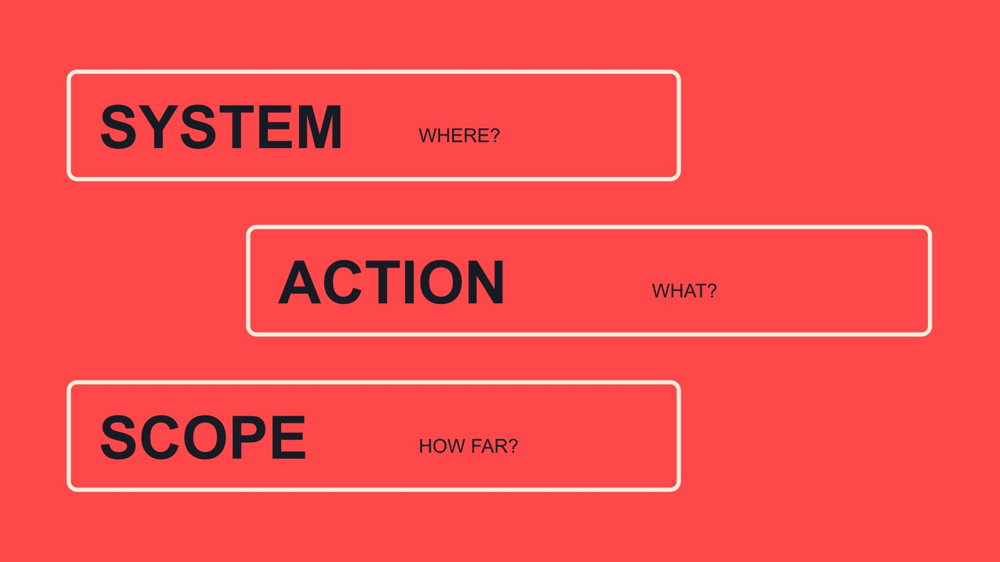

# Whitelisting Meaning: Specify the System and Permission

Status: local review draft; confirm the publication date before release.

Distinguish whitelisting in policy lists, email and creator advertising, then replace shorthand with an understandable permission request.

QuickKOL editorial graphic; not actual account metrics or a platform interface.

Whitelisting meaning depends on context. In a technical system it may concern allowing specified objects under a policy; in email it may concern permitted senders; in creator advertising it commonly refers to platform-supported content or identity permissions. A brand should name the system, object, action, recipient and period rather than rely on the shorthand. Permission in one context does not automatically authorize another, and it does not establish transferred account ownership, content ownership or every future use. This guide explains the language problem before the operating workflow.

## Start by asking which system the word refers to

An email saying please whitelist us does not tell the recipient whether a confirmation message is missing, an advertising permission is needed or a URL belongs in an internal rule. Familiar language is not a complete request. Asking for context can prevent an unnecessary access request before it begins.

Brand, agency, creator and IT teams may each be accustomed to one usage. Translate the job into an action they can understand instead of arguing over a single universally correct meaning. Where useful, preserve the original wording and record the specific meaning both parties confirmed.

If a sentence cannot identify what is allowed and who acts, it is not yet operational. Treating shorthand as agreement can send a colleague looking for controls in the wrong system or make a recipient think the brand wants more capability than it actually needs. A clarification should reduce uncertainty about the work, not merely replace one unexplained acronym with another. Include the relevant object reference so the recipient can recognize it.

## Allowlisting: identify the policy and allowed objects

The [NIST allowlist definition](https://doi.org/10.6028/NIST.SP.800-63-4), in its Digital Identity Guidelines context, describes a documented set of elements allowed by a policy decision and identifies whitelist as a historical term. That technical definition is not a universal creator-marketing clause granting content use.

A brand team need not reproduce identity-system procedures to understand the vocabulary. The relevant lesson is that an allowed object, governing rule and responsible administrator need to be identified. Already on the list means little without knowing which list and which action it permits.

If the task concerns company security configuration, the system owner should explain and operate it. A creator or marketer should not change unfamiliar settings because a shorthand request arrived. This article explains the distinction rather than supplying ways around restrictions or removing controls. Behavior in one kind of allowlist should not be projected onto every other system. The context remains part of the definition, even when a shared word makes the situations appear similar.

## An allowed email source is not advertising or content permission

The [Mailchimp confirmation-email guide](https://mailchimp.com/help/troubleshoot-the-opt-in-confirmation-email/) discusses sender allowlisting as one consideration in troubleshooting confirmation delivery. It does not guarantee primary-inbox placement, reading or a reply, and it is not creator-ad authorization.

Describe what happened before requesting a change: which confirmation, when, which system and what the recipient can observe. Do not begin by assuming a security rule must change; other delivery or interface conditions may need the appropriate person’s review.

Allowing receipt also does not mean accepting continuing marketing or a new partnership assignment. Technical delivery, subscription choice and commercial agreement are separate. Preserve the actual issue and resolution instead of turning email problem handled into collaboration authorized. This distinction is useful when a business conversation spans several tools: one system may confirm successful delivery while another still has no accepted proposal, and the report should not compress those states into a single positive status.

## Use the specific mechanism name for creator advertising

In creator work, whitelisting commonly describes authorized advertising with creator-related content or identity. Instead of using only the shorthand, specify the proposed platform mechanism, advertiser, content object and period.

The [Meta partnership-ad overview](https://about.fb.com/news/2024/02/creator-marketplace-for-brands-and-creators-to-collaborate-on-instagram/) described this advertising collaboration in an official 2024 introduction. It establishes a different context from email delivery here, not a promise that historical interfaces or market availability apply to every account today.

The [creator ad-permission guide](/blog/what-is-whitelisting-creator-ad-permissions/#answer) further separates content conditions, platform capability and actual advertising. Make all three intelligible without requesting every possible capability in an initial inquiry. Explain the real use first, let the recipient decide what they wish to discuss and follow the mechanism currently supported by the relevant platform. Naming the mechanism also improves handoffs: an operator can investigate the correct object instead of guessing which of several meanings a previous conversation intended.

## Replace the shorthand with five pieces of information

An editorial request can identify five things: system, object, proposed action, user of the capability and period. Explain why the request is made and how the recipient can ask questions or propose narrower scope. This is a communication framework, not an official platform form.

A hypothetical request might say: We would like to discuss using the identified demonstration through our advertiser identity on the named advertising platform for a mutually confirmed period. Are you open to discussing that use? Material, version, dates, fees and technical arrangements remain to be confirmed together. Please also tell us if you would prefer a narrower scope. Before sending, supply the actual object instead of leaving the recipient to guess which demonstration is meant.

This wording is an invitation to discuss, not an established license. It should not demand a code or access immediately. Record which part the recipient answered rather than expanding open to a conversation into acceptance of every proposed condition. The value of a clear opening is that it supports a meaningful response before technical configuration begins.

For example, ask to discuss advertising with a specified demonstration on a named platform for a defined period. Avoid asking for all whitelisting or merging a request and an accepted arrangement into one sentence.

The [collaboration scope checklist](/blog/creator-contract-scope-checklist/#answer) can preserve confirmed versions, uses and owners. Technical capability does not settle commercial conditions; willingness to discuss does not activate platform permission. A record should make the stage intelligible to someone outside the conversation rather than leaving only they said yes. A clear request gives the recipient something concrete to answer and gives the requester a way to recognize when the answer concerns a smaller or different use.

## Agreement, configuration and use are different states

A recipient can agree to discuss a proposal before confirming its terms, while configuration remains incomplete. Conversely, a historical capability still working does not establish acceptance of a new use. One green status should not stand for every layer of confirmation.

Describe the actual task state, such as request sent, scope unconfirmed, capability available or execution not started. These are editorial descriptions, not claims that every platform has those exact backend labels. Actual names and conditions depend on the current system.

When plans change, identify the changed object: material, advertiser, market or period. Different changes may require different treatment, but shorthand should hide none of them. The appropriate owner can determine which discussion is needed and transfer the result to the operator. This prevents a planning note from becoming an unintended instruction to begin work simply because one technical prerequisite happens to be available.

## Permission does not automatically include every content right

The [content usage-rights guide](/blog/creator-rates-usage-rights/#answer) distinguishes work, version, use, period and relevant conditions. A platform control can enable an action without transferring every asset or establishing all conditions for third-party music and contributors.

Similarly, calling material UGC does not establish unrestricted reuse. Explain how the brand wants to use it and which basis is needed. Where the question exceeds the team’s competence, use the appropriate professional rather than treating this article as a universal legal determination.

Both parties can propose narrower use or another version. Defined scope is generally easier to discuss than a permanent capability whose meaning remains unclear. Align the material, operating use and participants’ understanding instead of using terminology to conceal unresolved conditions. This also helps a production colleague know whether a proposed translation, recut or new placement belongs to the conversation already held or requires another clearly stated request.

## Two similar-looking requests belong to different owners

Consider an editorial hypothetical. Team A cannot receive a project confirmation email and asks for whitelisting. Team B uses the same word to request a conversation about creator advertising. Routing both without explanation can confuse two different jobs.

A should identify the email system and delivery issue for the appropriate owner to examine. B should identify advertising platform, proposed identity or content, use and period for the party able to discuss that arrangement. Resolving A does not approve B, and B agreeing to discuss does not establish A’s delivery.

Keep the outcomes and unresolved items separately. This is not an actual client event or a settings procedure for every platform. It shows why which system and what action moves work forward more effectively than familiar English alone. The recipient can then ask a precise follow-up instead of either ignoring the request or granting an unrelated capability that nobody needed.

## Close the conversation with an accurate record

Close with the actual mechanism and action: requester, object, what was confirmed, unresolved conditions and next owner. Whitelisting can remain a search term, but should not remain the only explanation.

QuickKOL can help interpret a proposed partnership, research relevant work and prepare personalized contact. It does not grant platform permissions for any participant or turn fluent wording into commercial acceptance.

When a team can say exactly what is being allowed, the definition work has become useful. Execution still follows the relevant system, parties and actual use rather than assumptions attached to the shorthand.

## Different contexts behind one word

| Context | Make explicit | Does not establish |

| --- | --- | --- |

| Technical allowlist | System, policy and allowed objects | Creator content rights |

| Email troubleshooting | Sender and actual delivery problem | Reading, reply or partnership acceptance |

| Creator advertising | Platform mechanism, object, use and period | Account ownership or unrestricted use |

Context explanation and editorial request framework, not settings instructions or universal legal terms.

## Permission-request rewrite checks

Make each request answerable.

- [ ] Which system?

- [ ] Which object and action?

- [ ] Who requests, uses and can confirm?

- [ ] Which use and period?

- [ ] What are the agreement, configuration and execution states?

- [ ] Who handles changes and ending?

## Research date and limitations

Sources reviewed November 2, 2026. Methods, tables and decision rules are editorial recommendations. Hypothetical examples are not actual client results or industry benchmarks. Source geography and periods are specified where relevant. This draft is in independent local review; confirm its publication date before release.

## Sources

- [NIST SP 800-63-4: Digital Identity Guidelines](https://doi.org/10.6028/NIST.SP.800-63-4)

- [Mailchimp: Troubleshoot the Opt-in Confirmation Email](https://mailchimp.com/help/troubleshoot-the-opt-in-confirmation-email/)

- [Meta: Brands and Creators Collaborate on Instagram (February 21, 2024)](https://about.fb.com/news/2024/02/creator-marketplace-for-brands-and-creators-to-collaborate-on-instagram/)
