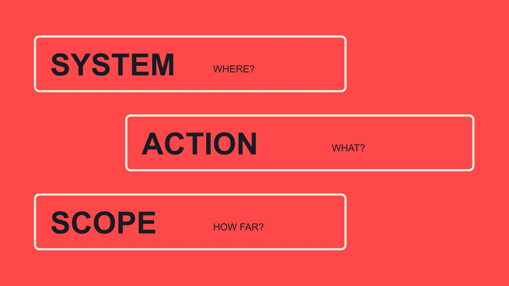

# Whitelisting Meaning：先说明系统、对象与动作

状态：本地审阅稿；正式发布日期待确认。

解释 whitelisting 在名单、邮件和达人广告语境中的不同含义，再把简称改写成可理解的权限请求。

QuickKOL 编辑图形；不呈现真实账号指标或平台界面。

Whitelisting meaning 取决于语境，不能只用“白名单”解释所有请求。技术系统里可能指按规则允许某些对象；邮件语境可能指允许某类发件来源；达人广告里则常被用来描述平台支持的内容或身份授权。品牌沟通时应说清具体系统、对象、动作、接收方和期间。一个场景中的允许，不自动成为另一个场景的许可，也不代表账号所有权、内容所有权或未来所有用途已经转移。

## 先问：这个词出现在哪个系统

一封邮件写“请帮我们 whitelisting”，接收人仍不知道是收不到确认信、需要广告授权，还是要把某个网址加入内部规则。词语熟悉不代表请求已经清楚。先问上下文，可以避免直接索取并不需要的权限。

品牌、代理、创作者和IT团队可能各自习惯一种用法。沟通应把任务翻译成彼此都能理解的动作，而不是争论谁使用了唯一正确的术语。必要时保留原话，再在记录中写出双方确认的具体含义。

如果一句话无法说明允许什么、由谁执行，就还不是可操作请求。把行业简称当成已达成共识，可能让后续同事在错误系统里找按钮，也可能让接收人以为品牌想要比实际更多的访问能力。

## 许可列表：先有规则和对象

[NIST 许可列表定义](https://doi.org/10.6028/NIST.SP.800-63-4)在其数字身份指南语境下，将 allowlist 解释为按政策决定允许的特定元素记录，并说明历史上也称 whitelist。这个定义属于技术文档语境，不是达人营销行业对内容使用的统一授权条款。

品牌团队不必为了理解术语，照搬身份系统的技术操作。需要记住的是：必须有具体对象、规则和管理者。“已经在名单里”只有在知道名单是什么、允许做什么时才有意义。

若任务属于公司安全配置，交给相应系统负责人说明和操作，不让创作者或营销同事凭一个简称修改自己不了解的设置。本文只解释概念差异，不提供绕过限制或取消安全控制的方法，也不把一类许可列表的行为推断为所有系统通用。

## 邮件允许来源，不等于广告或内容许可

[Mailchimp 确认邮件排查说明](https://mailchimp.com/help/troubleshoot-the-opt-in-confirmation-email/)将发件来源允许列表放在确认邮件送达排查语境中。它是处理某类邮件问题的一个因素，不等于保证进主收件箱、被阅读或获得回复，也不是达人广告授权。

当团队遇到邮件问题，先描述发生什么：哪封确认邮件、什么时间、哪个系统，收件人能看到什么。不要一开始就认定必须更改安全规则；可能还有其他送达或界面情境需要由合适人员检查。

让某封邮件可以送达，也不意味着对方同意长期营销消息或新的合作工作。技术接收、订阅选择与商务同意分别处理。品牌内部记录应保留真实问题与解决动作，不把“邮件问题已处理”改写成“合作已经获得授权”。

## 达人广告应使用具体机制名称

在内容合作中，whitelisting 常被用于描述品牌通过获准方式使用创作者身份或内容投放广告。与其只说简称，不如说明拟议的平台机制、广告主体、内容对象与期间。

[Meta 合作广告说明](https://about.fb.com/news/2024/02/creator-marketplace-for-brands-and-creators-to-collaborate-on-instagram/)在2024年的官方介绍中描述品牌与创作者合作后运行合作广告。这里用它确认一种不同于邮件送达的广告语境，不将历史界面或市场范围写成当前所有账户都可用的保证。

[达人广告授权指南](/zh/blog/what-is-whitelisting-creator-ad-permissions/#answer)进一步拆分内容条件、平台权限与实际投放。三层都应明确，但不必在第一次询问中要求所有能力。先说实际用途，让接收方判断愿意讨论什么，再按对应平台当前支持的机制推进。

## 把一个简称改写成五项信息

编辑建议的请求包含：在哪个系统、针对什么对象、希望允许什么动作、由谁使用、适用多久。再说明提出请求的原因以及对方可以如何提问或提出较小范围。这个框架不是平台官方表单。

一个假设请求可以写：“我们希望讨论，在指定广告平台，由本品牌广告主体于双方确认的期间使用某段演示内容。想先确认你是否愿意讨论这种用途；素材、版本、期间、费用与技术安排尚待共同确认。若你只接受较小范围，也欢迎说明。”发送前需要补齐真实对象，不能让接收者猜“某段内容”是哪一份。

这段话只是邀请讨论，不是已经成立的许可，也不要求接收人当场提供代码或访问能力。品牌应记录对方回答了哪部分，不能把“可以聊聊”扩大成全部条件通过。

例如，品牌可提出讨论在指定平台、指定期间，用一段已明确的演示内容运行某项广告。不要写成“给我们全部 whitelisting”，也不要把请求和已获确认混在同一句。

[合作范围清单](/zh/blog/creator-contract-scope-checklist/#answer)可以保存后续确认的版本、用途和负责人。技术能力不自动确认商业条件；商业上愿意讨论也不表示平台权限已经生效。记录要让没参加原对话的人仍能理解当前阶段，而不是只看到一句“对方说可以”。

## 同意、设置与实际使用是三个状态

接收人可以同意讨论，之后再确认条款；系统中也可能尚未完成设置。反过来，某个历史权限仍然可用，也不证明新用途已经谈妥。不要让一个“绿色”状态替代所有层面的确认。

状态可按具体任务记录，例如已提出请求、范围待确认、技术能力可用、尚未执行。它们是编辑描述，不应冒充所有平台都有的后台状态。实际界面名称和条件仍以当前系统为准。

若计划变化，指出变化对象：新素材、新广告主体、新市场或新期间。不是每项变化都需要同一处理，但都不应被简称掩盖。由相应负责人判断需要重新讨论什么，并把结果传给真正执行的人。

## 许可不自动包含所有内容权利

[内容使用权指南](/zh/blog/creator-rates-usage-rights/#answer)帮助区分作品、版本、用途、期限与相关条件。一个平台按钮可以支持某项动作，却不代表品牌拥有全部素材，也不自动确认第三方音乐或出镜人的所有适用条件。

同样，不应因为一份内容被称作 UGC，就推定任何人都可随意重用。请求中应说明品牌希望怎样使用，以及需要什么依据。若问题超出团队能确定的范围，交给适当专业人员，不把本文当作通用法律判断。

品牌与创作者都可以提出较小用途或替代版本。清楚范围通常比要求一个含义不明的永久权限更容易讨论。要点是让实际内容、实际使用与参与方理解一致，而不是用术语掩盖尚未解决的条件。

## 两种请求，看起来相同却交给不同人

以下为编辑假设。项目邮件里的确认信收不到，团队A说需要 whitelisting；媒体团队B也用同一个词，实际想讨论创作者广告权限。若转给同一个人却不解释，两项工作可能互相误导。

A应说明邮件系统与具体送达问题，交由适当负责人检查。B应说明广告平台、拟议身份或内容、用途与期间，交给有权讨论合作的人。解决A不等于B获批，B同意讨论也不能证明A已正常送达。

最后分别保存处理结果和未解决项。这个例子不是实际客户事件，也不描述可用于任意平台的设置步骤。它说明为什么“哪个系统、允许什么”比一句常见英文更能推动工作。

## 用准确语言结束这次沟通

最终记录采用真实机制和明确动作：谁提出、对什么对象、确认了什么、哪里仍未知、下一步由谁负责。可以保留 whitelisting 作为检索用语，但不要让它成为唯一说明。

QuickKOL 可以帮助理解合作需求、研究相关作品并准备个性化联系。它不替任何参与者授予平台权限，也不会将一句流畅英文自动变成商业同意。

当团队能说清允许什么，沟通才真正完成了定义工作。后续执行仍需对应系统、参与方和实际用途的确认，而不是沿用对简称的想象。

## 同一个词的不同语境

| 语境 | 应明确 | 不能推导 |

| --- | --- | --- |

| 技术许可列表 | 系统、政策与允许对象 | 达人内容使用权 |

| 邮件排查 | 邮件来源及实际送达问题 | 被阅读、回复或同意合作 |

| 达人广告 | 平台机制、对象、用途与期间 | 账号所有权或无限使用 |

语境解释和编辑请求框架，不是设置指南或统一法律条款。

## 权限请求改写清单

每项请求都能回答具体问题。

- [ ] 哪个系统？

- [ ] 允许哪个对象执行什么动作？

- [ ] 谁请求、谁使用、谁能确认？

- [ ] 适用用途与期间是什么？

- [ ] 同意、设置与执行处于什么阶段？

- [ ] 变化与结束由谁处理？

## 研究日期与使用边界

资料核验于 2026 年 11 月 2 日。文中方法、表格和决策规则为编辑建议，标为假设的示例不是实际客户结果或行业基准。外部资料的适用地区与时期按各段说明；本稿处于独立本地审阅阶段，正式发布日期待确认。

## 来源

- [NIST SP 800-63-4: Digital Identity Guidelines](https://doi.org/10.6028/NIST.SP.800-63-4)

- [Mailchimp: Troubleshoot the Opt-in Confirmation Email](https://mailchimp.com/help/troubleshoot-the-opt-in-confirmation-email/)

- [Meta：Brands and Creators Collaborate on Instagram（2024-02-21）](https://about.fb.com/news/2024/02/creator-marketplace-for-brands-and-creators-to-collaborate-on-instagram/)
