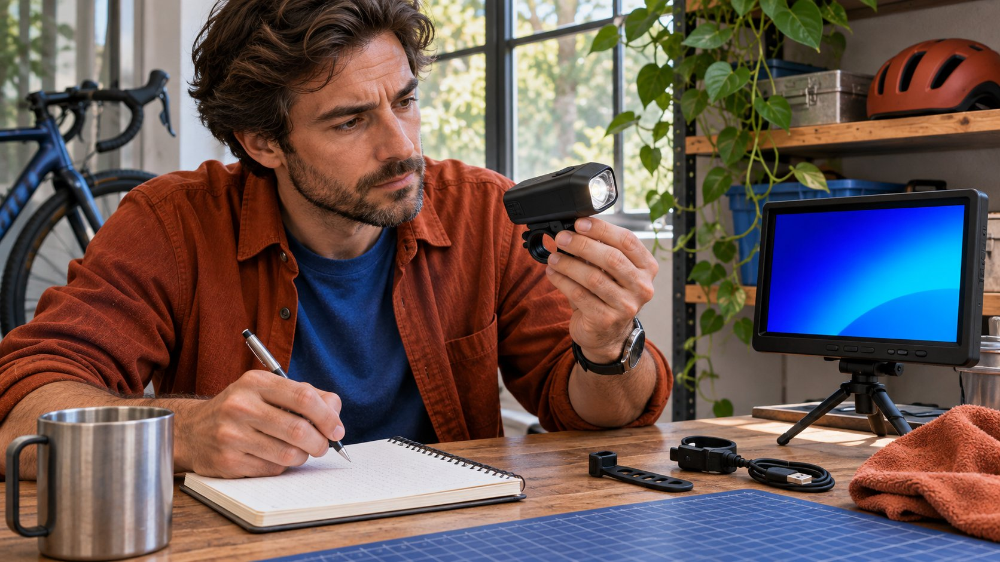
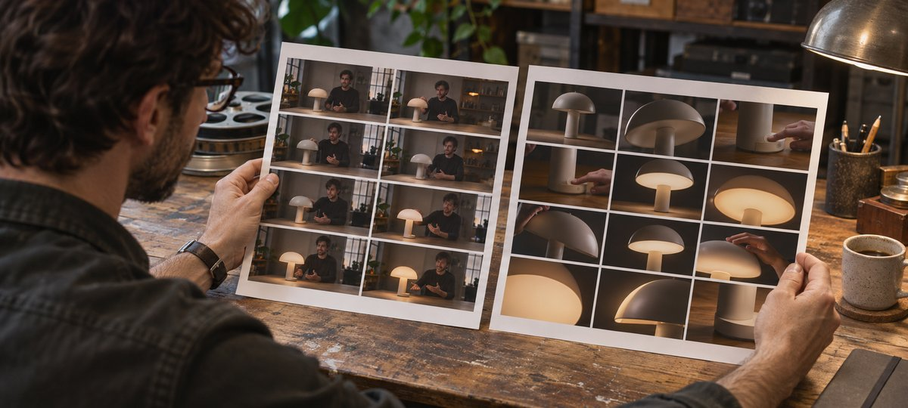

# Best YouTube Channels for a Brand Brief

Status: local review draft; confirm the publication date before release.

Find YouTube channels for a defined brand job and shortlist them from timestamped work samples.

AI-generated editorial illustration, not an actual creator, client, product or event.

Choose YouTube channels by defining the job and reviewing work for the explanation, demonstration or storytelling it requires. Use dated examples of regular videos and relevant sponsored segments. Record timecodes, creator role, audience questions and delivery limits. Search results can start discovery. A shortlist should show why each channel fits and what still needs verification.

## Start with the job the channel would perform

Suppose a bicycle light brand wants a channel to explain nighttime installation. The audience needs to see the orientation, closure of the mount and resulting beam. Decide whether to commission a dedicated tutorial, a segment in an existing show or a production file the brand will publish. Use the [creator selection guide](https://www.quickkol.com/blog/creator-selection-beyond-followers/#answer) to specify setting, length, language and delivery. A channel may be good at reviews yet weak at teaching. Another may film close-ups well while its audience geography remains unknown. Evaluate these questions against the task. If the brand needs a video primarily for its support site, assess whether the creator can provide a clean master and a sequence the viewer can follow without being familiar with the host. If the buy is a segment on the creator’s channel, inspect how the host transitions into the demonstration and whether the surrounding episode helps the intended audience understand it. Give the person collecting samples a written test they can repeat.

## Record search scope before interpreting result order

The [YouTube Search help](https://support.google.com/youtube/answer/16090438?hl=en) identifies relevance, engagement and quality and notes that search and watch history can affect results when enabled. Use several phrases tied to the job, such as installing a night ride light mount and comparing bicycle lights from the same camera angle. Keep the query, date, language and why a result entered the sample. Run separate discovery where markets differ. Review channel pages, recurring series and recent uploads as well as recommendations. Give each candidate the same acceptance conditions even if it was discovered through a different route. A channel that appears repeatedly may be a good research lead, but search position does not establish suitability. Save the rank only if reproducing the query matters. If you choose a starting set of twelve channels, say how they were selected and what was outside the scope. A colleague in another market can run the same terms and record the differences. Treat the resulting list as your working sample, without representing it as a ranking of all YouTube channels.

## Review comparable work at specific timestamps

For each channel, review two ordinary videos and one relevant sponsored example when available. Mark missing evidence. Record dates, subject, role and common test points. One example might show the latch close at 2:14 and explain the applicable model at 4:20. Check whether the motion is visible, whether edits interrupt the sequence and whether captions support it. Keep ordinary and sponsored work distinct. An older viral video alone cannot establish current production fit. The [YouTube embed help](https://support.google.com/youtube/answer/171780?hl=en) describes options for setting a start time when embedding. In a research sheet, retain a readable video link and the exact timecode regardless of embedding. If the sponsor segment contains a product claim, inspect how the host explains its conditions. A strong lighting comparison in a studio may not show how a mounting step works outside. Give the reviewer a way to flag evidence as partial instead of choosing between an undeserved pass and an unexplained rejection. Do not copy frames into external materials without reviewing permission.

AI-generated editorial illustration. Record the specific action and timecode when comparing regular and sponsored work.

## Separate mandatory conditions from comparative quality

Mandatory conditions might include French narration, vertical and horizontal exports, the intended licensed use, region or completion before an event. Comparative qualities such as pacing, continuous coverage and consistency across relevant work can be scored zero, one or two for absent, partial and clear observed evidence. Use pending where there is no observation. Suppose channel A demonstrates the motion clearly but has unresolved ad rights. Channel B has clear proposed permissions but no nighttime example. Give them different follow-up tasks. Decide which issue affects the buying decision before selecting one. In a hypothetical review, the first team could accept a short sample from B while discussing rights with A. If a requirement is essential, do not average it away with strengths in other categories. A high visual score cannot cure an unavailable publication date. A missing data point can be addressed with an appropriate question or a different scope. Record the exact evidence that would change each status.

## Review sponsorship and available performance evidence separately

The [YouTube branded content disclosure help](https://support.google.com/youtube/answer/154235?hl=en) describes the paid promotion setting for videos with sponsorship or other commercial relationships. Review how the sponsor is integrated, whether the disclosure is visible and whether important demonstration steps remain. For the actual project, have the responsible people verify the market requirements and platform setup. Use the [YouTube sponsored content analytics guide](https://www.quickkol.com/blog/youtube-analytics-sponsored-content-cohorts/#answer) to review evidence the team is authorized to see. Public views provide context. Sales, unique viewers and geography require relevant records. A channel-level summary cannot establish results for one video. If a creator provides a native aggregate for a related series, record its date, included videos and metric definition. Ask only for information needed for the current decision. A sponsorship buyer may care about whether the tutorial held viewers through the demonstration. A production buyer may need only proof that the creator can film the necessary shot. Align the request to the actual deal before collecting private reporting.

## Verify channel identity, on-camera roles and contact authority

The [YouTube channel ID help](https://support.google.com/youtube/answer/3250431?hl=en) explains that channels have distinct identifiers and that the primary owner can access the relevant IDs in settings. Record the public channel URL, a verified identifier where available, current name and observation date. The presenter, producer and business contact can be different people. Use the published contact route and confirm who can discuss posting and asset rights. If a different host or regional account will perform the assignment, review whether the selected work represents that delivery. A video attributed to a network might be published by a separate member channel. Keep the contract subject and actual publication account explicit. If a creator renamed a channel, preserve the date you observed the new name and verify the older links. An apparent match in display names should not be enough to send a confidential brief. Keep a record of who confirmed the intended contact and what they are authorized to approve. Record the information at the level your team actually needs.

## Write a checkable reason for each shortlist decision

A shortlist entry could say that the channel shows nighttime filming and French narration, with a continuous latch sequence at 2:14, and ad permission pending. If you have polished product footage but no continuous procedure, record that evidence for unboxing and request a tutorial example. For someone who does not advance, write a task-specific reason without making a broad quality judgment. Assign who will find the sample, who will verify permission and when to revisit. A new product or placement can change the order. For example, a studio host might become the first choice for an internal training film because studio legibility matters more than an outdoor series. Keep the observation alongside the decision so the team can reuse it for a suitable job. Have a reviewer unfamiliar with the list reproduce one score before requesting quotes. If they cannot find the critical shot, correct the timecode or the stated reason.

## Review what the shortlist helped the team decide

Review time from discovery to a credible quote, the proportion of samples that fit, how quickly questions were resolved and which terms mattered in the final agreement. If successive searches surface mostly unboxing videos, check whether the query leans too heavily on product names. Try installation and maintenance language. If suitable work leads to delayed delivery, revisit the scheduling requirement. Keep discovery, follow-up and outcome distinct. A buyer can use those observations to refine the next assignment without treating one shortlist as an all-purpose ranking. If the test never progressed to a paid project, say that the team verified evidence and contact fit only. Do not imply that content or sales were delivered.

## Compare reviews, tutorials and repair channels on one job

Imagine three fictional channels that cover bicycle lights. The review channel compares beams but does not show the mount close. The tutorial channel demonstrates full installation and provides captions but films only indoors. The repair channel explains compatibility and common mistakes but rarely publishes sponsorships. For an indoor installation film, the second candidate can be an early conversation if rights and fit check out. For a nighttime demonstration, ask the first candidate how they would capture a continuous mounting sequence. The third could advise on technical accuracy or produce a different piece, with sponsorship experience still open. Record a specific sample and the scope of each decision. A lack of evidence for one format does not establish lack of ability. Ask for a representative example or proposal before adding an obligation. Give your colleagues a brief explanation of which preference would change if the assignment changes. For example, an internal service video might value clear compatibility guidance above on-channel reach. Keep the brand’s minimum requirements consistent while you compare candidates for that job. When asking for a custom sample, agree what is required and how it will be used. If the team changes the timeline, ask each candidate to confirm availability again. The shortlist is a snapshot of the task, evidence and terms on the review date.

## YouTube task scorecard

| Dimension | Evidence | Decision |
| --- | --- | --- |
| Core action | Video link and timecode | Clear, partial, absent or pending |
| Sponsor context | Sponsor sample, disclosure and native scope | Review separately |
| Delivery and rights | Account, deadline, permission and owner | Assign follow-up |

Scores are specific to this assignment.

## YouTube shortlist checklist

Tie each decision to observable evidence.

- [ ] Define what the channel would deliver
- [ ] Review specific work from different dates
- [ ] Verify identity, sponsored work and data scope
- [ ] Assign follow-up for open conditions

## Research date and limitations

Sources reviewed November 6, 2026. Methods, tables and decision rules are editorial recommendations. Hypothetical examples are not actual client results or industry benchmarks. Source geography and periods are specified where relevant. This draft is in independent local review; confirm its publication date before release.

## Start creator research with a clear task

Use QuickKOL to interpret a brief, discover relevant creators and research their work and contact routes. Verify data, commercial terms and outcomes at their source.

[Explore QuickKOL](https://www.quickkol.com/#capabilities)

## Sources

- [YouTube Search help](https://support.google.com/youtube/answer/16090438?hl=en)
- [YouTube embed help](https://support.google.com/youtube/answer/171780?hl=en)
- [YouTube branded content disclosure help](https://support.google.com/youtube/answer/154235?hl=en)
- [YouTube channel ID help](https://support.google.com/youtube/answer/3250431?hl=en)
