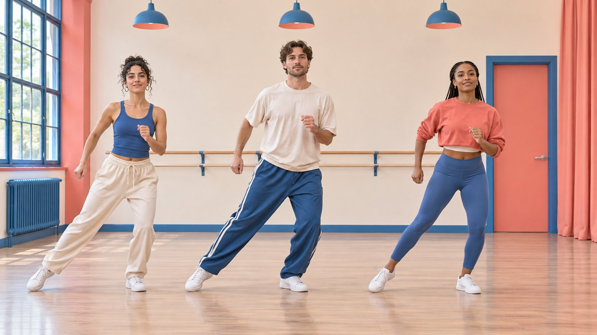
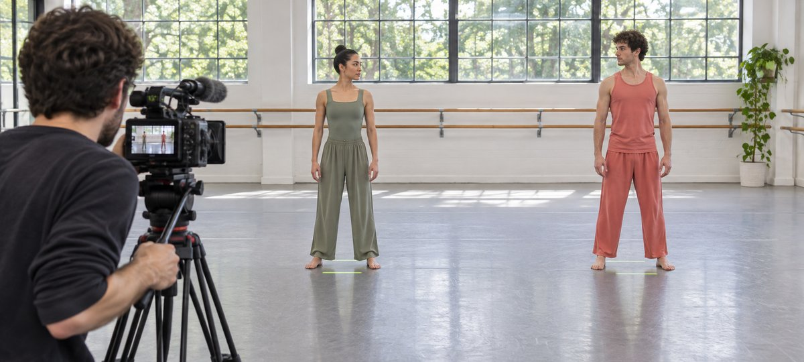

# Dancers for Campaigns: Plan an Ensemble Shoot

Status: local review draft; confirm the publication date before release.

Define formation, rehearsal, coverage, rights and acceptance for a multi-dancer production.

AI-generated editorial illustration, not an actual creator, client, product or event.

For a brand shoot with dancers, specify what the ensemble must show on camera before deciding who to cast. Rehearse the formation in the actual framing and confirm that the widest movement remains visible. Capture a continuous wide take before filming details. Review performer, choreography, music, editing and paid usage permissions separately. Accept deliverables against the agreed shot, format, rights and file requirements.

## Define what the ensemble needs to show

Imagine a short film for an activewear label. The brief might call for three dancers to perform the same lateral movement at different intensities so viewers can see how the clothing moves. Decide whether synchronization, a relay between performers or one person’s detail is the key visual. A vague request for energy often leaves the editor with short shots that cannot explain the sequence. Use the [campaign brief guide](https://www.quickkol.com/blog/write-a-useful-campaign-brief/#answer) to identify the intended viewer, what they need to understand and which movement must remain continuous. Label optional shots separately. Confirm the primary aspect ratio, channel, duration, spoken material and planned advertising use. A vertical film that needs all three dancers in the same shot has different spatial requirements from a horizontal group performance. Check that the story still works in the primary format before promising adaptations. The buyer can approve an annotated frame that demonstrates what counts as a complete movement. Treat that visual decision as part of the brief. It helps casting and location owners estimate time and space from the same information.

## Cast for roles with relevant work samples

Separate choreography, lead performance, supporting performance, on-set coordination and account publication. One person can fill multiple roles, but the work and compensation should be clear. Ask candidates to identify what they did in samples they can share. Review formation control, direction for camera, response to cues, rehearsal availability and communication. For publishing, specify the account and whether other performers are appearing only. Keep any test representative and short and make room for safe adjustments. If a cast member withdraws, review formation, wardrobe, permissions and closing coverage with the replacement. An existing group can save preparation time, yet you still need to know who has agreed to appear and who controls its posting account. When an individual provides two examples, ask which clips they directed and which they joined as a performer. A producer can compare the evidence against the actual role instead of assuming that polished editing proves rehearsal leadership. Keep access to audition files limited to the people evaluating the assignment. Give shortlisted dancers the actual movement scope, schedule and expected media use before they commit.

## Rehearse the widest movement in the delivery frame

Draw the opening, widest extension, turn and ending. Have the choreographer place floor marks suited to the room, then review hands, feet, wardrobe and overlap with the camera operator. The key action should be legible in vertical framing with room for the interface and captions. Record a real camera test to check distance, mirrors, fabric highlights and foot sound. If the group cannot fit, consider staggered depth, smaller lateral travel or a dedicated vertical take. Test at the planned performance intensity. People standing still reveal little about where a sleeve or foot will go in motion. In a narrow room, moving the camera back may introduce reflections or equipment at the sides. Try the revised mark with the full movement and review playback at phone size. A performance director should check that everyone has a clear route and the floor remains suitable. Place equipment outside movement lanes. A safe adjustment can also make the film clearer. For example, if the diagonal crossing hides the center dancer at the moment the garment needs to be visible, change the crossing order during rehearsal and record the new formation for the edit.

AI-generated editorial illustration. Review the floor marks with the camera framing and record a test of the widest lateral movement.

## Capture a continuous wide take before matching details

Roll before the first beat and through a stable ending. Note the music version, tempo, starting count, movement order and wardrobe position. Begin pickups before the action of interest and continue long enough to give the editor a join. If a close view of a trouser cuff belongs on a particular knee bend, record the count and direction from the wide take. A detail that cannot match can still work as a separate illustration. Keep a backup with a usable start, finish and key movement. Suppose the lead changes from starting on the left foot to the right. That may be fine for the performance, but the close view from the earlier version may no longer work. Write the change in the slate log and record the necessary insert again while the cast is still present. If the editor will receive silent and sound versions, distinguish music playback for synchronization from the rights-cleared audio intended for release. At playback, have the choreographer and camera operator confirm the same reference take and record timecodes for the places the buyer most needs to inspect.

## Review performer, choreography and music permissions separately

The [U.S. Copyright Office choreography circular](https://www.copyright.gov/circs/circ52.pdf) distinguishes potentially copyrightable choreography from examples such as commonplace social dance steps. It is U.S. registration guidance. Review the specific work, rights holder and markets separately. Before the shoot, confirm what is authorized for each performer, choreography, music, venue and added asset. Use the [creator rates and usage rights guide](https://www.quickkol.com/blog/creator-rates-usage-rights/#answer) to state channels, territories, term, editing and paid use. If a track is available in a platform library, check its conditions for the actual account and intended use. A selectable track does not establish rights for an ad on another platform. Mark the release restrictions on any unresolved clip. When one cut uses a replacement sound, check how the new beat changes synchronization and whether the scope of the choreography use changed. Review consent for close views as well as group appearance if your agreement separates them. A spreadsheet can link an asset to the applicable permissions without storing private contract details in the editor’s public folder. Give the approver access to the controlled record when a question arises.

## Set the publishing owner and disclosure plan

Name the account, uploader, reviewer, moderation owner, publication window and expiry of authorization. Appearing in the video does not give each dancer a posting obligation. Where a dancer publishes an endorsement with a material connection for a U.S. audience, the [FTC influencer disclosure guidance](https://www.ftc.gov/business-guidance/resources/disclosures-101-social-media-influencers) explains the need for clear disclosure appropriate to the actual connection. Review its placement in the real video and accompanying copy so a viewer can encounter it. Check that critical information remains understandable without sound. If the brand makes a paid cut, review the permissions and disclosure relevant to that deliverable. Preserve the approved file, copy and link when it goes live. An ensemble member might share the final brand post independently. Clarify whether that is invited, part of the deal or outside the production. If the draft uses subtitles near the bottom of the frame, check that required commercial information and native controls do not obscure them. Give the account owner the approved caption and any material wording restrictions before upload.

## Review captions, frame and edit handoff together

The [W3C captions guide](https://www.w3.org/WAI/media/av/captions/) explains captioning for speech and sounds needed to understand a video. For instructional cues, distinguish spoken counts, music and other meaningful sounds and decide where additional visual explanation is needed. The handoff should identify the approved cut, clean master, caption file, exported ratios and permitted pickups. Check the phone view for feet, movement direction, product detail and interface overlap. Deliver raw files only within the agreed scope. Give each export a visible version. If the planned secondary aspect ratio obscures a dancer, accept the main cut and separately evaluate the secondary shot before delivery. Test a captions-on version with the actual soundtrack because a caption that is legible in a still might block the moment of interest in motion. Store a short approval log indicating who checked the file and what they checked. A production coordinator can then distinguish a crop change from a new performance take. Close only the deliverables that have passed and give open items a responsible reviewer and date.

## Distinguish reshoots from optional omissions

Suppose the wide take passes, but a side view hides the third dancer’s cuff. Check whether the brief promised a visible comparison for all three performers. If the shot is optional, omit it. If it is critical evidence, reproduce the same action and check continuity. When advertising clearance for the soundtrack is pending, the picture can be reviewed while that distribution version remains on hold. Write each decision as an edit, clearance or scheduling item. This helps you book a short pickup for the actual missing material. A replacement insert might require the same wardrobe but no additional performance from the other dancers. Ask the choreographer whether the pickup can be done without misrepresenting the sequence. Confirm the approved cut again after inserting the new shot. If the deadline moves, update the publication plan and any performer notice that depends on timing. A good closing record identifies what can be released immediately and what still depends on a named action. If the brand accepts a shorter version, review whether it preserves the promised movement and the captions a viewer needs. Share the omitted shot and the reason with the wardrobe lead and choreographer. If the team later makes an ad cut, start from the approved assets and permitted uses in the handoff.

## Ensemble production handoff

| Stage | Evidence | Check |
| --- | --- | --- |
| Rehearsal | Marks and widest-motion test | Action remains visible |
| Shoot | Reference wide take, counts and pickup notes | Shots can match |
| Delivery | Versions, captions, clearance scope | Approve per channel |

Review each derivative version against its own permissions.

## Ensemble set checklist

Review before rolling, before wrap and before publishing.

- [ ] Movement, formation and framing agree
- [ ] Wide take and pickups match
- [ ] Participant and asset permissions are clear
- [ ] Publishing and review owners are assigned

## Research date and limitations

Sources reviewed November 6, 2026. Methods, tables and decision rules are editorial recommendations. Hypothetical examples are not actual client results or industry benchmarks. Source geography and periods are specified where relevant. This draft is in independent local review; confirm its publication date before release.

## Start creator research with a clear task

Use QuickKOL to interpret a brief, discover relevant creators and research their work and contact routes. Verify data, commercial terms and outcomes at their source.

[Explore QuickKOL](https://www.quickkol.com/#capabilities)

## Sources

- [U.S. Copyright Office choreography circular](https://www.copyright.gov/circs/circ52.pdf)
- [FTC influencer disclosure guidance](https://www.ftc.gov/business-guidance/resources/disclosures-101-social-media-influencers)
- [W3C captions guide](https://www.w3.org/WAI/media/av/captions/)
