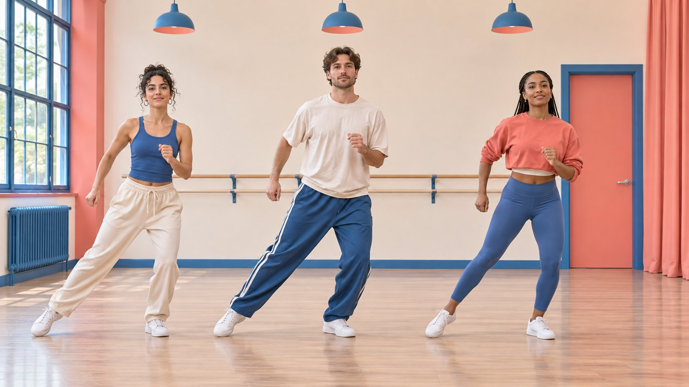
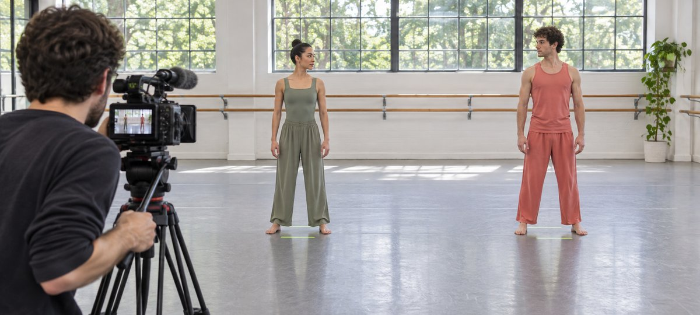

# 舞者群演合作：队形、镜头和交接

状态：本地审阅稿；正式发布日期待确认。

为多人舞蹈合作设定队形、彩排、镜头、授权和验收标准。

AI 生成的编辑示意图，不是真实达人、客户、产品或活动。

找舞者拍品牌内容时，先确定这支片子需要怎样的多人动作和镜头，再定人数和合作角色。请负责人按实际画幅走一遍队形，确认动作最宽时完整入画，先拍可连续观看的全景，再补细节。表演者、编舞、音乐、剪辑与付费使用分别核对。最终按镜头、画幅、许可和交付文件验收。

## 先确定群舞在片中要证明什么

以一支运动服品牌短片为例，目标可能是展示三位舞者用不同力度完成同一个横向步法，观众能看到衣服怎样随动作变化。先决定是看同步、看接力还是看某个人的细节。如果动作目的不清，制作方容易只写“有活力”，剪辑师收到的却是很多不能接起来的局部。用[活动 Brief 撰写指南](https://www.quickkol.com/zh/blog/write-a-useful-campaign-brief/#answer)写清谁看、要看懂什么、什么镜头必须连续，哪些属于选拍。再确认主画幅、渠道、时长、是否要口播与是否计划投放。

## 按角色与证据选人

把编舞、领舞、其他表演者、现场协调和账号发布列开。一个人可以兼多职，但交付与费用要能拆分。请候选人用有权分享的作品说明本人负责什么。比较队形保持、镜头方向、对口令反应、可排练时间和现场沟通。若要借账号发布，明确是哪一个账号、是否需要团队逐条发布、是否有人只参与拍摄。试片尽量用有代表性的短动作，提供适合个人的安全调整。若原成员临时缺席，换人后重走队形、服装、授权和结尾镜头。

## 用实际画幅走完最大动作

先画下开场、最大横向展开、转身和收尾。让编舞负责人按场地情况标站位，和摄影一起看所有人的手脚、衣物以及人之间的遮挡。手机竖屏应看到整个关键动作，界面文字区留出空间。用一段实际镜头测试拍摄距离、镜面反射、衣料亮部和脚步声。若主要画面容不下队形，可以改成前后层次、减少横向位移或为竖屏另拍。让舞者在正常强度下完成测试，别仅凭静止站位估算。

AI 生成的编辑示意图。把站位标记和摄像机的画幅一起检查，录一段包含最大横向动作的测试。

## 先锁定一条连续全景，再拍可衔接的特写

全景从第一拍之前录到结束后的稳定动作。记录音乐版本、速度、起始拍、动作次序与服装位置。补镜应从上一段动作前开始，再延伸到下一拍，后期才有接点。假设裤脚弹性要用近景，就指定第几拍的弯腿，并在全景确认方向。若连续性无法接起来，把特写用于独立说明，避免让剪辑被迫假装动作没有变化。保留一条开场、结尾和关键步骤均合格的备份镜头。

## 把人的许可、编舞与音乐拆开

[美国版权局编舞说明](https://www.copyright.gov/circs/circ52.pdf)区分可能受版权保护的编舞与常见社交舞步等。该说明是美国注册指引，具体舞段、权利人和投放地区仍需独立核对。开拍前确认每位表演者、编舞、音乐、场地及新增素材的权利范围。用[达人费率与使用权指南](https://www.quickkol.com/zh/blog/creator-rates-usage-rights/#answer)写明渠道、地区、时长、改编及广告。若音轨来自平台曲库，查看项目实际用途和账号的使用条件，不能把可选音轨理解为跨平台投放授权。未确认的片段设置发布限制。

## 明确谁能发布以及何时披露

先写账号、上传人、审核人、评论处理、发布时间和授权有效期。多人出现不代表每个人都要发布。若由有商业关系的舞者在美国市场发布推荐，[美国FTC达人披露指南](https://www.ftc.gov/business-guidance/resources/disclosures-101-social-media-influencers)要求按实际关系清楚披露。审阅时看具体画面和文案，确认披露出现在观众能看到的位置。无声浏览也应看得懂关键信息。若品牌剪成投放版，按新交付核对权限和相应披露。发布当天保存通过审核的文件、文案和链接。

## 让字幕、画幅与剪辑交付都可验收

[W3C字幕指南](https://www.w3.org/WAI/media/av/captions/)介绍语音和理解所需声音的字幕。若短片有教学口令或关键提示，区分音乐、节拍与说话，按内容决定字幕和动作说明。对方验收时应能定位主剪、纯净母版、字幕、导出比例和获准的补镜。检查手机端脚步、动作方向、产品细节和界面覆盖。没约定交原片的情况下只交已同意的素材。给文件清楚的版本名，避免发布旧剪。

## 把要返拍的缺口和可删镜头分开

假设全景合格，第三位舞者袖口被侧拍遮住。先看 Brief 是否要求三位都要清楚展示同一细节。若该镜头是辅助，可不用。若是对照的关键证据，补拍实际动作并记录连续性。音乐未获广告许可时，可以先验收画面，暂停有问题的发布版本。把改动写成逐条决定，标出它影响画面、授权还是发布日期，再安排补拍或关闭。若品牌同意发布一个较短的版本，先检查该剪辑是否保留原定动作以及观看者理解所需的字幕。把删除镜头的理由写给服装组和编舞负责人，方便他们回看。后续另做广告版时，从当前批准的素材和许可范围开始。

## 多人舞蹈拍摄交接

| 阶段 | 验收材料 | 重点 |
| --- | --- | --- |
| 彩排 | 站位图和最大动作试拍 | 关键动作完整可见 |
| 拍摄 | 参考全景、拍号和特写记录 | 镜头能衔接 |
| 交付 | 版本、字幕、权限范围 | 逐渠道确认 |

按实际许可审核每个衍生版本。

## 多人舞者片场检查

开机前、撤场前和发布前分别核对。

- [ ] 动作、队形和画幅一致
- [ ] 主全景与补拍能衔接
- [ ] 每位参与者与素材使用范围明确
- [ ] 发布者和审核者均已指定

## 研究日期与使用边界

资料核验于 2026 年 11 月 6 日。文中方法、表格和决策规则为编辑建议，标为假设的示例不是实际客户结果或行业基准。外部资料的适用地区与时期按各段说明；本稿处于独立本地审阅阶段，正式发布日期待确认。

## 用清楚的任务开始达人研究

用 QuickKOL 理解 Brief、发现相关达人并研究作品与联系路径；数据、合作条件和结果仍需核验。

[了解 QuickKOL](https://www.quickkol.com/#capabilities)

## 来源

- [美国版权局编舞说明](https://www.copyright.gov/circs/circ52.pdf)
- [美国FTC达人披露指南](https://www.ftc.gov/business-guidance/resources/disclosures-101-social-media-influencers)
- [W3C字幕指南](https://www.w3.org/WAI/media/av/captions/)
