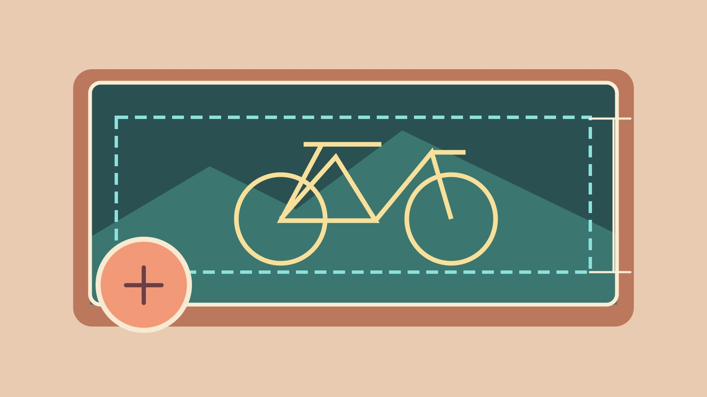
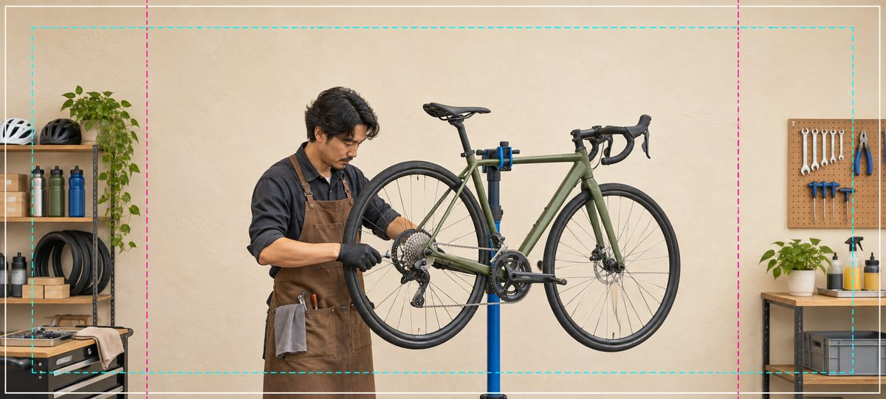

# Facebook Cover Photo Dimensions and Crop Checks

Status: local review draft; confirm the publication date before release.

Read Facebook Page cover dimensions and verify mobile, desktop and avatar overlap.

QuickKOL editorial graphic; not actual account metrics or a platform interface.

Meta’s Facebook Page help lists a 400 × 150 pixel minimum and an 851 × 315 sRGB JPG under 100 KB as its fastest-loading example. It gives separate desktop and mobile display ratios of 16:9 and 2.4:1 and warns that the profile picture can cover part of the image. Leave room around important subjects in the source and verify the result on the actual Page on both devices.

## Identify the exact cover surface

Start by confirming that the asset belongs to a Facebook Page. Personal profiles, groups, events and ads have their own surfaces, so record the Page, market, language, avatar version and replacement date. Some people arrive directly at a post or through a search result and may not see the cover. Put essential hours, terms and contact details in the relevant text or destination as well. Use the [social media operating plan](https://www.quickkol.com/blog/social-media-marketing-operating-plan/#answer) to assign design, review and update ownership. For example, a bicycle shop may want the cover to communicate that it does repairs. The Page introduction can carry opening hours and its service page can explain how to book. Decide which of those details need to change next season. If several branches share one design, identify which Page should use it and whether local contact information belongs outside the image. In the design file, label this as the Page cover and give it a specific version. That helps prevent an event banner from being uploaded during a busy launch.

## Record the minimum, upload example and display ratios separately

The [Meta Page cover dimensions guide](https://www.facebook.com/help/125379114252045) lists a minimum of 400 × 150 pixels and describes an 851 × 315 sRGB JPG under 100 KB as its fastest-loading example. It gives a desktop display ratio of 16:9 and a mobile ratio of 2.4:1, with cropping and resizing possible across screens. It also describes approximately 40 pixels of profile-picture overlap on mobile and suggests PNG for covers with logos or text. Put these in distinct fields. Display ratio and upload ratio describe different things. Dividing the suggested width by height does not tell you exactly which parts will remain visible after publication. Keep a high-quality master and verify the export on actual devices. A project may prepare several compositions for testing. That is a design decision rather than a new platform size requirement. Check the help page again when the editor changes or a Page starts using a different layout. When handing over specifications, include the reviewed date so a future editor can distinguish current platform guidance from an older file template.

## Build crop tolerance into the photograph

In the illustrated bicycle shop, the mechanic and the parts of the frame that explain the work sit near the middle. Shelves and pegboard can lose some area without changing the meaning. When photographing, leave space around the subject and any mark. Aim to preserve the face, hand action and relevant product detail at several crops. Allow extra room for the avatar, interface and background transition near the left and lower edges. A design file can use two provisional masks to spot likely conflicts. Confirm the result on the actual Page and keep guide lines out of the exported image. Suppose the image needs to show that the shop services bicycles. A frame with the mechanic looking down and holding a tool may communicate that even if some workshop equipment disappears. A tightly cropped portrait might lose that context entirely. Have a colleague review both candidate photographs on a small screen without explaining the assignment. If they cannot tell which service is shown, improve composition before adding text.

AI-generated editorial illustration. The lines demonstrate composition margins and do not map to Facebook’s actual crop.

## Give the image and the text distinct roles

The [W3C image alt decision tree](https://www.w3.org/WAI/tutorials/images/decision-tree/) recommends a brief text alternative when a photograph conveys meaningful information in context. If the cover surface does not provide an appropriate way to include an equivalent, keep essential information in accessible Page text or a relevant post. For example, put seasonal repair booking details in an update that can be revised, while the photograph conveys the workshop and people. If a few words are necessary in the design, check contrast and legibility in the narrowest observed mobile view. Use approved brand assets. The [campaign brief guide](https://www.quickkol.com/blog/write-a-useful-campaign-brief/#answer) can identify the purpose of the photo and where the separate text lives. Someone who does not see the photo should still be able to find the service, hours and correct booking route. For a shared design across markets, keep local language changes in a separate version rather than reducing two languages to unreadably small type. Put accessibility and permissions into the review sheet alongside visual quality. This makes it easier to approve a photo without prematurely approving its message.

## Verify the saved Page on phone and desktop

During an authorized preview or update, inspect the actual Page on a desktop browser and the relevant phone app or mobile browser. Check for avatar overlap, missing action and visible degradation in the background or mark. Record device, viewport, entry route, avatar and file version. Distinguish the editor preview from the saved view. Where you can use an appropriate ordinary visitor view, verify it as well. A control visible to an administrator may be absent for a visitor. If the crop is wrong, adjust composition and re-export. A larger file does not change which element gets covered. Suppose the mobile view keeps the mechanic’s face but loses the hand that shows the repair. Shift the relevant action or choose another photo, then check the desktop view again. Do not decide from a screenshot that has been scaled in a presentation. Open the Page under the same conditions in which a reader will see it. If the team cannot access one device or client, record the untested scope and name who can review it before sign-off.

## Compare exports and prepare a rollback

Export suitable variants from the same master, such as a photographic JPG and a PNG with a mark. Record dimensions, color space, file size, compression settings, date and actual result. If the saved view looks soft, check the export, the loading state and the real display conditions. Compare color on the same device against the master to isolate a visible difference. Retain the previously approved cover and avatar combination so the owner can restore or replace it after the campaign. Recheck overlap when the avatar changes. A test might reveal that the JPG variant looks cleaner for the photo, while a compressed logo has visible artifacts. Use the variant that serves the intended image and record which version was saved. Do not infer a universal file format from one test. If uploading a large source makes review difficult, prepare a deliberately optimized copy and compare it at the intended size. Keeping the master allows the designer to create a new output without degrading a previously compressed file.

## Write an actionable acceptance record

Suppose an autumn repair cover reads clearly on desktop but the avatar covers the booking word on mobile. Move the essential action into a reliable Page text destination and revise the composition. Review the phone, desktop and available visitor views, then record the result. Give operations the file version, dimensions, date, owner, switch time and conditions that require another test. Repeat acceptance when the Page layout, avatar or device view changes. List any untested client in the handoff. One phone is evidence for the view observed. If a seasonal detail goes out of date, the owner should know which approved evergreen image to restore and where to update the text. Keep the source image, final export and review record together. Someone taking over the Page should be able to identify which image is live without comparing similar filenames. If the copy was approved separately from the artwork, include a reference to both approvals so a later revision does not inadvertently remove the useful text route.

## Plan two compositions for the next shoot

When the location allows, take a slightly wider and a slightly tighter composition of the same action. Keep lighting and background consistent so the selection depends on what the picture communicates. Use provisional masks to review likely overlap at the shoot and document which information both photographs convey. If the Page unexpectedly changes its avatar, repeat the overlap check with that new image. A wider option can also help when a sponsor wants an alternate crop. Keep it as a separate authorized asset with its own edit history. During review, ask a colleague to arrive from two common entry routes and find the repair booking option. If both routes show the repair scene but only one makes the destination easy to find, the problem may be in Page navigation. Repair the readable text or action route before deciding to replace the photo. Another reviewer can check the event date on a smaller screen and compare it with the ordinary service information so the two do not conflict. Put design-only checks and actual Page observations on separate rows. A design guide does not certify future crops. If several people review, have each record the exact version they saw. This can reveal that a mobile reviewer was looking at a previously saved cover while another reviewer saw an unsaved edit. Repeat the important observations on the correct version before signing off. Leave an evergreen fallback that the Page owner can identify by its file name.

## Page cover specifications and acceptance

| Item | Guidance | Use |
| --- | --- | --- |
| Minimum | 400 × 150 pixels | Check upload boundary |
| Loading example | 851 × 315 sRGB JPG under 100 KB | Use as a photo export reference |
| Display and overlap | Desktop 16:9, mobile 2.4:1, possible avatar overlap | Verify actual devices |

Specifications are from the Meta Page help reviewed for this draft.

## Page cover release checks

Review each view against the same saved version.

- [ ] Separate minimum upload size and display ratios
- [ ] Allow room for the subject and avatar
- [ ] Keep essential information in text
- [ ] Check desktop, phone and rollback file

## Research date and limitations

Sources reviewed November 6, 2026. Methods, tables and decision rules are editorial recommendations. Hypothetical examples are not actual client results or industry benchmarks. Source geography and periods are specified where relevant. This draft is in independent local review; confirm its publication date before release.

## Start creator research with a clear task

Use QuickKOL to interpret a brief, discover relevant creators and research their work and contact routes. Verify data, commercial terms and outcomes at their source.

[Explore QuickKOL](https://www.quickkol.com/#capabilities)

## Sources

- [Meta Page cover dimensions guide](https://www.facebook.com/help/125379114252045)
- [W3C image alt decision tree](https://www.w3.org/WAI/tutorials/images/decision-tree/)
