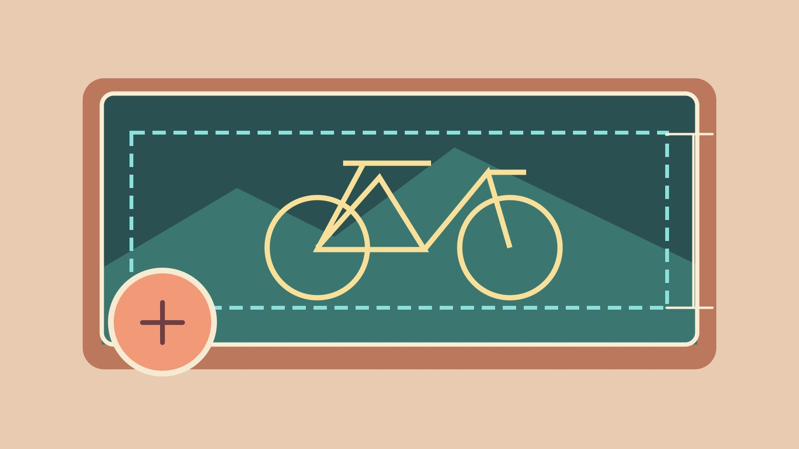
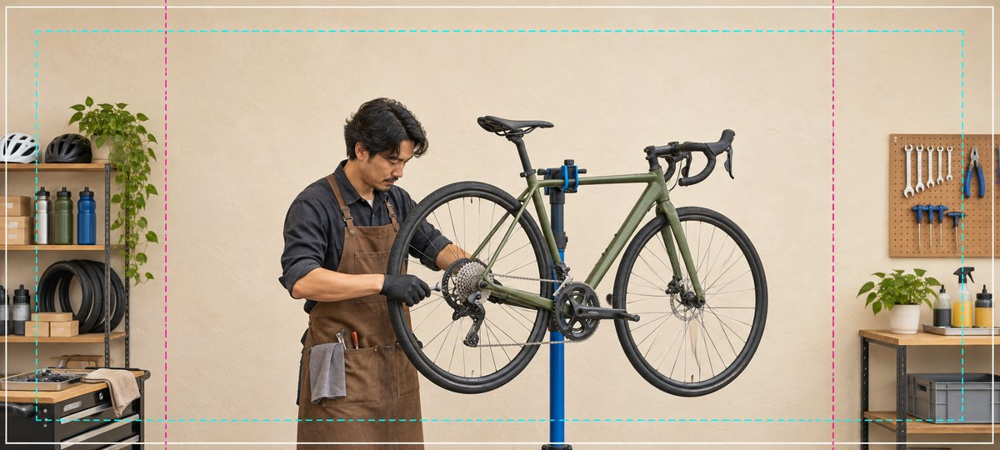

# Facebook 封面尺寸：怎样核对桌面和手机裁切

状态：本地审阅稿；正式发布日期待确认。

读懂 Facebook 公共主页封面尺寸，验证手机、桌面和头像遮挡。

QuickKOL 编辑图形；不呈现真实账号指标或平台界面。

Meta 的 Facebook 公共主页帮助说明给出的最低尺寸是 400 × 150 像素，加载建议是低于 100 KB 的 851 × 315 sRGB JPG。帮助页分别列出桌面 16:9、移动设备 2.4:1 的显示比例，并提醒头像会遮挡部分封面。准备素材时给关键主体留余量，再用实际公共主页分别核对两个设备。

## 先确认你正在更换哪种封面

先确认编辑对象是 Facebook 公共主页。个人主页、群组、活动或广告素材各有自己的画面位置，不能用一张规格表替代。记录具体主页、投放地区、语言、头像版本和更换日期。页面常用入口可能从贴文或搜索直接到内容，读者未必看到封面，因此把最重要的营业时间、活动条款和联系方式另写进相应文本或页面入口。用[社交营销执行计划](https://www.quickkol.com/zh/blog/social-media-marketing-operating-plan/#answer)分配素材、审核和更新责任。

## 把最低尺寸、加载建议和屏幕比例分别记录

[Meta 公共主页封面尺寸说明](https://www.facebook.com/help/125379114252045)列出 400 × 150 像素最低尺寸，并称 851 × 315、低于 100 KB 的 sRGB JPG 加载最快。它也说明电脑 16:9、手机 2.4:1，可能按屏幕剪裁和缩放；手机头像重叠约 40 像素。帮助页建议带标志或文字时考虑 PNG。把这些记成不同字段。显示比例与上传文件比例不同，不能靠计算画出通用安全区。保留高质量母版，再按实际设备确认导出的图。

## 在拍照时就给边缘留可裁的内容

示意照里，修车师傅和自行车的关键部分靠近中间，货架与工具板可以被裁掉一部分。拍照时让主体和标志有间隔，尽量选择两侧还能看到有意义细节的环境。脸、手部动作和产品要能在不同画幅里保持完整。给左侧和下方头像、界面和背景过渡留空间。可先在设计稿画两层参考框，检查最可能冲突的位置，再在实际主页确认。不要让裁切线出现在最终上传图中。

AI 生成的编辑示意图。虚线用于说明构图余量，不对应 Facebook 的实际裁切范围。

## 把信息和照片放到各自合适的位置

[W3C 图片替代文字决策树](https://www.w3.org/WAI/tutorials/images/decision-tree/)说明，应根据上下文为有信息作用的照片提供可访问的简短描述。对不能设置等效文字的封面，确保关键说明另有可读文本。比如季节性“维修预约”用可更新的介绍或贴文说明，图片展示空间与人员。若必须放几个字，检查移动端最窄位置、对比度和字间距。品牌字标要用得到许可且合适的资源。用[活动 Brief 撰写指南](https://www.quickkol.com/zh/blog/write-a-useful-campaign-brief/#answer)写明图的作用和另存的文字来源。

## 用实际手机和桌面核对上传后的结果

按权限预览或更新时，从桌面浏览器、手机应用或移动浏览器检查实际公共主页。看头像是否挡脸、关键工具是否被切掉、背景或字标是否出现锯齿。保存设备、窗口宽度、入口、头像和文件版本，说明当前是编辑预览还是已保存。若内部有合适的普通访问视角，复查布局，避免只看管理员页面。发现问题时先调整构图，再重新导出，不通过单纯提高分辨率来解决遮挡。

## 安排导出对照和一次回退

从原始母版导出两种适用文件，例如照片版 JPG 和带标记的 PNG。记录导出尺寸、色彩、体积、压缩率、导出日期和实际效果。网页如果看着模糊，先看原始导出是否清晰、网络加载状态和实际显示。颜色偏差可在相同设备用同一张母版对照。保留上一个获准封面与头像组合，活动结束后按计划恢复或替换。若需要更换头像，封面遮挡重新验收。

## 写清一份可以执行的最终验收

假设一张“秋季维修”封面在桌面可读，手机的头像压住“预约”字样。把图片中的必要动作移到正文入口，再修改构图。手机、桌面和普通访问分别看一遍并记录。交付时给运营素材版本、尺寸、日期、负责人、切换时间和需要再次测试的条件。页面模板、头像或设备显示有变化时，重跑验收。任何未覆盖的客户端写进交接，不把一次手机测试视为覆盖所有设备。

## 为下一次取景留下两种备选画面

如果场地允许，同一动作多拍一个稍宽的构图和一个稍紧的构图。保持相同光线与背景，让选择主要取决于信息清晰度。现场直接用参考框检视容易遮挡的位置，并写明两张图都能传达什么。临时改用新头像时重做叠加检查。试拍时可以请同事从两个实际常见入口打开页面并找“预约维修”。如果两人都能看到修理场景，却只有一人找到入口，问题可能出在页面导航。先修正可读文字或行动入口，再看图片是否要重做。另一个同事可从较小屏幕核对活动日期，同时打开常规的服务介绍，验证二者没有冲突。把仅做过设计稿检查的项目和已经在主页验证的项目分列，不能把图上的安全线写成 Meta 的保证。

## 公共主页封面规格和验收

| 字段 | 说明 | 用法 |
| --- | --- | --- |
| 最低尺寸 | 400 × 150 像素 | 检查上传边界 |
| 加载建议 | 851 × 315 sRGB JPG，低于 100 KB | 作为照片导出参考 |
| 显示与遮挡 | 桌面 16:9，手机 2.4:1，头像可能遮挡 | 核对真实设备 |

规格来自本次核对的 Meta 公共主页帮助说明。

## 封面更换前检查

同一版本分别核对不同视图。

- [ ] 区分上传最低尺寸和显示比例
- [ ] 给主体和头像留空间
- [ ] 另存关键文字信息
- [ ] 桌面、手机与回退文件已核对

## 研究日期与使用边界

资料核验于 2026 年 11 月 6 日。文中方法、表格和决策规则为编辑建议，标为假设的示例不是实际客户结果或行业基准。外部资料的适用地区与时期按各段说明；本稿处于独立本地审阅阶段，正式发布日期待确认。

## 用清楚的任务开始达人研究

用 QuickKOL 理解 Brief、发现相关达人并研究作品与联系路径；数据、合作条件和结果仍需核验。

[了解 QuickKOL](https://www.quickkol.com/#capabilities)

## 来源

- [Meta 公共主页封面尺寸说明](https://www.facebook.com/help/125379114252045)
- [W3C 图片替代文字决策树](https://www.w3.org/WAI/tutorials/images/decision-tree/)
