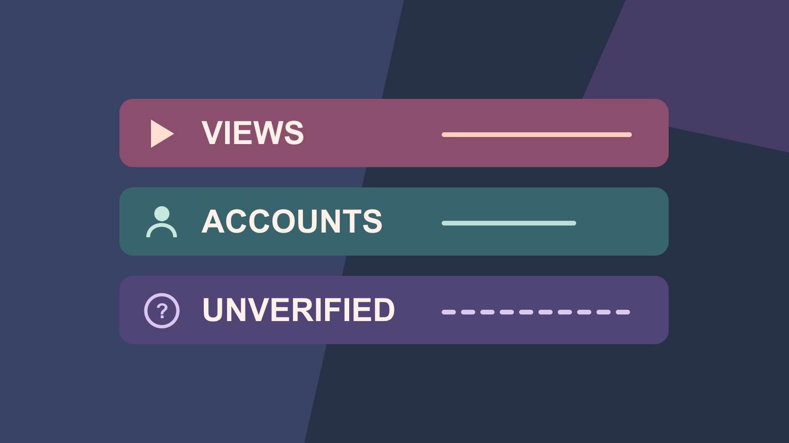

# Free Instagram Views: Check Source and Metric Scope

Status: local review draft; confirm the publication date before release.

Separate unverified Instagram view offers from organic distribution, paid data and verifiable outcomes.

QuickKOL editorial graphic; not actual account metrics or a platform interface.

When you see a free Instagram views offer, check where the views would come from, whether they can be verified in an authorized report and whether the service requests account access. Organic views can be reviewed in Instagram Insights. Keep unexplained data out of verified results while you investigate it. Views and unique accounts reached are different measures.

## Clarify what free means in the claim

Free may describe ordinary distribution without a separate ad budget, or it may be a service’s promise to add a count. Review the actual service, traffic source, access request and reporting. A normal public post can still take production, review and operating time. A page that promises two thousand views without identifying the account scope, time, method or evidence gives a buyer too little to verify. [Meta’s 2019 inauthentic engagement announcement](https://about.fb.com/news/2019/04/preventing-inauthentic-behavior-on-instagram/) describes its action against a service accused of selling fake likes, views and followers. This is historical evidence of the platform’s position. It does not adjudicate the accuracy of a particular account today. If the offer requires account credentials or broad permissions, have the authorized account owner review the request through the organization’s normal process and keep the login in official channels. A view count alone cannot establish what the service actually delivered. Describe the source as unknown until you have evidence. Review the offer before anyone relies on it for a campaign promise or shares account access.

## Read native definitions before interpreting the count

The [Instagram Insights overview](https://help.instagram.com/788388387972460) defines views as times content was played or displayed and accounts reached as unique accounts that saw it at least once. For Reels, an account can be reached without playing the video, and repeated views can occur. The guide also notes availability and estimated metrics. In the actual report, record content ID, date, window and the definition visible for the selected field. Suppose a Reel shows 1,800 views and 1,200 accounts reached. You cannot conclude that exactly 600 people watched twice. Report only the supported counts. If an account does not show a field, keep that field unavailable. A view count can help describe distribution while a separate action, such as a user opening a product guide, needs its own evidence. A screenshot from someone else’s dashboard may show a similar label with a different scope. Keep source and definition next to the value. If the report rounds a public total, do not reconstruct extra precision from a differently timed report.

## Give organic, paid and unknown traffic separate records

Review native content results by asset and window, then look up paid delivery using the actual promotion ID and dates. A boosted post may appear in both content and ad reporting with overlapping scopes or different event definitions. Recompute a split only when the platform evidence establishes compatible definitions. Suppose a content report shows 2,400 views and an ad report shows 800 of a particular video event. You cannot automatically label the remaining 1,600 organic. Record which observation comes from the content report, which comes from ads and what could not be aligned. Use the [campaign measurement guide](https://www.quickkol.com/blog/creator-campaign-measurement/#answer) to define the reporting window. If the promotion has several placements, check the scope before describing its source as Instagram only. Where one report includes a different time zone or delayed events, preserve the actual start and end dates. Avoid reporting a combined total when a campaign buyer needs to understand distinct performance. A paid service using the platform’s ad tools can show an authorized delivery report. An outside promise without corresponding evidence should remain a separate unknown item.

## Investigate an unexpected change with a timeline

Suppose an older tutorial suddenly receives additional views. Record the observation time and native report before checking creator reposts, website links, platform promotion, public discussion and metric changes. The increase alone cannot establish that someone bought activity. Ask the authorized account and ads owners about known events. Separate what happened from what remains unclear. A share on the same day may suggest a lead for follow-up without establishing causation. Preserve the observation and review it again if it affects a decision. An isolated screenshot from another tool does not settle the source. A campaign team might notice that the post was added to a mailing list or that a demonstration answered a newly common question. Use the actual evidence to document those events and say whether the traffic link is available. If the unexplained count is not important to the current decision, keep the annotation and move on to the records that are verifiable. Reserve a separate incident workflow for an actual security concern rather than inferring it from the performance chart.

## Run an organic test that can explain a difference

The [Instagram creator Best Practices announcement](https://about.fb.com/news/2024/10/best-practices-education-hub-creators-instagram/) describes education on creation, engagement and reach. Choose one variable tied to the brand’s job, such as whether a tutorial opens with the finished result or the tools. Hold the rest reasonably comparable. Set two ordinary slots, a consistent audience language, an observation window and metric definitions. Use the [guide to reading creator engagement data](https://www.quickkol.com/blog/read-creator-engagement-data/#answer) to interpret comments, saves and reach. Begin with what the content should help someone do. A small-desk mounting tutorial might be evaluated for relevant follow-up questions, saves or visits to the dimension guide. Do not promise that a particular editing pattern will generate a set number of views. Choose a common reporting point, such as a fixed number of days after publication, and note any exceptional event. If the first version was shared by a partner and the second was not, record that distribution difference. A small trial can help the team improve the next video without establishing a general rule for Instagram.

## Practice reporting with two hypothetical posts

Suppose post A has 1,000 views, 760 accounts reached and 22 saves, while post B has 1,500 views, 740 accounts reached and 12 saves. With comparable definitions and windows, you can say B recorded more views while A recorded more accounts reached and saves. The example does not establish whether topic, repeated display or distribution explains the difference. If the task is helping more people find the tutorial, review reach and the relevant next action. Do not sum the two reach values as a deduplicated audience. A viewer may encounter both posts. If the buyer would normally pay for more distribution, make that its own test with a paid objective and report. Avoid choosing a creative solely because an unlabeled service total is larger. In a handoff, write what changed in the observed metrics, what was different about the test and what remains open. The analyst can then recommend a follow-up without claiming an experiment answered questions it never measured.

## Make the correction traceable

If the report has already labeled unknown views as organic, retain the original version. List the affected asset, old value, verifiable fields, remaining unknowns and correction date. Give readers a short note and state any business effect separately. If an external party uses another definition for settlement, review the agreed metric and source before handling the discrepancy through the appropriate route. At the start of later campaigns, document accepted sources, collection times and review ownership. If the corrected report has a native total but no valid organic breakdown, show the total and mark the breakdown unavailable. Do not discard a supported fact merely because a related interpretation changed. Give the stakeholder who received the earlier slide a way to find the correction. If a suspected source becomes verified later, append a new observation and explain why the status changed. Keep the record focused on the actual post and reporting question. A performance correction should never become an accusation about a creator without independently supported evidence.

## Identify what an outside service actually offers

Ask what an outside service actually delivers when it promises more views in a free trial. Editing advice can be evaluated in a content experiment. Authorized advertising work can be checked against the actual ad report and agreed charges. A count promise without a documented method remains outside verified activity. Record whether any account access is involved, who approves it, what evidence the team can see and when the arrangement ends. You can examine a public claim without supplying credentials or making a purchase. If another team member already used a service, ask the authorized account owner to document what was shared and inspect available settings through the official route. Treat any access issue separately from the question of whether views changed. A supplier may provide a report that lists a target number rather than observed delivery. Identify that difference before the information reaches a campaign recap.

## Use one content journey to choose the next step

Suppose the campaign needs to know whether someone understands the mounting steps. Review views, saves and visits to the dimensions page as different events. Have a colleague watch the edit and follow the real publication route to make sure the page describes the model shown. If the next test changes only the opening, keep the destination and review window stable. If the product or link changes, label those differences. State whether the next test concerns the script, distribution or destination. A corrected report might show that a Reel reached a useful audience even though the guide link was wrong. Fix the link, then measure the new journey with a new observation window. That is more informative than adding a count to an older report to make the pilot look larger. Keep the original period so the owner can see which changes were made after the issue was found.

## Instagram view evidence

| Observation | Verification | Scope |
| --- | --- | --- |
| Native views | Actual content ID, window and field | Plays or displays |
| Accounts reached | Native definition and selected window | Unique accounts seeing the content |
| Unverified source | Source evidence pending | Separate from verified results |

Avoid deriving organic traffic by subtracting incompatible measures.

## View reporting checklist

Review the actual asset and metric.

- [ ] Record source, content and date
- [ ] Separate views from accounts reached
- [ ] Verify paid and organic definitions
- [ ] Preserve observations and corrections

## Research date and limitations

Sources reviewed November 6, 2026. Methods, tables and decision rules are editorial recommendations. Hypothetical examples are not actual client results or industry benchmarks. Source geography and periods are specified where relevant. This draft is in independent local review; confirm its publication date before release.

## Continue learning engagement definitions

Check definitions, windows and evidence before evaluating the content.

[Read the engagement guide](https://www.quickkol.com/blog/read-creator-engagement-data/#answer)

## Sources

- [Meta’s 2019 inauthentic engagement announcement](https://about.fb.com/news/2019/04/preventing-inauthentic-behavior-on-instagram/)
- [Instagram Insights overview](https://help.instagram.com/788388387972460)
- [Instagram creator Best Practices announcement](https://about.fb.com/news/2024/10/best-practices-education-hub-creators-instagram/)
