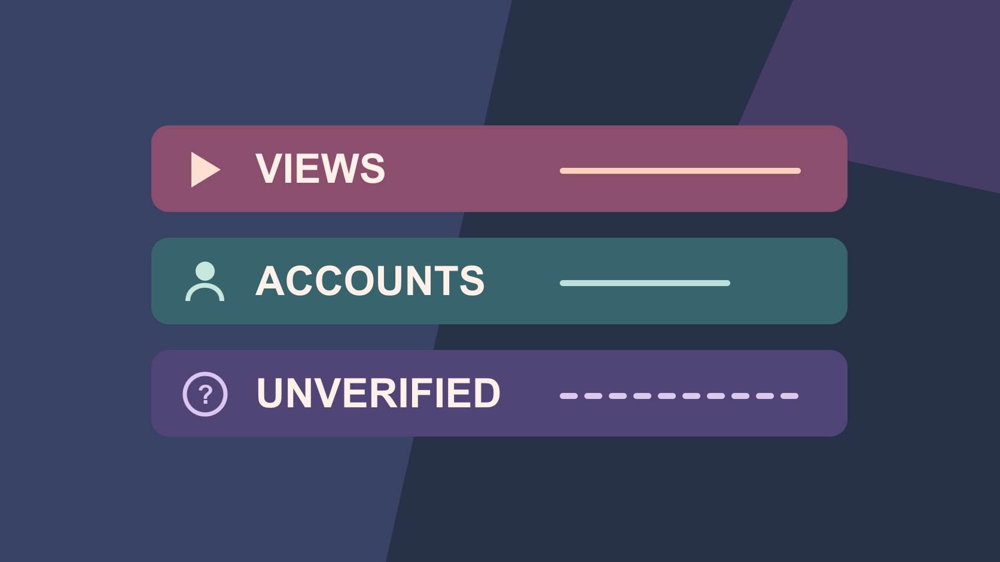

# 免费 Instagram 播放量：核对来源和指标

状态：本地审阅稿；正式发布日期待确认。

把来源不明的 Instagram 播放承诺与自然分发、付费数据和可核验结果区分。

QuickKOL 编辑图形；不呈现真实账号指标或平台界面。

如果看到“免费 Instagram 浏览量”的承诺，先核对这些播放会来自哪里、是否能从有权限的报表核验、服务是否要求访问账号。自然浏览量来自真实内容分发，可以用 Instagram 成效分析复查。遇到来源不明的数据，标为待核验，不把它们计入已确认结果。浏览量和独立触达本身也是两个不同指标。

## 先确认“免费”描述的是什么

“免费”可能是没有单独付广告费的自然分发，也可能是外部服务给数字的宣传。查看实际服务内容、来源、授权请求和报表。普通公开发布仍可能花制作、审核和运营时间。外部页面只说“到账两千播放”，没有账号范围、时间、方法或数据来源，就没有足够证据把它列入活动成绩。[Meta 2019 年非真实互动公告](https://about.fb.com/news/2019/04/preventing-inauthentic-behavior-on-instagram/)记录当时公司针对虚假点赞、浏览和粉丝销售提起的诉讼。它提供平台立场的历史背景，不用于判断某个今天账号的数据真伪。

## 读原生指标，避免把播放当成人数

[Instagram 成效分析说明](https://help.instagram.com/788388387972460)把浏览量定义为内容播放或展示次数，把观看人数解释为至少看过一次的独立账户。Reels 观看人数可以包括看到但未播放的账号，浏览量可能有重复。帮助页也标注指标的可用性或估算性质。查看实际报表中的内容 ID、日期、时间窗口和所选指标定义。假设一条 Reel 显示 1,800 浏览与 1,200 个独立账户，这两个数不能换算出恰好有 600 人重复看。只报告当前有证据的计数。若账号没显示字段，写未提供。

## 给自然、广告和未知来源分别建记录

先按内容和报告范围查自然数据，再按实际推广 ID 和投放日期查付费。如果一条帖子被速推，原生内容报表与广告报表可能重叠或定义不同。只有平台明确提供同一口径的拆分时才能重算。假设内容报表有 2,400 浏览，广告报表另有 800 个某种播放事件，不能直接把剩余 1,600 写作自然浏览。标记哪条来自帖子、哪条来自广告，哪个指标无法对齐。用[活动衡量与对账指南](https://www.quickkol.com/zh/blog/creator-campaign-measurement/#answer)确定复查窗口。

## 把异常当成问题，先查时间线

假设一条旧教程突然多出一批浏览，先记录所见时间和原生报表，再看创作者转载、官网链接、平台推广、公开讨论和指标调整。不要从上涨本身判断有人购买。可以问负责账号和投放的同事是否有已知活动。记录发生了什么和仍不清楚的地方。如果有人转发页面，与增长同一天只能说明时间重合，因果需要更多材料。保存观察时点并复查，避免使用第三方工具的单条截图作为定论。

## 做一个能解释差异的自然内容小试验

[Instagram 创作者最佳实践公告](https://about.fb.com/news/2024/10/best-practices-education-hub-creators-instagram/)介绍面向创作者的制作、互动与触达教育。针对品牌任务选一个变量，例如开头先展示成品还是先展示工具，其他要素保持尽量可比。设定两个普通时段、相同地区语言、观察窗口和指标。用[阅读达人互动数据指南](https://www.quickkol.com/zh/blog/read-creator-engagement-data/#answer)解读评论、收藏和触达。先确定内容要帮人做什么。假设视频是教用户在小桌面装支架，记录是否有人问下一步、保存教程或打开尺寸页。

## 用两条假设帖子练习汇报

假设帖子 A 有 1,000 浏览、760 个触达账号和 22 次收藏，帖子 B 有 1,500 浏览、740 个触达账号和 12 次收藏。口径与窗口一致时，可以写 B 记录的浏览次数更多，A 触达和收藏较高。原因可能涉及题材、重复展示或分发，示例没有这些证据。若团队要增加能够找到教程的人，继续看独立触达与具体行动。两个帖子的触达不能直接加成互不重叠的总人数。

## 从证据整理出可追溯的改动

如果报表已把未知播放列为自然，把原版本留作档案。修订行标出受影响内容、原数值、现在能核对的字段、仍未知的部分和更正日期。给读者一段简明说明，业务影响另列。若外部机构用不同口径结算，先核对合同约定的指标和来源，再按适当流程沟通。以后在活动开始时写清哪些数据来源可用、何时保存和谁负责复查。

## 确认第三方服务到底交付什么

如果供应商声称免费试用会增加浏览，问清实际交付是剪辑建议、广告代运营、发布协作还是数字增长。对剪辑建议，可以用内容实验验收；对授权的广告服务，看实际广告报告和付款范围；对没有明确方法的增长承诺，不计入已验证活动。把是否访问账户、谁批准权限、能否查看数据和何时结束写清。正在检查来源时，不需要为了验真向服务提交账号、个人数据或付费。

## 用同一条内容链路复盘下一步

假设本轮要知道用户是否理解支架安装，播放、收藏和访问尺寸说明页要分别核对。先让一位同事完整看一遍成片，再通过实际发布入口打开说明页，确认画面展示的型号与页面一致。下一轮若只改开头，就保留原尺寸页和观察窗口。若内容换了产品或链接，就把两轮差异注明。报告写出需要进一步试验的是脚本、分发还是链接。

## Instagram 浏览证据分栏

| 观察 | 验证方式 | 结论范围 |
| --- | --- | --- |
| 原生浏览 | 实际内容 ID、窗口和字段 | 播放或展示次数 |
| 独立触达 | 原生定义与指定窗口 | 至少看过一次的独立账户 |
| 未核来源 | 来源凭证待补 | 单列、不计已确认结果 |

不要把不同窗口或指标相减来推算自然流量。

## 浏览数据复核

按实际内容和指标检查。

- [ ] 标记来源、内容和时间
- [ ] 区分浏览与独立触达
- [ ] 核对付费与自然口径
- [ ] 保留异常观察和更正

## 研究日期与使用边界

资料核验于 2026 年 11 月 6 日。文中方法、表格和决策规则为编辑建议，标为假设的示例不是实际客户结果或行业基准。外部资料的适用地区与时期按各段说明；本稿处于独立本地审阅阶段，正式发布日期待确认。

## 继续学习互动数据口径

先核对定义、窗口与证据，再用合适的指标评价内容。

[阅读互动指标指南](https://www.quickkol.com/zh/blog/read-creator-engagement-data/#answer)

## 来源

- [Meta 2019 年非真实互动公告](https://about.fb.com/news/2019/04/preventing-inauthentic-behavior-on-instagram/)
- [Instagram 成效分析说明](https://help.instagram.com/788388387972460)
- [Instagram 创作者最佳实践公告](https://about.fb.com/news/2024/10/best-practices-education-hub-creators-instagram/)
