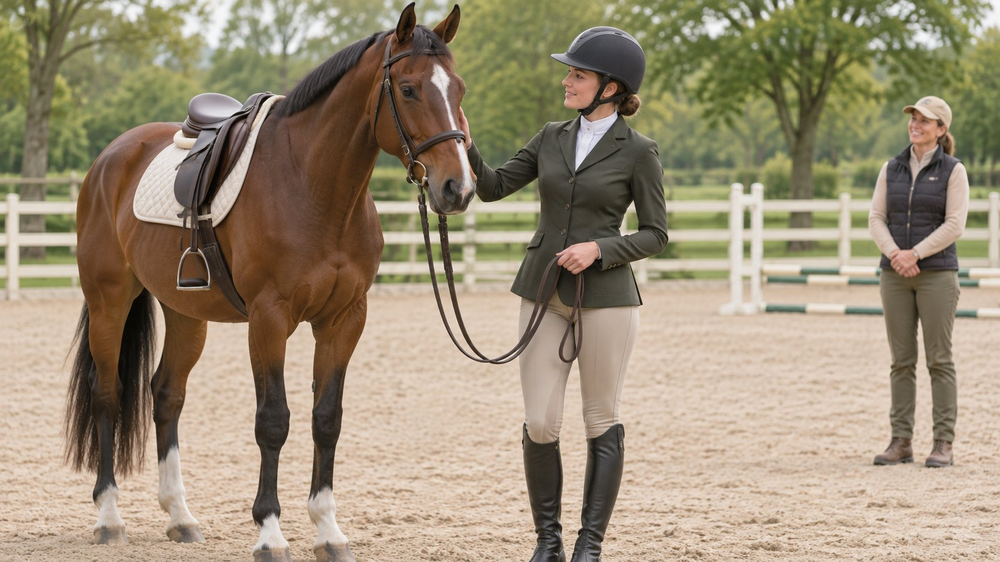
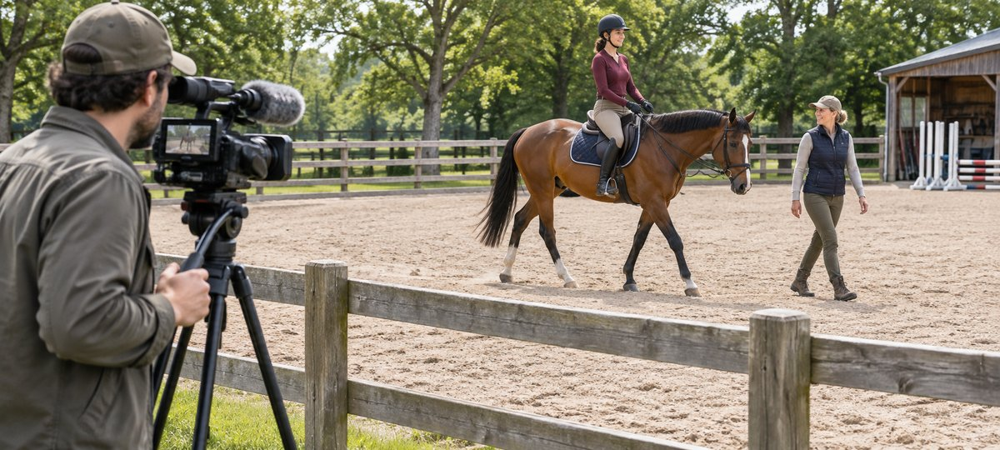

# Horse Rider Collaborations: Plan an Equestrian Shoot

Status: local review draft; confirm the publication date before release.

Define the rider role, venue, equine welfare, camera positions and delivery for equestrian content.

AI-generated editorial illustration, not an actual creator, client, product or event.

When hiring a horse rider for brand content, specify the product action and decide whether the story requires mounted footage. Have appropriate on-site specialists review horse, rider and venue. Put camera zones, stop authority, fallback footage and permissions into the brief. If conditions change, let the equestrian and venue owners decide whether the planned filming can proceed.

## Decide what the content needs to show

Suppose a brand wants to show the location of a jacket pocket and how its zipper operates. Those details can be filmed on the ground. If viewers also need to see the hem during movement, describe that need to the on-site lead before planning mounted coverage. Use the [campaign brief guide](https://www.quickkol.com/blog/write-a-useful-campaign-brief/#answer) to record product, format, use, demonstration and boundaries. A competitor’s jumping footage is not evidence that a similar shot belongs in this assignment. Give each planned shot an alternative and prioritize the deliverables that do not require the horse. Keep safety and performance claims within the evidence the team can verify. A marketing objective such as showing how a jacket packs away can be fulfilled in a stable work area or another permitted location. If a mounted segment is genuinely necessary, identify what it adds and have the specialist decide whether the intended setup is suitable. The buyer should know what the project can deliver if that shot is removed.

## Verify the adult rider, horse lead and production roles

Review the adult rider’s experience in a comparable environment and assignment with the venue or appropriate equestrian lead. A competition result cannot establish suitability for a specific horse, location and camera setup. Identify rider, horse lead, venue contact, camera operator, producer and publisher. Ask for relevant work they can share and confirm the person’s role. Decide who handles venue access, approvals and any required arrangements for the production. Performer, creator and rider can be different people. If the on-camera speaker will discuss the product, the team needs someone to review the script and someone to verify the equestrian context. The horse owner or handler should know the planned activity and what might change on the day. If a contractor brings a substitute horse or rider, repeat the relevant on-site review before attempting footage. Give each person only the instructions and authority relevant to their work. The producer should know whom to ask when a proposed change affects the animal or venue.

## Have the venue lead review camera positions

Have the venue lead designate camera, waiting and access areas before setup. Keep equipment, cables and props out of the routes the venue marks. The photo shows a camera outside a fence for illustration. The actual boundary must be set on site. Rehearse the cue and framing under the approved conditions before bringing a horse into the setup. Refer any proposed change in camera location, lighting, sound or drone use back to the relevant owner. If the approved camera position cannot show a cuff, get that detail in a separate ground shot. Do not enter an unapproved area to save a take. Give the crew a simple marked plan that identifies where to wait, who can move equipment and who communicates with the rider. Keep entrances available for the venue’s normal operations and response plan. If the production shares the site with other people, have the venue determine when and where filming is appropriate. An editorial plan can be changed to fit the location without changing the product facts.

AI-generated editorial illustration. Have the on-site owner confirm camera positions and access for the actual venue.

## Put welfare and stop authority into the brief

The [British Equestrian Federation welfare policy](https://www.britishequestrian.org.uk/assets/About%20the%20BEF/Rulebook/Rulebook%202025/Policy10-Equine_Ethics_and_Welfare_25.pdf) gives equine welfare priority within its stated scope. For a production, put the responsible decision-maker, communication method, crew waiting point and fallback in the plan. Changes to footing, weather, equipment or the horse’s condition require the relevant on-site owner to decide whether to proceed, modify the activity or stop. The production schedule cannot make that decision. Make clear who may call a pause and who can authorize a restart. The editorial photo provides production context and does not teach riding or horse handling. If a buyer asks for a repeated movement, check whether the specialist agrees and whether existing footage already covers the visual need. Ask the production team to stop recording new takes when the lead calls a pause. Keep a written record of the change without speculating about animal health. A short update can tell the client which visual will be replaced and when the approved alternative will be reviewed.

## Verify equipment for the actual venue and activity

The [British Horse Society helmet guidance](https://www.bhs.org.uk/go-riding-and-learn/riding-out-hacking/what-to-wear/hats-and-helmets) emphasizes correct fit and securing the helmet. It explains that protection cannot be guaranteed in every circumstance. This is U.K. guidance. Have the venue and qualified people check equipment against the actual activity, local rules and relevant arrangements. The production crew should not ask anyone to remove or change required equipment for a cleaner image. Technical statements about tack or protective products need evidence and appropriate professional review. Review ads, stills and behind-the-scenes versions as well. If one intended shot depends on showing an unobstructed hairstyle or product tag, redesign the shot rather than compromising the venue’s requirements. The product can be filmed separately where appropriate. A footage review should look for inaccurate implications created by editing, such as a claim that a garment prevents injury when the project only documented its appearance. Give the reviewer the original context of the shot and the intended caption.

## Plan fallback shots that do not add riding activity

If the planned mounted sequence cannot go ahead, use an appropriate fitting, garment movement on the ground, cleared product still or interview to answer the same question where possible. A zipper position can be shown in a standing and seated setup. If the question truly requires mounted footage, document the changed scope and reschedule only under approved conditions. Do not present archive footage as a recording from the current day or product. Keep the captions consistent with the scene and verify fallback permissions. The customer might still get a useful explanation of the pocket even if the brand cannot demonstrate movement in the saddle. Let the producer and buyer agree which task the replacement actually fulfills. If a deadline requires immediate delivery, label the supported product claims and leave any unfilmed demonstration out of the approved edit. The next production owner can decide whether the remaining shot warrants a separate session.

## Review location, people, footage and publication rights

Use the [creator rates and usage rights guide](https://www.quickkol.com/blog/creator-rates-usage-rights/#answer) to document rider appearance, creator publication, brand use, advertising, derivatives, territory and duration. Check location, the relevant permission for filming the horse and any other people through the appropriate owners. If using event footage, review organizer and production rights separately. The [FTC influencer disclosure guidance](https://www.ftc.gov/business-guidance/resources/disclosures-101-social-media-influencers) addresses commercial endorsements with a material connection for a U.S. audience. Check the actual market and relationship. Before export, review the footage and copy so venue approval is not described as an institutional endorsement. A rider can allow an interview on one channel while the event footage remains subject to separate permissions. Give the publisher a rights record that names the actual asset. If a promotional use was omitted from the original agreement, request a new review before adapting it. Include expiry and a responsible person for removal or renewal. Keep approval evidence with the released version so a later edit does not inherit an unrelated permission.

## Write an acceptance record for crew, venue and client

Record actual shots, substitutions, approved versions, missing actions, rights and publishing owner. Suppose the venue cancels the mounted segment and ground footage clearly shows the pocket. Accept the pocket deliverable and leave the mounted demonstration for a separate decision. Give the team a clear review point and date, retaining venue conditions and observations. Review the final edit for misleading framing that could invite viewers to imitate an activity under different conditions. Put the specific product version beside the footage and give the buyer the changed scope in writing. A later reviewer should be able to see which approval covered the location and which covered publication. If the material is used again in a different market, repeat the appropriate permission and claims checks.

## Rehearse a change that removes mounted filming

Imagine the crew has arrived when the equestrian lead cancels mounted filming for the day. The producer directs crew to the venue’s approved waiting area and checks with the buyer what the ground shots can answer. The stylist uses the same jacket for zipper and pocket details. The interview describes only verified product facts. The editor marks the mounted shot as missing and avoids substituting archive material as though it were new footage. If the buyer still needs the mounted action, open a separate request for the on-site lead to assess. Record the venue decision, replacement footage, claims removed, accepted scope and follow-up. If the short film will be released in a new market or ad placement, have the relevant owner verify scope again. Record the cancellation time and who received it without publicly speculating about the horse’s condition. Rehearse that communication before the shoot so the crew does not receive competing instructions. A client can approve a useful jacket demonstration while a distinct riding use remains unverified. Give the publisher both the approved version and any statement that was removed. If another agency makes a cut from the footage, it can then see which parts of the original brief were completed and which were deliberately left out.

## Equestrian production handoff

| Item | Verify | Owner |
| --- | --- | --- |
| Venue | Access, equipment and stop authority | Venue and equestrian leads |
| Shot | Required action and fallback | Production |
| Publication | Version, rights and copy | Brand review and publishing |

The illustration cannot set the actual camera zone.

## Production and publication checks

Start with the actual venue and equestrian leads.

- [ ] Confirm whether mounted footage is needed
- [ ] Verify roles, camera zone and stop authority
- [ ] Prepare a fallback without mounted activity
- [ ] Review rights and claims for each use

## Research date and limitations

Sources reviewed November 6, 2026. Methods, tables and decision rules are editorial recommendations. Hypothetical examples are not actual client results or industry benchmarks. Source geography and periods are specified where relevant. This draft is in independent local review; confirm its publication date before release.

## Start creator research with a clear task

Use QuickKOL to interpret a brief, discover relevant creators and research their work and contact routes. Verify data, commercial terms and outcomes at their source.

[Explore QuickKOL](https://www.quickkol.com/#capabilities)

## Sources

- [British Equestrian Federation welfare policy](https://www.britishequestrian.org.uk/assets/About%20the%20BEF/Rulebook/Rulebook%202025/Policy10-Equine_Ethics_and_Welfare_25.pdf)
- [British Horse Society helmet guidance](https://www.bhs.org.uk/go-riding-and-learn/riding-out-hacking/what-to-wear/hats-and-helmets)
- [FTC influencer disclosure guidance](https://www.ftc.gov/business-guidance/resources/disclosures-101-social-media-influencers)
