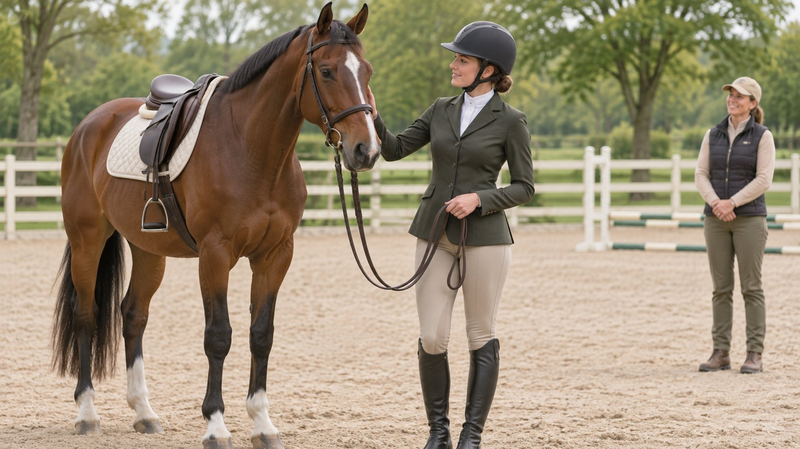
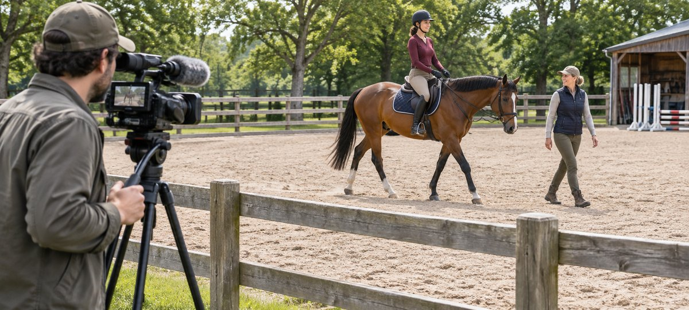

# 骑手达人合作：场地、马匹与镜头安排

状态：本地审阅稿；正式发布日期待确认。

为马术品牌内容核对骑手角色、场地、马匹福利、机位和交付。

AI 生成的编辑示意图，不是真实达人、客户、产品或活动。

找马术骑手拍品牌内容，先写清要展示的产品动作及是否确实需要骑乘，再请有资质或合适经验的现场负责人核对马匹、骑手和场地。把摄影区域、停止口令、备用镜头和许可提前写入 Brief。遇到条件变化时，由马术和场地方作判断，制作组按许可拍摄。

## 先确定要展示的产品任务

假设品牌要展示外套口袋位置与拉链触感。这些细节可以在地面拍；若要让观众看到运动时衣摆如何变化，再向现场负责人说明镜头需要。用[活动 Brief 撰写指南](https://www.quickkol.com/zh/blog/write-a-useful-campaign-brief/#answer)写产品、画幅、用途、示范与不能拍的范围。不要因为竞品用了跃障镜头就把类似动作加进计划。给每个镜头写可替代的版本，先完成不需要马匹参与的交付。未经实际验证不写安全或性能结论。

## 分别确认成年骑手、马匹负责人和制作角色

看骑手在类似环境和任务中的经验，由场地或合适的马术负责人核对。过去某个赛事的成绩并不能直接说明适合在这匹马、这块地和这套机位下表演。先确认骑手、马匹负责人、场地、摄影、制作和发布人。让对方分享有权提供的作品或经历，核对在片中扮演的角色。检查场地进入、活动批准和相关保障由谁处理。演员、达人和骑手可能是同一人，也可能是不同的人。

## 让机位图经过场地负责人确认

场地负责人先安排摄影、人员等待、出入口和设备区域，确保道具、脚架、电缆不进入对方指定的通行区。示意照将相机画在围栏外，实际边界不能照搬。用真实场地和画幅做准备，在有马匹前先演练口令与取景。变更机位、灯光、声音或无人机前请负责人重新判断。若许可机位拍不到袖口等细节，可把近景移到地面，不为抢镜临时进场。

AI 生成的编辑示意图。机位与通行范围由现场负责人按真实场地确认。

## 将马匹福利和停止权限写成现场规则

[英国马术联合会马匹福利政策](https://www.britishequestrian.org.uk/assets/About%20the%20BEF/Rulebook/Rulebook%202025/Policy10-Equine_Ethics_and_Welfare_25.pdf)强调在其适用范围内优先考虑马匹福利。把原则落实到拍摄时，指定有权停止的人、沟通方式、人员集合与备用安排。若场地、天气、设备或马匹状态变化，交现场负责人决定继续、调整或暂停。制作时间和宣传目标不能替代该判断。让所有人知道谁可发起停止、谁能确认复拍。不要将本文示意图当作骑术或马匹处理指南。

## 按实际活动和地区核对头盔及装备

[英国马术协会骑行头盔指南](https://www.bhs.org.uk/go-riding-and-learn/riding-out-hacking/what-to-wear/hats-and-helmets)强调合适佩戴与固定，并指出头盔不能保证所有情况下都能保护骑手。该材料是英国指导。让现场人员根据当地规则、活动和保险要求核对适用装备。制作组不为画面要求摘下或调整需要的装备。若产品是马具或保护用品，任何技术说法都要由合适的专业人员和实际证据支持。广告、截图和幕后内容同样要复查。

## 准备不用增加骑乘动作的备用镜头

如果计划中的骑乘段不能拍，用地面试穿、服装动作、获准的静态产品照或采访回答同一个问题。假设主任务是展示拉链，可以用站姿和坐姿拍出位置；若任务确实需要骑乘状态，就明确交付的范围变了，等允许再安排。不要把旧素材当成当天拍摄或当前款。画面与字幕保持一致，备用内容也要有权限。

## 逐项确认场地、人物、素材和发布权限

用[达人费率与使用权指南](https://www.quickkol.com/zh/blog/creator-rates-usage-rights/#answer)记录骑手出镜、创作者发帖、品牌账号、付费投放、衍生、地区与期限。场地、马匹出镜相关许可及其他出镜者也要通过适当负责人核对。若使用赛事画面，另看主办方和摄制方的权利。美国市场商业推荐的适用披露参考[美国FTC达人披露指南](https://www.ftc.gov/business-guidance/resources/disclosures-101-social-media-influencers)。导出前检查镜头与文案，避免将现场批准误写成机构背书。

## 给制片、现场和客户一份可执行的验收

交付记录写实际镜头、替代说明、获准版本、缺失动作、许可与上线责任。假设场地负责人取消骑乘，地面镜头符合衣袋演示。可以验收衣袋交付，将骑乘演示另列待安排。给团队具体复查点和下一次日期，留场地要求与实际观察。确认最终素材没有用错误视角引导观众重复危险动作。

## 用临时取消骑乘的演练校验分工

假设外套团队已经在场，马术负责人要求取消当天骑乘镜头。制片先通知工作人员按许可区域等待，再和客户核对地面镜头能回答什么。造型师拿同一款外套拍拉链与口袋，采访只解释实际能确认的产品细节。编辑把骑乘动作标为未拍，不用历史镜头冒充。若品牌仍需要该动作，另开请求，由现场负责人重新决定。复盘将场地指示、替代画面、被省略的说法、客户接受的范围和下一步写到同一份记录里。若短片将在另一个地区或广告渠道发布，仍要由对应人员检查范围。记录取消时间和传达给谁，不公开猜测马匹状况。

## 马术内容拍摄交接

| 项目 | 核对 | 负责方 |
| --- | --- | --- |
| 现场 | 人员范围、设备与停止权限 | 场地与马术负责人 |
| 镜头 | 必要动作与替代方案 | 制作 |
| 发布 | 版本、权限和文案 | 品牌审核与运营 |

示意图的机位不能替代现场确认。

## 开拍与发布检查

先请实际场地方与马术负责人确认。

- [ ] 确认是否需要骑乘
- [ ] 核对分工、机位和停止权限
- [ ] 准备不依赖骑乘的备选镜头
- [ ] 逐用途确认权限与说法

## 研究日期与使用边界

资料核验于 2026 年 11 月 6 日。文中方法、表格和决策规则为编辑建议，标为假设的示例不是实际客户结果或行业基准。外部资料的适用地区与时期按各段说明；本稿处于独立本地审阅阶段，正式发布日期待确认。

## 用清楚的任务开始达人研究

用 QuickKOL 理解 Brief、发现相关达人并研究作品与联系路径；数据、合作条件和结果仍需核验。

[了解 QuickKOL](https://www.quickkol.com/#capabilities)

## 来源

- [英国马术联合会马匹福利政策](https://www.britishequestrian.org.uk/assets/About%20the%20BEF/Rulebook/Rulebook%202025/Policy10-Equine_Ethics_and_Welfare_25.pdf)
- [英国马术协会骑行头盔指南](https://www.bhs.org.uk/go-riding-and-learn/riding-out-hacking/what-to-wear/hats-and-helmets)
- [美国FTC达人披露指南](https://www.ftc.gov/business-guidance/resources/disclosures-101-social-media-influencers)
