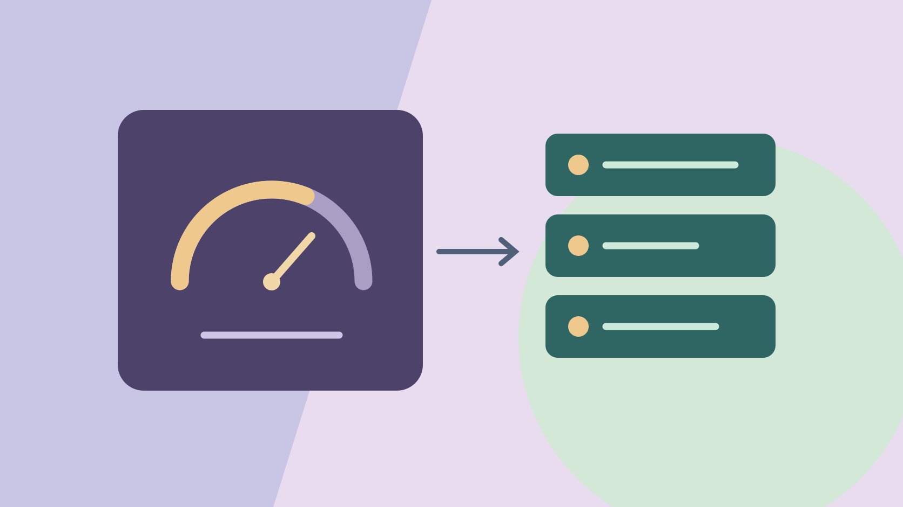

# HypeAuditor: Review Audience Quality Evidence

Status: local review draft; confirm the publication date before release.

Separate HypeAuditor scores from verified facts and use corroborating evidence for campaign review.

QuickKOL editorial graphic; not actual account metrics or a platform interface.

HypeAuditor’s AQS is a vendor score that can help prioritize follow-up. Identify the platform, report version and date, then inspect the work, known events and authorized native reporting. A low score or isolated change is a signal to investigate. Evaluate deliverables, audience evidence and substantiated risks separately.

## Define the purchasing question before reading a score

Suppose a brand needs a desk tool demonstration. One candidate can film precise hand movements. Another regularly publishes technical tutorials to a relevant audience. Decide first whether the buyer needs the production file, a post or both. Use the [creator selection guide](https://www.quickkol.com/blog/creator-selection-beyond-followers/#answer) to define skill, market, language, account, usage and required evidence. A third-party score may help prioritize review. It does not establish production fit or permission. When a creator will deliver only an asset, their audience may not be central to the assignment. If the brand pays for a creator publication, relevant audience and performance evidence might affect scope. Write those conditions before comparing scores. For a repeat campaign, distinguish the roles the brand needs this time from what a prior creator delivered. The analyst should know whether to verify technical clarity, geography, visibility or another requirement. That prevents an appealing score from becoming a reason that no one can relate to the contract.

## Read each AQS in its platform and report context

The [HypeAuditor Instagram AQS guide](https://help.hypeauditor.com/en/articles/2221731-what-is-aqs-audience-quality-score-and-how-is-it-calculated) describes Audience Quality Score and categories including engagement, audience and growth patterns. The [HypeAuditor TikTok AQS guide](https://help.hypeauditor.com/en/articles/4091619-what-is-the-account-quality-score-and-how-is-it-calculated) uses Account Quality Score for the TikTok report. It also uses a one-to-one-hundred scale, with a different set of inputs. Two scores of seventy-five do not represent the same measurement. Record platform, report name, observation date, available components and documentation. If a score is missing, leave it unavailable rather than substituting another platform’s value. Check the report that the purchasing team can actually access. If a PDF and online view were captured at different times, preserve both observations and avoid treating them as one snapshot. A vendor may update a method or label. Keep the date beside any interpretation that relies on a definition. The summary should tell a reader which score is used and what the underlying fields can and cannot establish for this specific campaign.

## Keep modeled estimates separate from native reporting

The [HypeAuditor data provenance guide](https://help.hypeauditor.com/en/articles/2221718-where-does-the-data-come-from-and-how-accurate-are-your-reports) describes processing public information and using models for estimates of demographics, engagement and authenticity-related fields. Do not label those values as native data provided by the account owner. Record the field, window, source and unknowns. If a modeled geographic share differs from an authorized native report, compare dates, populations and methods before drawing a conclusion. A channel summary cannot establish results for one sponsored post. Use the [guide to reading creator engagement data](https://www.quickkol.com/blog/read-creator-engagement-data/#answer) to confirm units and denominators. Suppose a model estimates followers in a market while the native report describes viewers reached last month. The two percentages answer different questions. Keep both with their definitions and decide which one fits the task. If the brand’s new campaign requires content in that market, request only the relevant permitted evidence. Note whether the current report can distinguish sponsored work from other posts. Any missing field can remain open while creative fit is evaluated separately.

## Document an anomaly and potential explanations separately

Suppose a vendor chart shows unusually strong follower growth over several days. Record account, dates, values and source. Then check public posts, partner shares, permitted advertising records, renames and collection intervals. Determine what two or more sources can actually establish. A change can trigger review without proving purchasing or automation. If a public collaboration appeared during the same period, report the timing without assuming causation. Avoid an accusation that the evidence does not support. A model can flag a pattern because it resembles previous observations, while the current case may involve a different event or incomplete collection. Ask the authorized account owner for relevant context where appropriate. If the change appears only in one export, check whether the other report uses a different cutoff. Give each explanation a status, such as observed, plausible or unsupported. A buyer can request more evidence or run a limited test without publishing a judgment about the account.

## Check counterexamples for both low and high scores

Suppose A has a lower vendor score but clear tutorials with stable subject matter and legible hand movements. B has a higher score but no continuous demonstration of a comparable product. For a brand-owned production file, verify A’s production terms and rights. For a creator post, the relevant audience or growth questions may remain open. Ask B for a work example that fits the job. Do not convert a high score into a guarantee or a low score into proof of conduct. Give both candidates the same creative requirement and identify which evidence actually remains unresolved. A reviewer can blind the score during the work sample review to reduce its effect on judgments about the video. After that review, bring the score back as one evidence row. A deal can narrow to production while reporting questions are investigated, if that meets the brand’s goal. Do not infer that either person’s audience will purchase the product from these hypothetical scores.

## Make any follow-up request concrete

Explain the account, dates and field in a follow-up. You can ask whether two sources cover different periods and whether an authorized aggregate for the intended market is available. Avoid a broad demand that someone prove their followers are real. Let the account holder provide the appropriate scope without unrelated private information. Explain whether the evidence affects production, publication or settlement. After receiving it, record source, limits and next review rather than overwriting the prior report. If a creator explains a jump with a publicly visible event, capture that fact and check how closely the dates match. Leave the causal question open unless stronger evidence exists. If the platform does not expose a requested field, consider whether another relevant metric can support a narrower test. The reviewer should be able to read the response and identify which question it resolves. Avoid passing the full correspondence to recipients who need only the outcome.

## Give every open risk a next action rather than a label

Keep verified facts, investigation signals, unknowns and the actual buying decision in separate fields. If the market scope is missing, check an authorized report. If the work sample differs from the task, ask for relevant evidence. If rights are unresolved, leave that placement open. Handle significant issues through the organization’s process without turning a provisional status into a label about the creator. Record the reason, next review and scope affected. Where appropriate, test a small production to verify a specific deliverable. A result such as suitable for production and pending for publication is more precise than a universal approval or rejection. If later evidence resolves the gap, append it with a date and reviewer. Give the buyer the reason the decision changed. Do not infer future campaign outcomes from past score movements alone. The purpose of the handoff is to connect a business question to evidence a colleague can review.

## Recheck once to distinguish stale and missing evidence

If a report is stale, check whether the same account, source and scope can be reproduced. If not, preserve the earlier dated observation and explain the difference. Compare definitions before trying to reconcile screenshots. The final handoff identifies candidates who meet the current requirements and the open evidence for everyone else. Include which claim will be corrected if a later report changes. This leaves the next buyer with a reproducible record of what was known at the time.

## Rehearse a correction on one concrete record

Suppose a team labels a risk confirmed even though it has only a vendor score and one change in a chart. Revise the entry to further review and state the observed metric, date and source. Check a compatible native report and relevant public events where available. Leave the cause unresolved if the evidence does not establish it. Give prior recipients a dated correction. Then specify whether the change affects an asset decision, audience review or nothing about the current purchase. A careful correction should reduce unsupported claims while preserving the valid observation. Assign a person to review the wording if the result will be shared outside the research team. Use the same scenario as an approval exercise. For the production-only assignment, the unresolved score does not change whether the clip clearly shows the action. For the market-specific publication, the audience question still matters. If a colleague wants to use a higher score as a comparison, ask whether it comes from the same platform, period and field. When new evidence arrives, have another reviewer check that it actually supports any changed status. If the issue remains unresolved, decide whether a more limited assignment or a separate trial meets the buyer’s need. A conservative decision can be made without describing the creator as deceptive. The handoff can say that the video demonstrates the required motion and a compatible report was unavailable for the intended market. It should identify which date was checked and who can reopen the issue. Later, if the vendor updates its methodology, preserve the original dated finding and decide whether a new check is necessary. An old model output can still document what the team saw then, even if it cannot be compared directly with a new value. Keep the evidence request short and tied to the actual decision.

## HypeAuditor evidence review

| Item | Record | Follow-up |
| --- | --- | --- |
| Vendor score | Platform, version, date and field | Verify method and scope |
| Public work | Link and timecode | Check fit for the assignment |
| Native reporting | Authorized window and scope | Verify only needed fields |

A single anomaly cannot establish wrongdoing.

## Before using a vendor score

Record the evidence and follow-up for each claim.

- [ ] Confirm platform and metric name
- [ ] Separate estimates and native reporting
- [ ] Review relevant work separately
- [ ] Keep unexplained signals open

## Research date and limitations

Sources reviewed November 6, 2026. Methods, tables and decision rules are editorial recommendations. Hypothetical examples are not actual client results or industry benchmarks. Source geography and periods are specified where relevant. This draft is in independent local review; confirm its publication date before release.

## Start creator research with a clear task

Use QuickKOL to interpret a brief, discover relevant creators and research their work and contact routes. Verify data, commercial terms and outcomes at their source.

[Explore QuickKOL](https://www.quickkol.com/#capabilities)

## Sources

- [HypeAuditor Instagram AQS guide](https://help.hypeauditor.com/en/articles/2221731-what-is-aqs-audience-quality-score-and-how-is-it-calculated)
- [HypeAuditor TikTok AQS guide](https://help.hypeauditor.com/en/articles/4091619-what-is-the-account-quality-score-and-how-is-it-calculated)
- [HypeAuditor data provenance guide](https://help.hypeauditor.com/en/articles/2221718-where-does-the-data-come-from-and-how-accurate-are-your-reports)
