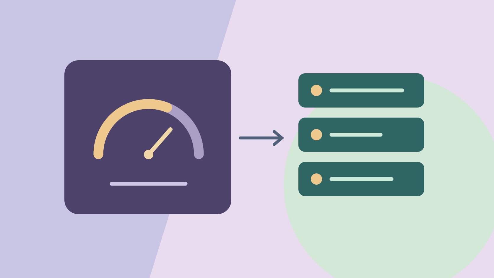

# HypeAuditor：怎样核对受众质量评分

状态：本地审阅稿；正式发布日期待确认。

区分 HypeAuditor 分数与可核事实，用多种资料复核品牌合作问题。

QuickKOL 编辑图形；不呈现真实账号指标或平台界面。

HypeAuditor 的 AQS 是供应商评分，用于决定哪些信息值得进一步核验。先确认分数对应哪个平台、报告版本与时间，再看实际作品、已知活动和获准原生报表。异常分数或单一变化只能作为待核信号。采购时按具体交付、受众证据和可解释的风险分别判断。

## 明确品牌需要解决的采购问题

假设品牌想买一条桌面工具说明，备选有擅长拍手部动作的创作者和擅长发布专业教程的账号。首先决定是买成片、买发布还是两者都买。用[达人筛选指南](https://www.quickkol.com/zh/blog/creator-selection-beyond-followers/#answer)记录技能、市场、语言、账号、权利与必须核验的指标。第三方分数可以决定先复核哪一行，不能直接替代试片和许可。若创作者只交文件，观众相关字段未必是当前任务关键。

## 两种 AQS 分别看平台和字段定义

[HypeAuditor Instagram AQS 说明](https://help.hypeauditor.com/en/articles/2221731-what-is-aqs-audience-quality-score-and-how-is-it-calculated)介绍 Audience Quality Score，列出互动、受众和增长模式等组成。[HypeAuditor TikTok AQS 说明](https://help.hypeauditor.com/en/articles/4091619-what-is-the-account-quality-score-and-how-is-it-calculated)将 TikTok 报告中的同一缩写解释为 Account Quality Score，也使用 1–100 尺度但纳入不同字段。不要把两个 75 当同一测量。记下平台、报告名、所见时间、可用细分与帮助文档。分数不可见就标缺失，不能用其他平台的值代替。

## 把供应商估算和原生报表分别保留

[HypeAuditor 数据来源说明](https://help.hypeauditor.com/en/articles/2221718-where-does-the-data-come-from-and-how-accurate-are-your-reports)介绍从公开信息加工并用模型估算部分人口、互动和真实性字段。不能把估算写成从账号所有者后台直接取得。报告要记录字段、窗口、来源和未知。假设供应商推断某地区比例与账号报表不同，先看两边覆盖的时间、受众对象和方法。若只有总账号分析，不推算某个赞助帖。用[阅读达人互动数据指南](https://www.quickkol.com/zh/blog/read-creator-engagement-data/#answer)核对分子、分母和范围。

## 记录异常的事实和可能解释

假设供应商图表显示几天涨粉明显，先记账号、日期、数值和来源。再查公开内容、合作方转载、获准投放记录、账号改名和采集间隔。看两种以上来源能证实什么。一次增长可以触发复核，不能单独证明购买或自动化。若发现同期有公开合作节目，写“同日发生”，不武断归因。若没有实际证据，也不要公开指控账号或创作者。

## 用低分与高分各做一项反例检查

假设 A 的分数较低，但公开教程有清晰手部动作和稳定题材；B 的分数较高，却找不到相关产品的连续演示。若买品牌自有内容，先验证 A 的制作条件和许可；若买发帖，A 的受众或增长问题仍需复核。B 可以请提供任务相近样片。不要把高分写成安全保证，也不要把低分写成证据。给两位相同的作品要求，记录对每人确实要查的事项。

## 把创作者沟通写成具体证据请求

联系时说明要核对哪个账号、哪几天和什么字段。可以说“我们看到两个来源的日期不同，能否确认目标市场在相关期间的报表范围”。避免“你必须证明粉丝真实”等无法精确处理的要求。允许提供适当汇总，保护不相关隐私。解释证据用于制作、发布还是付款决定。收到回复后写来源、条件和下次复查，不覆盖原报告。

## 让每个风险都对应下一步而不是标签

表里分开已证实事实、需要核验的信号、目前未知和实际采购决定。若市场范围未知，先核对获准报表；若作品不匹配，补样；若未确认许可，暂不投放。对高风险事项按组织流程处理，不把风险状态当达人身份标签。记录决定依据、复查时间和影响范围。必要时用小样本试点验证具体产出。

## 安排一次重查以区分过期与缺失

如果旧报告已经过期，查看同一账号、来源和窗口能否重现；不能就保留当时记录并说明。对照截图时查版本与时间，不强行统一数值。最终提交写哪些适合短名单、还有哪些待核。

## 用一条真实记录演练如何更正

假设团队先写“风险已证实”，实际材料只有第三方低分和一次图表变化。将状态改为“需要核对”，写清已观察的指标、时间与来源。核对原生报表和公开事件，若仍无证据就保留未知。给已收到旧版本的同事更正，避免继续转述。可以用同一个假设做审批练习。一条记录里品牌只买产品短片，评分待核不会影响能否看清动作。另一条需要达人在特定市场发帖，先核对范围后再决定。如果同事提议用一个高分作对照，先问是不是同一平台、时期和字段。收到新报表后，让另一位同事核对它是否真的支持状态变化。即使证据不能关闭问题，也能据此缩小合作范围或另安排试点。

## HypeAuditor 报告证据表

| 对象 | 能记录 | 还需什么 |
| --- | --- | --- |
| 供应商评分 | 平台、版本、时间与字段 | 核对方法和适用范围 |
| 实际作品 | 链接与时间点 | 判断是否符合任务 |
| 原生报表 | 获准窗口和范围 | 验证需用的字段 |

异常信号不能独立证明不当行为。

## 使用评分前核对

逐条记录证据和下一步。

- [ ] 确认平台和评分名称
- [ ] 区分估算和原生报表
- [ ] 独立核对相关作品
- [ ] 把待核信号留在待核状态

## 研究日期与使用边界

资料核验于 2026 年 11 月 6 日。文中方法、表格和决策规则为编辑建议，标为假设的示例不是实际客户结果或行业基准。外部资料的适用地区与时期按各段说明；本稿处于独立本地审阅阶段，正式发布日期待确认。

## 用清楚的任务开始达人研究

用 QuickKOL 理解 Brief、发现相关达人并研究作品与联系路径；数据、合作条件和结果仍需核验。

[了解 QuickKOL](https://www.quickkol.com/#capabilities)

## 来源

- [HypeAuditor Instagram AQS 说明](https://help.hypeauditor.com/en/articles/2221731-what-is-aqs-audience-quality-score-and-how-is-it-calculated)
- [HypeAuditor TikTok AQS 说明](https://help.hypeauditor.com/en/articles/4091619-what-is-the-account-quality-score-and-how-is-it-calculated)
- [HypeAuditor 数据来源说明](https://help.hypeauditor.com/en/articles/2221718-where-does-the-data-come-from-and-how-accurate-are-your-reports)
